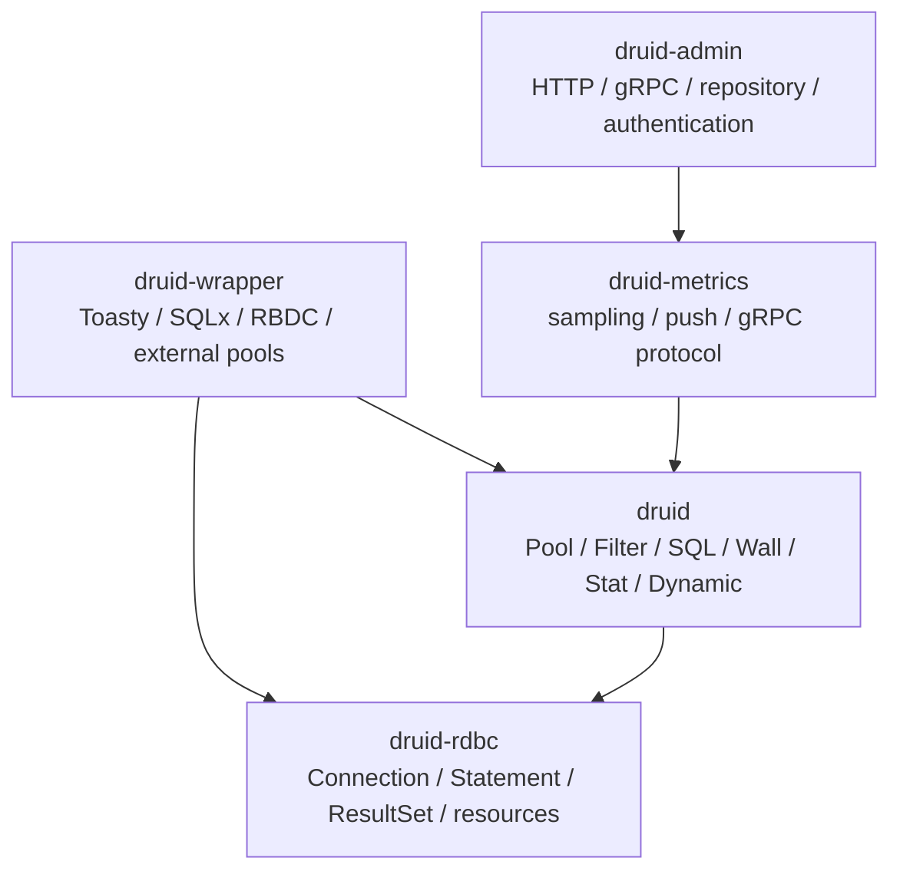
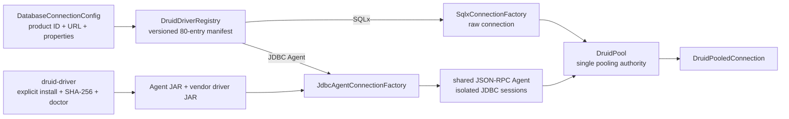

<a id="readme-top"></a>

<div align="center">

# druid-rust

**A planned, complete semantic migration of Alibaba Druid 1.2.28 to Rust**

[English](./README.md) | [简体中文](./README.zh-CN.md)

[Positioning](#1-project-positioning-and-status) ·
[Features](#2-features-and-maturity) ·
[Five-product-crate architecture](#4-three-module-architecture-and-five-crate-target) ·
[Examples](#6-executable-examples-and-call-paths) ·
[Migration roadmap](#11-migration-roadmap-and-phases) ·
[Contributing](#19-contributing-security-and-license)

</div>

---

> **Project status: semantic migration in progress**
>
> This repository is a buildable and tested Cargo workspace. It includes core,
> native-pool, SQL, Wall, statistics, dynamic data-source, built-in Toasty, and
> several direct-driver and external-pool bridge implementations. It does not yet
> implement all Druid semantics and has no stable public API. Any completion claim
> requires Java oracles, Rust contracts, and real-database evidence.
>
> This is not a line-by-line Java translation, but it is also not an
> architecture-inspired subset that silently drops functionality.

> **Architecture/configuration checked:** 2026-10-08. Runtime and release gates remain open; see the [current audit](docs/verification/rdbc-first/architecture-progress-audit-2026-10-08.md).

## 1. Project Positioning and Status

**druid-rust is a workspace that migrates the observable behavior of Alibaba Druid
into the asynchronous Rust ecosystem.** Connection pooling,
Connection/Statement/ResultSet behavior, filters, SQL firewall, statistics, dynamic
data sources, administration, and wrappers are tracked in object and semantic ledgers.

Rust platform adaptation uses Toasty, Tokio, sqlparser, SQLx, RBDC, deadpool, bb8,
Axum, and related ecosystem components. Replacing a platform mechanism never removes
the obligation to migrate Druid result semantics.

### 1.1 What this project is

| Field | Value |
| :--- | :--- |
| Java baseline | Druid `1.2.28`, commit `33824c3dec1612711f9bb4e409319bcab2e4cd0e` |
| Product modules (current source) | `druid-rdbc`, `druid`, `druid-wrapper`, `druid-metrics`, `druid-admin`; `druid-bench` is a verification member |
| Approved architecture | ADR-CRATE-002 + ADR-RDBC-006: one `druid-rdbc` standard implemented by wrappers and Druid proxies |
| Public connection | `DruidPooledConnection` |
| Current raw contract | `druid_rdbc::connection::Connection`; final Task6 deletion/API/runtime acceptance remains open |
| Approved integration contract | `druid-rdbc::Connection/Statement/ResultSet/...` single standard trait tree |
| Native pool | `DruidPool` |
| Built-in standard data source | Toasty 0.9, SQLite by default |
| Current version | `0.0.0-design` |
| MSRV | `1.95` |
| Default toolchain | `1.97.1` |
| Edition / Resolver | `2021` / `2` |
| Unsafe policy | `forbid` |
| Publication | Unpublished; every crate has `publish = false` |
| License | Apache-2.0 |

### 1.2 What this project is not

- **Not a line-by-line or layout-by-layout copy.** Java behavior is migrated through
  object and semantic ledgers; scheduling, ownership, and ecosystem adaptation use
  Rust mechanisms.
- **Not a feature-inspiration project.** When Rust lacks a direct platform object, the
  behavior must be represented through `ADAPTER`, `MERGE`, `SPLIT`, or `PROTOCOL`
  rather than removed.
- **The Druid governance layer is not a SQL generator.** Toasty is the built-in
  data-source/ORM entry point, while DruidPool, Filter, Stat, and recycling semantics
  remain owned by druid-rust.
- **Not a schema-migration tool.** Database version management belongs to the host
  application or a dedicated migration tool.
- **Not release-ready.** Multi-database matrices, complete Java differential tests,
  stable APIs, CI, coverage, and benchmarks remain open.

### 1.3 Status evidence

Current acceptance is recorded in [verification status](docs/verification/rdbc-first/status.md),
not inferred from the commands listed in this README. P01/P02 have historical accepted
scopes; P04 Task6 remains FIX_REQUIRED and Task7–8/P05–P07 remain open. The
[2026-10-08 audit](docs/verification/rdbc-first/architecture-progress-audit-2026-10-08.md)
separates source checks, actual targeted tests, historical workspace failures and missing
release evidence. No stable API, full database matrix or production certification is claimed.

## 2. Features and Maturity

### 2.1 Feature matrix

| Feature | Status | Owning module | Current boundary | Verification |
| :--- | :---: | :--- | :--- | :--- |
| Public `DruidPooledConnection` | 🚧 Partial | `druid` | Full JDBC breadth is incomplete | core/pool contracts |
| Standard `Connection` contract | 🚧 Partial | `druid-rdbc` | lifecycle/resource/capability certification pending | standard contract |
| Druid native async pool | 🚧 Partial | `druid` | Full configuration and production matrix pending | lifecycle/concurrency/maintenance |
| PreparedStatement cache | 🚧 Partial | `druid` | Callable and driver matrices pending | Java oracle + Rust tests |
| SQL AST, Wall, and statistics | 🚧 Partial | `druid` | dialect/rule/layered-stat matrix incomplete | differential tests |
| Dynamic data-source switching | 🚧 Partial | `druid` | HA health and recovery pending | route/switch tests |
| Default Toasty integration | 🧪 Preview | `druid-wrapper` | SQLite tested; other real DBs pending | real SQLite + all-features |
| SQLx/RBDC database operations | 🚧 Partial | `druid-wrapper` | real-database matrix pending | adapter contracts |
| 80 SQL database product catalog | 🧪 Preview | `druid-wrapper` | fixed 15/25/40 phases; catalog entries are not verified support | manifest/registry contracts |
| JDBC Agent long tail | 🧪 Preview | `druid-wrapper` + release asset | cross-language H2 contract works; vendor matrix pending | Rust/Java/H2 contract |
| Explicit driver install and diagnostics | 🧪 Preview | `druid-wrapper` | content-addressed JARs, SHA-256, doctor; no implicit download | installer contract |
| bb8/deadpool external pools | 🧪 Preview | `druid-wrapper` | must not nest DruidPool | real SQLite bridges |
| Java-compatible `/druid/*` Admin | 🚧 Partial | `druid-admin` | real HTTP/gRPC services; current network acceptance remains open | verification status |
| Complete Java semantics | 🚧 Partial | workspace | full semantic and production acceptance remains open | specifications and verification status |

### 2.2 Status legend

| Status | Definition |
| :--- | :--- |
| ✅ Stable | Public API, differential, real integration, docs, and compatibility commitments are complete |
| 🧪 Preview | Real implementation and tests exist, but API or database matrix may change |
| 🚧 Partial | Only the explicitly recorded semantic slices are available |
| 🗓️ Planned | No acceptable real implementation exists |
| ⛔ Unsupported | The platform cannot carry the capability and an alternative plus explicit error is recorded |

## 3. Rust Baseline and Platform Support

| Item | Value | Source |
| :--- | :--- | :--- |
| MSRV | `1.95` | workspace `rust-version`; required by Toasty 0.9 |
| Default toolchain | `1.97.1` | `rust-toolchain.toml` |
| Edition | `2021` | workspace package |
| Resolver | `2` | workspace |
| rustfmt | stable | toolchain component |
| Clippy | workspace `all + pedantic` | workspace lint |
| Async runtime | Tokio 1.x | workspace dependency |
| `no_std` / WASM | No commitment | database-driver and Tokio dependencies |

Stable Linux, macOS, and Windows support requires CI evidence. The current local
verification environment is not a cross-platform release commitment.

<a id="4-three-module-architecture-and-five-crate-target"></a>

## 4. RDBC-First Five-Product-Crate Architecture

### 4.1 Current module responsibilities

ADR-CRATE-002 supersedes the former ADR-CRATE-001 `druid-core + facade` target.
The five product crates already exist; their presence does not establish release readiness.

| Product crate | Responsibility | Main production dependencies |
| :--- | :--- | :--- |
| `druid-rdbc` | Independent standard traits, errors, metadata, resources and Wrapper identity | No Druid product dependency |
| `druid` | Pool, holder, logical proxies, Filter, SQL, Wall, Stat and Dynamic | druid-rdbc |
| `druid-wrapper` | Toasty/SQLx/RBDC/DuckDB/libSQL/HTTP SQL/JDBC Agent and external-pool integration | druid, druid-rdbc |
| `druid-metrics` | Local observation, sampling, push and shared gRPC protocol | druid |
| `druid-admin` | HTTP/gRPC management, repository, authentication, static UI and standalone binary | druid-metrics |

`druid-bench` is the sixth workspace member and a verification helper, not a sixth product crate.
Toasty integration belongs to `druid-wrapper`; its default features are `driver-catalog` and `toasty-sqlite`. SQLx, RBDC, and external pool adapters require explicit features.

### 4.2 Dependency direction

Arrows point from a dependent crate to its production dependency.



An embedding application supplies `StatViewServlet::new(context_path, service)` with its
own statistics callback. It can add wrapper metrics through
`MonitorViewServlet::with_metrics_appendix(provider)`. The former one-argument
`StatViewServlet::new` and `druid-admin` driver feature forwarding are removed;
enable driver features on `druid-wrapper` in the embedding application instead.

### 4.3 Connection ownership and dispatch

```text
Driver / ConnectionFactory
    -> Box<dyn druid_rdbc::connection::Connection>
        -> DruidConnectionHolder
            -> DruidPooledConnection
                -> pooled Statement / PreparedStatement / CallableStatement / ResultSet
```

Wrappers and Druid logical proxies implement the same standard trait tree. Druid adds
Filter dispatch, statistics, prepared cache and lifecycle policy around that contract.
bb8/deadpool implement the `Pool` acquisition contract and retain their original pool
authority through `ExternalConnectionLease`; they must not be nested as factories inside `DruidPool`.

### 4.4 Verification boundary

Current source and configuration were checked on 2026-10-08. P04 Task6 remains
FIX_REQUIRED; Task7, Task8 and P05–P07 remain open. Source checks and historical
package passes do not establish current full-workspace or release acceptance.
See the [architecture/progress audit](docs/verification/rdbc-first/architecture-progress-audit-2026-10-08.md)
and [authoritative verification status](docs/verification/rdbc-first/status.md).

## 5. Design Principles

| Principle | Engineering rule | Verification |
| :--- | :--- | :--- |
| Semantic migration | Java objects and methods enter object/semantic ledgers | Java/Rust differential |
| Type safety | Driver types remain inside adapters | compile/public API audit |
| Clear ownership | A holder owns one physical connection; a lease returns once | exactly-once tests |
| One pooling authority | Native and external modes are mutually exclusive | provider contract |
| Explicit errors | Unsupported capabilities return structured errors | error/capability tests |
| Safe defaults | Unknown schemes, invalid savepoints, and dirty transactions fail safely | negative-path tests |
| Evidence-driven | File existence or matching names do not establish completion | real DB + oracle |
| Evolvable | Built-in standard and extensions have separate boundaries | feature/API audit |

## 6. Executable Examples and Call Paths

The current tests use the single standard contract. These source links are entry points,
not an assertion that every target or feature has passed on the current revision.

### 6.1 Toasty and direct standard connections

- [Toasty canonical matrix](crates/druid-wrapper/tests/task6_toasty_canonical_matrix_test.rs)
- [SQLx canonical matrix](crates/druid-wrapper/tests/task6_sqlx_canonical_matrix_test.rs)
- [External Wrapper identity and borrow contracts](crates/druid-rdbc/tests/standard_wrapper_contract_test.rs)

### 6.2 Pooled connections, filters and prepared resources

- [Filter and statistics semantics](crates/druid/tests/standard_filter_stat_semantics_test.rs)
- [Prepared cache LRU regression](crates/druid/tests/task6_prepared_cache_lru_regression_test.rs)
- [Prepared close cleanup regression](crates/druid/tests/task6_prepared_close_cleanup_regression_test.rs)

### 6.3 External pools and migration evidence

- [SQLx bb8 pool](crates/druid-wrapper/tests/sqlx_bb8_pool_test.rs)
- [SQLx deadpool pool](crates/druid-wrapper/tests/sqlx_deadpool_pool_test.rs)
- [Deleted-test migration ledger](docs/verification/rdbc-first/task6-deleted-test-migration.tsv)
- [Physical-to-standard migration](docs/rdbc/physical-to-standard-migration.md)

API signatures remain unstable. The migration ledger binds original behavior to current
test identities; a linked source file alone does not prove execution or equivalence.

### 6.4 80-database catalog and JDBC Agent

`druid-wrapper` ships a versioned, SQL-only catalog of exactly 80 database products
in fixed 15/25/40 delivery phases. Non-SQL products such as Redis, MongoDB, Kafka,
RabbitMQ, etcd, and ZooKeeper are deliberately excluded. `declared`, `experimental`,
`verified`, and `certified` are distinct evidence states; only the last two count as
public support. An 80-entry catalog is therefore not an “80 databases supported”
claim.



The core pool never downloads a driver. Downloads are explicit HTTPS administrative
operations and require a SHA-256 checksum; commercial drivers are supplied locally
by an authorized user. The Agent is spawned without a shell, uses bounded JSON-RPC
2.0 NDJSON messages with request correlation and timeouts, and hosts isolated raw
JDBC sessions rather than another pool. A process is shared by matching runtime
identity and evicted after an idle TTL. `driver-matrix.yml` defines the H2 contract
for Linux, macOS, and Windows, but its first remote result is still pending; each vendor
also needs its own live evidence gate.

```bash
cargo run -p druid-wrapper --features managed-driver-install --bin druid-driver -- catalog
cargo run -p druid-wrapper --features managed-driver-install --bin druid-driver -- install-agent <root> <agent.jar> [sha256]
cargo run -p druid-wrapper --features managed-driver-install --bin druid-driver -- install-file <root> h2 <h2.jar> [sha256]
cargo run -p druid-wrapper --features managed-driver-install --bin druid-driver -- doctor <root> h2
```

## 7. Cargo Features

Features are owned by their product crate. `druid` has an empty default feature set;
it depends on `druid-rdbc` and its runtime libraries, not on a `druid-core` facade.

| Crate / feature | Default | Current behavior |
| :--- | :---: | :--- |
| `druid` / `config-http` | No | Optional HTTP configuration dependency |
| `druid` / `sqlite`, `postgresql`, `mysql`, `turso` | No | Empty feature entries; they do not activate a database driver |
| `druid-wrapper` / `driver-catalog`, `toasty-sqlite` | Yes | Driver catalog and Toasty SQLite integration |
| `druid-wrapper` / `postgresql`, `mysql`, `turso` | No | Toasty provider feature selection |
| `druid-wrapper` / `duckdb-native`, `http-sql`, `libsql-native` | No | Optional native/HTTP driver dependencies |
| `druid-wrapper` / `jdbc-agent`, `managed-driver-install` | No | JDBC Agent bridge and managed driver tooling |
| `druid-metrics` / `client`, `server` | No | gRPC client/server dependencies |

```bash
cargo check -p druid --no-default-features
cargo check -p druid-wrapper --features sqlite
cargo check -p druid-metrics --features client
cargo check -p druid-wrapper --all-features
```

These are usage examples, not proof that the current feature matrix passes. SQLx/RBDC/
bb8/deadpool remain non-optional wrapper dependencies; complete feature isolation and
feature-combination verification are open P05 requirements. Non-SQL Toasty providers
do not enter the Druid SQL database support count.

## 8. Core API and Usage

The approved ADR-RDBC-006 relationship is:

```text
Driver / ConnectionFactory
    → Box<dyn druid_rdbc::connection::Connection>
        → DruidConnectionHolder (raw owner slot)
            → DruidPooledConnection (implements the same Connection)
```

Retired `Physical*` names belong to migration history. Current adapters and logical proxies use the single standard; complete Task6 acceptance remains open.

Core traits and objects:

| Object | Responsibility |
| :--- | :--- |
| `Pool` | Unified acquisition and state contract for native/external providers |
| `DruidPool` | Native pool implementation |
| `DruidPooledConnection` | Public facade, Filter dispatch, recycling |
| `DruidConnectionHolder` | Physical connection, state, timing, counters, prepared cache |
| `druid_rdbc::connection::Connection` | Standard contract implemented by direct adapters and pooled proxies |
| `ConnectionFactory` | Creates/validates unpooled connections in native mode |
| `ExternalConnectionLease` | Holds and returns an external-pool object |
| `ConnectionCapabilities` | Declares advanced adapter capabilities |

Use `druid_rdbc::connection::Connection` and `druid_rdbc::driver::ConnectionFactory`
for the standard boundary, and `DruidPooledConnection` for the product pooled handle.

## 9. Backends, Formats, and Optional Engines

| Channel | Backend | Pool owner | Current evidence |
| :--- | :--- | :--- | :--- |
| Built-in Toasty | SQLite | DruidPool | real tests pass |
| Built-in Toasty | PostgreSQL/MySQL/Turso | DruidPool | features compile; real DB pending |
| Non-SQL Toasty | DynamoDB | n/a | SQL factory rejects it explicitly |
| Direct SQLx | SQLite | DruidPool | real tests pass |
| Direct SQLx | PostgreSQL/MySQL | DruidPool | real DB pending |
| Direct RBDC | RBDC driver ecosystem | DruidPool | trait contract; real DB pending |
| SQLx + bb8 | SQLite/SQLx drivers | bb8 | real SQLite bridge |
| SQLx + deadpool | SQLite/SQLx drivers | deadpool | real SQLite bridge |

Engine capabilities are not equal. Callers must inspect capabilities; unsupported
operations return explicit errors and never silently report success.

## 10. Concurrency, Memory, and Resource Model

- `DruidPooledConnection` provides exclusive mutable access for a lease.
- The same `DruidConnectionHolder` moves between the idle queue and active facade.
- Native open/active/idle/creating counters remain conserved and never exceed
  `max_open`.
- `DynamicDataSource` uses `ArcSwap<DataSourceGroup>`; switching affects later routes.
- A transaction connection never drifts because of dynamic switching.
- Explicit async close performs rollback, reset, and validation.
- `Drop` reuses only clean connections that require no async repair; dirty connections
  are discarded safely.
- External leases return to their original bb8/deadpool owner, never to DruidPool.
- Cancellation, panic, and recycle errors must not cause double returns or capacity
  leaks.

## 11. Migration Roadmap and Phases

Execute the [RDBC-first master roadmap](docs/superpowers/plans/2026-08-21-rdbc-first-master-roadmap.md)
and its existing child plans. The accepted [five-crate specification](docs/superpowers/specs/2026-08-21-rdbc-first-five-crate-architecture.md)
and [single-standard specification](docs/superpowers/specs/2026-08-24-rdbc-single-standard-trait-tree.md)
define the architecture and behavior requirements. Consult [verification status](docs/verification/rdbc-first/status.md)
for accepted scope, failures, prerequisites and open tasks. Module existence and source
checks cannot replace behavioral, real-integration or production-property evidence.

## 12. Documentation Set

| Document | Responsibility |
| :--- | :--- |
| [Architecture baseline](docs/druid-rust-Architecture.zh_CN.md) | Architecture history, invariants and ADRs; interpret historical snapshots with current evidence |
| [Accepted five-crate specification](docs/superpowers/specs/2026-08-21-rdbc-first-five-crate-architecture.md) | Product responsibilities and acceptance requirements |
| [Master roadmap](docs/superpowers/plans/2026-08-21-rdbc-first-master-roadmap.md) | Plan dependencies and execution sequence |
| [Verification status](docs/verification/rdbc-first/status.md) | Actual evidence and open acceptance gates |
| [Current architecture/progress audit](docs/verification/rdbc-first/architecture-progress-audit-2026-10-08.md) | Dated source, configuration and progress interpretation |

README provides navigation; specifications, plans and evidence remain their respective
sources of truth. Historical counts are not current completion percentages.

## 13. Quality Gates

Fresh fmt/build/clippy/docs, complete C1/C2 runtime, compiler coverage, public API/SemVer,
feature combinations, MSRV, Java differential, real-database, network/security and supply-chain
gates are required by the plans. Their current status is recorded in the
[verification ledger](docs/verification/rdbc-first/status.md). Example commands below are
not recorded PASS results; default tests do not certify all features or release readiness.

Recommended local commands:

```bash
cargo check --workspace
cargo test --workspace
cargo fmt --all -- --check
cargo check -p druid --all-features
cargo clippy -p druid --all-targets --no-deps -- -D warnings
```

## 14. Benchmark Surface

The following are measurement targets, not current performance claims:

| Scenario | Required measurement | Current state |
| :--- | :--- | :--- |
| `pool_acquire` | hot/cold acquisition, contention, timeout | no stable report |
| `recycle` | rollback, reset, validate, discard | no stable report |
| `prepared_cache` | hit/miss/LRU/concurrent in-use | no stable report |
| `sql_parse/wall` | multiple dialects, rules, complex SQL | no stable report |
| `sql_merge` | parameterization, fingerprint, histogram | no stable report |
| `dynamic_switch` | ArcSwap switching and routing | no stable report |

Performance results may be published only with hardware, toolchain, database versions,
dataset, and commit information.

## 15. Compatibility and Migration

| Topic | Rule |
| :--- | :--- |
| Java baseline | fixed at Druid 1.2.28; upgrades require a differential batch |
| SemVer | applies after `publish = false` is removed |
| MSRV | currently 1.95; changes update workspace, README, and release notes |
| Default features | changing a default feature is a compatibility event |
| Object naming | governed by the object-name consistency audit |
| Errors | preserve structured classification; strings alone are insufficient |
| Adapters | do not leak third-party types or silently reduce capabilities |
| Vendor patches | record source, change scope, and removal condition |

## 16. Troubleshooting

### Toasty and SQLx SQLite link conflict

Cargo can link only one `libsqlite3-sys`. The current vendor patch lets Toasty SQLite
and SQLx 0.8 share `libsqlite3-sys 0.30.1`.

```bash
cargo tree -i libsqlite3-sys
```

### Data disappears with `sqlite::memory:`

Each physical SQLite memory connection has an independent database.
`ToastyConnectionFactory` restores a maximum-connection limit of one for this URL.
Use a file database or an explicitly tested shared-cache URL when multiple connections
must share state.

### External-pool capacity doubles or connections do not return

Check whether a bb8/deadpool bridge was nested inside `DruidPool`. An external provider
returns the canonical `DruidPooledConnection` directly and
`ExternalConnectionLease` returns the object to its original owner.

### Endpoint strings exist but Admin HTTP is unavailable

`druid-admin` has real Topcoat/Axum routes and HTTP/gRPC services. Check listener,
authentication/TLS configuration and the latest network-test evidence. Endpoint strings
alone do not prove reachability; current network acceptance remains open.

### `UnsupportedOperation`

Inspect `ConnectionCapabilities` first. An adapter must not emulate unsupported
capabilities with configuration or an in-memory flag.

## 17. crates.io Publication

All workspace packages currently set `publish = false`. The five planned product
packages are `druid-rdbc`, `druid`, `druid-wrapper`, `druid-metrics` and `druid-admin`;
`druid-bench` is a verification helper. Minimum publication conditions:

- [ ] The target module has no false `DONE` states in object or semantic ledgers.
- [x] Its former transitional implementation crates have been consolidated and are
      not separate release artifacts.
- [ ] Default and optional features have real integration tests.
- [ ] `cargo publish --dry-run` passes.
- [ ] fmt, clippy, test, doc, audit, and deny run in CI.
- [ ] docs.rs builds the published feature matrix.
- [ ] MSRV passes in a clean environment.
- [ ] Public API, error, and configuration compatibility policies are frozen.
- [ ] License, vendor, and third-party NOTICE audits are complete.

## 18. Contribution Flow

- Locate the Java origin and current state in the object ledger before editing.
- Use CodeGraph to analyze objects, call paths, and affected tests.
- One `.rs` file represents one Java object or an explicit Rust-only object.
- Do not use `todo!()`, `unimplemented!()`, empty logic, or centralized `compat.rs`
  stubs as implementation.
- New objects and public methods use Chinese doc comments and identify Java origins.
- Update all migration ledgers for every new or changed
  `MERGE/SPLIT/ADAPTER/PROTOCOL` decision.
- Add a failing test first, implement, then run real-database or Java differential
  verification.
- Report commands, pass counts, open gates, and known warnings in the handoff.

## 19. Contributing, Security, and License

druid-rust is licensed under [Apache-2.0](LICENSE).

The name `druid-rust` identifies a Rust semantic migration of Alibaba Druid; it does
not represent an official Alibaba distribution. Publications and releases must retain
upstream attribution.

Ordinary logs must not expose database passwords, tokens, complete connection URLs,
raw SQL parameters, or other PII. A formal vulnerability-disclosure channel will be
established before the first release; do not publicly disclose unpatched issues before
then.

---

<div align="center">

[Back to top](#readme-top) ·
[Architecture](docs/druid-rust-Architecture.zh_CN.md) ·
[Documentation index](docs/superpowers/plans/2026-08-21-rdbc-first-master-roadmap.md) ·
[Issues](https://github.com/easy-4-rust/druid-rust/issues)

</div>
