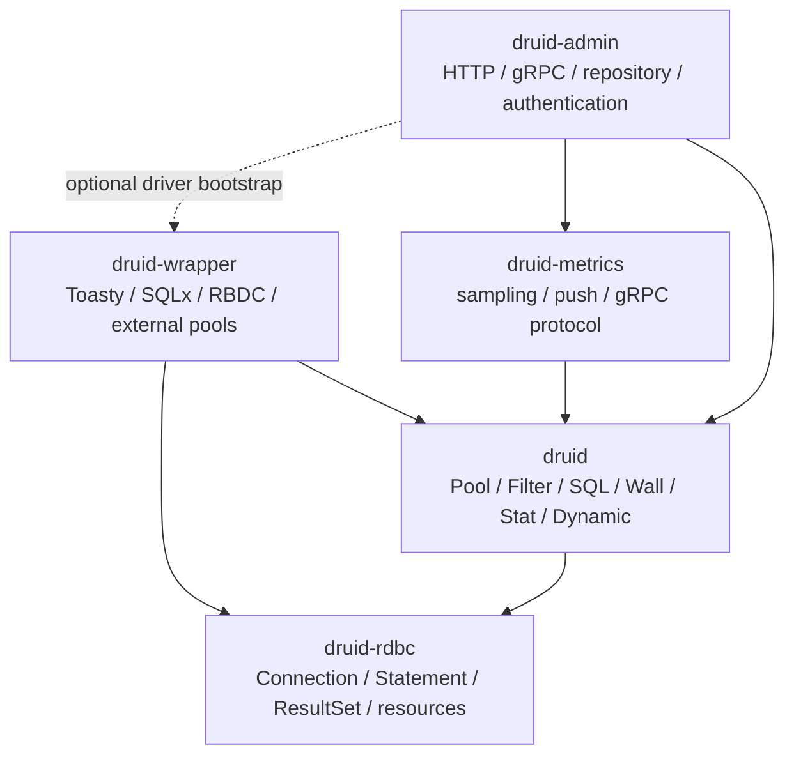
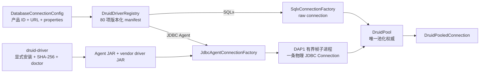

<a id="readme-top"></a>

<div align="center">

# druid-rust

**阿里 Druid 1.2.28 到 Rust 的规划式完整语义迁移**

[English](./README.md) | [简体中文](./README.zh-CN.md)

[定位与状态](#1-项目定位与状态) · [功能与成熟度](#2-功能与成熟度) ·
[五产品 Crate 架构](#4-三模块架构与五目标) ·
[示例与调用路径](#6-可执行示例与调用路径) ·
[迁移路线](#11-迁移路线与阶段) ·
[贡献与许可证](#19-贡献安全与许可证)

</div>

---

> **项目状态：功能语义迁移进行中**
>
> 当前仓库是可构建、可测试的 Cargo workspace，已经包含 core、native pool、
> SQL、Wall、统计、动态数据源、Toasty 内置数据源和多种驱动/外部池桥接实现。
> 它尚未完成全部 Druid 语义迁移，也没有稳定公共 API。任何“完成”都必须有
> Java oracle、Rust contract 和真实数据库证据。
>
> 迁移不是 Java 源码逐行翻译，但也不是只借鉴架构模式后自行删减功能。

> **架构与配置核验**：2026-10-08。运行时和发布门禁仍开放，详见[当前核验](docs/verification/rdbc-first/architecture-progress-audit-2026-10-08.md)。

## 1. 项目定位与状态

**druid-rust 是把阿里 Druid 的可观察功能语义迁移到 Rust 异步生态的
workspace。** 连接池、Connection/Statement/ResultSet、过滤器链、SQL
防火墙、统计、动态数据源、管理面和 wrapper 都进入对象总账和语义契约表。

Rust 平台适配使用 Toasty、Tokio、sqlparser、SQLx、RBDC、deadpool、bb8、
Axum 等生态组件。组件替换只改变实现机制，不改变 Druid 结果语义的迁移责任。

### 1.1 是什么

| 字段 | 值 |
| :--- | :--- |
| Java 基线 | Druid `1.2.28`，提交 `33824c3dec1612711f9bb4e409319bcab2e4cd0e` |
| 产品模块（当前源码） | `druid-rdbc`、`druid`、`druid-wrapper`、`druid-metrics`、`druid-admin`；`druid-bench` 为验证成员 |
| 已批准架构 | ADR-CRATE-002 + ADR-RDBC-006：wrapper 与 Druid proxy 实现同一 `druid-rdbc` standard |
| 对外连接 | `DruidPooledConnection` |
| 当前 raw 合同 | `druid_rdbc::connection::Connection`；Task6 删除/API/运行验收仍开放 |
| 已批准 integration 合同 | `druid-rdbc::Connection/Statement/ResultSet/...` 单一 standard trait tree |
| Native pool | `DruidPool` |
| 内置标准数据源 | Toasty 0.9，默认 SQLite |
| 当前版本 | `0.0.0-design` |
| MSRV | `1.95` |
| 默认工具链 | `1.97.1` |
| Edition / Resolver | `2021` / `2` |
| unsafe 策略 | `forbid` |
| 发布状态 | 未发布；每个 crate `publish = false` |
| 许可证 | Apache-2.0 |

### 1.2 不是什么

- **不是逐行、逐类布局复制。** Java 行为通过对象总账和语义契约迁移；
  调度、所有权和生态适配使用 Rust 机制实现。
- **不是功能借鉴项目。** Rust 中没有直接标准对象时，应通过
  `ADAPTER/MERGE/SPLIT/PROTOCOL` 迁移，而不是删去能力。
- **Druid 治理层不是 SQL 生成器。** Toasty 是内置标准数据源/ORM 入口，
  但 DruidPool、Filter、Stat 和回收语义仍由 druid-rust 掌握。
- **不是 Schema migration 工具。** 数据库版本管理由宿主应用或专用工具承担。
- **尚未达到发布标准。** 多数据库矩阵、完整 Java 差分、稳定 API、CI、
  覆盖率和基准仍未闭环。

### 1.3 状态证据

当前验收以[验证状态](docs/verification/rdbc-first/status.md)为准，不能由 README 列出的
命令推定通过。P01/P02 已验收历史限定范围；P04 Task6 仍为 FIX_REQUIRED，Task7–8
与 P05–P07 仍开放。[2026-10-08 核验](docs/verification/rdbc-first/architecture-progress-audit-2026-10-08.md)
明确区分源码检查、局部实际测试、历史全仓失败与缺失的发布证据。
当前不声明稳定 API、完整数据库矩阵或生产认证已经完成。

## 2. 功能与成熟度

### 2.1 功能矩阵

| 功能 | 状态 | 所属模块 | 当前边界 | 验证 |
| :--- | :---: | :--- | :--- | :--- |
| `DruidPooledConnection` 对外连接 | 🚧 部分 | `druid` | JDBC 全广度未完成 | core/pool contract |
| 标准 `Connection` 合同 | 🚧 部分 | `druid-rdbc` | 生命周期/资源/能力认证待完成 | standard contract |
| Druid native 异步连接池 | 🚧 部分 | `druid` | 完整配置和生产矩阵未完成 | 生命周期/并发/维护测试 |
| PreparedStatement cache | 🚧 部分 | `druid` | Callable/driver 全矩阵待补 | Java oracle + Rust 测试 |
| SQL AST、Wall 与统计 | 🚧 部分 | `druid` | Druid 方言、规则、分层统计未完成 | differential 测试 |
| 多数据源热切换 | 🚧 部分 | `druid` | HA 健康和恢复未完成 | route/switch 测试 |
| Toasty 默认集成 | 🧪 预览 | `druid-wrapper` | SQLite 已测，其他数据库实测待补 | 真实 SQLite + all-features |
| SQLx/RBDC 数据库操作适配 | 🚧 部分 | `druid-wrapper` | 真实数据库矩阵未完成 | adapter contract |
| 80 个 SQL 数据库产品目录 | 🧪 预览 | `druid-wrapper` | 15/25/40 三阶段；目录不等于已验证支持 | manifest/registry contract |
| JDBC Agent 长尾驱动 | 🧪 预览 | `druid-wrapper` + release asset | H2 跨语言契约已接通；厂商实库矩阵待补 | Rust/Java/H2 contract |
| 驱动显式安装与诊断 | 🧪 预览 | `druid-wrapper` | JAR 内容寻址、SHA-256、doctor；无隐式下载 | installer contract |
| bb8/deadpool 外部池适配 | 🧪 预览 | `druid-wrapper` | 禁止嵌套 DruidPool | 真实 SQLite bridge |
| `/druid/*` Admin 兼容面 | 🚧 部分 | `druid-admin` | 已有真实 HTTP/gRPC 服务；当前网络验收仍开放 | 验证状态 |
| Java 全对象语义 | 🚧 部分 | workspace | 完整语义与生产验收仍开放 | 正式规格与验证状态 |

### 2.2 状态定义

| 状态 | 定义 |
| :--- | :--- |
| ✅ 稳定 | 公共 API、差分、真实集成、文档和兼容承诺齐全 |
| 🧪 预览 | 存在真实实现和测试，但 API 或数据库矩阵可能变化 |
| 🚧 部分 | 只有总账中明确列出的语义切片可用 |
| 🗓️ 计划 | 尚无可接受的真实实现 |
| ⛔ 不支持 | 平台确实无法承载，并已登记替代方案和明确错误 |

## 3. Rust 基线与平台支持

| 项目 | 值 | 来源 |
| :--- | :--- | :--- |
| MSRV | `1.95` | workspace `rust-version`；Toasty 0.9 最低要求 |
| 默认工具链 | `1.97.1` | `rust-toolchain.toml` |
| Edition | `2021` | workspace package |
| Resolver | `2` | workspace |
| rustfmt | stable | toolchain component |
| Clippy | workspace `all + pedantic` | workspace lint |
| async runtime | Tokio 1.x | workspace dependency |
| `no_std` / WASM | 不承诺 | 数据库 driver 和 Tokio 运行时依赖 |

Linux、macOS 和 Windows 的稳定支持矩阵需要 CI 证据。当前本地验证环境不能被
解释为跨平台发布承诺。

<a id="4-三模块架构与五目标"></a>

## 4. RDBC-First 五产品 Crate 架构

### 4.1 当前模块职责

ADR-CRATE-002 已取代 ADR-CRATE-001 的 `druid-core + facade` 目标。
五产品 crate 已存在，模块存在不代表达到发布验收标准。

| 产品 crate | 职责 | 主要生产依赖 |
| :--- | :--- | :--- |
| `druid-rdbc` | 独立标准接口、错误、metadata、资源与 Wrapper 身份 | 不依赖 Druid 产品实现 |
| `druid` | 池化、holder、logical proxy、Filter、SQL、Wall、Stat、Dynamic | druid-rdbc |
| `druid-wrapper` | Toasty/SQLx/RBDC/DuckDB/libSQL/HTTP SQL/JDBC Agent 与外部池适配 | druid、druid-rdbc |
| `druid-metrics` | 本地观测、采样、推送与公共 gRPC 协议 | druid |
| `druid-admin` | HTTP/gRPC 管理、repository、认证、静态 UI 和独立 binary | druid、druid-metrics；可选 druid-wrapper |

`druid-bench` 是第六个 workspace 成员，负责验证，不属于第六个产品 crate。
Toasty 集成归属 `druid-wrapper`；其默认 features 为 `driver-catalog` 与 `sqlite`。

### 4.2 依赖方向

箭头从使用方指向依赖方；虚线为可选依赖。



### 4.3 连接所有权与调用链

```text
Driver / ConnectionFactory
    -> Box<dyn druid_rdbc::connection::Connection>
        -> DruidConnectionHolder
            -> DruidPooledConnection
                -> pooled Statement / PreparedStatement / CallableStatement / ResultSet
```

Wrapper 与 Druid logical proxy 实现同一标准接口树。Druid 围绕该合同加入 Filter、
统计、prepared cache 和生命周期策略。bb8/deadpool 实现 `Pool` 获取合同，通过
`ExternalConnectionLease` 保留原连接池权威，不能作为 factory 再嵌套进 `DruidPool`。

### 4.4 验收边界

当前源码与配置核验日期为 2026-10-08。P04 Task6 仍为 FIX_REQUIRED，Task7、Task8
及 P05–P07 仍开放。源码检查与历史 package 通过不能证明当前全仓或发布验收通过。
详见[架构进度核验](docs/verification/rdbc-first/architecture-progress-audit-2026-10-08.md)
与[正式验证状态](docs/verification/rdbc-first/status.md)。

## 5. 设计原则

| 原则 | 工程落地 | 验证手段 |
| :--- | :--- | :--- |
| 语义迁移 | Java 对象和方法进入对象/语义账本 | Java/Rust 差分 |
| 类型安全 | driver 类型只存在于 adapter 内部 | 编译和公共 API 审计 |
| 所有权清晰 | holder 拥有一条物理连接；租约只归还一次 | exactly-once 测试 |
| 单一池化权威 | native/external 两种模式互斥 | provider contract |
| 错误显式 | 不支持能力返回结构化错误 | error/capability 测试 |
| 默认安全 | 未知 scheme、非法 savepoint、脏事务安全失败 | 负面路径测试 |
| 证据驱动 | 文件存在或名称相同不构成完成 | 真实 DB + oracle |
| 可演进 | 内置标准和扩展分层 | feature/API 审计 |

## 6. 可执行示例与调用路径

当前测试使用唯一标准合同。下面的源码链接用于定位入口，不代表每个目标或 feature
已经在当前源码版本通过。

### 6.1 Toasty 与 direct 标准连接

- [Toasty canonical 矩阵](crates/druid-wrapper/tests/task6_toasty_canonical_matrix_test.rs)
- [SQLx canonical 矩阵](crates/druid-wrapper/tests/task6_sqlx_canonical_matrix_test.rs)
- [外部 Wrapper 身份与借用合同](crates/druid-rdbc/tests/standard_wrapper_contract_test.rs)

### 6.2 池化连接、Filter 与 prepared 资源

- [Filter 与统计语义](crates/druid/tests/standard_filter_stat_semantics_test.rs)
- [Prepared cache LRU 回归](crates/druid/tests/task6_prepared_cache_lru_regression_test.rs)
- [Prepared close 清理回归](crates/druid/tests/task6_prepared_close_cleanup_regression_test.rs)

### 6.3 外部池与迁移证据

- [SQLx bb8 pool](crates/druid-wrapper/tests/sqlx_bb8_pool_test.rs)
- [SQLx deadpool pool](crates/druid-wrapper/tests/sqlx_deadpool_pool_test.rs)
- [删除测试迁移账本](docs/verification/rdbc-first/task6-deleted-test-migration.tsv)
- [Physical-to-standard 迁移](docs/rdbc/physical-to-standard-migration.md)

API 签名尚未稳定。迁移账本将原始行为绑定到当前测试身份；源码链接本身不能证明
实际执行或行为等价。

### 6.4 80 数据库目录与 JDBC Agent

`druid-wrapper` 内置版本化 SQL-only 产品目录，共 80 项，交付阶段固定为
15/25/40。Redis、MongoDB、Kafka、RabbitMQ、etcd、ZooKeeper 等非 SQL
产品不会为了凑数进入目录。`declared`、`experimental`、`verified`、
`certified` 是不同证据等级；公开支持数量只统计后两级，当前不能把 80 项目录
写成“已支持 80 种数据库”。



关键边界：

- `database-drivers.manifest.json` 记录产品、Druid 方言、协议族、运行时、Wall
  等级、能力和阶段；重复 ID、未知字段、未知 `DbType` 会在启动前失败；
- Agent 由 Druid 启动且不经过 shell，DAP1 使用 4 字节长度前缀、协议版本、
  请求 ID、帧上限、超时和结构化 `SQLException`；
- Agent 内只有一条 raw JDBC Connection，不创建第二个连接池；
- 核心建池路径不访问网络。下载只能通过显式 HTTPS 管理命令触发，远程安装必须提供
  SHA-256；商业驱动使用调用方已获授权的本地 JAR；
- `driver-matrix.yml` 已编排 Linux、macOS、Windows 的 H2 Agent 契约，但首次
  远端结果仍待执行；真实厂商数据库还需逐项补
  DDL/DML/query/transaction/prepared/failure 证据。

```bash
cargo run -p druid-wrapper --features managed-driver-install --bin druid-driver -- catalog
cargo run -p druid-wrapper --features managed-driver-install --bin druid-driver -- install-agent <root> <agent.jar> [sha256]
cargo run -p druid-wrapper --features managed-driver-install --bin druid-driver -- install-file <root> h2 <h2.jar> [sha256]
cargo run -p druid-wrapper --features managed-driver-install --bin druid-driver -- doctor <root> h2
```

## 7. Cargo Features

Feature 由所属产品 crate 管理。`druid` 的默认 feature 为空，依赖 `druid-rdbc`
与运行时组件，不是依赖 `druid-core` 的 facade。

| Crate / feature | 默认启用 | 当前行为 |
| :--- | :---: | :--- |
| `druid` / `config-http` | 否 | 可选 HTTP 配置依赖 |
| `druid` / `sqlite`、`postgresql`、`mysql`、`turso` | 否 | 空 feature 声明，不会激活数据库驱动 |
| `druid-wrapper` / `driver-catalog`、`sqlite` | 是 | 驱动目录与 Toasty SQLite 集成 |
| `druid-wrapper` / `postgresql`、`mysql`、`turso` | 否 | Toasty provider feature 选择 |
| `druid-wrapper` / `duckdb-native`、`http-sql`、`libsql-native` | 否 | 可选原生/HTTP 驱动依赖 |
| `druid-wrapper` / `jdbc-agent`、`managed-driver-install` | 否 | JDBC Agent 桥接与驱动管理工具 |
| `druid-metrics` / `client`、`server` | 否 | gRPC 客户端/服务端依赖 |

```bash
cargo check -p druid --no-default-features
cargo check -p druid-wrapper --features sqlite
cargo check -p druid-metrics --features client
cargo check -p druid-wrapper --all-features
```

以上是用法示例，不是当前 feature 矩阵通过证据。SQLx/RBDC/bb8/deadpool 仍是
wrapper 的非 optional 依赖；完整 feature 隔离和组合验证属于尚未关闭的 P05。
非 SQL Toasty provider 不计入 Druid SQL 数据库支持数。

## 8. 核心 API 与用法

ADR-RDBC-006 已批准对象关系：

```text
Driver / ConnectionFactory
    → Box<dyn druid_rdbc::connection::Connection>
        → DruidConnectionHolder（raw owner slot）
            → DruidPooledConnection（实现同一 Connection）
```

已退役的 `Physical*` 名称属于迁移历史。当前 adapter 与 logical proxy 使用唯一标准；Task6 完整验收仍开放。

核心 trait/对象：

| 对象 | 责任 |
| :--- | :--- |
| `Pool` | 统一 native/external provider 获取与状态合同 |
| `DruidPool` | Native pool 实现 |
| `DruidPooledConnection` | 对外连接 facade、Filter 和回收 |
| `DruidConnectionHolder` | 物理连接、状态、时间、计数和 prepared cache |
| `druid_rdbc::connection::Connection` | direct adapter 与 pooled proxy 实现的标准合同 |
| `ConnectionFactory` | Native 模式创建/校验未池化连接 |
| `ExternalConnectionLease` | External 模式持有并归还外部池对象 |
| `ConnectionCapabilities` | Adapter 高级能力声明 |

标准边界使用 `druid_rdbc::connection::Connection` 与
`druid_rdbc::driver::ConnectionFactory`；产品池化对象使用 `DruidPooledConnection`。

## 9. 后端、格式与可选引擎

| 通道 | 后端 | 池化归属 | 当前证据 |
| :--- | :--- | :--- | :--- |
| Toasty 内置 | SQLite | DruidPool | 真实测试通过 |
| Toasty 内置 | PostgreSQL/MySQL/Turso | DruidPool | feature 编译；实库待补 |
| Toasty 非 SQL | DynamoDB | 不适用 | SQL factory 明确拒绝 |
| SQLx direct | SQLite | DruidPool | 真实测试通过 |
| SQLx direct | PostgreSQL/MySQL | DruidPool | 实库待补 |
| RBDC direct | RBDC driver 生态 | DruidPool | trait contract；实库待补 |
| SQLx + bb8 | SQLite/SQLx driver | bb8 | 真实 SQLite bridge |
| SQLx + deadpool | SQLite/SQLx driver | deadpool | 真实 SQLite bridge |

多引擎能力不对等。上层必须读取 capability；不支持时返回明确错误，不得静默
伪造成功。

## 10. 并发、内存与资源模型

- `DruidPooledConnection` 对单个租约提供独占可变访问。
- `DruidConnectionHolder` 在 idle queue 与 active facade 之间移动同一所有权。
- native pool 的 open/active/idle/creating 计数必须守恒且不超过 `max_open`。
- `DynamicDataSource` 使用 `ArcSwap<DataSourceGroup>`；切换只影响后续路由。
- 事务连接不得因动态切换漂移。
- 显式异步 close 执行 rollback、状态复位和 validation。
- `Drop` 只复用无需异步修复的干净连接；脏连接安全淘汰。
- external lease 必须回到原 bb8/deadpool owner，不能交给 DruidPool。
- 取消、panic 和回收错误不得造成双重归还或容量泄漏。

## 11. 迁移路线与阶段

执行已有 [RDBC-first 主路线](docs/superpowers/plans/2026-08-21-rdbc-first-master-roadmap.md)
及其子计划。已批准的[五 crate 规格](docs/superpowers/specs/2026-08-21-rdbc-first-five-crate-architecture.md)
与[唯一标准规格](docs/superpowers/specs/2026-08-24-rdbc-single-standard-trait-tree.md)
定义架构和行为要求。[验证状态](docs/verification/rdbc-first/status.md)记录已接受范围、
失败、前置条件和开放任务。模块存在或源码检查不能替代行为、真实集成和生产属性验收。

## 12. 文档集合

| 文档 | 责任 |
| :--- | :--- |
| [架构基线](docs/druid-rust-Architecture.zh_CN.md) | 架构历史、不变量与 ADR；历史快照需结合当前证据解读 |
| [五 crate 正式规格](docs/superpowers/specs/2026-08-21-rdbc-first-five-crate-architecture.md) | 产品职责与验收要求 |
| [主路线](docs/superpowers/plans/2026-08-21-rdbc-first-master-roadmap.md) | 计划依赖与执行顺序 |
| [验证状态](docs/verification/rdbc-first/status.md) | 实际证据与开放门禁 |
| [当前架构进度核验](docs/verification/rdbc-first/architecture-progress-audit-2026-10-08.md) | 有日期的源码、配置与进度判断 |

README 提供导航；规格、计划与验证证据分别保留原有事实源。历史计数不是当前完成率。

## 13. 质量门禁

计划要求新鲜 fmt/build/clippy/docs、完整 C1/C2 运行、编译覆盖、公开 API/SemVer、
feature 组合、MSRV、Java 差分、真实数据库、网络安全及供应链验证。
当前状态以[验证账本](docs/verification/rdbc-first/status.md)为准。下面的命令是用法，
不是 PASS 记录；默认测试不能认证全部 features 或发布就绪。

推荐本地命令：

```bash
cargo check --workspace
cargo test --workspace
cargo fmt --all -- --check
cargo check -p druid --all-features
cargo clippy -p druid --all-targets --no-deps -- -D warnings
```

## 14. 基准矩阵

以下是待测目标，不是当前性能声明：

| 场景 | 需要测量 | 当前状态 |
| :--- | :--- | :--- |
| `pool_acquire` | 热/冷获取、竞争、超时 | 未形成稳定报告 |
| `recycle` | rollback、reset、validate、discard | 未形成稳定报告 |
| `prepared_cache` | hit/miss/LRU/并发 in-use | 未形成稳定报告 |
| `sql_parse/wall` | 多方言、多规则和复杂 SQL | 未形成稳定报告 |
| `sql_merge` | 参数化、指纹和直方图 | 未形成稳定报告 |
| `dynamic_switch` | ArcSwap 切换和路由 | 未形成稳定报告 |

性能结果只有在携带硬件、工具链、数据库版本、数据集和 commit 时才可发布。

## 15. 兼容与迁移

| 主题 | 规则 |
| :--- | :--- |
| Java 基线 | 固定 Druid 1.2.28；升级必须创建差异批次 |
| SemVer | 取消 `publish = false` 后遵循 SemVer |
| MSRV | 当前 1.95；变化必须更新 workspace、README 和发布说明 |
| 默认 feature | 改变默认 feature 视为兼容性事件 |
| 对象命名 | 由对象名称一致性检查约束 |
| 错误 | 保留结构化分类，禁止只返回字符串 |
| Adapter | 不泄漏第三方类型，不静默降低能力 |
| Vendor 补丁 | 必须记录来源、变更范围和移除条件 |

## 16. 故障排查

### Toasty 与 SQLx SQLite 链接冲突

Cargo 依赖图只能链接一个 `libsqlite3-sys`。当前 vendor 补丁让 Toasty SQLite
与 SQLx 0.8 共用 `libsqlite3-sys 0.30.1`。检查：

```bash
cargo tree -i libsqlite3-sys
```

### `sqlite::memory:` 数据消失

SQLite memory URL 每条物理连接是独立数据库。`ToastyConnectionFactory` 将其
最大连接数约束恢复为 1。需要多连接共享时使用文件数据库或支持共享缓存的明确
URL，并增加对应真实测试。

### 外部池出现容量翻倍或连接不归还

检查是否把 bb8/deadpool bridge 再放进 `DruidPool`。External provider 必须直接
返回 canonical `DruidPooledConnection`，并由 `ExternalConnectionLease`
归还原 owner。

### Admin endpoint 字符串存在但 HTTP 不可访问

`druid-admin` 已有真实 Topcoat/Axum 路由与 HTTP/gRPC 服务。排查监听地址、
认证/TLS 配置与最新网络测试证据。endpoint 字符串不能证明端口可达，当前网络验收仍开放。

### `UnsupportedOperation`

先检查 `ConnectionCapabilities`。适配器明确不支持的能力不应通过配置
或内存标志伪装成功。

## 17. crates.io 发布

当前所有 workspace package 均为 `publish = false`。五个计划产品 package 为
`druid-rdbc`、`druid`、`druid-wrapper`、`druid-metrics`、`druid-admin`；
`druid-bench` 负责验证。发布前至少满足：

- [ ] 目标模块的对象与语义账本没有伪 DONE。
- [x] 原过渡实现 crate 已归并，不再形成独立发布物。
- [ ] 默认 feature 和可选 feature 均有真实集成测试。
- [ ] `cargo publish --dry-run` 通过。
- [ ] fmt、clippy、test、doc、audit、deny 进入 CI。
- [ ] docs.rs feature 矩阵构建成功。
- [ ] MSRV 在干净环境验证。
- [ ] 公共 API、错误和配置兼容策略冻结。
- [ ] license、vendor 和第三方 NOTICE 审计完成。

## 18. 贡献流程

- 修改前先在对象账本定位 Java 来源和当前状态。
- 使用 CodeGraph 分析对象、调用链和影响测试。
- 一个 `.rs` 文件只承载一个 Java 对象或明确的 Rust-only 对象。
- 禁止 `todo!()`、`unimplemented!()`、空逻辑和集中式 `compat.rs` 充数。
- 新对象和公开方法使用中文 doc 注释并标注 Java 来源。
- 新增或改变 `MERGE/SPLIT/ADAPTER/PROTOCOL` 必须更新四张迁移表。
- 新功能先建立失败测试，再实现，再执行真实数据库/Java 差分。
- 提审时报告执行过的命令、通过数、未关闭门禁和已知告警。

## 19. 贡献、安全与许可证

druid-rust 使用 [Apache-2.0](LICENSE) 许可证。

`druid-rust` 表示 Alibaba Druid 的 Rust 语义迁移，不表示 Alibaba 官方发行。
引用、发布和宣传时必须保留上游来源说明。

普通日志不得输出数据库密码、token、完整连接 URL、原始 SQL 参数或其他 PII。
正式漏洞披露渠道将在首次发布前建立；在此之前不要公开未修复的漏洞细节。

---

<div align="center">

[返回顶部](#readme-top) ·
[架构文档](docs/druid-rust-Architecture.zh_CN.md) ·
[文档总入口](docs/superpowers/plans/2026-08-21-rdbc-first-master-roadmap.md) ·
[Issues](https://github.com/easy-4-rust/druid-rust/issues)

</div>
