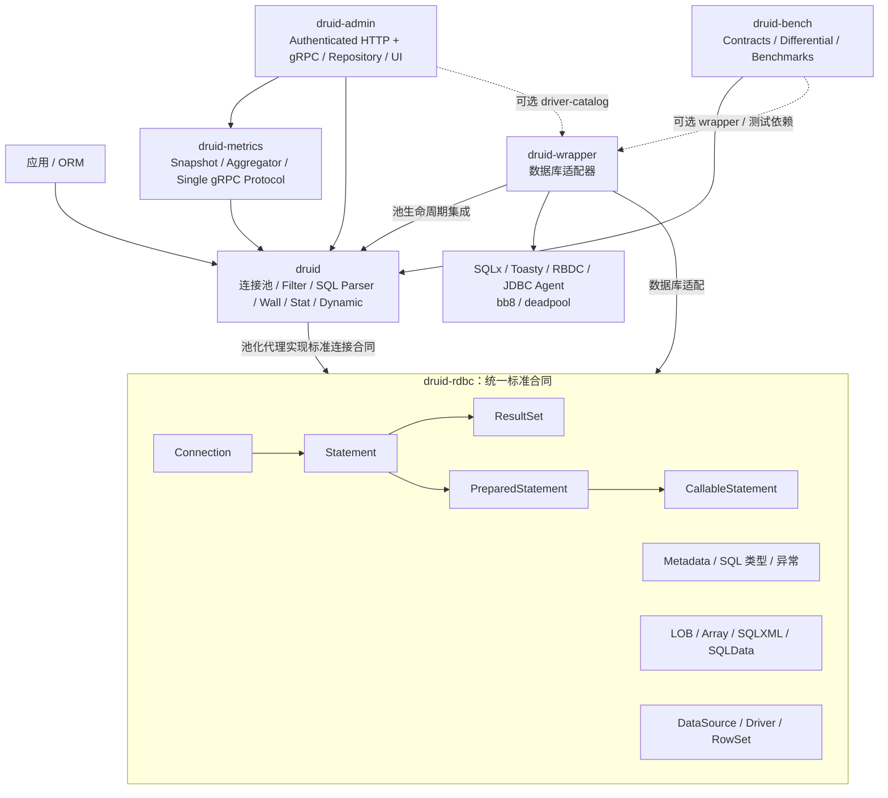
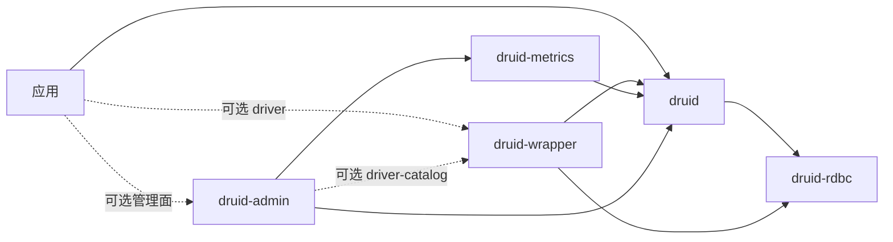
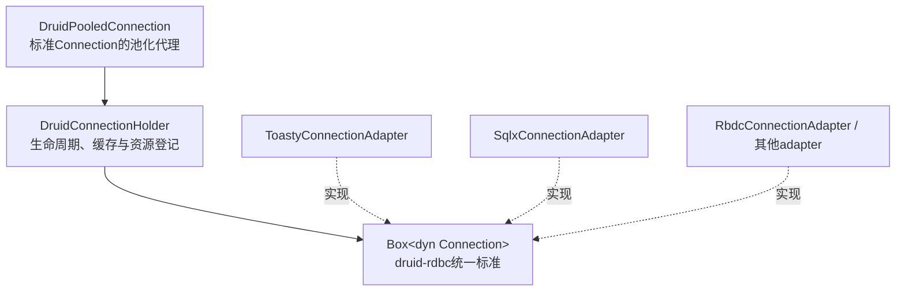
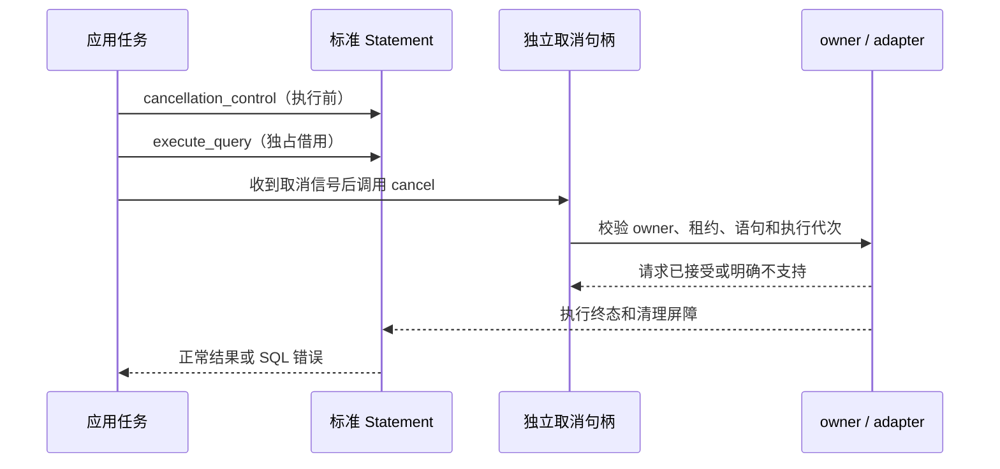
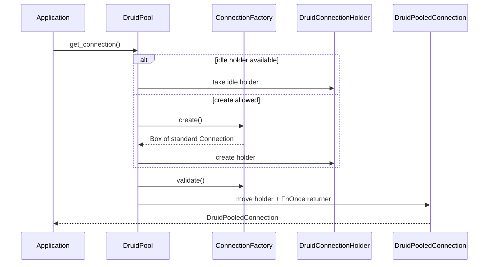
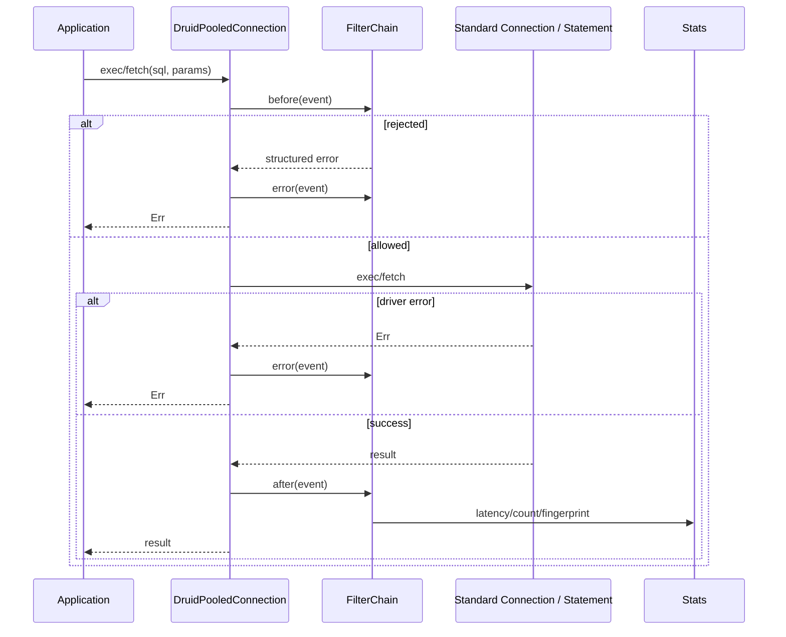
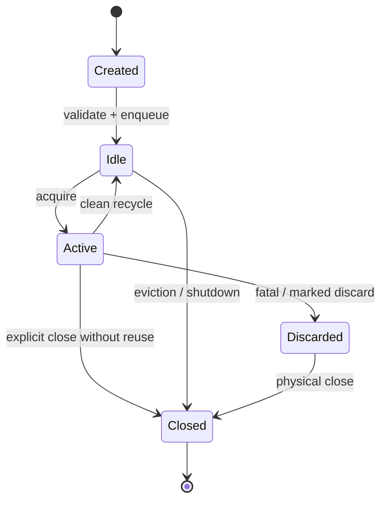
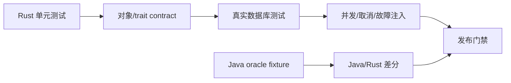

# druid-rust 架构设计文档

> 本文是 druid-rust 的总体架构入口。当前规格事实源为 ADR-CRATE-002 与
> ADR-RDBC-006，本文按当前源码描述实现及尚未验收的目标，不修改正式规格。
> 项目目标是把 Alibaba Druid
> 1.2.28 的功能语义有规划地迁移到 Rust，不是借鉴、重新想象或按文件机械翻译。
> 对象完成度、语义完成度和命名检查以 `docs/superpowers/specs/` 下的对象语义
> 总账、命名审计和驱动矩阵为准；执行状态以 `docs/superpowers/plans/` 为准。

| 字段 | 当前值 |
| :--- | :--- |
| 架构版本 | `V3.0.0-RDBC-FIRST` |
| Java 基线 | Druid `1.2.28`，提交 `33824c3dec1612711f9bb4e409319bcab2e4cd0e` |
| Rust 基线 | 当前工作区 HEAD |
| Rust MSRV | `1.95` |
| 默认工具链 | `1.97.1` |
| 文档状态 | 执行中；不得理解为完整迁移已经完成 |
| 事实核验日期 | 2026-10-08 |
| 当前版本与发布状态 | `0.0.0-design`；各 package `publish=false` |

当前是五产品 crate 加一个验证成员的 workspace。完整方法/原测试迁移已有
限定冻结输入的通过证据，当前严格 Clippy 已通过；全 features 网络回归、
资源取消、真实流式结果、API/SemVer/MSRV及生产门禁仍未闭合。
详细终态以[统一验收报告](./verification/rdbc-first/rdbc-single-standard-unification.md)及
[状态记录](./verification/rdbc-first/status.md)为准，不按文件数量估算完成率。

## 1. 文档责任与阅读路径

根 `docs/` 维护项目级架构入口，Superpowers specs/plans 维护规格事实与执行清单：

| 权威来源 | 责任 |
| :--- | :--- |
| 本文 | 当前架构、目标架构、不变量、模块边界和 ADR |
| [Superpowers 总入口](./superpowers/README.md) | 当前规格、计划、状态和历史 supersede 导航 |
| [RDBC-First 架构规格](./superpowers/specs/2026-08-21-rdbc-first-five-crate-architecture.md) | ADR-CRATE-002、目标 DAG、RDBC/运行时不变量和完成门禁 |
| [单一标准合同规格](./superpowers/specs/2026-08-24-rdbc-single-standard-trait-tree.md) | ADR-RDBC-006；wrapper与Druid proxies实现同一标准树，Physical只作为历史迁移分母 |
| [连接专项架构](./superpowers/specs/2026-08-12-connection-abstraction-design.md) | 连接对象、所有权、回收和驱动边界；旧 crate 目标段为历史记录 |
| [对象/语义总账](./superpowers/specs/2026-08-12-object-and-semantic-mapping.md) | Java core/admin/wrapper 对象和语义状态 |
| [命名审计](./superpowers/specs/2026-08-12-object-naming-audit.md) | canonical 名称、兼容路径和对象文件规则 |

同一变更只允许一个当前架构事实源。2026-08-20 的 `druid-core + druid facade`
计划由 ADR-CRATE-002 取代，旧文件保留历史证据但不得继续执行。

状态含义：

| 状态 | 定义 |
| :--- | :--- |
| `DONE` | Java/Rust 对象可追溯，行为差分和真实集成门禁已通过 |
| `PARTIAL` | 存在真实实现，但公开语义、错误分支或数据库矩阵未闭合 |
| `TODO` | 尚无可接受实现 |
| `RUST_ONLY` | Rust 生态扩展，不计入 Java parity 分母 |
| `ADAPTER` | 用 Rust 生态协议承载 Java 结果语义 |

## 2. 项目定位与边界

`druid-rust` 是面向 Rust 应用的数据库连接治理框架。应用只获取
`DruidPooledConnection`；池化、连接回收、SQL 事件、统计、动态路由和驱动差异
由内部对象协作完成。

项目名称表示对 Alibaba Druid 语义的 Rust 迁移，不表示 Alibaba 官方 Rust
发行版。许可证和上游来源必须在发布物中明确。

系统负责：

- Druid 连接池生命周期与配置语义；
- `Connection`、PreparedStatement、CallableStatement 和事务结果语义；
- Filter、Wall、Stat、SQL parser/visitor/output 等对象域；
- HA、动态数据源、管理面和 wrapper 语义；
- Rust driver/ORM 与独立 `druid-rdbc` 标准合同的适配；
- Java oracle、Rust contract、真实数据库和生产属性门禁。

系统不负责：

- 数据库 wire protocol 的重新实现；
- 应用 Schema migration；
- 替代数据库权限、网络隔离和凭据管理；
- 用名称相似或 crate 功能相近代替 Druid 行为迁移。

## 3. 总体架构



`Connection → Statement → ResultSet` 是标准操作对象链；`PreparedStatement → CallableStatement`
表示接口特化。元数据、SQL 类型与异常，以及 LOB、Array、SQLXML、SQLData、DataSource、Driver
和 RowSet 都属于 `druid-rdbc` 的合同范围。图中的 `druid-wrapper` 后端适配统一合同；池化代理与
连接所有权仍由 `druid` 管理。

上图描述当前 Cargo manifests 的直接产品依赖。它不代表目标 DAG 已验收：
Admin 对 Druid 的直接依赖及可选 Wrapper 依赖仍须按正式 P07 核验，
第17节保留已批准目标及其来源，不在本文静默变更依赖决策。

最重要的架构不变量：

1. 应用只依赖 `DruidPooledConnection`，不直接依赖 Toasty、SQLx 或 RBDC 类型。
2. `DruidConnectionHolder` 是 Druid 内部连接生命周期的唯一权威容器。
3. 每个 holder 同一时刻最多拥有一个 `Box<dyn druid_rdbc::connection::Connection>`。
4. Native 模式只有 `DruidPool` 一个连接池。
5. 外部池模式只持有 bb8/deadpool lease，不再嵌套进 `DruidPool`。
6. 每个连接租约只能归还一次；正常回收、淘汰和回收错误必须显式区分。
7. SQL feature unsupported返回结构化SQLFeatureNotSupported/`0A000`；Java默认UnsupportedOperation单独建模，不得静默成功。
8. 目标产品边界是 `druid-rdbc`、`druid`、`druid-wrapper`、`druid-metrics`、`druid-admin`；`druid-bench` 只负责验证。
9. Toasty/SQLx/RBDC/JDBC Agent/bb8/deadpool 统一属于 `druid-wrapper`；`druid-rdbc` 不含具体数据库依赖。
10. `druid::sql::*` 保持消费者 canonical 路径；标准Connection及driver合同统一归 `druid-rdbc`。
11. Metrics/Admin 只允许一份 `druid_metrics.v1` 线协议。

## 4. 当前模块与目标收敛

| 模块 | Java 来源 | 职责 | 当前状态 |
| :--- | :--- | :--- | :--- |
| `druid` | `/core` | Pool、holder、标准接口logical proxies、Filter、Parser、Wall、Stat、Dynamic；Druid所有权政策保留在产品层 | PARTIAL |
| `druid-wrapper` | `/druid-wrapper` | SQLx、Toasty、RBDC、JDBC Agent、bb8、deadpool、driver tooling | PARTIAL |
| `druid-metrics` | Rust-only | sampler/aggregator及公共gRPC协议有真实实现；P02历史范围已接受，最终supervisor/shutdown认证待完成 | PARTIAL |
| `druid-admin` | `/druid-admin` | HTTP/UI/repository、gRPC与安全配置已有实现；当前网络回归失败，TTL/容量/session与安全最终验收待完成 | PARTIAL |
| `druid-rdbc` | Java 平台映射 | 已独立存在；标准Connection/Statement/ResultSet、metadata、errors、resources及Wrapper，不持有Druid owner | PARTIAL |
| `druid-bench` | Rust-only验证 | 合同、差分与性能辅助成员；最终数据库及性能证据待完成 | PARTIAL |

依赖方向：



### 4.1 应用、标准合同与数据库适配器

`druid-rdbc` 定义与具体数据库无关的统一标准；`druid` 为应用提供连接池、过滤器和池化代理；`druid-wrapper` 将 SQLx、Toasty、RBDC、JDBC Agent 等后端接入该合同。标准对象链和合同组成见第 3 节总架构图。`druid-rdbc` 不持有池化 owner，owner、租约和回收策略属于 `druid`；具体数据库 I/O 属于 `druid-wrapper` 及其后端。

历史上 13 个 workspace crate 曾在 2026-07-29 物理收敛为三个；下表只记录
归并来源，不代表当前模块数量或目标拓扑：

| 已删除的原物理实现 | 当前模块 | 当前目录 |
| :--- | :--- | :--- |
| `druid-core`、`druid-pool`、`druid-sql`、`druid-stats`、`druid-dynamic` | `druid` | `crates/druid/src/{core,pool,sql,stats,dynamic}/` |
| `druid-toasty` | 后续迁入 `druid-wrapper` | `crates/druid-wrapper/src/toasty/` |
| `druid-sqlx`、`druid-rbdc`、`druid-sqlx-bb8`、`druid-sqlx-deadpool` | `druid-wrapper` | `crates/druid-wrapper/src/rbdc/`、`crates/druid-wrapper/src/sqlx/{bb8,deadpool}/` |

当前 workspace manifests 声明 `druid-rdbc`、`druid`、`druid-wrapper`、
`druid-metrics`、`druid-admin`、`druid-bench`；迁移期间全部 package
`publish = false`。

## 5. 连接对象模型



### 5.1 `DruidPooledConnection`

- 对应用暴露连接、PreparedStatement、CallableStatement 和事务方法；
- 通过 FilterChain 执行 before/after/error 事件；
- 持有一次性 return callback；
- 显式 `close/recycle` 负责异步复位和校验；
- `Drop` 只安全归还无需异步修复的干净连接；
- 归还后不得继续访问物理连接。

### 5.2 `DruidConnectionHolder`

- 拥有物理连接；
- 保存创建、最近活动、执行、保活和校验时间；
- 保存 use count、状态、discard、schema 和密码版本；
- 拥有标准 PreparedStatement cache 与资源 registry；
- 是 native idle queue 与对外连接之间移动的同一个对象。

### 5.3 标准 `Connection` 与 driver factory

`druid-rdbc::connection::Connection` 是底层adapter和Druid池化代理共同实现的合同：

- `exec/fetch` 与 Druid `Value/Row/ExecResult`；
- prepare、prepared execute 和 prepared close；
- begin、commit、rollback 和 savepoint；
- ping、close、abort、discard；
- auto-commit、read-only、isolation、holdability、catalog、schema；
- warnings、client info、network timeout、type map 和 vendor capability。

canonical factory是 `druid-rdbc::driver::ConnectionFactory`，返回未池化的标准连接。
`Physical*` 是P03/Task6固定迁移分母中的历史名称，不能重新作为当前公共接口；
删除与纯净性整体完成仍需最终compiler/public API/SemVer证据。

### 5.4 Statement 执行取消与池化租约

标准 Statement 需要跨任务取消时，应在开始执行前取得独立的 `StatementCancellation` 控制句柄。该句柄绑定当前物理 owner、逻辑租约、语句和执行代次；取消请求可与独占借用 Statement 的执行 Future 并行，不要求 Statement 实现 `Sync`：



应用应在执行前取得控制句柄，再由任务信号或超时触发 `cancel()`。取消调用的成功只表示请求已被控制面接受；数据库执行的终态仍以执行 Future 的结果为准。常见 SQLState `HY008` 表示执行确实被取消；如果执行先自然完成，则保留正常结果。调用方应在执行结束后关闭结果集和 Statement。

`druid` 的池化代理只将控制请求转发给创建它的逻辑句柄。连接归还、Statement 关闭或缓存语句重新 checkout 后，旧取消句柄不能跨越租约触及新执行。适配器完成取消清理屏障后才允许复用物理连接；清理错误、超时或执行 Future 在确认前被 drop 时，owner 标为不可用并由池丢弃，不能把 Future 结束误报为数据库已取消。

当前 SQLx 的后端能力按实际实现和已运行版本限定：

| 后端/场景 | 当前合同 | 证据边界 |
|---|---|---|
| 原生 SQLx SQLite | 缓冲/流式查询、execute、更新、批处理及默认生成键请求支持执行中取消；确认清理后可复用，同连接上的 VM 取消终态为 `HY008` | 本地嵌入式 runtime 3.46.0 的执行证据见 [取消合同证据](../openspec/changes/close-rdbc-jdbc42-contract-gaps/evidence/cancellation-contract.md)；不是独立服务端认证 |
| SQLx PostgreSQL 18.6、MySQL 8.0.36 | 当前取消入口返回 SQLState `0A000` | 真实连接的负向能力测试；不表示其驱动不能在其他集成中支持取消 |
| SQLx `Any` fallback | 返回 SQLState `0A000` | 以 Any 包装 SQLite 的测试确认不错误继承原生 SQLite 的取消能力 |
| SQLx SQLite generated keys 列名/列索引请求 | 当前返回 `0A000` | 只有 `ReturnGeneratedKeys` 模式在矩阵所列路径中支持；能力与取消能力分开判断 |

完整后端 × 执行入口及测试名称见 [SQLx 取消能力矩阵](../openspec/changes/close-rdbc-jdbc42-contract-gaps/evidence/sqlx-cancellation-capability-matrix.md)。这些状态仅对应表中实际验证的 feature 和版本，不能推广到未测驱动或宣称 JDBC TCK/全项目生产就绪。

## 6. 两种池化模式

### 6.1 Native Pool



Native 模式中 `ConnectionFactory` 只能创建未池化的底层标准连接。

### 6.2 External Pool Bridge

bb8/deadpool已经管理连接容量和回收。外部池桥接通过 `ExternalConnectionLease`
持有真实外部租约并委托标准Connection；holder采用external owner政策，
再由 `DruidPooledConnection` 提供治理，不作为factory重新放入DruidPool。

任何获取路径必须在 native 和 external provider 中二选一，禁止 pool-in-pool。

## 7. Toasty 标准 Driver Adapter

Toasty 当前位于 `druid-wrapper::toasty`，与 SQLx、RBDC、JDBC Agent 一样实现
`druid-rdbc` 标准Connection，factory也实现标准ConnectionFactory。Toasty不形成独立
产品 crate。Toasty Adapter 不创建 `toasty::Db`，因为 `Db` 自身包含连接池，直接
调用 Toasty `Driver::connect` 获取单条 raw connection，让 DruidPool 独占容量、
回收、Filter 和统计职责。

| feature | 定位 | 当前证据 |
| :--- | :--- | :--- |
| `sqlite`（Wrapper default） | 当前默认 Toasty SQLite Adapter | 真实 SQLite contract |
| `postgresql` | Wrapper 可选 Toasty Adapter | feature 存在；真实容器证据待重新核验 |
| `mysql` | Wrapper 可选 Toasty Adapter | feature 存在；真实容器证据待重新核验 |
| `turso` | Wrapper 可选 Toasty Adapter | feature 存在；真实服务门禁待补 |

Toasty 的 DynamoDB 等非 SQL provider 不暴露为 Druid feature，也不进入
SQL标准Connection与数据库支持计数。

SQLite 与 SQLx 同时启用时必须只有一个 `libsqlite3-sys` 链接版本。当前
`vendor/toasty-driver-sqlite` 以Toasty 0.9.0为来源，将 `rusqlite` 固定到
与SQLx 0.8共用的兼容版本，并保留同一原生连接的查询列metadata快照；
补丁来源和移除条件写在vendor README。

专项设计见
[`Toasty 内置数据源规格`](./superpowers/specs/2026-08-12-toasty-builtin-datasource.md)。

## 8. SQL 执行、Filter 与统计



Filter、Wall 和 Stat 是 Java Druid 的独立对象域，不能合并成两个简化 hook
后宣称完成。每个 Java hook、短路顺序、异常路径和统计字段都必须进入语义账本。

SQL parser 采用 `sqlparser` 只是 Rust 实现策略。Druid 自有 AST、visitor、
方言输出、parameterize 和 Wall 行为仍需由 Java corpus 差分验证。

## 9. 事务、状态和一致性

连接至少维护以下逻辑状态：



事务不变量：

- 未提交事务在回收前必须 rollback 或淘汰；
- auto-commit、read-only、isolation、holdability、catalog 和 schema 按配置复位；
- savepoint ID/名称和错误必须稳定；
- adapter 不支持的隔离级别或 read-only 必须明确失败；
- 事务内不得因动态路由切换到其他物理连接。

## 10. 并发、取消与资源所有权

- 共享注册表使用 `Arc`、`RwLock`、`DashMap` 或 `ArcSwap`；
- 单连接可变操作由租约独占，不把 driver connection 复制给多个任务；
- native pool 容量由 open/active/idle/creating 等计数共同约束；
- 取消不得造成双重归还、计数泄漏或脏事务复用；
- 维护任务关闭后必须停止创建、保活和淘汰循环；
- 高并发下最大连接数不能越界。

`DynamicDataSource` 已使用 `ArcSwap<DataSourceGroup>` 热切换节点组。切换只影响
后续路由，已取得的事务连接继续绑定原物理连接。

## 11. 错误模型与能力协商

标准Connection/Statement/ResultSet接口返回 `RdbcError`；Druid产品级pool/config等
边界使用 `DruidError` 并包装标准错误。需区分：

- 配置、初始化和获取超时；
- SQL parser、Wall 和参数错误；
- 驱动错误、连接关闭和不支持操作；
- fatal、transient、recoverable 和 discard 决策；
- prepared/callable、事务和保存点错误；
- 外部 provider 获取/归还错误。

不得通过字符串猜测全部 vendor 语义。SQLState、vendor code 和 driver
capability 需要保留结构化字段，并由对应真实数据库测试验证。

`ConnectionCapabilities` 是标准可选能力快照，默认false；资源使用
`ResourceOperations` 声明操作集合。capability=true必须有实际driver、池化和
共享合同证据，不支持时返回确定错误。Task7能力真实性验收仍开放。

## 12. 配置、安全与秘密

配置优先级和字段兼容必须以 Java Druid 的公开配置语义为基线。Rust 新增配置
需要登记为 `RUST_ONLY`，不得与 Java 同名字段产生不同含义。

安全规则：

- URL、密码、token 和 SQL 参数不得写入普通日志；
- Admin API 默认不暴露原始参数、凭据、内部错误栈和 PII；
- Wall 是纵深防御，不替代数据库最小权限；
- Adapter 只接受明确支持的 URL scheme，未知 scheme 不回退；
- TLS、证书和 cloud credential 由具体 driver/平台管理；
- DynamoDB 不得通过 SQL SPI 绕过能力边界。

## 13. 可观测性与管理面

观测对象分为：

| 层级 | 指标 |
| :--- | :--- |
| Pool | open、active、idle、creating、wait、timeout、discard |
| Connection | create/borrow/held/execute/validate/keep-alive 时间 |
| Statement | execute/error/result rows、prepared cache hit/miss |
| SQL | 指纹、执行次数、总/最大耗时、直方图、慢 SQL |
| Wall | 放行、拒绝、规则和数据源 |
| Dynamic | 节点选择、切换版本和失败 |

日志使用 `tracing`，指标适配 `metrics`/Prometheus。指标标签必须有界，禁止把
原始 SQL、用户 ID 或请求 ID直接作为高基数 label。

`druid-admin` 包含Axum/Tower HTTP路由、gRPC ingest、认证/TLS配置、repository
及Java兼容静态资源。独立binary启动HTTP与gRPC服务并监管退出；远端Metrics
使用唯一 `druid_metrics.v1` 线协议，REST保留Java-compatible JSON投影。
Toasty adapter属于Wrapper，Admin的可选driver-catalog会引入Wrapper依赖，
不把标准合同或数据库驱动定义转移到管理层。

P02历史限定范围已验收；当前完整all-features网络回归仍有8项失败，不能宣称
全部HTTP/gRPC可靠性、安全或覆盖率门禁完成。Java兼容面与Rust扩展分别记账，
P06/P07继续核验TTL/容量、session identity、认证授权、脱敏和确定性shutdown。

## 14. 部署、升级与回滚

druid-rust默认作为库嵌入应用进程。`druid-admin` 已有独立HTTP/gRPC binary
及服务入口，但只有通过统一协议、安全与故障验证后才可进入独立或sidecar
生产部署门禁。

升级要求：

- Cargo feature 和 MSRV 变化进入发布说明；
- 配置字段、错误枚举和公共类型遵循 SemVer；
- driver 升级运行对应数据库 contract；
- 连接池/holder 状态变化运行并发、取消、关闭和故障注入；
- Toasty SQLite vendor 补丁移除前验证 SQLx 共存依赖图；
- 回滚不得复用由新版本留下但旧版本无法解释的连接状态。

## 15. 测试与验收



测试证据分层：

1. Java 上游测试与固定 fixture；
2. Rust 单对象、状态机和错误分支；
3. 标准Connection/Statement/ResultSet及external pool共享合同；
4. SQLite/PostgreSQL/MySQL/Turso 等真实数据库；
5. Java/Rust 差分；
6. 并发压力、取消、超时、故障注入和性能；
7. fmt、clippy、doc、dependency、license 和安全门禁。

历史 2026-07-29 三模块归并曾记录以下证据（不可替代当前 HEAD 验证）：

- `cargo test --workspace --all-targets`：453/453；
- Toasty/core/SQLx/bb8/deadpool/wrapper：21 个真实 SQLite 用例；
- `cargo check -p druid --all-features` 通过；
- 当时 `cargo metadata` 只包含三个 workspace member。

这些证据只证明历史切片。2026-10-08严格全workspace/all-targets/all-features
Clippy已取得实际PASS；PostgreSQL/MySQL/Turso真实矩阵、Java全对象差分、
编译覆盖再生成、API/SemVer/MSRV及最新全仓运行门禁仍未闭合。

## 16. 迁移治理

完整迁移不得按 Rust 文件数计算。每个 Java 对象必须出现于对象账本，并选择：

- `DIRECT`：同名或语义等价对象；
- `MERGE`：多个 Java 对象由一个 Rust 对象承载；
- `SPLIT`：一个 Java 对象拆为多个 Rust 对象；
- `ADAPTER`：平台对象由 Rust 生态协议承载；
- `PROTOCOL`：对象行为转为 trait/事件/消息协议；
- `UNSUPPORTED`：仅在 Java 能力本身依赖不可用平台时登记，并给出替代与门禁。

`MERGE/SPLIT/ADAPTER/PROTOCOL` 都必须同时记录名称映射、行为映射、错误映射和
测试证据。没有真实逻辑的同名 struct、空 trait、`todo!()` 或 mock 冒烟测试
不计入完成。

路线和总账：

- [RDBC-First 总路线](./superpowers/plans/2026-08-21-rdbc-first-master-roadmap.md)
- [对象与语义总账](./superpowers/specs/2026-08-12-object-and-semantic-mapping.md)
- [对象名称审计](./superpowers/specs/2026-08-12-object-naming-audit.md)
- [驱动集成矩阵](./superpowers/specs/2026-08-12-driver-integration-matrix.md)
- [连接抽象与驱动适配架构](./superpowers/specs/2026-08-12-connection-abstraction-design.md)

## 17. ADR

| ADR | 决策 | 状态 |
| :--- | :--- | :--- |
| ADR-001 | `DruidPooledConnection` 是唯一对外连接 | 已确认 |
| ADR-002 | `PhysicalConnection` 是内部最小 SPI | SUPERSEDED_BY ADR-RDBC-006；历史决策保留 |
| ADR-003 | `DruidConnectionHolder` 是生命周期权威容器 | 已确认 |
| ADR-004 | Native 与 external pool 模式互斥 | 已确认 |
| ADR-005 | Toasty 是内置标准，SQLx/RBDC 是扩展 | 已确认 |
| ADR-006 | Toasty 使用 raw driver connection，禁止 pool-in-pool | 已确认 |
| ADR-007 | DynamoDB 不进入 SQL Connection 合同 | 已确认；历史Physical名称随ADR-RDBC-006迁移 |
| ADR-008 | SQL parser 实现可用 sqlparser，但结果语义必须对齐 Druid | 已确认 |
| ADR-009 | DynamicDataSource 使用 ArcSwap，事务租约不随切换漂移 | 已确认 |
| ADR-010 | Admin 的 Java 兼容面与 Rust-only API 分账 | 已确认 |
| ADR-011 | 完成状态由差分和真实门禁决定，不由文件/方法计数决定 | 已确认 |
| ADR-012 | 产品、文档和发布边界只有 `druid`、`druid-wrapper`、`druid-admin` | SUPERSEDED_BY ADR-CRATE-002 |
| ADR-013 | 现有内部 crate 必须归并为三模块目录，facade 重导出不等于完成归并 | SUPERSEDED_BY ADR-CRATE-002 |
| ADR-CRATE-001 | `druid-core`、`druid` facade、Wrapper、Metrics、Admin | SUPERSEDED_BY ADR-CRATE-002 |
| ADR-CRATE-002 | `druid-rdbc`、`druid`、`druid-wrapper`、`druid-metrics`、`druid-admin`；`druid-bench` 为验证成员 | ACCEPTED |
| ADR-RDBC-001 | `druid::sql::*` 保持消费者路径；driver SPI 归 `druid-rdbc` | ACCEPTED |
| ADR-RDBC-002 | logical handle 使用具体类型，不机械复制 Java trait 继承 | ACCEPTED |
| ADR-RDBC-006 | wrapper和Druid proxies实现同一druid-rdbc标准树，Physical迁移后删除 | 正式规格状态为PROPOSED_FOR_WRITTEN_REVIEW；P04实际执行，整体验收未关闭 |
| ADR-METRICS-001 | 统计 registry、sampler、timeline、Prometheus model 和 gRPC protocol/runtime 从 `druid` core 移入独立 `druid-metrics` crate | ACCEPTED |
| ADR-TRANSPORT-001 | 管理面 ingest repository、REST、认证、兼容静态 UI 和独立 binary 从 `druid-admin` 拆分出独立传输层职责 | ACCEPTED |
| ADR-ADMIN-001 | `druid-admin` 只消费 `druid-metrics` 协议，不反向依赖 `druid-wrapper`；管理统计归属 Metrics，HTTP/REST service 归属 Admin | ACCEPTED |

### RDBC-First 五产品 Crate 目标依赖图

> 以下为 ADR-CRATE-002 当前目标，按 2026-08-21 RDBC-First 计划集执行。

此目标与第3节的当前manifest图分别展示；当前Admin直接依赖Druid以及可选
Wrapper的事实尚未完成P07核验，不因源码已存在而自动更改批准目标。

```text
druid-rdbc <── druid
druid-rdbc <── druid-wrapper ──> druid
druid <── druid-metrics <── druid-admin
druid-admin -X-> druid / druid-wrapper
```

`druid` 保留核心产品身份；`druid-rdbc` 是低层可演进合同；Wrapper 同时消费
RDBC SPI 和 Druid Pool；Metrics 消费 Druid typed snapshot；Admin 只消费 Metrics。

ADR 反转必须同步修改源码、架构、对象账本、语义账本、测试和发布说明。

## 18. 术语

| 术语 | 含义 |
| :--- | :--- |
| `DruidPooledConnection` | 应用持有的池化连接 facade |
| `DruidConnectionHolder` | Druid 内部物理连接生命周期容器 |
| 标准 `Connection` | driver/ORM adapter与Druid pooled proxy共同实现的druid-rdbc合同 |
| `ConnectionFactory` | Native模式中创建和校验未池化标准连接的druid-rdbc工厂 |
| `ExternalConnectionLease` | External模式中持有、委托并归还外部池租约的Druid内部对象 |
| `Physical*` | 过渡抽取的历史接口及固定迁移分母，不作为当前canonical标准 |
| Native pool | 由 `DruidPool` 独占池化职责 |
| External pool | 由 bb8/deadpool 独占池化职责 |
| semantic parity | Java 与 Rust 的可观察行为、错误、状态和副作用一致 |
| Java oracle | 从 Java Druid 固定版本运行得到的对照结果 |
| Rust-only | Rust 生态新增能力，不计入 Java 迁移完成率 |
