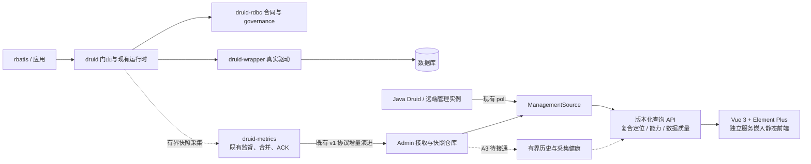
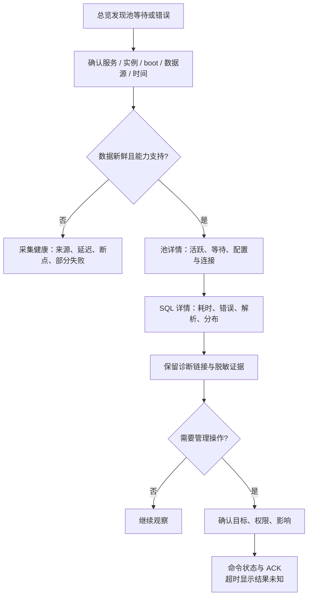

# Druid Admin 浅色监控台设计

> 2026-11-02 状态更新：修订 04 已获批准并落实到生产 Vue / Rust。本文件保留设计阶段的范围与基线记录；当前实现、验证及尚未接入指标以 [生产落地记录](../../verification/admin-live-console-20261102.md) 和 OpenSpec `admin-live-console` 为准。
状态：DRAFT，用户已批准视觉方向和设计＋原型交付。正式行为变更尚待按现有 OpenSpec 评审。设计任务 ID `A1–A4` 见 [剩余工作](remaining-work.md)。

## 1. 产品目标与选择

面向开发、值班与数据库平台人员，回答三个问题：**哪里异常、依据是什么、下一步如何定位。** 保留当前可用的数据源/SQL/Wall 能力，让数据来源、范围、新鲜度和支持情况成为每个诊断结论的一部分。

比较三种方案：

| 方案 | 取舍 |
|---|---|
| 只换配色和组件 | 风险低，但无法修复多实例定位、空数据掩盖故障和慢 SQL 口径问题 |
| 复用 Vue 3 / Element Plus，按数据链路逐步改版（选择） | 保留接口和独立二进制发布；先修可信度，再加趋势，迁移成本可控 |
| 重建独立前端与全新服务 | 会重复现有能力，扩大 API 与部署兼容面；当前没有必要 |

非目标：不做 ORM、不执行任意 SQL、不把所有数据库产品都画成“已支持”、不新增第二套 metrics 协议、不在监控页面探测性提交事务、不在本轮迁移生产代码。沿用现有 TLS、认证、同源 Session/显式 Bearer CORS 与静态资源构建合同。

## 2. 架构与故障定位路径

业务 SQL 路径不能等待 Admin 网络/磁盘。复用现有 bounded queue、coalesce 和 supervisor；趋势由独立消费者聚合。低频采集与容量控制也有开销，必须通过故障和性能预算量化，不能只写“不影响性能”。不复制 agent-job 的整套通信：本轮其 `agent-job-admin/src/metrics/timeline.rs` 仅供参考分档采样门控和有界缓冲，Druid 已有相似原语应复用。

## 3. 全局上下文与身份合同（A1）

生产版全局筛选：服务 → 实例 → 数据源；时间范围独立保存在 URL。面包屑显示来源模式（push / poll / 混合）、采样时刻和当前作用域。总览默认是最新快照，不把累计数写成“最近 15 分钟”。仅历史能力可用时启用窗口趋势。

- 实体键候选：`serviceName + instanceId + bootId + datasourceIdentity`；SQL 再加 `sqlId/fingerprint`。传输层以当前 repository 的 `ServiceIdentity/DataSourceId` 为基准核对，不能另造不兼容身份。
- `streamEpoch/sequence` 用于快照版本与断点判断，不把 sequence 作为池的业务 ID。重启后历史分段，旧深链接提示对象所属旧 boot，禁止自动跳到新 boot 的同号对象。
- 旧 URL 继续可访问。只能唯一解析时正常跳转；有歧义给选择界面或明确错误，不能任选第一项。新 URL 使用编码后的显式上下文，避免拼接分隔符碰撞。
- 筛选改变立即取消旧请求；响应落地前校验上下文版本。刷新只更新数据，不用 key 强制卸载页面。保存排序/分页/滚动/抽屉。
- 列表必须服务端分页、排序、过滤并有最大页大小；排序以稳定复合键作最终 tie-breaker。详情返回 not-found 与 unavailable 区分，不能把上游超时映射成不存在。

## 4. 页面注册与功能覆盖

| 页面 ID / 导航 | 当前基础与新增范围 | 关键字段 / 操作 / 子界面 | 任务与正式规格 |
|---|---|---|---|
| P01 运行总览 | 新聚合视图，复用现有数据源/SQL | 池容量、等待、错误、采集覆盖；问题列表→详情；趋势待 A3 | A1/A2/A3；admin-web-console |
| P02 服务与实例 | `/services` 已有 | 实例/boot、来源、最后采样、能力；切换作用域 | A1/A2；admin-web-console/admin-runtime |
| P03 数据源 | 现有列表与详情保留 | 活跃/空闲/最大/等待/事务/配置；详情抽屉→完整详情；连接/堆栈按能力 | A1/A2/A4；admin-web-console |
| P04 SQL 分析 | 现有列表、解析、分布保留 | 指纹、次数、总耗时、最大、错误、取回/更新行；搜索排序；SQL 详情抽屉 | A1/A2；admin-web-console |
| P05 慢 SQL | 现有最大耗时筛选保留并更正名称 | “曾慢 SQL（累计）”与未来“窗口慢请求”分开；阈值有单位；不显示错误占比 | A1/A2/A3；admin-web-console |
| P06 SQL 防火墙 | 现有 Wall 数据保留 | 检查/拒绝/违规、表、函数、白黑名单；明示名单是观察统计还是可编辑策略 | A1/A2；admin-web-console |
| P07 采集健康 | self_metrics/仓库计数已有，未全部上送 | lag、队列、合并、丢弃/拒绝、活跃任务、待 ACK、序列断点、TTL/容量 | A3；metrics-runtime/admin-runtime |
| P08 驱动与能力 | wrapper registry 基础 | 数据库/版本/驱动/平台；枚举能力、验证日期、负能力原因、证据链接 | R3/A2；ADR-003及现有驱动合同 |
| P09 操作记录（后续） | 命令/ACK 已有，完整审计 UI 待补 | 操作者、目标、requestId、提交/ACK时间、unknown；确认/取消/查询 | A4；admin-runtime，需增量审计需求 |
| P10 API 与诊断 | 现有 API 页面保留 | OpenAPI、响应示例、版本、脱敏规则；下载诊断包必须另验授权 | A1/A2；admin-web-console |

P02 在原型中通过顶部服务筛选与实例信息体现；P09/P10 的生产增强不在本次原型冒充实现。Web/Session/Spring 等 Java 平台页面须逐项核对 poll 能力，保留兼容入口；不硬套到 Rust 原生驱动。

### 详情子界面

- **S01 SQL 抽屉**：身份和采样信息固定在头部；兼容模式可呈现格式化 SQL，secure 模式按现行规范将 SQL 文本整体显示为 `[REDACTED]`，不是只去掉参数。指标、获授权的解析结果、直方图、错误四组。返回列表不丢状态。不存在/无权限/来源不可用各自提示。缺少原始 SQL 只显示指纹，不能客户端编造 SQL；被脱敏的 SQL 不得用客户端 fallback、缓存或另一路 API 恢复。
- **S02 数据源抽屉**：活跃/空闲/等待与配置分组；连接、活跃堆栈标注 poll/push 能力，配置值未知显示 `—`。完整详情继续复用现有字段，不为了简洁删掉诊断配置。
- **S03 管理操作确认（A4）**：目标实例/boot/池、操作影响、权限、可否回滚；提交期间禁止重复点击；取消仅关闭尚未提交的表单。已提交请求不能用关闭弹窗假装撤销。
- **S04 状态解释**：点击“部分数据/不支持/过期”可见来源、最后成功采样、原因与重试。提示不暴露原始 credential、SQL 参数或驱动完整错误。

## 5. 指标来源与计算口径

| 指标组 | 当前生产链路 | 新版展示 / 缺口 |
|---|---|---|
| 池 active/idle/maxActive/waiting | proto PoolSnapshotMsg 与仓库已有；poll 也可提供 | 当前快照，明确采样时间；利用率 active/maxActive，分母为零或未知不计算 |
| SQL 执行次数/总耗时/取回与更新行 | push SqlStatMsg 已有 | 先显示累计；窗口 QPS、耗时需 A3 增量序列，不能把累计平均冒充窗口平均 |
| SQL 原文、错误、最大、分布、配置 | v1 DTO 有丰富字段；push wire 不完整，poll 视远端能力 | 字段级 capability/availability；缺失不渲染零；A3 按成本扩展采集 |
| SQL 解析表/列/格式化 | 服务端 sql_parse 和前端兼容 fallback 已有 | 标注解析失败/方言；可复制脱敏文本，保留原 SQL 与解析结果区别 |
| Wall 三个基础计数 | snapshot 基础字段已有 | 明确 check/deny/violation 区别；表/函数/名单看具体来源能力 |
| 连接列表 / 活跃堆栈 | legacy poll 有实现，push 明确 unsupported | 不能因空集合认定没有活跃连接；沿用权限与 removeAbandoned 前提 |
| 管线自监控 | self_metrics 已有局部计数 | A3 传输并可视化；Admin 必须能独立显示连接断开，不能等断开的管线自报健康 |
| 历史趋势 | 三档 Timeline 原语存在，未接通端到端 | A3 复用；原型曲线全部是设计 fixture，不是观测值 |
| 分位数 / 慢请求率 | 当前 wire 没有完整窗口分布 | 不把 max 叫 P99；桶估算报告区间/估算标签，只有计数和边界兼容时才计算 |

建议响应增量（待批准）：`context`、`sampledAt`、`receivedAt`、`sourceMode`、`availability`、`capabilities`、`partialErrors`。availability 至少覆盖 `available / unsupported / not_reported / stale / redacted / error`，与有值的零明确区分；各字段可继承实体状态，但局部缺失必须可表达。

窗口语义：同一 boot/epoch 下，相邻累计计数差除实际采样间隔；计数倒退或间隔缺失标记断点而非负值/插值。平均耗时 = 窗口总耗时增量 / 窗口次数增量；跨实例加权汇总，不平均平均值。直方图必须桶边界相同且不重复汇总；分位数以桶界限表示精度。迟到样本、时钟漂移和重复 sequence 由采集端/仓库合同处理，浏览器不替代其去重。

历史建议复用 15 秒×180、60 秒×360、1 小时×360 三档，分别约 45 分钟/6 小时/15 天；它们是候选配置，不是当前产品已提供的承诺。每档独立采样门控，正确汇总峰值/计数/分布，不把平均当峰值。按实例/池/SQL 基数估算字节，受现有 retained 64 MiB / 进程 128 MiB 预算约束；SQL 高基数需要 top-K/溢出计数与明确覆盖率。若持久化需另行批准保留期、清理、恢复和磁盘预算，不暗中引入外部时序服务。

## 6. 视觉和响应式：以原稿中间件控制台为准

**当前视觉裁决：revision 04（2026-11-01）。** 用户提供原稿截图并明确“这种系统就该有这种中间件的样子”。前两版侧栏、大数字卡、装饰性留白的通用仪表盘方向已被否定，不作为后续实施依据。浅色指的是主体背景，不意味着改变 Druid 管理工具的产品形态。

- 保留原稿的深色顶部横向导航、蓝色选中菜单、紧凑环境摘要、白色内容面板与细边框数据表。主页为默认入口；主要工作导航为数据源、SQL 统计、慢 SQL、SQL 防火墙、API 索引；新增采集健康与驱动能力采用同一种控制台结构。
- SQL 是首要工作页面：同屏对比大量 SQL，执行耗时 / 取回行 / 影响行 / 执行与结果持有时间使用蓝、绿、橙、灰四组行内直方图。复用生产 `MiniHistogram.vue` 的分桶与色阶语义，悬停/聚焦可读桶边界和数量。
- 执行次数、错误次数、总耗时、最大耗时紧邻分布列，数字右对齐、单位明确；错误使用局部红色标识。累计最大值不叫 P99，累计总耗时不叫单次耗时。
- 列表采用排序、搜索、分页和详细统计。相同 SQL 分别显示所属实例，用紧凑来源提示避免跨服务混淆；详情保留复合身份。原型中点击 SQL 打开详情，正式 Vue 落地须保留原有“SQL 文本复制、行点击详情”操作，并提供明确详情入口，不能因原型演示而删除已有复制功能。
- 字号以 12–13 px 表格正文、15 px 面板标题为主；来源辅助文字 11 px 左右，关键统计不可截断。主交互区约 30 px 高，行内图形缩小但保留可命中的区域。没有侧栏、没有营销式大标题、没有大指标卡或装饰图形。
- Desktop 1280×1024：横向菜单＋满宽紧凑表格；Tablet 768×1024：菜单可横向滚动、筛选换行；Mobile 390×884：表格保持专业列结构，在容器内横滚，页面本身不横溢出；详情全屏。
- 数据不支持/部分失败/过期/无权限提示继续保留。工程解释收起，不把真实错误或能力缺失也隐藏。状态有文字，不能只靠颜色。

原稿与代码依据：用户附件、`web/src/views/SqlList.vue`、`web/src/components/MiniHistogram.vue`、`web/src/utils/format.js`。当前自包含原型用于评审，生产仍复用 Vue 3 / Element Plus。不把外观调整视为新的生产迁移成果。

### revision 04：主页与页面补齐

延续用户批准的原稿中间件风格。本修订是同一设计的补充，没有创建第二套规格；生产实施仍按既有 OpenSpec 与 A1–A4 推进。

| 页面 | 当前可点击原型内容 | 语义与实施边界 |
|---|---|---|
| 主页（默认） | 8 项紧凑键值摘要；问题定位表；服务实例表；采集能力检查；连接池表；错误 SQL 定位 | 最新快照 / 累计统计明确区分；累计错误不冒充当前告警；点击数据源或问题可下钻 |
| 数据源 | 运行与事务、连接生命周期 / PS 缓存、池配置三标签 | 保留原有统计方向；丰富字段只用于 poll 示例，push 未上报明确显示 |
| 数据源详情 | 运行统计、24 项配置、连接 / 堆栈、所属 SQL | 事务耗时 7 桶与连接持有 8 桶为独立演示分布；连接仅为样本；不读取生产堆栈 |
| SQL 详情 | 统计与四种分布、解析信息、错误详情、复制 SQL、返回所属池 | 复用原版信息层级；错误消息与敏感参数整体脱敏；完整 SQL 只来自虚构兼容模式 fixture |
| 慢 SQL | 100 / 500 / 1000 / 5000 / 10000 ms 可选阈值 | 按累计最大值筛“曾慢 SQL”；不会称为窗口慢请求率 |
| SQL 防火墙 | 规则、表、函数、白名单、黑名单五标签与紧凑计数 | 名单展示样本；丰富计数只覆盖支持来源；push 缺失不写成零 |
| 采集健康 | 来源 / boot / 模式 / 采样 / 接收 / seq / epoch；预算、丢弃、ACK、队列与事件 | 展示数据链路设计；明确待接通，进程内存没有测量不填模拟实测值 |
| 驱动与能力 | poll / push 字段矩阵、当前驱动、验证维度 | 已注册与已验证分开；缺驱动版本写“未采集” |
| API 索引 | 原有 8 条 GET 端点、SQL 查询参数、身份/错误/安全/契约边界 | 已核对 client.js 与 v1_api.rs；不提供发起生产请求的按钮 |

全局服务筛选联动数据源选项，主页和详情的 SQL 下钻使用服务 / 实例 / boot / 池的复合 fixture 身份；这验证的是设计意图，当前生产数值路径的 G01 仍未修复。SQL 搜索、排序、分页、刷新、异常状态以及键盘 Escape 关闭详情继续保留。列表表头之外的 SQL 摘要不显示无效排序按钮。

新增统计均为显式演示值。原型不能证明真实数据采集、字段全面迁移或性能门禁完成。正式 Vue 落地必须按 AC07 对现有字段逐项回归，不能把原型展示的子集作为删减原版功能的依据。

## 7. 状态与恢复合同

| 状态 | 用户看到什么 | 可执行动作 |
|---|---|---|
| 首次加载 | 保持布局的骨架/文字，不显示零作为占位 | 可改筛选；旧请求取消 |
| 正常但为空 | “此范围没有数据”，带筛选范围与时间 | 清筛选/返回上级 |
| 部分数据 | 可用内容＋失败来源计数与原因 | 到采集健康、重试失败源 |
| 过期 / 断开 | 最后成功值仍可见且标过期；曲线断点 | 重试/检查采集，不能标全绿 |
| API 失败 | 可恢复错误页或保留的旧值；明确区别 | 重试，不把错误吞成空列表 |
| 未认证 / 无权限 | 登录入口或禁止说明；不泄漏敏感详情 | 重新登录/返回可读页面 |
| 能力不支持 | 字段或功能“当前来源不支持” | 看能力矩阵；不提供无效按钮 |
| 命令已提交无 ACK | “结果未知”，保留 requestId 和时间 | 查询原请求状态；不自动重发执行 |

原型提供正常/部分/过期/空/失败/无权限切换用于评审，不代表服务端已有同名状态协议。

## 8. 安全与兼容性

脱敏在服务端完成，原型 fixture 不含真实凭据。原型里的完整 SQL 仅为**兼容模式的虚构示例**，绝不是 secure 模式只脱敏参数的授权。现行 `admin-runtime` 要求 secure 模式将 SQL 文本、参数、数据库 URL、用户名及驱动错误消息别名整体替换为 `[REDACTED]`，并递归处理嵌套对象/数组。格式化文本、复制、搜索、缓存与下载不能成为恢复通道；不以浏览器隐藏实现权限。Viewer 是新增角色建议，当前 Operator/Ingest 不能被文档误写为已有三角色。重置与日志操作必须权限校验、目标确认、唯一请求关联与审计；已有 API/legacy 行为需合同测试保护。

仍由现有 build.rs 嵌入前端构建结果；无前端资产时 API 仍可构建并明确提示。新页面可独立回滚至旧控制台，不能要求数据库/业务应用随 UI 原型一起升级。新增协议字段使用兼容演进与版本/能力协商，旧客户端收到不支持能力时降级。

## 9. 可执行验收与任务映射

| 验收 ID | 可观察行为 | 对应任务 / 复用测试 |
|---|---|---|
| AC01 | 相同数字 ID 的两个服务不会串详情；旧链接模糊时不选首项 | A1/G01；admin_v1_api_test |
| AC02 | 100 次执行只有 1 次慢时，不显示慢请求率 100% | A1/G02；新增口径合同，复用现有 SQL fixtures |
| AC03 | 远端超时、本地空、半数来源失败可区别于正常零结果 | A1/G03；admin_poll_backend_test |
| AC04 | push 缺 error/max/histogram，页面显示缺能力而非零 | A1/G04；protocol_roundtrip + v1 API |
| AC05 | 自动刷新/切服务不清筛选，晚响应不覆盖新页 | A1/G06；Vue 浏览器回归 |
| AC06 | 分页有上限、total 与过滤一致、排序跨页稳定 | A1/G07；v1 API 大集合合同 |
| AC07 | 保留现有配置/SQL解析/直方图/Wall名单，不因改版丢失 | A2；console_routes + 浏览器字段回归 |
| AC08 | 三尺寸无页面横溢出，键盘操作抽屉和状态提示可用 | A2；本原型初验，生产 Vue 仍须复验 |
| AC09 | 重启/计数回退/间隔断点不生成负 QPS 或虚假连续曲线 | A3；timeline 与协议/仓库测试 |
| AC10 | 管线饱和/重复/乱序/重启/停机满足现有时延与内存预算 | A3；admin-runtime / metrics-runtime 故障矩阵 |
| AC11 | 无权限不能提交命令，ACK 超时不自动重发 | A4；管理接口与真实进程测试 |
| AC12 | OpenAPI schema、错误状态与端点同源，不靠手填漂移 | A1/G08；生成产物一致性检查 |
| AC13 | secure 模式 SQL 文本整体 `[REDACTED]`，格式化/fallback/复制/搜索/缓存不能恢复；兼容模式保持现行行为 | A1/A2；admin_trace_redaction_test + 浏览器合同 |

实施时先为目标行为补失败测试，再做最小修改，使用已有 Java oracle / approved differences；用户未要求的兼容变化不得混入。原型验证仅覆盖设计交互，不冒充 AC01–AC13 的生产验收。

## 10. 评审后的进入条件

本设计与原型评审通过后，把 A1 的身份/口径/错误/能力合同写入现有 OpenSpec 增量 change；再分批开发 A1、A2。A3 的历史保留、字段成本、预算及 A4 权限/审计另有明确验收后实施。完整迁移工作继续按 R1–R4 推进，不因管理台美化而宣称全仓已完工。
