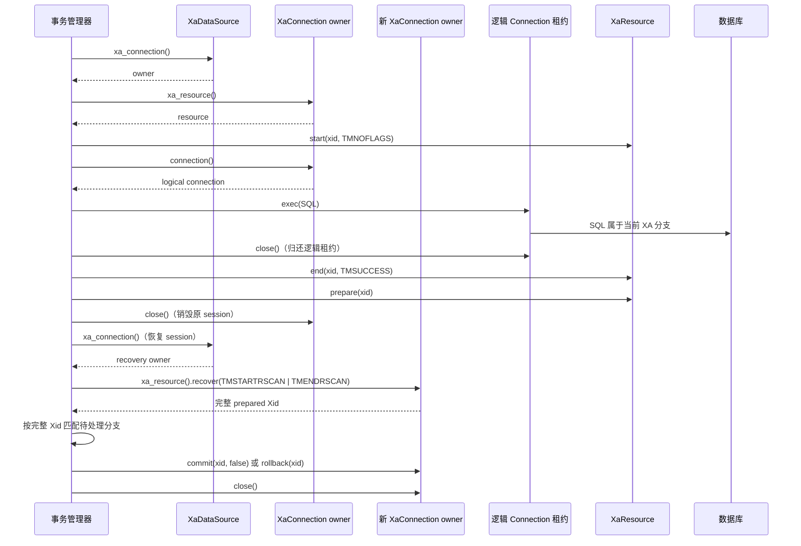

# JDBC Agent XA 集成

本文面向接入 `druid-rdbc` 的应用、外部连接池和事务管理器。JDBC Agent XA 只在调用方显式配置 `XADataSource` 类并且 Agent 成功协商 XA 后启用。普通 `JdbcAgentConnectionFactory` 建立的 JDBC 连接仍是普通连接；不能通过 JDBC URL、驱动名称或本地事务把它升级为 XA。

## 启用与配置

在依赖中为 `druid-wrapper` 启用 `jdbc-agent` feature。运行环境需要 Java，以及 JDBC Agent shaded JAR 和所选数据库厂商的 JDBC driver JAR；将两个 JAR 都放入 Agent 的 Java classpath。下面的 PostgreSQL 配置沿用本仓库的真实集成路径：`serverNames` 和 `portNumbers` 是数组属性，密码从环境变量读取。

```rust
use druid_wrapper::jdbc_agent::{JdbcAgentOptions, JdbcAgentXaDataSource};
use serde_json::{json, Map};
use std::{env, path::PathBuf, time::Duration};

fn postgres_xa_data_source() -> Result<JdbcAgentXaDataSource, Box<dyn std::error::Error>> {
    let agent_jar = PathBuf::from(env::var_os("DRUID_JDBC_AGENT_JAR").ok_or("missing agent JAR")?);
    let driver_jar = PathBuf::from(env::var_os("DRUID_JDBC_DRIVER_JAR").ok_or("missing JDBC driver JAR")?);
    let java = env::var_os("DRUID_JAVA_EXECUTABLE").unwrap_or_else(|| "java".into());
    let options = JdbcAgentOptions::java(java, [agent_jar, driver_jar])?
        .request_timeout(Duration::from_secs(60));

    Ok(JdbcAgentXaDataSource::new(
        "org.postgresql.xa.PGXADataSource",
        Map::new(),
        options,
    )?
    .property("serverNames", json!([env::var("DRUID_XA_PG_HOST")?]))
    .property("portNumbers", json!([env::var("DRUID_XA_PG_PORT")?.parse::<u16>()?]))
    .property("databaseName", json!(env::var("DRUID_XA_PG_DATABASE")?))
    .property("user", json!(env::var("DRUID_XA_PG_USER")?))
    .property("password", json!(env::var("DRUID_XA_PG_PASSWORD")?)))
}
```

属性名和值必须符合具体厂商 `XADataSource` 的 JavaBean 配置。不要把密码写入源码、日志或诊断输出。数据源的 `Debug` 实现只显示属性数量，不显示属性值；应用仍需按自身密钥管理要求保护环境变量和进程环境。

Agent/JDBC 驱动版本必须与目标数据库和运行时兼容。构建 Agent 可使用：

```powershell
mvn -f agents/jdbc-agent/pom.xml '-DskipTests' package
```

## 事务与 owner 生命周期

标准消费路径由 `druid-rdbc` 提供，事务管理器无需依赖 `druid-wrapper` 私有连接或资源类型。`XaConnection` 是物理 owner；它发放的 `Connection` 是可关闭、可重新借出的逻辑租约。关闭逻辑连接会使该租约归还或失效，但不关闭 XA owner，也不单独释放其 `XaResource`。关闭 owner 才会结束底层 Agent session，并使所有关联句柄失效。



XA 操作的 Rust 接口形状由合同测试编译验证；真实 PostgreSQL 用例还覆盖 prepare 后关闭原 owner、创建新 owner、recover 完整 Xid，再分别 commit 和 rollback。应用发生中途错误时，应由事务管理器按 XA 协议决定 rollback 或恢复，不得把错误改写成提交成功。遇到传输结果不确定、Agent 退出或 owner 已关闭时，隔离并丢弃 owner；保留原始 `RdbcError`/`XaError` 作为诊断依据，不继续复用该 session。

## 跨 session 恢复

只有支持持久 prepared transaction 的数据库和 XA 驱动才能提供断开后的恢复。事务管理器在原 session 执行 `start → SQL → end → prepare` 后，应先关闭逻辑连接，再关闭原 owner；恢复时通过同一显式 XA 数据源创建新 session，调用 `recover`，按完整 Xid（format id、global transaction id、branch qualifier）匹配待处理分支，然后执行二阶段 `commit(xid, false)` 或 `rollback(xid)`。恢复结果必须由数据库终态验证，不能仅凭 Agent 返回成功判断。

本仓库的真实闭环使用 PostgreSQL 18.6、pgjdbc 42.7.14 和 `max_prepared_transactions=10`，并由独立 JDBC 连接核对最终行状态。H2 2.3.232 在关闭原 XAConnection 后不能恢复 prepared Xid，因此它只用于 owner/租约生命周期和故障隔离测试，不作为跨 session 恢复证据。其他数据库/驱动的恢复能力需要各自的实库验证。

## 普通连接与迁移

普通 JDBC Agent 用户继续使用既有普通连接入口和配置，不需要 XA 属性或能力握手。只有应用确实使用事务管理器和分布式事务时，才改用显式 `JdbcAgentXaDataSource` 并配置厂商 XA 数据源；不要将普通连接包装成 `XaConnection`，也不要以本地事务替代 XA。未配置或未协商 XA 时，XA 能力请求必须 fail closed，并保留 `0A000` 不支持结果。

当前 workspace 包版本为 `0.0.0-design`，仓库未声明已发布稳定 SemVer 基线。本指南记录的是预发布 API 使用方式，不构成已发布版本承诺。发布前应结合最终公开 API 差异和兼容性政策决定版本号；已有 `XaConnection` 实现通过默认不支持方法保持源码兼容，新增 XA 类型与 JDBC Agent 数据源受 `jdbc-agent` feature 控制。

## 验证

运行不需要数据库的公开消费者合同：

```powershell
cargo test -p druid-wrapper --features jdbc-agent --test jdbc_agent_xa_external_consumer --locked --offline
```

PostgreSQL 跨 session 真实恢复由 JDBC Agent Maven 集成 harness 启动：

```powershell
mvn -o -f agents/jdbc-agent/pom.xml '-Ddruid.rustXaIntegration=true' '-Dtest=RustXaClientRecoveryIntegrationTest' test
```

普通外部消费者测试验证 `JdbcAgentXaDataSource: XaDataSource` 和仅依赖标准 trait 的 XA 操作签名；上述 ignored Rust 消费者测试由 Maven/Testcontainers harness 单独激活，验证真实 PostgreSQL 中 prepare/recover/commit/rollback 结果。测试证据、实际版本、源码哈希及 API/SemVer 审查记录在 OpenSpec change 的 `evidence/xa-rust-client.md`。
