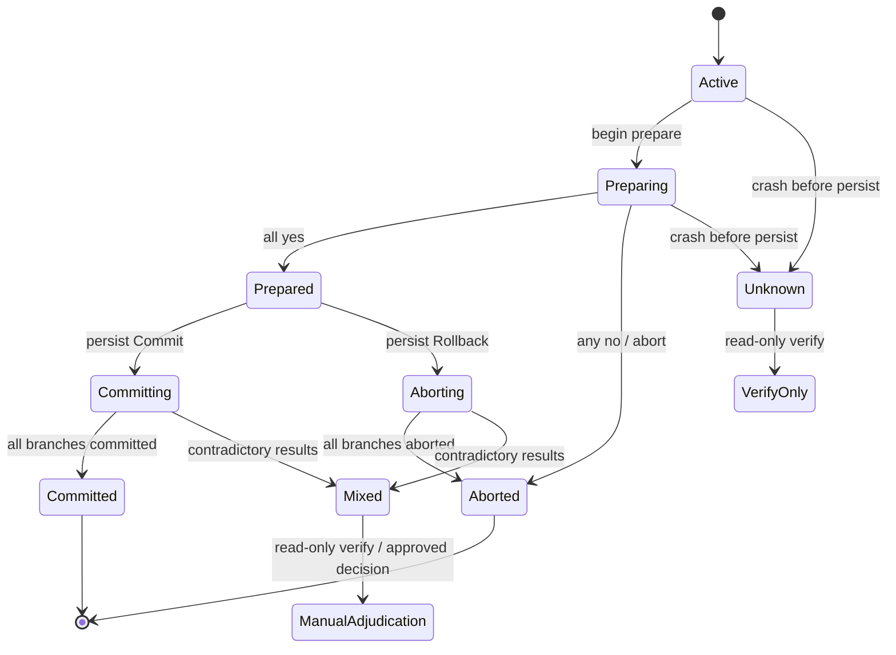
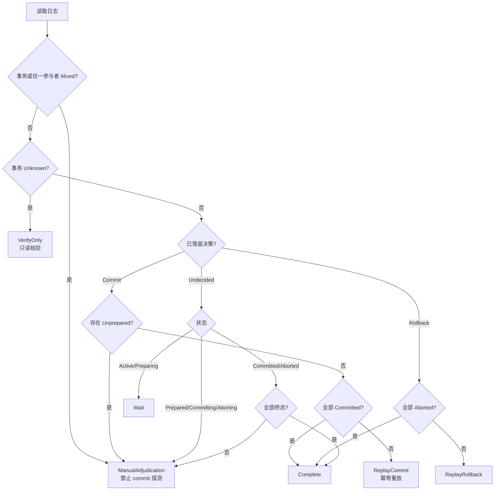

# Durable 2PC 协调日志与恢复模型（8.1）

日期：2026-11-02
状态：**模型冻结；持久化与故障注入未实现（8.2–8.7 仍开放）**

本文件冻结 durable two-phase commit 协调器的事务状态、参与者状态、日志键与恢复决策顺序。实现入口在 `druid_rdbc::governance::two_phase`，对应测试 `crates/druid-test/tests/two_phase_recovery_model_test.rs`。这是 Rust 扩展；Java Druid 只有 XA 分支操作，不能把 XA `recover` 当作本模型已持久化。

## 1. 状态机

## 2. 参与者状态

| 状态 | 含义 | 恢复处理 |
|---|---|---|
| `Unprepared` | 尚未收到 prepare 响应 | 只允许 rollback replay；commit 决策下出现即视为日志损坏 |
| `Prepared` | 已投票 yes | 按已落盘决策重放 |
| `Committed` | 已确认提交 | 跳过，不重复提交 |
| `Aborted` | 已确认回滚 | 跳过，不重复回滚 |
| `Unknown` | 网络/崩溃导致无法确认 | 不得视为未提交；只读核验或按已落盘决策重放 |
| `Mixed` | 观察到矛盾结果 | **禁止再次 commit 探测**，人工/批准策略裁决 |

## 3. 日志模型

| 字段 | 约束 |
|---|---|
| `schema_version` | 固定从 `1` 开始；恢复拒绝未知版本 |
| `transaction_id` | 持久化键固定为 `2pc:tx:{id}` |
| `state` | 见状态机 |
| `decision` | `Undecided` / `Commit` / `Rollback`，外部副作用前落盘 |
| `participants[]` | 每项含资源名与 `ParticipantState`；逐分支保存，禁止合并为单一布尔 |

## 4. 恢复决策顺序

## 5. 安全不变量

1. `Mixed` 永远不返回 `ReplayCommit`；`RecoveryAction::allows_commit_retry()` 仅对 `ReplayCommit` 为真。
2. `Unknown` 只返回 `VerifyOnly`，不得把网络错误当作未提交。
3. prepare 后、决策前崩溃必须返回 `ManualAdjudication`，不得猜测 commit/rollback。
4. 已落盘 commit 决策的重放是幂等操作，不等于再次 commit 探测。
5. 已完成分支必须跳过，不能重复提交或回滚。

## 6. 证据与未完成边界

- `two_phase_recovery_model_test`：8 passed，覆盖 Mixed 禁止探测、Unknown 只读、无决策裁决、commit/rollback 重放、终态与日志键。
- 严格 Clippy：`cargo clippy -p druid-rdbc -p druid-test --all-targets --all-features -- -D warnings -A clippy::pedantic` exit 0。
- 未实现：SQLite/WAL 持久化（8.2）、外部副作用前落盘边界（8.3）、恢复重放幂等键（8.4）、逐参与者结果核验（8.5）、故障注入（8.6）、文档示例（8.7）。模型冻结不代表 durable 2PC 已完成。
