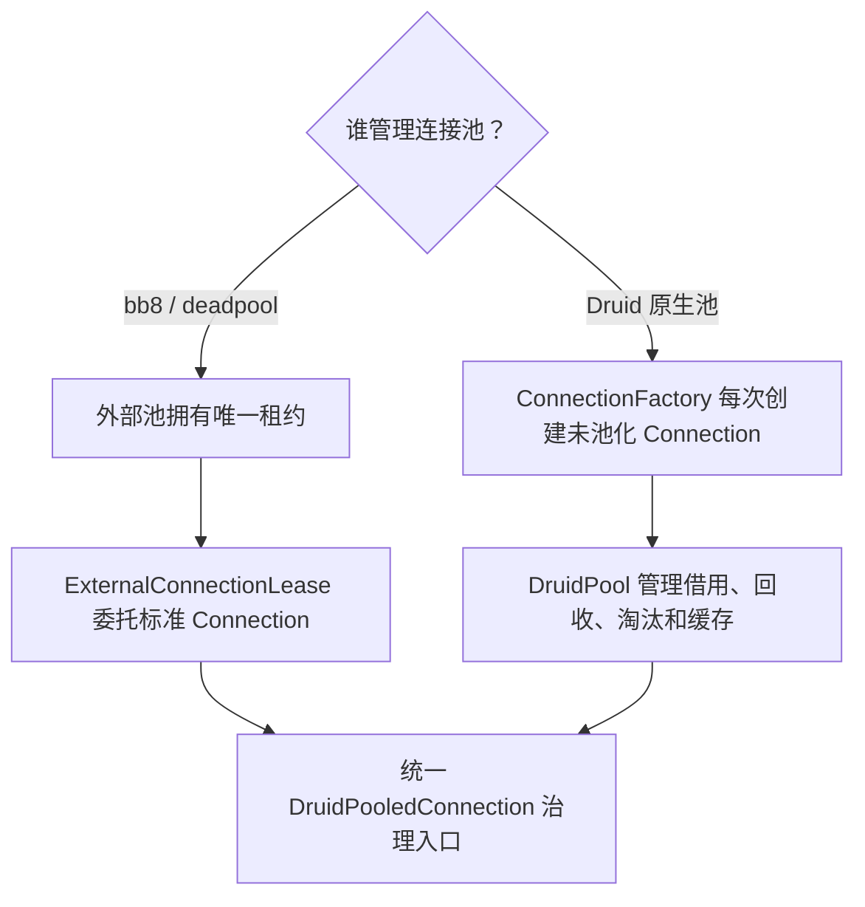

# RDBC 集成作者指南

本指南用于实现和验收 druid-rust 数据库适配器，沿用 [ADR-RDBC-006](../superpowers/specs/2026-08-24-rdbc-single-standard-trait-tree.md) 和 [标准合同 v1](standard-contract-v1.md)。当前版本是 `0.0.0-design`，尚未发布稳定 API。下面区分源码接线、共享合同与真实数据库认证；文档存在不表示 Task8 完成。

## 1. 先选择连接所有者



原生 factory 不获取已经池化的连接。当前 [SqlxConnectionFactory](../../crates/druid-wrapper/src/sqlx/sqlx_connection_factory.rs) 每次创建独立 SQLx 连接；[LibSqlConnectionFactory](../../crates/druid-wrapper/src/libsql/libsql_connection_factory.rs) 每次创建独立后端对象。factory 创建结果是 `Box<dyn druid_rdbc::connection::Connection>`。

外部池接入参考 [bb8](../../crates/druid-wrapper/src/sqlx/bb8/sqlx_bb8_pool.rs)、[deadpool](../../crates/druid-wrapper/src/sqlx/deadpool/sqlx_deadpool_pool.rs) 及 [ExternalConnectionLease](../../crates/druid/src/core/external_connection_lease.rs)。外部池负责归还租约，不把外部池桥接包装为 ConnectionFactory 再放入 DruidPool。

实现标准池化连接事件时，按 [池化连接事件与生命周期](pooled-connection-events.md) 注册并分发 Connection/Statement 事件。通知只表达生命周期事实：逻辑连接关闭通知发生在租约回收开始前，不能用它推断物理连接已完成重置或可再次借出。

原生池 builder 的真实接线入口为 [DruidPoolBuilder::factory](../../crates/druid/src/pool/config.rs)。池容量、初始化、validation、默认状态、prepared cache 与异常淘汰由 Druid 配置决定，adapter 不维护第二份池政策。

## 2. 实现唯一标准树

1. 在 Wrapper 的具体驱动目录实现 Connection 与 ConnectionFactory；类型和文件遵循项目命名、中文 doc 注释及 Java 来源规则，禁止生产 wildcard import、todo/unimplemented 和空实现充数。
2. Statement/PreparedStatement/CallableStatement 拥有 actor、executor 或原生 handle；返回对象不得借用创建它的 Connection。执行入口保持独占可变访问。
3. ResultSet 使用拥有型 Box 并保有必要的 actor/lease；异步 next 推进当前游标。不可变 metadata 使用拥有型 Arc snapshot；live DatabaseMetaData 继续拥有连接访问能力。
4. Wrapper 解包沿用标准视图与原 owner 生命周期；继承接口、Prepared/Callable 叶子与 get_statement 的真实共享逻辑身份都需要测试。
5. 同一实现可共享私有执行 core，但不得复制第二套 canonical SQL API，或通过公开具体产品类型逃避标准接口约束。

共享 adapter 实现可参考 [StandardAdapterPreparedStatement](../../crates/druid-wrapper/src/standard_adapter_prepared_statement.rs) 与 [StandardAdapterResultSet](../../crates/druid-wrapper/src/standard_adapter_result_set.rs)。参考实现的能力范围不是新驱动的默认认证；仍需核对 driver 的参数、事务、metadata 和错误语义。

## 3. 保留请求与返回值

| 场景 | 作者必须实现或明确拒绝的行为 |
| --- | --- |
| Prepared 参数 | 原 1-based 下标、NULL、typed value、stream/Reader 长度及资源身份；执行前 materialization 不改变请求语义 |
| 生成键 | mode、索引/名称及顺序完整传播；不支持的请求在创建 raw Statement 前拒绝，不降级为 None |
| 查询摘要 | 已缓冲结果保留真实 known_row_count，不消费游标；未知 streaming 结果为 None |
| 结果序列 | query/update count 与 current-result disposition 分开；无效整数不产生 driver/关闭/推进副作用 |
| metadata | NULL/empty/pattern 和三态 nullability 保留，不猜测未知类型或能力 |
| label getter | 保留原标签、解析次数和动态 driver override；不得重复读取或改变 Filter 顺序 |
| typed resource | Blob/Clob/NClob/Array/Ref/RowId/SQLXML/URL 分派到对应操作；保留可空值和共享身份 |
| SQL 错误 | SQLState、vendor、cause/next、warning、client-info、truncation 和 batch partial counts 保留 |

默认 UnsupportedOperation 与 SQL feature unsupported/0A000 是两种不同结果。不要把所有未实现行为统一返回一种错误，也不要把结构化驱动错误压缩为 message。

## 4. 资源与取消

对新驱动，正常 close/free、重复释放、释放后读取、driver 失败及 owner 失败分别验证。需要可控屏障测试两个取消窗口：驱动释放等待中，以及驱动已成功但 owner 通知未完成时。取消后共享 alias 必须能观察确定结果或继续完成受监管释放，不能永久等待 Releasing。

driver release 与 owner notification 各自恰好一次；简单把状态回退 Open 可能重复释放已成功的 driver。Druid release arbiter 留在私有治理层，不暴露为 RDBC 对产品的依赖。

资源 factory、SQLXML 状态、capability 和取消保护当前仍属于 Task7 剩余义务。接入代码不得把已有正常并发测试当作取消认证。参见 [Task7 预检](../verification/rdbc-first/task7-resource-cancellation-source-preflight-2026-10-08.md)。

## 5. 缓冲与 streaming

明确声明结果是在查询返回前全部缓冲，还是从后端按需读取。`Vec<Row>` 加 async next 是缓冲结果，不认证有界首行。真正 streaming 需要证明：首行在总结果读取完前可消费、缓冲容量有界、消费者背压有效、取消释放后端资源、连接/Statement close 不留下孤儿任务。

Stream 是唯一 ResultSet 的适配，不创建第二个标准 cursor。known_row_count 不得通过 drain 整个流计算；metadata snapshot 不得伪装成 live metadata。

SQLx 的 [缓冲结果集](../../crates/druid-wrapper/src/sqlx/sqlx_buffered_result_set.rs) 完整保存查询行；[异步前向结果集](../../crates/druid-wrapper/src/sqlx/sqlx_async_result_set.rs) 通过容量为 1 的请求队列按 `next()` 拉取。调用方应按实际查询路径判断消费和内存语义。

## 6. feature 与注册

按照当前 [Wrapper manifest](../../crates/druid-wrapper/Cargo.toml) 声明实际 feature。当前默认为 driver-catalog 与 sqlite；DuckDB、HTTP SQL、libSQL 和 JDBC Agent 有独立入口，managed-driver-install 启用驱动管理 CLI。

feature 名称存在不证明依赖隔离。当前 SQLx、RBDC、bb8、deadpool 仍为非 optional 依赖；真实隔离与 feature powerset 验证属于 P05。新驱动应同步 feature 声明、代码 cfg 和依赖 optional 边界，并用 no-default-features 与独立 feature 的真实依赖图证明未启用驱动不被引入。

canonical registry 目标为 `druid_rdbc::driver::DriverRegistry`。当前 DriverManager 与其他产品解析路径尚未全部统一；不要新增独立全局 registry 或同步 factory 内嵌 runtime block_on。注册变更沿用 [P05 计划](../superpowers/plans/2026-08-21-driver-registry-feature-boundaries.md)，不能用本指南另建规格。

## 7. 共享合同与真实数据库

现有 [standard_connection_contract](../../crates/druid-wrapper/tests/common/standard_connection_contract.rs) 对同一 acquire owner 验证真实 SQLite prepared 执行、metadata、幂等关闭、结构化错误/fatal discard、显式 close rollback，以及 dirty Drop 不泄漏事务状态。

该 helper 含 SQLite SQL 和内存库重建断言，是 SQLite 的共享合同，不是可直接对任意数据库调用的泛化证明。对 PostgreSQL/MySQL 等，保留相同可观察合同并实现正确数据库 fixture，不机械复制 SQLite 的“新连接看不到整张表”断言。

direct、原生池、bb8/deadpool 应执行同一适用合同；再覆盖 Prepared/Callable、生成键、live metadata、资源与 Filter/错误传播。独立 compile fixture 验证外部作者能实现标准、dyn dispatch、Send/lifetime 和元数据所有权。

下面是已存在目标的执行入口，不表示本指南编写时已重新运行或通过：

```powershell
cargo test -p druid-wrapper --test sqlx_bb8_pool_test --locked --offline
cargo test -p druid-wrapper --test sqlx_deadpool_pool_test --locked --offline
cargo test -p druid-wrapper --all-features --locked --offline
```

offline 仅在所需依赖已经缓存时适用。真实数据库测试必须记录 driver/数据库版本、配置 profile、工具链、源码 SHA、命令、exit code 和日志；缺少服务或凭据记 NOT_RUN/NOT_VERIFIED，不能通过 mock 或 SQLite 通过声明其他数据库支持。

## 8. 证据交付与最终验收

| 交付物 | 用途 |
| --- | --- |
| [adapter implementations](../verification/rdbc-first/rdbc-adapter-implementations.tsv) | 实际 adapter/factory、标准 trait、私有 core 和行为证据绑定 |
| [production consumers](../verification/rdbc-first/rdbc-production-consumers.tsv) | 实际调用点及迁移目标；planned 目标不等于实现完成 |
| [runtime traces](../verification/rdbc-first/rdbc-adapter-runtime-traces.tsv) | 唯一测试身份、factory/executor、运行阶段与真实 trace 绑定 |
| [JDBC semantic inventory](../verification/rdbc-first/jdbc42-semantic-inventory.tsv) | Java 来源、语义和能力证据；不得缩小原分母 |
| [验证状态](../verification/rdbc-first/status.md) | 命令终态、范围、失败及未验证项 |

trace 必须由实际标准 factory/driver 调用产生，覆盖指定阶段；不能在测试里手填计数冒充真实执行。compiler coverage 必须由当前源码编译生成，不能改 hash 使过期证据看起来有效。

完整质量门禁还包括 fmt/check/clippy/test/doc、all-features、MSRV1.95、依赖 DAG、public API/SemVer、Java 差分、真实数据库与性能。公开破坏性修正按 Task8 的精确 allowlist 验收；缺失工具先按项目规则取得安装授权。每项证据记录实际范围，局部通过不代替全仓或全部驱动认证。

作者完成实现后，对正式规格逐项交付 PROVED/CONTRADICTED/INCOMPLETE/NOT_VERIFIED；仍有缺失项时保留开放状态，不以测试文件、方法签名或 capability=true 作为完成证明。
