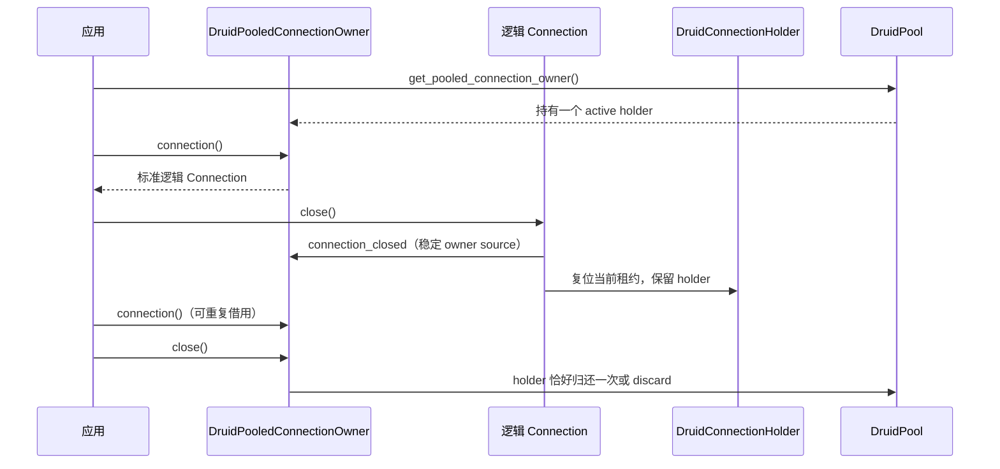
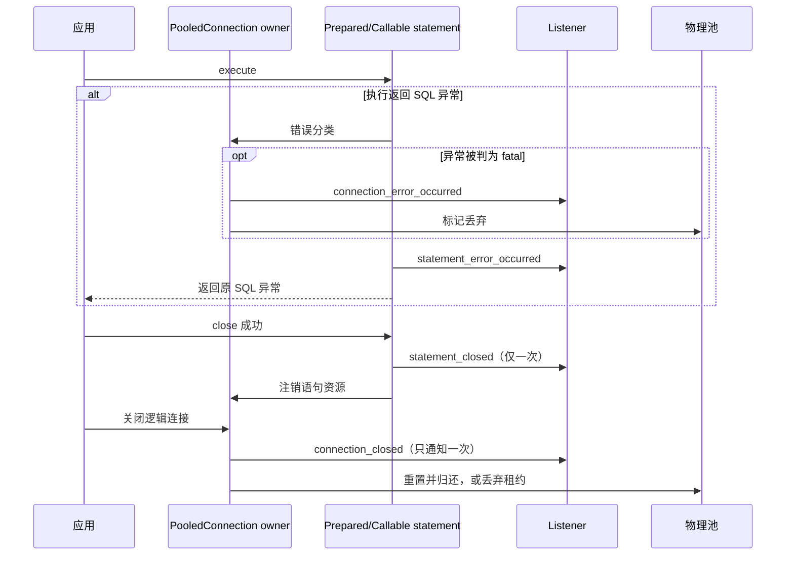

# 池化连接事件与生命周期

`druid-rdbc::data_source::PooledConnection` 是外部连接池的标准 owner 合同。池实现负责保存监听器，并在生命周期事件发生时通知；默认注册方法返回 SQLState `0A000`，所以不支持事件的旧实现可继续编译，但不能声称支持事件。Druid 原生池通过 holder 管理监听器，并在通知时使用固定快照。

## 订阅和分发

外部池可以使用 `PooledConnectionEventRegistry` 保存 listener。以下是池 owner 实现需要遵循的关键片段，省略具体连接获取和 owner 类型：

```rust
use druid_rdbc::data_source::{
    ConnectionEventListener, PooledConnectionEventRegistry, PooledConnectionSource,
    StatementEventListener, StatementSource,
};
use druid_rdbc::error::SqlException;
use std::sync::Arc;

struct PoolEvents {
    listeners: PooledConnectionEventRegistry,
}

impl PoolEvents {
    fn add_connection_listener(&self, listener: Arc<dyn ConnectionEventListener>) {
        self.listeners.add_connection_event_listener(listener);
    }

    fn remove_connection_listener(&self, listener: &Arc<dyn ConnectionEventListener>) -> bool {
        self.listeners.remove_connection_event_listener(listener)
    }

    fn add_statement_listener(&self, listener: Arc<dyn StatementEventListener>) {
        self.listeners.add_statement_event_listener(listener);
    }

    fn remove_statement_listener(&self, listener: &Arc<dyn StatementEventListener>) -> bool {
        self.listeners.remove_statement_event_listener(listener)
    }

    fn logical_connection_returned(&self, owner: PooledConnectionSource) -> usize {
        self.listeners.notify_connection_closed(owner)
    }

    fn connection_became_invalid(
        &self,
        owner: PooledConnectionSource,
        error: Arc<SqlException>,
    ) -> usize {
        self.listeners.notify_connection_error(owner, error)
    }

    fn prepared_statement_closed(
        &self,
        owner: PooledConnectionSource,
        statement: StatementSource,
    ) -> usize {
        self.listeners.notify_statement_closed(owner, statement)
    }

    fn prepared_statement_failed(
        &self,
        owner: PooledConnectionSource,
        statement: StatementSource,
        error: Arc<SqlException>,
    ) -> usize {
        self.listeners.notify_statement_error(owner, statement, error)
    }
}
```

`PooledConnection` 的四个 add/remove 方法应委托到同一 owner 的 listener registry。每个 notify 返回发生 panic 的 listener 数，池应将非零数写入受控诊断。不要在持有 owner、statement 或 pool 内部互斥锁时调用用户回调；先完成状态转换并复制通知所需句柄，再在锁外分发。监听器可能同步回调注册/移除方法。

## Druid 原生池 owner

现有 `DruidDataSource::get_connection()` 与 `DruidPool::get_connection()` 仍返回原有 `DruidPooledConnection`。需要 JDBC `PooledConnection` 生命周期的调用方使用新增的 `get_pooled_connection_owner()`，取得 `DruidPooledConnectionOwner`：owner 拥有池中的一个 holder，每次只发放一个逻辑 `Connection`；关闭逻辑连接通知 owner 并完成异步复位，holder 留在 owner 内供下一次借用；关闭 owner 时才通过原生池 callback 归还 holder，复位失败则丢弃。owner 关闭会让尚存的逻辑句柄立即报告 closed，且不会等待调用方先 drop 句柄。owner 的事件 source 在所有通知间保持同一 `Arc` 身份。



## 通知顺序和资源所有权



实现和适配器应保留这些边界：

- `statement_error_occurred` 只针对带 SQL 异常的 Prepared/Callable 执行失败。若分类结果为 fatal，先执行 fatal owner 处置，再发送语句错误事件；调用方仍收到原执行错误。
- `statement_closed` 在语句关闭成功后发送。重复关闭不重复发事件；语句关闭失败不会谎报关闭成功。逻辑关闭、缓存句柄处理和资源注销沿同一语句身份执行。
- `connection_closed` 表示逻辑连接正在归还，不代表物理连接已重置或可以再次借出。池必须继续执行状态复位和 validation，失败连接必须丢弃。
- 同一 listener `Arc` 重复注册会产生相同次数的通知；一次 remove 只移除一个注册项，随后通知少一次。未注册 listener 的 remove 返回 `false`。
- 每轮通知固定捕获 listener 快照，在锁外调用。回调中的注册变更从后续通知生效；一个可展开 panic 不阻止快照中的其他 listener 或必要清理。`panic=abort` 不可恢复。

## 验证入口

外部实现兼容性由 `crates/druid-rdbc/tests/standard_external_implementor_test.rs` 验证；注册次数、事件身份与重入由 `crates/druid-rdbc/tests/standard_event_contract_test.rs` 验证；Druid holder、PreparedStatement/CallableStatement 代理的通知与清理由 `crates/druid/tests/task6_druid_pooled_connection_differential_test_parity_part_02.rs` 和 `crates/druid/tests/callable_cache_lifecycle_test.rs` 验证。上述测试范围不替代真实驱动/真实池的数据库认证。
