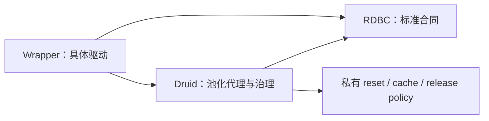

# RDBC 单一标准合同 v1

本文将 ADR-RDBC-006 的已批准要求整理为使用者与集成作者合同。它不是新的规格事实源，也不表示 v1 已发布或验收完成。当前 workspace 为 `0.0.0-design`、`publish=false`；Task6、Task7、Task8 仍开放。

事实源：[单一标准规格](../superpowers/specs/2026-08-24-rdbc-single-standard-trait-tree.md)、[五产品架构](../superpowers/specs/2026-08-21-rdbc-first-five-crate-architecture.md)。实施与验收见[统一计划](../superpowers/plans/2026-08-24-rdbc-single-standard-unification.md)及[当前证据状态](../verification/rdbc-first/status.md)。本文描述必须保持的合同；各适配器实际支持范围必须另外查验真实数据库证据。

## 1. 唯一接口与产品边界

`druid-rdbc` 是数据库 integrations 的唯一 JDBC-like 标准。驱动与 Druid 池化代理直接实现同一标准，不建立第二套 Physical、raw 或 logical 数据库接口。raw/logical 的差别属于所有权和关闭政策。

| 能力 | 责任边界 |
| --- | --- |
| Driver 接受 URL、命名、建连 | RDBC 标准 Driver；具体实现属于 Wrapper |
| ConnectionFactory、canonical DriverRegistry | RDBC 的 Rust 扩展 |
| Connection/Statement/PreparedStatement/CallableStatement/ResultSet | RDBC 唯一标准树 |
| 元数据、SQL 错误、资源操作和 Wrapper 标准视图 | RDBC |
| 产品 profile 编排、池槽、回收/丢弃政策 | Druid |
| validation query 选择、rollback/reset、prepared cache | Druid 私有实现，经标准方法调用驱动 |
| owner 通知与受监管释放 | Druid 私有治理；不得泄露为 RDBC 产品依赖 |

DriverManager 与多条 registry 路径的最终统一属于 P05。上述责任划分不能作为当前路径已全部收敛的证明。

DriverManager 的显式注册顺序是 Java 兼容层行为。获取连接时，候选协商委托
`druid-rdbc::driver::DriverRegistry::connect`：不接受 URL 的驱动跳过；接受 URL
但返回 `Ok(None)` 时继续尝试后续驱动；首个 `Some(connection)` 返回；驱动错误保留原错。
登录超时包围整个候选尝试过程。`get_driver` 仅查找首个声明接受 URL 的驱动，不建连。
这条协商语义已统一，但产品 profile、inventory 与显式注册的完整路径收敛仍需 P05 验证。

## 2. 对象所有权与异步执行

| 对象 | 合同 |
| --- | --- |
| Driver、ConnectionFactory、DriverRegistry | `Send + Sync + 'static` |
| Connection | `Send + 'static`；可变操作独占访问，不强制 `Sync` |
| Statement、PreparedStatement、CallableStatement | `Send + 'static`；拥有 executor/actor/native handle，不借用创建它的 Connection |
| ResultSet | `Send + 'static`；查询返回 `Box<dyn ResultSet>`，`next(&mut self)` 异步推进 |
| DatabaseMetaData | live runtime、`Send + 'static`；返回的行集拥有 actor/lease |
| ResultSetMetaData、ParameterMetaData | 不可变拥有型快照、`Send + Sync + 'static`；通过 `Arc` 返回 |
| 可变资源 | `Send + 'static`；只读 view 的 `Sync` 要求单独声明 |

运行时接口必须 dyn-compatible，异步方法采用统一 Send future 映射。返回对象不得携带创建 Connection 的局部可变借用。共享元数据不等于共享可变游标，不使用 `Arc<dyn ResultSet>` 配合独占推进。

池化 Statement 保留真实逻辑租约和底层标准 Statement。关闭及级联清理必须服从原 owner 政策；不能把租约归还与物理连接销毁混同，也不能在外部池上再次嵌套原生池。

## 3. 参数、NULL 与读取语义

- 列、参数和资源位置采用 1-based 合同。`ColumnIndex::new` 拒绝零；有符号转换还拒绝负值及平台整数溢出。列数/资源长度范围由实际操作校验。
- SQL NULL 的值层表示为 `Value::Null`；可空对象以 `Option<T>` 表达。primitive getter 必须维护 `was_null`，不能把 NULL 与普通零值的观察语义混合。
- 列下标与原列名重载必须保留对应身份及参数。默认列名解析与驱动原生覆盖的行为边界按既有合同保留，不能为简化 Filter 增加重复原生读取。
- Decimal scale、Calendar、type map、stream length 的未指定、显式值和可空值保持区分。强类型资源 getter 保留句柄身份及共享流/Reader 状态，不能扁平化成标量或复制内容冒充同一资源。
- 成功 getString 的统计与泛型 getObject/value 读取分开；UTF-16 长度、NULL、类型错误、关闭及旧租约错误按 Druid 既有政策处理。

完整对象分母为 Java 8 `java.sql` 52 个加 `javax.sql` 17 个对象；这不要求恰好创建 69 个 Rust 类型。语义总账及逐方法映射见 [JDBC inventory](../verification/rdbc-first/jdbc42-semantic-inventory.tsv) 和 [Task6 方法账本](../verification/rdbc-first/task6-method-migration.tsv)。

## 4. 执行、生成键与结果序列

查询返回拥有型 ResultSet；更新返回 update count。`known_row_count() -> Option<u64>` 只报告已经知道的完整查询行数，不能请求数据库、读取后续行或移动游标，也不能作为 update count。未知流式结果默认返回 `None`，关闭后返回 `None`；缓冲实现应保留真实缓冲长度。

生成键准备请求必须完整传递 `GeneratedKeys` 的模式、列内容及顺序。未实现的非 None 请求必须在创建 raw Statement 前明确拒绝，不能降级为 None。Druid 缓存键同时区分生成键请求与结果集选项；普通准备与显式 None 可以复用同一条目。

已有 Toasty SQLite prepared 列索引/列名行为返回 SQLite 单 rowid 键，不承诺任意多列投影。普通 Statement 的列选择执行重载和其他驱动必须各自按合同验收，不能扩大该特例的支持范围。

`get_more_results_current(i32)` 仅接受 JDBC 的 1/2/3 处置，其他整数返回参数错误且不推进序列、不关闭游标。无参数默认处置不等于整数零。对 Druid 关闭或失效租约，关闭门禁优先，不能让参数错误遮蔽 `ConnectionDiscarded`。

## 5. 元数据与 Wrapper

live DatabaseMetaData 查询结果继续保有必要的连接 actor/lease；不可变列/参数快照不借用可变连接。NULL、空字符串、搜索 pattern 以及未知 metadata 不能互相替换。

`Wrapper` 仅提供同一标准树的视图。`unwrap_mut` 返回原对象的独占标准视图，保留叶子与继承接口身份；不得借助产品具体类型、Any 或第二套驱动执行接口实现公共解包。空目标为参数错误，未知标准目标为 SQL feature 不支持。独占视图不可重叠或越过 owner 生命周期。

`ResultSet::get_statement` 返回拥有型创建语句句柄；Druid 必须保留真实共享逻辑状态及 Prepared/Callable 叶子能力。SQL/id 描述符不能替代创建对象身份。可变解包本身不能证明 owner 保活或关闭协议成立。

## 6. 错误分层

| 场景 | 必须保留的结果 |
| --- | --- |
| SQL feature 不支持 | SQLFeatureNotSupportedException taxonomy 与 SQLState `0A000` |
| Java 默认 UnsupportedOperationException | 独立 typed `UnsupportedOperation`，不能统一改写为 SQL feature 错误 |
| 驱动 SQL 错误 | SQLState、vendor code、cause/source、next exception 及类型信息 |
| warning、client-info、DataTruncation | 对应结构化 payload，不压缩为普通字符串 |
| batch 部分失败 | 64-bit counts 与 partial failure；Java int cast view 和 Rust checked view 分开 |
| Pool/Wall 政策错误 | 由 Druid 治理层分类，不侵入独立 RDBC 合同 |

成功/失败、关闭和过期租约的优先顺序属于可观察合同。不能以笼统 `is_err` 替代特定错误断言，也不能以 UnsupportedOperation 清空已存在的具体驱动能力。

## 7. 资源、能力与流式验收边界

资源 free/close 必须幂等，释放后访问必须明确拒绝；SQLXML 状态、1-based 资源位置与实际 operation/factory 接线必须在共享合同中证明。驱动释放和 Druid owner 通知各自恰好一次。调用者取消不能造成重复释放、永久 Releasing/Closing 或遗失通知；驱动失败、owner 失败、重试及 supervisor drain 分别验证。

capability=true 必须有该 adapter 的实际行为证据。默认 false、方法存在或另一个数据库通过均不能认证支持。测试凭据缺失记录 NOT_RUN/NOT_VERIFIED，不生成能力通过声明。

缓冲行集和真实 streaming 必须明确分型。保存 `Vec<Row>` 的游标即使采用 async next，也不能作为真实有界首行读取证明。Stream 适配沿用唯一 ResultSet 标准，需要首行、背压、取消和驱动生命周期证据。

**当前边界：**上述资源取消、capability 与 streaming 要求属于 Task7 八项剩余义务。本文没有将当前实现标记为满足这些要求。

## 8. 完成证据与兼容性

`0.0.0-design` 阶段允许经批准的预发布破坏性修正；仍必须具备原基线、精确 breaking allowlist、真实 public API/SemVer 输出、external implementor 及迁移证据。[迁移映射](physical-to-standard-migration.md) 中 TASK7_PENDING 目标不能作为已存在实现。

旧 `druid::core::lookup_driver_extension` 与 Wrapper `init_driver_extensions` inventory 入口已退出。产品建池应通过 `DruidDriverRegistry::resolve` 或 `DruidDatabasePoolBuilder`；Java 风格的进程内显式驱动注册继续通过 `DriverManager`。该入口删除属于预发布 API 变化，必须计入 SemVer 报告及迁移验收。

最终验收必须同时具备：单一标准和 zero Physical 公共名、配置 adapter 的直接实现、Druid holder/代理合同、回收/关闭唯一性、69 对象语义分母、错误 waiver、共享 conformance、API/SemVer、Java 差分与真实数据库、fmt/check/clippy/test/doc、all-features、MSRV 和依赖 DAG。每项结论采用 PROVED/CONTRADICTED/INCOMPLETE/NOT_VERIFIED 并链接真实证据。

当前 C1/C2 完整通过记录只证明其冻结范围；全 features 回归仍失败，不能据此声明标准整体完成。最新范围和未完成项以验证状态与机器终态为准。
