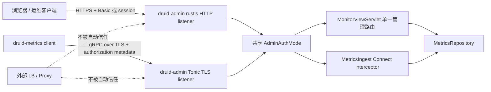

# druid-admin 威胁模型与安全部署边界

## 1. 范围与安全结论

`druid-admin` 同时暴露 HTTP 管理界面和唯一 `druid_metrics.v1` gRPC ingest。
两个 listener 默认分别绑定 `127.0.0.1:8080` 与 `127.0.0.1:9090`。只要任一
listener 的 IP 不是 loopback，启动配置就必须同时提供应用内 TLS 证书链/私钥和
`basic` 认证；缺少任一项会在 bind 前失败。

loopback 只减少网络暴露，**不提供同一主机跨用户隔离**。能以本机用户身份访问
loopback、读取进程环境、调试进程或读取 secret 文件的攻击者仍在信任边界内。远程
部署必须使用本进程实际终止的 TLS 与应用层认证，不能仅因为外部 proxy 宣称已终止
TLS 就把本进程的明文 remote listener 当成安全 listener。当前实现不信任
`Forwarded`/`X-Forwarded-*`，也没有“受信 proxy 可替代应用内 TLS”的配置模式。

## 2. 数据流和终止位置

- HTTP TLS 在 `druid-admin` 的 rustls listener 终止。
- gRPC TLS 在同一进程的 Tonic server 终止。
- 两端读取同一份 PEM 证书链和私钥材料；不会自动生成证书或 secret。
- gRPC interceptor 在调用 `MetricsIngest::connect` 前验证标准
  `authorization` metadata。`ClientHello` 的 service/instance/boot/epoch 只用于协议
  身份与序列校验，绝不是认证凭据。

## 3. 资产、威胁者、入口与控制

| 资产 | 威胁者 / 能力 | 入口 | 主要风险 | 控制 | 验证证据 |
| :--- | :--- | :--- | :--- | :--- | :--- |
| datasource、SQL fingerprint、Wall 与运行指标 | 未认证远程客户端 | 管理 HTML/JSON、`/metrics` | 监控信息披露、服务枚举 | remote TLS + Basic/session；默认 deny；未认证 302 到 login | `admin_binary_test::remote_http_and_grpc_use_tls_and_require_authentication`、`servlet_test::auth_metrics_requires_login` |
| ingest repository 与 sequence/ACK 真值 | 伪造 metrics client | gRPC `Connect` | 注入伪造统计、推动 ACK、触发运维命令 | TLS；gRPC authorization interceptor；之后再校验 Hello/每帧 identity 与 protocol | binary TLS/auth 测试的 missing/invalid/valid metadata；`grpc_network_e2e_test` |
| 管理用户名、密码、session cookie | 日志读取者、错误观察者、同主机用户 | env、login form、Authorization/Cookie | secret 泄露、session 劫持 | password/auth/TLS material 自定义 Debug 脱敏；错误不回显值；TraceLayer 不记录 body/header；cookie `Secure; HttpOnly; SameSite=Lax` | `monitor_properties_debug_redacts_password`、strict Clippy 与安全自审 |
| TLS 私钥 | 文件系统读取者、镜像读取者 | PEM 私钥文件 | listener 身份冒用 | 外部 secret provisioning；启动时只读取，不生成；要求最小文件权限和独立挂载 | invalid PEM 启动失败测试；部署权限检查属于环境门禁 |
| 可用性与 bounded command migration | 恶意/异常服务端、慢 consumer | bidi response stream | teardown 背压丢命令、任务卡死 | W channel + 2W validated-command migration cap；并发 drain/reader EOF；溢出 fail-closed | `validated_w_plus_one_commands_survive_teardown_backpressure_and_live_traffic_resumes` |

## 4. Public / protected route 矩阵

| 路由 | Public | 未认证契约 | 说明 |
| :--- | :---: | :--- | :--- |
| `GET /health` | 是 | `200` JSON | 仅进程存活，不返回 repository 内容 |
| `GET {context}/login.html` | 是 | `200` | 登录页 |
| `POST {context}/submitLogin` | 是 | `200 success/error` | 成功时创建 server-side session；不在 URL 传密码 |
| `{context}/css/*`、`{context}/js/*`、`nopermit.html` | 是 | `200/404` | 登录所需静态资源 |
| 管理 HTML、Java 兼容 JSON、Rust REST aliases | 否 | `302 Location: {context}/login.html` | Basic 或有效 session 才放行 |
| `GET /metrics` | 否 | `302` | Prometheus 输出包含运行与 repository 指标 |
| gRPC `Connect` | 否（remote） | gRPC `UNAUTHENTICATED` | loopback 且 auth disabled 时允许；remote 配置不允许 disabled |

URL query 中的 `loginUsername/loginPassword` 不再构成认证旁路，因为 URL 常被 access
log、浏览器历史和 proxy 记录。HTTP Basic header 与现有 login/session 共享同一组凭据。

## 5. 配置与 secret 假设

| 环境变量 | 作用 | 默认 / 约束 |
| :--- | :--- | :--- |
| `DRUID_ADMIN_HTTP_ADDR` | HTTP bind | `127.0.0.1:8080` |
| `DRUID_ADMIN_GRPC_ADDR` | gRPC bind | `127.0.0.1:9090` |
| `DRUID_ADMIN_TLS_CERT_PATH` | PEM 证书链 | 与 key 成对；remote 必填 |
| `DRUID_ADMIN_TLS_KEY_PATH` | PEM 私钥 | 与 cert 成对；remote 必填 |
| `DRUID_ADMIN_AUTH_MODE` | `disabled` / `basic` | 未设置为 disabled；remote 禁止 disabled |
| `DRUID_ADMIN_LOGIN_USERNAME` | Basic/login 用户名 | basic 必填且非空 |
| `DRUID_ADMIN_LOGIN_PASSWORD` | Basic/login 密码 | basic 必填且非空；不得打印或写入 metrics |

生产环境应由 secret manager 或只读 volume provision PEM 与凭据。私钥文件应由运行用户
独占读取（Unix 推荐 `0600` 文件、`0700` 父目录）；证书可读权限按部署需要收紧。环境
变量可能被同用户进程、崩溃采集或运维平台读取，因此平台必须限制进程检查、日志导出和
secret 展示权限。测试目录中的证书/私钥只用于本地回归，不能部署。

## 6. CSRF、session 与浏览器边界

现有 Java 兼容 login 使用 server-side session cookie，并保留 `SameSite=Lax` 边界；本
任务没有发明新的 token、OIDC 或 CSRF 协议。remote TLS 模式的 cookie 设置 `Secure`，
loopback 明文兼容模式省略 `Secure` 以免浏览器永远不发送；两者都设置 `HttpOnly`、
`SameSite=Lax` 和最小 `Path=/`。当前受保护管理接口以读取为主，`submitLogin` 是 cookie 建立动作；若后续
加入使用 cookie 的状态修改 POST/PUT/DELETE，必须在该变更中加入同步 CSRF token 或等价
防护，不能只依赖 SameSite。GET/HEAD 不得执行状态修改。

## 7. 剩余风险与运维门禁

- loopback 仍允许同主机其他用户在主机访问控制不足时探测服务。
- Basic 凭据必须通过 TLS；本进程不负责密码轮换、锁定、MFA 或集中 IdP。
- certificate expiry、轮换和 reload 由部署系统管理；当前变更要求重启加载新材料。
- 外部 proxy 模式没有显式 trust configuration，因此不能关闭应用内 remote TLS/auth。
- repository TTL、容量与 service churn 上限仍按既有 P06 ruling 处理；本任务没有扩展该范围。
- 发布前应继续运行 cargo-deny/audit 和实际部署文件权限、证书链、DNS/SAN、轮换演练。
