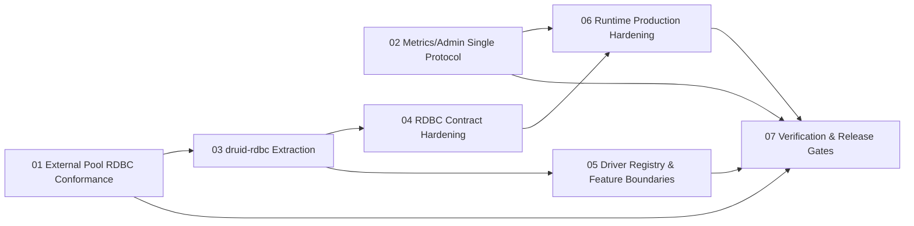
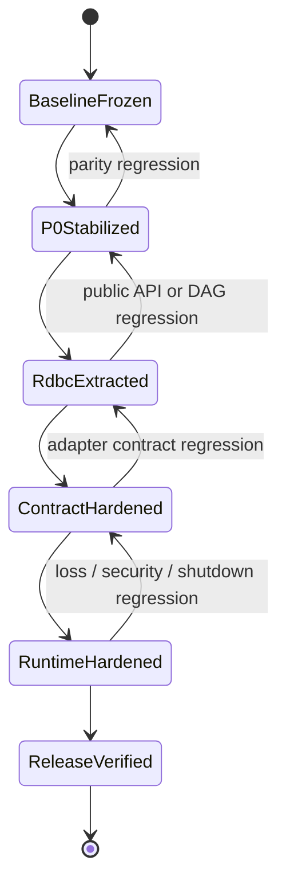

# RDBC-First Five-Crate Master Implementation Plan

> **For agentic workers:** REQUIRED SUB-SKILL: Use superpowers:subagent-driven-development (recommended) or superpowers:executing-plans to implement this plan task-by-task. Steps use checkbox (`- [ ]`) syntax for tracking.

**Goal:** 将当前 workspace 演进为 `druid-rdbc + druid + druid-wrapper + druid-metrics + druid-admin` 五产品 Crate，并以 `druid-bench` 统一承载合同、差分和性能验证。

**Architecture:** 先修复会污染迁移基线的 P0 行为缺陷，再无行为抽取 `druid-rdbc`，随后强化错误、能力、异步游标、driver registry、feature 和运行时门禁。`druid` 保留核心产品身份和 `druid::sql::*` canonical 路径，不再执行已回滚的 `druid-core + facade` 拆分。

**Tech Stack:** Rust 2021、Cargo workspace、Tokio、Tonic/Prost、SQLx、Toasty、RBDC、bb8、deadpool、CodeGraph、cargo-public-api、cargo-semver-checks、Criterion

**Spec:** `docs/superpowers/specs/2026-08-21-rdbc-first-five-crate-architecture.md`

## Global Constraints

- Java 基线固定为 Druid `1.2.28` / `33824c3dec1612711f9bb4e409319bcab2e4cd0e`。
- Rust MSRV 固定 `1.95`，默认工具链固定 `1.97.1`，Edition 固定 `2021`。
- `unsafe_code = "forbid"`；生产代码禁止 wildcard import、`todo!()`、`unimplemented!()`。
- 每个 Java 类/接口/枚举/record 对应一个 `.rs` 文件；`mod.rs` 只声明和重导出。
- 保留用户未提交修改；严禁 Git worktree、自动切换分支、reset 或重写历史。
- `druid::sql::*`、Pool、Filter、Wall、连接回收和 exactly-once resource 语义必须保持。
- 迁移期间所有 package `publish = false`。
- 未取得实际测试、真实网络或真实数据库证据时不得标记 DONE。

---

## 1. 计划依赖图



P01 与 P02 可并行；P03 必须在 external pool 合同修复后开始，避免把已知不等价
行为搬入新 crate。P07 只汇总新鲜证据，不新增生产功能。

## 2. 子计划清单

| 顺序 | 计划 | 独立交付物 | 进入条件 | 退出条件 |
| :---: | :--- | :--- | :--- | :--- |
| 01 | [External Pool RDBC Conformance](2026-08-21-external-pool-rdbc-conformance.md) | bb8/deadpool 与 direct SQLx 能力等价 | 当前 default suite 可运行 | 同一 conformance suite 全通过 |
| 02 | [Metrics/Admin Single Protocol](2026-08-21-metrics-admin-single-protocol.md) | 唯一 proto、真实 payload、真实 gRPC、secure default | 当前两个 proto 已冻结为失败证据 | 双进程网络 E2E 通过 |
| 03 | [druid-rdbc Extraction](2026-08-21-druid-rdbc-extraction.md) | 新低层 crate 与兼容重导出 | P01 完成；API baseline 已捕获 | DAG、外部消费者和 workspace 门禁通过 |
| 04 | [RDBC Contract Hardening](2026-08-21-rdbc-contract-hardening.md) | 分层错误、能力、cancellation-safe resource、async cursor | P03 完成 | direct/external adapter 新合同通过 |
| 05 | [Driver Registry and Feature Boundaries](2026-08-21-driver-registry-feature-boundaries.md) | 单一 registry、真实 optional features | P03 完成 | feature powerset 与 forbidden deps 通过 |
| 06 | [Runtime Production Hardening](2026-08-21-runtime-production-hardening.md) | 有界队列、supervisor、shutdown、TTL、认证 | P02 完成；P04 稳定 | 故障、过载、安全门禁通过 |
| 07 | [Verification and Release Readiness](2026-08-21-rdbc-first-verification.md) | 最终依赖、API、语义、NFR、发布报告 | P01-P06 完成 | 规格第 10 节全部有证据 |

## 3. 全局状态机



## 4. 主路线任务

### Task 1: 冻结执行基线并建立统一状态目录

**Files:**
- Create: `docs/verification/rdbc-first/baseline.md`
- Create: `docs/verification/rdbc-first/status.md`
- Modify: `docs/superpowers/README.md`

**Interfaces:**
- Produces: `BASELINE_SHA`、Cargo package 集合、public API hash、CodeGraph 统计、计划状态矩阵

- [ ] **Step 1: 记录只读基线**

Run:

```bash
git status --short --branch
git rev-parse HEAD
cargo metadata --format-version 1 --no-deps \
  | jq -r '.packages[].name' | sort
codegraph status
```

Expected: 记录实际 SHA；package 为 `druid`、`druid-admin`、`druid-bench`、
`druid-metrics`、`druid-wrapper`；CodeGraph 状态为 up to date。

- [ ] **Step 2: 捕获测试与 API 基线**

Run:

```bash
cargo test --workspace
cargo public-api -p druid -sss --all-features \
  > api/druid-public-api.rdbc-first.before.txt
shasum -a 256 api/druid-public-api.rdbc-first.before.txt
```

Expected: default workspace suite PASS；API 文件非空并记录 SHA-256。若测试失败，
先记录 pre-existing failure，不得进入结构迁移。

- [ ] **Step 3: 写状态矩阵**

Create `docs/verification/rdbc-first/status.md` with exact rows:

```markdown
| Plan | Status | Evidence |
| :--- | :--- | :--- |
| external-pool-rdbc-conformance | NOT_STARTED | -- |
| metrics-admin-single-protocol | NOT_STARTED | -- |
| druid-rdbc-extraction | BLOCKED_BY_P01 | -- |
| rdbc-contract-hardening | BLOCKED_BY_P03 | -- |
| driver-registry-feature-boundaries | BLOCKED_BY_P03 | -- |
| runtime-production-hardening | BLOCKED_BY_P02_P04 | -- |
| rdbc-first-verification | BLOCKED_BY_P01_P06 | -- |
```

- [ ] **Step 4: 验证文档链接**

Run:

```bash
python3 - <<'PY'
from pathlib import Path
for p in Path('docs/superpowers').rglob('*.md'):
    text = p.read_text()
    assert ('T' + 'BD') not in text, p
print('superpowers docs scanned')
PY
```

Expected: `superpowers docs scanned`。

- [ ] **Step 5: Commit**

```bash
git add docs/verification/rdbc-first docs/superpowers/README.md \
  api/druid-public-api.rdbc-first.before.txt
git commit -m "docs(architecture): freeze rdbc-first execution baseline"
```

### Task 2: 执行 P0 双路线

**Files:**
- Execute: `docs/superpowers/plans/2026-08-21-external-pool-rdbc-conformance.md`
- Execute: `docs/superpowers/plans/2026-08-21-metrics-admin-single-protocol.md`
- Modify: `docs/verification/rdbc-first/status.md`

**Interfaces:**
- Consumes: baseline SHA/API snapshot
- Produces: `P01_COMPLETE`、`P02_COMPLETE`

- [ ] **Step 1: 执行 P01**

Run every checkbox in the P01 plan. Expected: direct SQLx、bb8、deadpool 使用同一
contract suite，prepared/metadata/LOB/close 均通过。

- [ ] **Step 2: 执行 P02**

Run every checkbox in the P02 plan. Expected: repo 只剩一份 Metrics proto，真实网络
E2E 证明 payload、ACK、resend、reset、full snapshot 和安全默认值。

- [ ] **Step 3: 更新状态**

Only after both reports contain fresh commands and exit codes, change the two rows to
`COMPLETE` and unblock P03/P06. Do not infer completion from files existing.

- [ ] **Step 4: Commit**

```bash
git add docs/verification/rdbc-first/status.md
git commit -m "docs(verification): record rdbc-first p0 evidence"
```

### Task 3: 抽取并强化 RDBC 合同

**Files:**
- Execute: `docs/superpowers/plans/2026-08-21-druid-rdbc-extraction.md`
- Execute: `docs/superpowers/plans/2026-08-21-rdbc-contract-hardening.md`
- Execute: `docs/superpowers/plans/2026-08-21-driver-registry-feature-boundaries.md`
- Modify: `docs/verification/rdbc-first/status.md`

**Interfaces:**
- Consumes: P01 conformance seam、old/new public API baseline
- Produces: `druid-rdbc` package、`RdbcError`、capability contracts、async cursor、single registry

- [ ] **Step 1: 执行无行为抽取计划**

Expected: `druid-rdbc` 不含 forbidden dependencies，`druid::sql::*` 外部消费者仍编译，
default/all-features suite 不因目录移动改变行为。

- [ ] **Step 2: 执行合同强化计划**

Expected: unsupported 统一 `0A000`；resource cancellation test、async cursor SQLite
integration 和 buffered-row-set compatibility tests 全部通过。

- [ ] **Step 3: 执行 registry/feature 计划**

Expected: 产品建池只有一条 canonical registry path；no-default-features 不拉取未启用
driver；所有 feature powerset 能编译。

- [ ] **Step 4: 更新状态并 Commit**

```bash
git add docs/verification/rdbc-first/status.md
git commit -m "docs(verification): record rdbc contract convergence"
```

### Task 4: 生产化运行时

**Files:**
- Execute: `docs/superpowers/plans/2026-08-21-runtime-production-hardening.md`
- Modify: `docs/verification/rdbc-first/status.md`

**Interfaces:**
- Consumes: single Metrics protocol、cancellation-safe resources、stable capability model
- Produces: bounded queues、supervisor、deterministic shutdown、repository TTL、TLS/auth policy

- [ ] **Step 1: 执行 runtime hardening 计划**

Expected: saturation、slow close、cancel、shutdown timeout、service churn、unauthenticated
request tests 具备可重复结果。

- [ ] **Step 2: 更新状态并 Commit**

```bash
git add docs/verification/rdbc-first/status.md
git commit -m "docs(verification): record production runtime gates"
```

### Task 5: 最终验证与规格同步

**Files:**
- Execute: `docs/superpowers/plans/2026-08-21-rdbc-first-verification.md`
- Modify: `docs/druid-rust-Architecture.zh_CN.md`
- Modify: `README.md`
- Modify: `README.zh-CN.md`
- Modify: `docs/superpowers/README.md`
- Modify: `docs/verification/rdbc-first/status.md`

**Interfaces:**
- Consumes: P01-P06 evidence
- Produces: release readiness verdict and remaining gates

- [ ] **Step 1: 运行最终验证计划全部门禁**

Expected: each requirement in the architecture spec §10 links to a command output or report;
missing real-database/remote evidence remains `NOT_VERIFIED`, never silently PASS.

- [ ] **Step 2: 同步所有当前态文档**

Run:

```bash
rg -n 'ADR-CRATE-001|druid-core.*facade|当前源码仍为三' \
  README.md README.zh-CN.md docs
```

Expected: matches only inside explicitly marked historical/superseded sections and old plan
records. Current sections name `ADR-CRATE-002` and the RDBC-first topology.

- [ ] **Step 3: Commit**

```bash
git add README.md README.zh-CN.md docs api scripts Cargo.toml crates
git diff --cached --check
git commit -m "docs(architecture): complete rdbc-first verification record"
```

## 5. 停止条件与回滚点

- P01 未通过时，不开始移动 `PhysicalConnectionLease` 或 RDBC SPI 文件。
- P02 未通过时，不删除 Admin 旧 proto；先保持失败证据和兼容测试。
- public API external consumer 失败时，只允许增加薄重导出，不复制实现。
- 任一 adapter 合同出现行为差异时，回退当前阶段的结构移动，不回退已验证 P0 修复。
- 真实数据库证据缺失不阻塞结构开发，但阻塞 support status 和发布完成声明。

## 6. 规格覆盖矩阵

| 已批准要求/审查结论 | 执行计划 | 最终证据 |
| :--- | :--- | :--- |
| external bb8/deadpool Prepared/Metadata/LOB 等价 | P01 | external-pool-conformance report |
| Metrics/Admin 单一 proto、真实 payload、ACK/resend/reset/full snapshot | P02 | grpc network E2E + runtime security report |
| Admin loopback/TLS/auth 和管理信息脱敏 | P02 + P06 | security E2E + threat model |
| `druid-rdbc` 独立合同和 `druid::sql::*` 兼容 | P03 | DAG + external consumer + public API snapshot |
| RDBC/Pool/Wall 错误分层与 0A000 | P04 | error contract + sorter regression |
| capability 声明可执行、direct/external 同合同 | P01 + P04 | adapter matrix |
| cancellation-safe resource lifecycle | P04 | cancellation/owner failure tests |
| async cursor 与 buffered row set 显式分型 | P04 | cursor test + ResultSet compatibility + benchmark |
| 三套 registry 收敛、无 runtime block_on | P05 | resolution/reentrancy tests |
| feature 真正隔离依赖、package ownership/publish/CI 修复 | P05 | feature powerset + ownership scripts |
| Pool/Metrics 有界队列和受监管 task | P06 | saturation/supervisor/shutdown tests |
| Admin repository TTL/cap/service churn | P06 | repository capacity test |
| Java parity、真实数据库、NFR、supply chain 和发布 verdict | P07 | final semantic/release reports |

Self-review conclusion: architecture spec §§3-10 each maps to at least one independently executable
plan and one named verification artifact. No requirement is delegated only to the final report.
