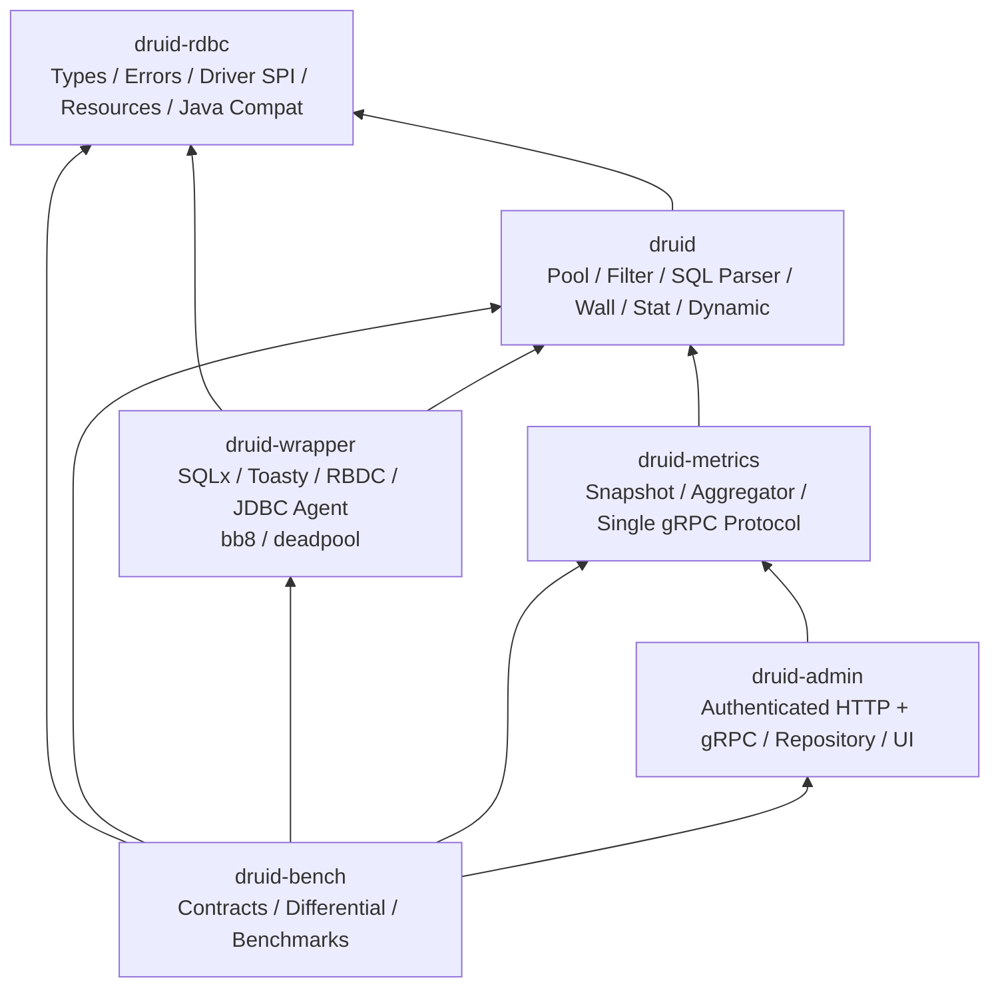

# RDBC-First 五产品 Crate 架构规格

> **状态：ACCEPTED**
>
> **批准日期：2026-08-21**
>
> **决策编号：ADR-CRATE-002**
> **取代：ADR-CRATE-001（`druid-core + druid facade` 目标）**

## 1. 目标

在不丢失 Alibaba Druid 1.2.28 可观察语义的前提下，把当前分散于
`druid::sql`、`druid::core::Physical*` 和 `druid::spi::Rdbc*Access` 的统一
数据库合同收敛为独立 `druid-rdbc` crate，并保留 `druid` 作为池化、Filter、
SQL Parser、Wall、Stat 和 Dynamic 的核心产品 crate。

本规格只定义目标、职责、不变量和验收标准；实现必须按
[`2026-08-21-rdbc-first-master-roadmap.md`](../plans/2026-08-21-rdbc-first-master-roadmap.md)
及其子计划执行。

## 2. 冻结基线

| 项目 | 冻结值 |
| :--- | :--- |
| Java 语义基线 | Alibaba Druid `1.2.28` |
| Java commit | `33824c3dec1612711f9bb4e409319bcab2e4cd0e` |
| 本次 Rust 审计基线 | `8e97a5e7e9b86be53583a7e01f8228d059cb9dde` |
| Rust MSRV | `1.95` |
| 默认工具链 | `1.97.1` |
| Edition / resolver | `2021` / `2` |
| unsafe policy | `forbid` |
| 当前产品 crate | `druid`、`druid-wrapper`、`druid-metrics`、`druid-admin` |
| 当前验证成员 | `druid-bench` |
| 目标新增产品 crate | `druid-rdbc` |

执行计划时必须重新记录实际 HEAD、dirty worktree、Cargo metadata 和 CodeGraph
状态；本表不是跳过新鲜基线检查的许可。

## 3. 当前事实与问题定义

### 3.1 当前合同分成三层

| 层 | 当前路径 | 当前职责 | 主要问题 |
| :--- | :--- | :--- | :--- |
| 消费者门面 | `druid::sql::*` | Java SQL 名称和 Druid logical handle | `Connection/Statement/ResultSet` 多为具体池化类型别名 |
| 驱动 SPI | `druid::core::Physical*` | SQLx/Toasty/RBDC/JDBC Agent 真正实现的接口 | 暴露面散落在巨大 `core` namespace |
| 资源 SPI | `druid::spi::Rdbc*Access` | Array/Blob/Clob/Ref/SQLXML 生命周期 | 与 Statement/ResultSet 生命周期模型割裂 |

结论：具体 logical handle 符合 Rust 所有权模型，不要求机械改成 Java 风格 trait
继承；真正需要稳定的是 driver-facing SPI、平台类型、错误、能力和资源协议。

### 3.2 已确认的 P0 阻断

1. `druid-metrics` 与 `druid-admin` 定义两套不兼容 gRPC 协议。
2. Metrics exporter、真实 payload、resend、reset 和 full snapshot 未闭合。
3. Admin binary 未启动 gRPC server；默认公网监听且 standalone router 无认证。
4. `PhysicalConnectionLease` 未透明委托 prepared statement、metadata 和 LOB 能力，
   导致 bb8/deadpool 与 direct SQLx 的统一连接合同不等价。

### 3.3 已确认的 P1 风险

- `RdbcResourceContext::free` 在 `Releasing` 状态跨 `await`，取消后可能永久卡住。
- `PhysicalResultSet::next` 同步，SQLx 只能 `fetch_all`，不存在真实流式游标。
- `DruidError` 混合 Pool/SQL/Wall/HA/配置错误，不支持能力错误不统一。
- DriverManager、inventory extension、80 产品 registry 三套解析路径并存。
- wrapper 的 `--no-default-features` 仍无条件引入 SQLx/Toasty/RBDC/bb8/deadpool。
- Pool close/refill 使用无界队列；Metrics unregister task 未受 supervisor 管理。
- Admin repository 没有 TTL、容量和 service churn 清理。

## 4. 目标拓扑



Cargo 依赖方向以箭头为准。禁止以下反向依赖：

- `druid-rdbc -X-> druid`
- `druid -X-> druid-wrapper`
- `druid -X-> druid-metrics`
- `druid-admin -X-> druid`
- `druid-admin -X-> druid-wrapper`
- `druid-metrics -X-> druid-wrapper`

## 5. Crate 职责

### 5.1 `druid-rdbc`

唯一职责是跨 Druid 核心和具体数据库 Adapter 的低层合同：

```text
druid-rdbc/src/
├── types/       Value、Row、SQL type、日期时间、Savepoint、URL
├── error/       RdbcError、SqlException、SQLState、vendor code
├── spi/         PhysicalConnection、Statement、Prepared、Cursor、Metadata
├── resource/    ResourceId、Context、Capabilities、LOB/Array/Ref/SQLXML
└── compat/      Java 8 / JDBC 4.2 名称、常量、overload 和异常映射
```

约束：

- 不依赖 `druid`、SQLx、Toasty、RBDC、bb8、deadpool、Axum、Tonic、Kube。
- 初期 `publish = false`，不承诺第三方稳定 ABI/API。
- 每个迁移的 Java 类/接口/枚举/record 仍遵守“一对象一 `.rs` 文件”。
- 对外可增长错误/事件使用 `#[non_exhaustive]`。
- unsupported SQL 能力统一映射 `SQLFeatureNotSupportedException / SQLState 0A000`。

### 5.2 `druid`

保留当前产品身份和主要实现：Pool、logical handles、Filter、SQL Parser、Wall、Stat、
Dynamic、XA、Druid lifecycle。它依赖 `druid-rdbc`，并继续把公共兼容入口暴露为：

```rust
pub mod sql {
    pub use druid_rdbc::{
        error::{SqlException, SqlWarning},
        types::{
            Date, RdbcString, RdbcType, RdbcUrl, Row, Savepoint, SqlType, Time, Timestamp,
            Types, Value,
        },
    };
    pub use druid_rdbc::error::{
        SqlException as SQLException,
        SqlWarning as SQLWarning,
    };
    pub use crate::core::{
        DruidPooledCallableStatement as CallableStatement,
        DruidPooledConnection as Connection,
        DruidPooledPreparedStatement as PreparedStatement,
        DruidPooledResultSet as ResultSet,
        DruidPooledStatement as Statement,
    };
}
```

实现允许分阶段完成，但最终用户现有 `druid::sql::*` 路径不得消失。

### 5.3 `druid-wrapper`

只拥有具体 driver、外部 pool 和 driver tooling：SQLx、Toasty、RBDC、DuckDB、
libSQL、HTTP SQL、JDBC Agent、bb8、deadpool、driver catalog/installer/diagnostics。

Direct adapter 与 external pool 的差异只能是 resource owner；两者对外返回的
`DruidPooledConnection` 必须满足同一 RDBC capability contract。

### 5.4 `druid-metrics`

拥有 typed snapshot registry、sampler、bounded aggregator、timeline、Prometheus
model、唯一 gRPC proto、client/server 生成合同和可靠传输状态机。

SQL 热路径不得执行 `send().await`、网络、磁盘或阻塞 I/O。

### 5.5 `druid-admin`

只消费 `druid-metrics` 的 server/protocol contract，拥有认证 HTTP/gRPC、repository、
Java 兼容 REST/UI、Prometheus 和运维命令。不得重新定义第二份 metrics proto。

### 5.6 `druid-bench`

不是产品 crate。它拥有跨 crate conformance、Java/Rust differential、feature
powerset、故障注入和性能/NFR 证据。

## 6. RDBC 合同不变量

1. `DruidPooledConnection` 是消费者唯一 logical pooled connection。
2. `PhysicalConnection` 只表示一条未池化 raw driver connection。
3. Native 模式只由 `DruidPool` 池化；external 模式只由 bb8/deadpool 池化。
4. `PhysicalConnectionLease` 必须透明委托底层已声明能力。
5. 能力声明必须由同一 adapter conformance suite 证明。
6. 显式 close/free、Drop、取消和 owner failure 都必须有确定状态迁移。
7. 同一资源只能释放或归还一次；错误不得让等待者观察到伪成功。
8. buffered row set 与 async cursor 是两个显式类型，名称不得暗示不存在的流式能力。
9. Java parity surface 和 Rust-native surface 共用同一状态机，不复制实现。
10. Java 继承只迁移可观察语义，不机械制造 Rust trait 继承树。

## 7. Metrics/Admin 线协议不变量

- 唯一 proto package：`druid_metrics.v1`。
- 唯一服务：`Connect(stream ClientFrame) returns (stream ServerFrame)`。
- ACK window 存储可原样重发的完整序列化 frame。
- 相同 stream identity/sequence 的重复 batch 必须幂等。
- sequence gap 必须触发 resync；Admin 重启必须要求 full snapshot。
- ResetStats/RequestFullSnapshot 只有实际执行后才能 success ACK。
- 非 loopback 监听必须启用 TLS 和认证；token、凭据、SQL 参数不得进入 Debug/日志。

## 8. 运行时不变量

- 所有队列必须有容量或 latest-value/watch 语义。
- 每个 queue-full 分支必须定义 drop、coalesce、wait 或 fail-fast 策略。
- 每个 spawned task 必须由 supervisor/JoinSet/JoinHandle 所有。
- shutdown 顺序固定为：停止 admission → 关闭 producer → drain/flush → cancel → join。
- shutdown 超时必须报告未完成数量，不得静默丢失。
- Admin repository 必须有 TTL、最大 service/datasource/SQL 数量和淘汰指标。

## 9. 兼容与发布策略

- 源码迁移期间所有 workspace package 使用 `publish = false`。
- `druid::sql::*`、Pool、Filter、Wall 和主要错误路径先建立 public API baseline。
- 旧路径只允许薄重导出；禁止复制第二套类型或实现。
- 删除旧路径前必须有外部消费者编译测试和迁移指南。
- feature 必须真实控制依赖或行为；空 feature 不得充当支持声明。
- 产品目录只有获得规定平台/版本/行为证据后才能从 declared/experimental 升级。

## 10. 完成门禁

以下全部成立才可完成 ADR-CRATE-002：

1. Cargo metadata 包含五个产品 crate 和 `druid-bench` 验证成员。
2. 依赖 DAG 与第 4 节完全一致，没有禁止反向边。
3. `druid-rdbc` forbidden dependency 检查通过。
4. `druid::sql::*` 外部消费者 API compatibility 检查通过。
5. direct SQLx、bb8、deadpool、Toasty、RBDC、JDBC Agent 通过统一合同。
6. Metrics/Admin 使用同一生成 proto，并通过真实网络 E2E。
7. async resource cancellation、shutdown、queue saturation 和 repository TTL 测试通过。
8. `cargo fmt/check/clippy/test/doc` 的 workspace/all-features/MSRV 门禁通过。
9. public API/semver、cargo-deny/audit、benchmark 和真实数据库证据有新鲜报告。
10. README、总体架构、Superpowers specs/plans 和验证脚本不再声明旧目标为当前事实。

## 11. 非目标

- 本规格不要求重新实现数据库 wire protocol。
- 不要求一次提交完成所有 Java Druid 1.2.28 对象迁移。
- 不要求立即向 crates.io 发布 `druid-rdbc`。
- 不要求为每个 JDBC 接口创建 Rust trait。
- 不把 80 产品目录数量当成支持数量。

## 12. ADR 记录

| ADR | 决策 | 状态 |
| :--- | :--- | :--- |
| ADR-CRATE-001 | `druid-core + druid facade + wrapper + metrics + admin` | SUPERSEDED_BY ADR-CRATE-002 |
| ADR-CRATE-002 | `druid-rdbc + druid + wrapper + metrics + admin`；`druid-bench` 为验证成员 | ACCEPTED |
| ADR-RDBC-001 | `druid::sql::*` 保持消费者 canonical 路径；driver SPI 归 `druid-rdbc` | ACCEPTED |
| ADR-RDBC-002 | logical handle 使用具体类型；不机械复制 Java trait 继承 | ACCEPTED |
| ADR-RDBC-003 | buffered row set 与 async cursor 显式分型 | ACCEPTED |
| ADR-RUNTIME-001 | 队列有界、任务受监管、shutdown 可证明 | ACCEPTED |
| ADR-TRANSPORT-002 | Metrics/Admin 共享唯一 bidi gRPC proto | ACCEPTED |
| ADR-ADMIN-002 | Admin 默认 loopback；远程监听要求 TLS+认证 | ACCEPTED |
