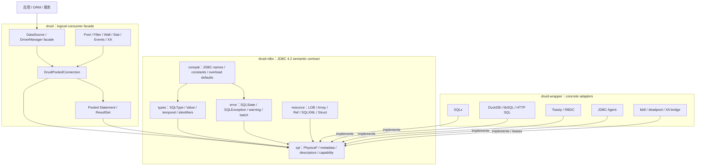
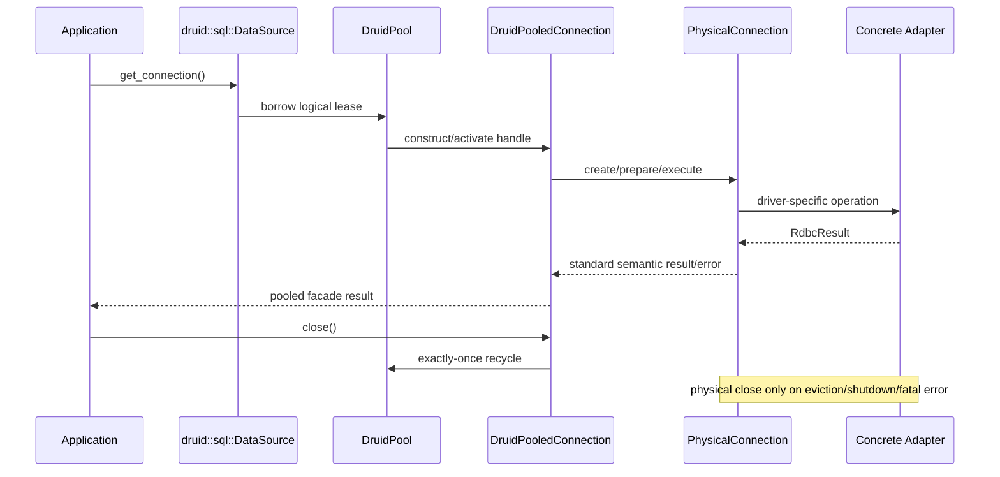
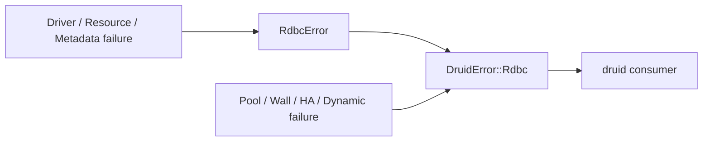
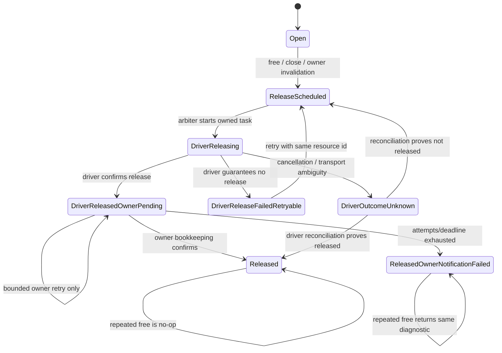

# druid-rdbc JDBC 4.2 语义合同设计规格（已取代）

> **状态：SUPERSEDED_BY ADR-RDBC-005**
>
> 本文保留为第一次双层方案的审计记录。用户复核后否决了把 `Physical*` SPI 放在
> `druid-rdbc` 的设计。当前事实源为
> [`2026-08-24-jdbc42-standard-bridge-layering.md`](2026-08-24-jdbc42-standard-bridge-layering.md)。
>
> **决策编号：ADR-RDBC-004**
>
> **补充：ADR-CRATE-002、ADR-RDBC-001、ADR-RDBC-002、ADR-RDBC-003**

## 1. 决策摘要

`druid-rdbc` 采用“双层 JDBC 4.2 合同”：

1. 以 Java 8 JDBC 4.2 为语义基线，建立完整的标准对象、方法、常量、默认行为和
   异常处置分母。
2. 用 Rust 惯用的 driver-neutral `Physical*` SPI 承载驱动实现，不复制 Java
   interface 继承树。
3. `druid::sql::*` 保持 Druid logical pooled consumer facade；`druid-rdbc` 不拥有
   池化 logical handle。
4. `druid-wrapper` 实现具体数据库、外部连接池和可选 XA/driver bridge。
5. 标准分母必须完整，但实现能力可以分期。未实现项必须区分
   `SQL_FEATURE_UNSUPPORTED_0A000` 与 Java default 的
   `JAVA_DEFAULT_UNSUPPORTED_TYPED`；不得通过缺少 API、伪造 capability 或模糊错误
   隐藏缺口。

本决策不声明 JDBC TCK 合规。完成本规格只能声明：

> `druid-rdbc` provides a Java 8 JDBC 4.2-aligned semantic contract and a
> Rust-native physical driver SPI.

在 JDBC TCK、完整 RowSet、Java/Rust differential 和真实数据库矩阵通过前，禁止使用
“JDBC 4.2 compliant implementation”表述。

## 2. 基线与权威来源

| 项目 | 冻结值 |
| :--- | :--- |
| JDBC 规范 | JSR 221 JDBC 4.2 Maintenance Release 2 |
| Java API | Java SE 8 `java.sql` + `javax.sql` |
| Java 源码主 oracle | OpenJDK 8 tag `jdk8u502-b07`，peeled commit `7373384725418fa645fb4508ec05a869bc7fc3e7` |
| 主 oracle archive | `https://github.com/openjdk/jdk8u/archive/7373384725418fa645fb4508ec05a869bc7fc3e7.tar.gz` |
| 主 oracle archive SHA-256 / size | `5f9c0657c534319a272751431a1f5919cfdcd4e0ac4e0fb9b7e181bc27fa489b` / `94,004,963` bytes |
| 本机交叉校验 | Corretto build `1.8.0_504-b01` 的 `src.zip`；仅作交叉验证，不作为可下载主 oracle |
| API 文档交叉校验 | Oracle Java SE 8 `java.sql` / `javax.sql` API |
| Druid 语义基线 | Alibaba Druid `1.2.28` |
| Druid commit | `33824c3dec1612711f9bb4e409319bcab2e4cd0e` |
| 本规格 Rust 审计基线 | `401bf26b867b46dcec4ed8900fc44678c2ba6cd6` |
| Rust MSRV | `1.95` |
| 默认工具链 | `1.97.1` |
| Edition / resolver | `2021` / `2` |
| unsafe policy | `forbid` |

生成 inventory 前必须校验主 oracle 的 tag peeled commit、archive 字节数和 SHA-256。
若归档不可得或 hash 不匹配，inventory gate 必须失败；其他 OpenJDK 8 发行版只能作为
交叉验证来源。本机 Corretto `src.zip` 下 `java/sql/**/*.java` 与
`javax/sql/**/*.java` 已与该 commit 逐文件比较一致，差异只存在于未打包进 `src.zip` 的
`package.html`、properties 和 XSD 资源。执行时还必须重新记录实际 HEAD、工作树、Cargo
metadata、工具版本和 CodeGraph 状态；上表不是使用陈旧结果宣称完成的许可。

## 3. 当前事实

截至审计基线：

- `druid-rdbc` 已包含 `types`、`error`、`spi`、`resource`、`compat` 五个模块族。
- `druid::sql::*` 是公开 consumer 路径；`druid::rdbc` 是 crate-private 兼容 shim。
- `druid::sql::Connection/Statement/PreparedStatement/CallableStatement/ResultSet` 是
  Druid 池化 concrete handle，不是 driver SPI trait。
- `druid-rdbc::spi::Physical*` 是 pool 到 concrete adapter 的真实驱动边界。
- 当前 `DruidPooledConnection` 仍公开实现 `PhysicalConnection`；这与目标 logical/physical
  边界冲突，必须作为有兼容性影响的显式迁移项处理。
- `Types` 的 39 个 JDBC 4.2 code 和 `RdbcType` 的 39 个 JDBC type variant 已存在。
- `RdbcError` 仍是 scaffold；driver-facing fallible API 仍依赖过渡
  `druid_rdbc::compat::DruidError`。
- `ParameterMetaData` 只有 `druid::sql` 本地模型，没有完整 driver-backed call chain。
- `CallableStatement` facade 已存在，但没有通用生产 `PhysicalCallableStatement` 能力证明。
- LOB/Array/Ref/SQLXML handle 已声明，生产 adapter 的 `Rdbc*Access` 覆盖和创建入口仍不完整。
- SQLx 当前查询使用 `fetch_all` 和 `Vec<Row>`；任何“streaming”命名都不能作为真实流式
  能力证据。

因此当前状态是“JDBC 语义片段 + Physical SPI + P03 过渡兼容层”，不是完整 JDBC 4.2
semantic contract。

## 4. 目标架构



### 4.1 依赖方向

```text
druid-rdbc <- druid <- druid-wrapper
      ^                    |
      +--------------------+
```

- `druid-rdbc` 禁止依赖 `druid`、具体 driver、具体 pool、HTTP/gRPC framework。
- `druid` 可以依赖 `druid-rdbc`，但不得依赖 `druid-wrapper`。
- `druid-wrapper` 可以依赖 `druid-rdbc` 与 `druid`。
- 具体 adapter 不能在 `PhysicalConnection` 内再建立第二连接池。

### 4.2 模块职责

`types`、`error`、`resource` 和 `compat` 共同构成标准语义内核；不新增空泛的
`semantic/` 转发层。

| 模块 | 拥有 | 不拥有 |
| :--- | :--- | :--- |
| `types` | JDBC type code、值、时间、URL、Savepoint、RowId、descriptor value | pool、driver runtime |
| `error` | `RdbcError`、SQLState、vendor code、cause/next、warning、batch taxonomy | Pool/Wall/HA 产品错误 |
| `resource` | Array/Blob/Clob/NClob/Ref/SQLXML/Struct handle、owner 和状态机 | concrete DB I/O |
| `compat` | Java 8 名称、常量、overload descriptor、default failure mapping | 完整产品错误或第二套实现 |
| `spi` | `Physical*`、metadata、parameter/callable descriptor、capability、driver registry primitive | logical pooled handle |

`compat` 只能适配标准名称和行为，不能成为对象堆积文件。每个 Java 类、接口、枚举或
record 仍须由独立 `.rs` 文件承载；`mod.rs` 只做声明和定向重导出。

## 5. logical 与 physical 所有权



必须保持：

1. `DruidPooledConnection` 是 consumer 的 logical connection。
2. `PhysicalConnection` 是未池化 raw driver connection 或对 raw lease 的透明物理边界。
3. logical `close` 归还连接；physical `close` 关闭数据库资源。
4. native pool 与 bb8/deadpool 不能形成双池。
5. `CallableStatement → PreparedStatement → Statement` 使用组合和显式接口，不使用
   `Deref` 模拟继承。
6. 最终态禁止 `DruidPooledConnection`、`DruidPooledStatement` 或其他 logical handle
   实现任何 `Physical*` trait。迁移使用独立 logical forwarding API，并以 compile-fail
   fixture 证明 logical handle 不满足 Physical trait bound。
7. 移除既有 public trait impl 前必须记录 public API diff、external consumer 影响、迁移
   指南和兼容窗口；不能把 trait-impl removal 当成内部重构。

## 6. JDBC 4.2 标准分母

### 6.1 `java.sql`：52 个对象

以下每个对象必须在机器可读 inventory 中有唯一 Java key，并按第 6.3 节分别记录所有权、
语义处置、证据和能力状态：

| 家族 | Java 8 对象 | 默认 Rust 所有者 |
| :--- | :--- | :--- |
| driver | `Driver`, `DriverAction`, `DriverManager`, `DriverPropertyInfo` | registry primitive 在 `druid-rdbc::spi`；consumer facade 在 `druid::sql`；实现位于 wrapper |
| connection | `Connection`, `Savepoint`, `ClientInfoStatus` | logical handle 在 `druid`；physical contract/value 在 `druid-rdbc` |
| statement | `Statement`, `PreparedStatement`, `CallableStatement` | logical handle 在 `druid`；descriptor/physical SPI 在 `druid-rdbc` |
| result | `ResultSet`, `ResultSetMetaData`, `ParameterMetaData`, `DatabaseMetaData` | logical/proxy 在 `druid`；value/physical metadata 在 `druid-rdbc` |
| types | `SQLType`, `JDBCType`, `Types`, `Date`, `Time`, `Timestamp`, `RowId`, `RowIdLifetime`, `PseudoColumnUsage` | `druid-rdbc::types` / `compat` |
| resource | `Array`, `Blob`, `Clob`, `NClob`, `Ref`, `SQLXML`, `Struct` | `druid-rdbc::resource`；concrete access 在 wrapper |
| UDT stream | `SQLData`, `SQLInput`, `SQLOutput` | `druid-rdbc::resource` / `compat`，可选能力 |
| wrapper | `Wrapper` | `druid-rdbc::spi` |
| base error | `SQLException`, `SQLWarning`, `BatchUpdateException`, `DataTruncation`, `SQLClientInfoException` | `druid-rdbc::error` |
| non-transient error | `SQLNonTransientException`, `SQLDataException`, `SQLIntegrityConstraintViolationException`, `SQLInvalidAuthorizationSpecException`, `SQLNonTransientConnectionException`, `SQLSyntaxErrorException` | `SqlExceptionKind` / compatibility names |
| transient/recoverable error | `SQLTransientException`, `SQLTransientConnectionException`, `SQLTransactionRollbackException`, `SQLTimeoutException`, `SQLRecoverableException`, `SQLFeatureNotSupportedException` | `SqlExceptionKind` / compatibility names |
| Java runtime security | `SQLPermission` | `JAVA_RUNTIME_ONLY`；不复制 SecurityManager 机制 |

### 6.2 `javax.sql`：17 个对象

| 家族 | Java 8 对象 | 默认 Rust 所有者 |
| :--- | :--- | :--- |
| datasource | `CommonDataSource`, `DataSource`, `ConnectionPoolDataSource` | `druid::sql` logical facade |
| pooled connection | `PooledConnection` | pool lifecycle 在 `druid`；physical factory contract 在 `druid-rdbc` |
| connection events | `ConnectionEvent`, `ConnectionEventListener` | `druid` event bus |
| statement events | `StatementEvent`, `StatementEventListener` | `druid` event bus |
| row set | `RowSet`, `RowSetEvent`, `RowSetInternal`, `RowSetListener`, `RowSetMetaData`, `RowSetReader`, `RowSetWriter` | compatibility facade 在 `druid`；buffer/cursor primitive 在 `druid-rdbc` |
| XA | `XAConnection`, `XADataSource` | orchestration 在 `druid`；concrete bridge 在 wrapper |

### 6.3 inventory schema

对象、常量、声明方法、继承方法、default 方法和 overload 的机器清单必须把不同维度拆成
独立列，不能把所有权、行为、证据和能力压成一个互斥状态：

| 列 | 允许值 |
| :--- | :--- |
| `item_key` | 唯一 key：标准项为 `java:<fqcn>#<signature>`，Rust 扩展为 `rust:<module-path>` |
| `java_fqcn` / `java_member` | Java 8 主 oracle 中的对象/member；Rust 扩展两列均为 `-` |
| `owner` | `DRUID_RDBC`, `DRUID`, `WRAPPER`, `JAVA_RUNTIME` |
| `semantic_disposition` | `MATCH`, `SQL_FEATURE_UNSUPPORTED_0A000`, `JAVA_DEFAULT_UNSUPPORTED_TYPED`, `JAVA_RUNTIME_ONLY`, `RUST_EXTENSION` |
| `evidence_level` | `DECLARED`, `IMPLEMENTED`, `TESTED`, `REAL_DB` |
| `capability_state` | `NOT_APPLICABLE`, `DECLARED_FALSE`, `IMPLEMENTED_UNTESTED`, `TESTED`, `REAL_DB_VERIFIED` |
| `rust_entry_point` | 唯一 module-qualified Rust path；Java-only 项为 `-` |
| `notes` | 默认行为、兼容转换或标准外部依赖说明 |

其中：

- `SQL_FEATURE_UNSUPPORTED_0A000` 表示 JDBC 标准可选能力未实现，返回
  `SQLFeatureNotSupportedException` taxonomy 与 `SQLState=0A000`。
- `JAVA_DEFAULT_UNSUPPORTED_TYPED` 表示 Java 8 default 本身规定
  `UnsupportedOperationException`；Rust 使用独立 typed error kind 保留该 default 语义，
  不伪装成 `0A000`。
- `RUST_EXTENSION` 不进入 JDBC parity 分母，但仍必须有 owner、entry point 与独立测试。

禁止 `MISSING`、`UNKNOWN`、空列、重复 `item_key` 或一个标准 Java key 出现两个互相冲突的
`owner`/`semantic_disposition`。Rust extension 必须使用独立 `rust:` key，不能伪造 Java
member。同一行可以合法表达
`owner=DRUID + semantic_disposition=SQL_FEATURE_UNSUPPORTED_0A000 + evidence_level=TESTED`。

## 7. 标准语义合同

### 7.1 索引、NULL 和参数

- JDBC column、parameter、LOB position 和 Array slice index 保持 1-based。
- `Value::Null` 是 SQL NULL 的唯一规范表示；不得同时使用 `None` 与
  `Some(Value::Null)` 表示同一 SQL NULL。`Option<T>` 只表达 metadata/application
  属性本身可缺失，不包裹 `Value` 形成第二种 NULL。
- public Rust entry point 使用已验证的 `ColumnIndex`、`ParameterIndex`、`LobPosition`
  和 `ArrayIndex` newtype。compat/FFI/配置边界从 signed integer 执行 `TryFrom`，因此 0、
  负数和越界值都可达且返回结构化 `RdbcError`；内部 0-based offset 只能由 newtype 的
  checked conversion 产生。
- primitive compatibility getter 必须维护 per-cursor `was_null` 状态。
- label lookup 与 index lookup 共享同一列解析结果；重复 label 遵循 JDBC first-match 语义。
- Prepared/Callable 参数不得在绑定时把 stream、LOB 或 opaque value 提前有损压成标量。
- Callable indexed/named、IN/OUT/INOUT 和 REF_CURSOR 均进入 inventory；未实现的标准
  可选能力使用 `SQL_FEATURE_UNSUPPORTED_0A000`。

### 7.2 Statement 和 ResultSet

- Statement 默认只有一个 current ResultSet；重新执行时按合同关闭旧 current ResultSet。
- query、update、generic execute、batch、generated keys 和 large counts 必须分别建模。
- batch 保持输入顺序，并使用无损 `i64` 存储或等价 `BatchUpdateCounts` 类型，区分成功、
  `SUCCESS_NO_INFO=-2`、`EXECUTE_FAILED=-3` 与 partial counts。JDBC `int[]` 兼容视图是
  Java-compatible projection：逐项执行与 Java `(int) longValue` 相同的低 32-bit two's
  complement 窄化，不抛新增错误；`getLargeUpdateCounts` 等价入口始终返回无损 `i64`
  clone。Rust 另提供不同名称的 checked projection（例如 `try_update_counts_i32`），溢出时
  返回结构化错误并标记 `RUST_EXTENSION`，不能改变 JDBC compatibility entry point。
- ResultSet 初始在 before-first；forward-only/read-only 是最低必选能力。
- scrollable/updatable 是可选能力，但不能伪报支持。
- buffered result 与 async cursor 使用两个显式类型；`Vec<Row>` 结果不得命名为 streaming。
- ResultSet 关闭不得自动释放已按 JDBC 生命周期独立返回的 LOB handle。

### 7.3 transaction 和 connection

- 新 logical connection 的默认 auto-commit 为 true，除非 adapter 有可证明的标准差异映射。
- commit/rollback/savepoint/read-only/isolation/catalog/schema/type-map/client-info 都进入方法台账。
- logical close 幂等并 exactly-once recycle；physical close 幂等并 exactly-once driver release。
- fatal driver error 必须携带足够 SQLState/vendor/kind 信息供 exception sorter 决定 discard。
- 活动事务 close 的 adapter-specific 行为必须有 disposition 和测试，不得静默推断。

### 7.4 metadata

- `DatabaseMetaData`、`ResultSetMetaData`、`ParameterMetaData` 使用 driver-backed contract，
  不能只有脱离调用链的 facade model。
- metadata 的 `null`、空字符串和 pattern 含义必须区分。
- column/parameter index 继续保持 1-based。
- capability 返回 true 必须有同 adapter 的行为测试；没有证据时返回 false。
- Java 8 default：`getMaxLogicalLobSize=0`、`supportsRefCursors=false`，除非 adapter 明确覆盖。
- `PhysicalDatabaseMetaData` 最终覆盖 Java 8 声明面，或为每个缺口记录唯一 disposition。

### 7.5 Java 8 default 方法

Java default interface method 的代码形状不迁移，但其默认返回或默认错误属于合同。

- Statement large-update default、Prepared/Callable SQLType overload、ResultSet typed update、
  SQLInput/SQLOutput SQLType overload和 DatabaseMetaData defaults 必须进入 inventory。
- 默认不支持项区分 Java 的 `UnsupportedOperationException` 与
  `SQLFeatureNotSupportedException` 语义，并在 Rust 侧形成稳定、文档化映射。
- Java default 的 `UnsupportedOperationException` 映射为
  `JAVA_DEFAULT_UNSUPPORTED_TYPED`，标准可选 SQL 能力映射为
  `SQL_FEATURE_UNSUPPORTED_0A000`；两者不得共享一个含糊的 unsupported variant。
- Rust API 可以用 descriptor 或具名方法代替 Java overload，但每个 overload 必须可追溯到
  唯一 Rust entry point。

## 8. 错误合同与 P04 waiver 退出

### 8.1 最终所有权



- `RdbcError` 只包含 driver-facing SQL、resource、argument、validation、batch 和 capability
  错误。
- `DruidError` 只在 `druid` 拥有实际定义，聚合 Pool/Wall/HA/Dynamic 与显式 RDBC wrapper。
- driver/resource/types/metadata SPI 禁止返回 `DruidError`。
- `compat::DruidError` waiver 在 P04 Task 1 内继续有效，仅用于冻结、比对和迁移 24-variant
  基线；当且仅当 `WAIVER_EXIT_GATE_1..6` 全部通过时失效。Task 1 开始本身不使 waiver
  失效。

### 8.2 SQL exception fidelity

必须保留：

- nullable reason；
- nullable SQLState；
- vendor code；
- cause/source；
- next-exception chain；
- warning chain；
- exception taxonomy；
- batch partial/large update counts；
- `SQLClientInfoException.failed_properties: Map<String, ClientInfoStatus>`；
- DataTruncation 的 index、parameter/read flag、data size、transfer size，以及
  read=`01004` warning、write=`22001` exception 区分。

Java exception 的 `cause` descriptor 与 Rust `std::error::Error::source()` 必须分别建模：
可拥有、`'static` 且构成 Rust source chain 的 cause 必须由 `source()` 返回；跨进程、不可
拥有或仅有 Java descriptor 的 cause 保存在结构化字段中并明确 `source() == None` 的原因。
禁止在计划中无条件规定所有 `SqlException::source() == None`。

标准 SQL feature unsupported 的唯一出口是 feature-not-supported taxonomy 与 `0A000`。
Java default 明确规定的 `UnsupportedOperationException` 使用独立 typed mapping。直接构造
无 disposition、无 SQLState 的通用 `UnsupportedOperation` 不能作为最终 driver-facing
行为。

### 8.3 P04 Task 1 六项硬门禁

以下标识是 P04 Task 1 的唯一 waiver-exit 定义；P04 plan、verifier、report 和后续计划必须
逐字引用同一组 gate ID，不得维护第二套近似条件：

1. `WAIVER_EXIT_GATE_1_COMPAT_REMOVED`：`druid-rdbc::compat` 不再定义或重导出完整
   `DruidError`。
2. `WAIVER_EXIT_GATE_2_SIGNATURES_CLEAN`：
   `druid-rdbc::{types,error,spi,resource,compat}` 的全部生产 fallible signature、import、
   fully-qualified path 和 construction 均不含 `DruidError`。
3. `WAIVER_EXIT_GATE_3_ADAPTERS_CLEAN`：所有 concrete adapter 与 external lease 的
   driver-facing boundary 使用 `RdbcError`，并有动态分母扫描；固定文件数不能代替扫描。
4. `WAIVER_EXIT_GATE_4_PRODUCT_OWNER_UNIQUE`：`druid` 中存在唯一产品 `DruidError`
   实现，显式包装 `RdbcError`；Pool/Wall/HA/Dynamic 不反向进入 `druid-rdbc`。
5. `WAIVER_EXIT_GATE_5_BASELINE_DISPOSED`：24-variant 过渡基线的每个 variant、字段、
   Display/source/classification/conversion 都有唯一迁移 disposition 和行为证据。
6. `WAIVER_EXIT_GATE_6_COMPAT_VERIFIED`：public API diff、external consumer、错误转换、
   exception sorter、workspace/all-features、MSRV 与迁移文档全部通过。

任一门禁失败时，P04 Task 2 及后续 JDBC alignment 实施任务不得开始。

## 9. 资源状态机

### 9.1 状态



要求：

- `free`/`close` 重复调用 no-op 或返回相同完成状态。
- caller future 只等待结果，不拥有 release operation；实际释放由 arbiter/supervised task
  持有，因此 caller cancellation 不能取消 driver release 或永久阻塞 waiters。
- owner failure、explicit free、Drop 和 connection invalidation 共享一个 exactly-once release
  arbiter。
- 每次释放携带稳定 resource ID/idempotency key。只有 driver 明确保证“未发生释放”时才可
  重试 driver call；结果未知时必须先 reconcile，不能盲目 double-free。
- driver 已释放而 owner bookkeeping 未完成时，只重试 owner notification，不再调用 driver。
- owner notification policy 必须有界且可配置；默认最多 3 次尝试（初次 + 2 次重试），
  backoff 为 10ms、50ms，总 deadline 为 1s。测试使用 paused time。deadline、shutdown 或
  最大次数到达时进入 `ReleasedOwnerNotificationFailed`，物理资源仍保持 released。
- waiters 在 `Released`、`ReleasedOwnerNotificationFailed`、可重试 driver failure 或
  `DriverOutcomeUnknown` 被唤醒并获得可诊断结果，不能永久等待或观察伪成功。
- Array/Blob/Clob position 保持 1-based；free 后除 repeated free 外的操作返回 closed error。
- SQLXML 的 readable/writable/initialized/freed 状态必须显式。
- capability=false 时不得先改变资源状态再返回 unsupported。

## 10. Rust API 形状

### 10.1 trait 策略

- 第三方 adapter 必须实现的 `Physical*` trait 保持开放，不 seal。
- 只由本 crate 组合的 helper/extension trait 可以 seal。
- 已公开且未 seal 的 trait 不增加无默认 required method；使用有默认方法、extension trait
  或新版本 trait。
- dyn 使用路径必须 object-safe；泛型 helper 放入 `*Ext` trait。
- 不使用 `Deref` 模拟 JDBC 继承。

每个公开 trait 必须在机器清单中标记 `DYN_REQUIRED`、`PATH_ONLY` 或 `GENERIC_ONLY`。
`DYN_REQUIRED` 由 `Box<dyn Trait>` 与 `Arc<dyn Trait>` external compile fixture 证明；
`PATH_ONLY` 必须有 path/associated-item compile fixture；泛型 helper 只能位于
`GENERIC_ONLY` 的 `*Ext` trait。

`Wrapper` 的 object-safe core 必须保留 Java 的失败语义：

```rust
fn is_wrapper_for(&self, iface: Option<TypeId>) -> Result<bool, RdbcError>;
fn unwrap(&self, iface: Option<TypeId>) -> Result<Unwrapped<'_>, RdbcError>;
```

`None` 或无法 unwrap 不能静默变成成功 `None`；它们映射到结构化 SQL exception。
`WrapperExt::unwrap_ref<T>()` 等泛型便捷方法可以返回 `Result<&T, RdbcError>`，但不能进入
object-safe core。若为 Druid 历史行为保留 permissive lookup，必须使用不同方法名并标记
`RUST_EXTENSION`，不能冒充 JDBC `unwrap`。

### 10.2 类型策略

- 公开 error/event/status enum 可增长时使用 `#[non_exhaustive]`；P03 冻结的过渡
  `DruidError` 在 waiver 期不得改变。
- public struct 字段默认 private，并提供 constructor/accessor/builder。
- index、count、vendor code、resource ID 等容易混淆的 primitive 使用有语义的 newtype 或
  descriptor。
- API 输入优先 `&str`、slice 或 `impl AsRef`；输出保持 concrete。
- 公开 fallible path 不因用户输入 panic，不使用 `unwrap`。
- 每个公开类型具备合适的 `Debug`；凭据、URL secret 和 SQL 参数必须脱敏。

### 10.3 命名与文件治理

- 文件与目录使用 snake_case；类型使用 PascalCase；方法使用 snake_case。
- 每个 Java 对象一个 `.rs` 文件；内部 builder 可与主对象同文件。
- `mod.rs` 只做 module 声明和定向 `pub use`。
- 生产代码禁止 wildcard import。
- 单文件超过 800 行视为 blocker；500–800 行必须进行 cohesion review。
- `compat/exceptions.rs` 等多对象聚合文件必须按对象拆分，不能长期作为兼容捷径。

## 11. Driver、DataSource、Pool、Event 与 XA

### 11.1 Driver

- `druid-rdbc::spi` 拥有 URL acceptance、driver property、版本和物理 factory registry
  primitive。
- Java `Driver.connect` 的“不接受 URL 可返回 null”映射为先执行 `accepts_url`，再用
  `Option`/typed resolution 表达，而不是把“不接受”伪装为连接失败。
- `druid::sql::DriverManager` facade 负责 consumer-facing selection、timeout 和诊断入口。
- 具体 driver registration/extension 归 `druid-wrapper`。

### 11.2 DataSource 与 pool

- `DataSource` 返回 `DruidPooledConnection`，因此属于 `druid` logical facade。
- `PooledConnection` 的 Java 可观察事件语义由 `druid` pool event bus 表达。
- logical connection close 触发一次 recycle/event；physical pool object close 才关闭 raw
  connection。
- bb8/deadpool 只改变 resource owner，不改变 consumer facade 或 capability contract。

### 11.3 Event 与 XA

- Connection/Statement event 的顺序、次数和 error payload 进入 inventory。
- XA orchestration 在 `druid`；driver-neutral XA resource port 属于 `druid-rdbc::spi`，
  concrete bridge 属于 wrapper。该 port 返回 `RdbcError`，并仅在 `druid` coordinator
  边界转换为 `DruidError`。
- `javax.transaction.xa::{XAResource,Xid,XAException}` 不计入 52+17，但作为 XA 的
  `EXTERNAL_STANDARD_DEPENDENCY` 进入配套 inventory，覆盖常量、recover flags、result
  codes、Xid 格式和错误映射。XA capability 保持 false 时可以不实现 port 行为；一旦返回
  true，配套 inventory 和 conformance suite 必须先通过。
- 当前 `druid::core::XaResource` 返回 `DruidError` 的 open trait 不是最终边界；计划必须
  明确迁移、兼容 shim 或经批准的例外，P04 动态 verifier 必须覆盖该路径。
- XA、StatementEvent 和高级 RowSet 可以
  `semantic_disposition=SQL_FEATURE_UNSUPPORTED_0A000`，但不能省略标准处置或宣称支持。

## 12. RowSet 与 async cursor

`javax.sql.RowSet` 与 Rust async cursor 不是同一对象：

- `BufferedRowSet` 表示 eager、可脱离连接的行集合。
- `QueryCursor` 表示有背压、持有明确 owner 的 async stream。
- Java RowSet facade 在 `druid` 暴露标准兼容行为，并可组合 `BufferedRowSet`。本 ADR 排除
  JavaBeans introspection、serialization 和 design-time runtime，但保留 RowSet 的可观察
  property、command、credential-redaction、reader/writer 和 listener/event 语义。
- `RowSetResultSet` 或任何 `Vec<Row>` 类型不得用于证明 `javax.sql.RowSet` 已实现。
- Rust async cursor 是 `RUST_EXTENSION`，其取消、背压和 owner release 单独验证，不计入
  JDBC 方法覆盖率。
- 本 ADR 的 69 对象分母只覆盖 `javax.sql` 根包中的 7 个 RowSet 对象；
  `javax.sql.rowset`、`javax.sql.rowset.serial`、`javax.sql.rowset.spi` 不属于当前分母。
  若产品声明 `JdbcRowSet`、`CachedRowSet`、`WebRowSet`、`FilteredRowSet` 或 `JoinRowSet`
  兼容，必须先建立独立扩展规格和新增分母，不能从 `BufferedRowSet` 推断完成。

## 13. 验证模型

### 13.1 四级证据

| 级别 | 含义 | 允许声明 |
| :--- | :--- | :--- |
| `DECLARED` | inventory 有对象/方法/常量和唯一 disposition | 只声明 API 已登记 |
| `IMPLEMENTED` | production call chain 有真实实现或标准 unsupported | 声明行为已实现 |
| `TESTED` | shared conformance suite 覆盖可观察行为 | 声明被测试的 capability |
| `REAL_DB` | 真实数据库/版本矩阵执行 | 声明该 adapter 的实际支持 |

低等级证据不能替代高等级证据；对象存在、编译成功或测试 target 为 0 都不能证明行为。

### 13.2 必须的 gate

| Gate | 证据 |
| :--- | :--- |
| API inventory | 52 + 17 对象、常量、方法、继承/default/overload 的完整多列 schema 与唯一 Java key |
| constants/defaults | 39 type code、Statement/ResultSet/metadata constants 和 Java 8 defaults 逐项差分 |
| index/null | index newtype 的 signed/0/1/boundary 转换；`Value::Null` 唯一表示；primitive/`was_null` 测试 |
| lifecycle | logical recycle、physical close、ResultSet cascade、resource cancellation 和 exactly-once |
| errors | SQLState/vendor/kind/cause/next/warning、client-info payload、DataTruncation 和 i64 batch counts 逐字段测试 |
| metadata | capability 与真实实现一致；null/empty/pattern 不混淆 |
| adapter | direct SQLx、bb8、deadpool、Toasty、RBDC、DuckDB/libSQL、JDBC Agent 共用 suite |
| pool | native/external ownership一致，无双池、泄漏和重复归还 |
| logical/physical | compile-fail 证明 logical handles 不实现 `Physical*`；public trait-impl removal 有 migration evidence |
| trait surface | `DYN_REQUIRED/PATH_ONLY/GENERIC_ONLY` 清单及对应 compile fixture |
| XA companion | XA=true 时 `XAResource/Xid/XAException` 配套 inventory 与 conformance 通过 |
| differential | Java 1.2.28 与 Rust 对相同输入的输出、错误、状态、副作用和清理差分 |
| real DB | 每个宣称支持的 adapter/database/version 有新鲜执行报告 |
| compatibility | `druid::sql::*` external consumer、public API、semver、MSRV 通过 |
| DAG | `druid-rdbc` forbidden dependency 和 workspace DAG 通过 |

### 13.3 capability truthfulness

每个 adapter capability 只能处于：

```text
DECLARED_FALSE
IMPLEMENTED_UNTESTED
TESTED
REAL_DB_VERIFIED
```

只有 `TESTED` 或 `REAL_DB_VERIFIED` 可以对 consumer 返回 true。产品目录、feature 名称、
facade 类型存在或测试文件存在都不是 capability=true 的证据。

## 14. P03/P04 联动执行顺序

```mermaid
flowchart LR
    P03T6["P03 Task 6<br/>机械抽取 closeout"] --> TRANS["ERROR_OWNERSHIP_<br/>TRANSITIONAL_UNTIL_P04"]
    TRANS --> P04T1["P04 Task 1<br/>强制退出 DruidError waiver"]
    P04T1 --> INV["JDBC 4.2 inventory<br/>52 + 17 + method/default matrix"]
    INV --> SEM["标准语义缺口<br/>types / metadata / resources"]
    SEM --> CAP["capability truthfulness"]
    CAP --> LIFE["cancel-safe lifecycle"]
    LIFE --> CURSOR["BufferedRowSet / QueryCursor"]
    CURSOR --> DIFF["adapter + Java differential + real DB"]
```



### 14.1 P03

- P03 继续是 no-behavior extraction，不向当前 SCC 追加新的 JDBC 行为。
- P03 Task 6 必须完成 public-path 动态分母、DAG、API/semver、MSRV 和验证报告。
- P03 允许保留完整 24-variant transitional `compat::DruidError`，但完成状态必须明确为
  `ERROR_OWNERSHIP_TRANSITIONAL_UNTIL_P04`。
- P03 不得把 waiver 描述为最终 ADR 架构。

### 14.2 P04

- Task 1 是绝对前置：先退出 waiver，再修改任何标准行为。
- P04 plan 的 Task 1 必须逐字采用本规格的 `WAIVER_EXIT_GATE_1..6`；现有扫描范围、步骤和
  report 若与 gate ID 不一致，先修订计划和 verifier，不能让“计划 GREEN、规格失败”。
- Task 1 后新增 JDBC 4.2 inventory/disposition gate，冻结对象、方法、常量和 owner。
- 现有 capability、resource cleanup、BufferedRowSet/QueryCursor 任务必须引用本规格并以
  inventory 为分母。
- 缺失 `ParameterMetaData`、`Struct`、`SQLData`、`SQLInput`、`SQLOutput`、driver descriptor
  和 metadata defaults 按独立、可审查任务实施。
- adapter conformance 与 Java/Rust differential 是完成门禁，不作为文档性尾项。

### 14.3 计划事实源

实施计划修订后：

- 本规格是 JDBC 4.2 语义合同的唯一规格事实源。
- `2026-08-21-rdbc-first-five-crate-architecture.md` 继续是 crate topology 事实源。
- P03/P04 plan 只能描述执行步骤，不得修改上述规格决策。
- 不新建 OpenSpec 或 Spec Kit change；仓库继续使用现有 Superpowers specs/plans。

## 15. 兼容和 SemVer

- `druid-rdbc` 当前 `publish=false`，但 public surface 仍需 API snapshot 和 external consumer
  证明，不能以未发布为由无约束变化。
- P03 对现有 `druid` module-qualified public path 保持零删除预算。
- P04 的错误分层是有意 API 变化，必须提供 migration guide 和 exact public API diff。
- `DruidPooledConnection: PhysicalConnection` 等 public trait impl 的移除也是有意 API 变化，
  必须单独 snapshot、external-consumer/compile-fail 验证并提供替代 logical API。
- 旧路径只能定向重导出同一类型，不能复制实现。
- `#[doc(hidden)]` 不消除 semver 影响；实验 API 必须 private 或 feature-gated。
- 不向已公开、第三方可实现的 Physical trait 增加无默认 required method。

## 16. 非目标

- 不实现数据库 wire protocol。
- 不复制 Java checked exception、reflection、`Class<T>`、JNDI、SecurityManager、
  `SQLPermission` 执行机制、PrintWriter、Executor、JavaBeans introspection/runtime 或
  serialization UID；RowSet 的 property/event 可观察语义仍在范围内。
- 不复制 Java interface inheritance 或 Druid Java 中 `PooledConnection implements Connection`
  的类型合并。
- 不把 Java 9 JDBC 4.3 的 request boundary、sharding key、builder 和 `enquote*` 纳入本轮。
- 不要求每个 adapter 立即实现 Callable、XA、scrollable/updatable、UDT 或完整 RowSet；但
  它们必须有标准 API disposition 和 truthful capability。
- 不把 Rust async 扩展计入 JDBC parity 分母。

## 17. 完成条件

只有以下全部满足，才能把 ADR-RDBC-004 标记为 IMPLEMENTED：

1. 52 个 `java.sql` 和 17 个 `javax.sql` 对象均有机器可读 inventory row；主 oracle 的
   version/size/SHA-256 校验通过。
2. 每个标准常量、声明/继承/default 方法和 overload 都有唯一 `java:` item key、owner、
   semantic disposition、evidence、capability state 和 Rust entry point。
3. P04 Task 1 六项 waiver-exit gate 全部通过。
4. `RdbcError` 保留 SQL exception fidelity、client-info/DataTruncation payload 和 i64 large
   batch counts；SQL feature unsupported 为 `0A000`，Java default unsupported 使用独立
   typed mapping。
5. index/null/transaction/statement/result/resource/metadata lifecycle gate 通过。
6. logical/physical ownership、logical-not-Physical compile-fail、native/external pool 和
   cancellation-safe exactly-once release gate 通过。
7. capability=true 的每一项都有同 adapter 的测试证据。
8. `druid::sql::*` compatibility、DAG、public API、semver、MSRV、fmt/check/clippy/test/doc 通过。
9. Java/Rust differential 和真实数据库矩阵对所有“已支持”声明提供新鲜证据。
10. crate 文档和用户文档使用准确声明，不再把 facade presence 当作标准能力完成证明。

## 18. 决策记录

| ADR | 决策 | 状态 |
| :--- | :--- | :--- |
| ADR-RDBC-001 | `druid::sql::*` 是 consumer canonical path；driver SPI 归 `druid-rdbc` | ACCEPTED |
| ADR-RDBC-002 | logical handle 使用具体类型；不复制 Java trait 继承 | ACCEPTED |
| ADR-RDBC-003 | buffered row set 与 async cursor 显式分型 | ACCEPTED |
| ADR-RDBC-004 | JDBC 4.2 标准语义内核 + Rust Physical SPI 双层合同 | PROPOSED_FOR_WRITTEN_REVIEW |
