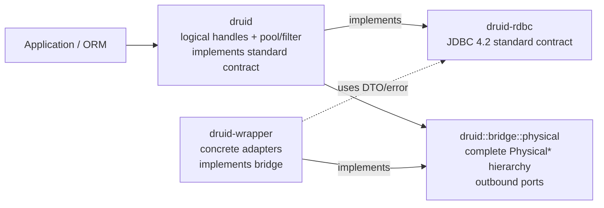

# JDBC 4.2 标准合同与 Druid Bridge 分层规格（已取代）

> **状态：SUPERSEDED_BY ADR-RDBC-006**
>
> 用户否决了完整 `druid::bridge::physical` 第二套 canonical hierarchy。当前事实源为
> [`2026-08-24-rdbc-single-standard-trait-tree.md`](2026-08-24-rdbc-single-standard-trait-tree.md)。
>
> **决策编号：ADR-RDBC-005**
>
> **取代：ADR-RDBC-004 的 `druid-rdbc::spi` 双层方案**

## 1. 决策

`druid-rdbc` 是 Rust 版 Java 8 `java.sql` / `javax.sql` 标准合同层，不是 Druid 内部
驱动 SPI 容器：

1. `druid-rdbc` 只定义 JDBC 4.2 可观察语义：标准对象、类型码、SQLState、异常链、
   1-based 索引、SQL NULL/`wasNull`、default 行为、资源生命周期、metadata 和 capability。
2. `druid` 的 logical pooled handles 实现 `druid-rdbc` 标准合同。
3. `druid` 拥有 public `druid::bridge::physical` 完整 Physical hierarchy，承载
   pool/filter/lifecycle 到 concrete driver 的 outbound port。
4. `druid-wrapper` 实现完整 `PhysicalConnection/Statement/PreparedStatement/
   CallableStatement/ResultSet/Metadata/Resource` hierarchy，并复用 `druid-rdbc` 的 DTO、
   错误和 descriptor。
5. 最终 `druid-rdbc` 不包含 `spi` module、`Physical*`、Druid factory/lease、resource
   owner/access、filter unwrap 或 async cursor runtime。

允许声明“JDBC 4.2-aligned standard contract”，不得在 TCK、完整 RowSet、Java/Rust
differential 和真实数据库矩阵通过前声明 JDBC compliant implementation。

## 2. 基线

| 项目 | 冻结值 |
| :--- | :--- |
| JDBC | JSR 221 JDBC 4.2 MR2 / Java SE 8 |
| Java source oracle | OpenJDK `jdk8u502-b07`, commit `7373384725418fa645fb4508ec05a869bc7fc3e7` |
| archive SHA-256 / size | `5f9c0657c534319a272751431a1f5919cfdcd4e0ac4e0fb9b7e181bc27fa489b` / `94,004,963` bytes |
| Java Druid | `1.2.28` / `33824c3dec1612711f9bb4e409319bcab2e4cd0e` |
| Rust layering audit | `2912808f572180b72bae09617b80c3a04a9d75a9` |
| MSRV / default / edition | `1.95` / `1.97.1` / `2021` |
| unsafe | `forbid` |

执行时重新记录 HEAD、dirty state、Cargo metadata、工具版本和 CodeGraph 状态。inventory
生成前必须验证 oracle commit、archive size 与 SHA-256。

## 3. 当前混层事实

当前 `druid-rdbc::spi` 的 32 个公开导出混合：

- JDBC DTO：Callable/Prepared 参数、执行结果、generated keys、ResultSet metadata DTO；
- driver 操作：Connection/Statement/Prepared/Callable/ResultSet/Metadata；
- Druid bridge：`PhysicalConnectionFactory/Info/Capabilities`、prepared cache key；
- Druid runtime：resource owner/access/context/state、lease 和 physical unwrap。

`DruidPooledConnection` 当前实现 `PhysicalConnection`，标准 logical 对象因此被错误标记为
raw driver object。`Wrapper` 也混有 `is_wrapper_proxy`、`statement_connection` 和
`Physical*` variants。完整 Physical hierarchy 必须保留，但 owner 必须迁到 Druid，且
logical types 禁止实现它。

## 4. 目标拓扑



Cargo normal DAG：

```text
druid-rdbc <- druid <- druid-wrapper
      ^                    |
      +--------------------+
```

`druid` 对 wrapper 只允许 dev-dependency；`druid-rdbc` 禁止依赖 Druid、driver、pool、
Tokio owner 或 HTTP/gRPC runtime。

## 5. `druid-rdbc` 标准层

目标目录：

```text
src/
├── connection/
├── statement/
├── result_set/
├── metadata/
├── resource/
├── data_source/
├── driver/
├── types/
├── error/
└── compat/
```

- 不存在 public `spi` module。
- 不存在 `Physical*`、`Druid*`、Pool、Filter、Lease、Owner runtime 类型。
- 标准 trait 由 Druid logical handles、Druid `Raw*Facade` 或其他标准实现者实现；wrapper
  raw driver objects 只实现 Physical hierarchy。
- 标准层定义资源 `free`、close、index、NULL、metadata/capability 的可观察合同，但不拥有
  Druid release arbiter、discard 或 pool bookkeeping。
- 每个 Java 对象一个 `.rs`；`mod.rs` 只声明和定向重导出。

## 6. `druid` 标准实现与 bridge

### 6.1 consumer facade

`druid::sql::*` 保持 canonical consumer path。`DruidPooledConnection`、pooled
Statement/Prepared/Callable/ResultSet、DataSource 和 metadata proxy 实现对应
`druid-rdbc` standard traits，并显式适配完整 Physical hierarchy。

### 6.2 adapter-author bridge

```text
crates/druid/src/bridge/
├── physical/
│   ├── physical_connection.rs
│   ├── physical_connection_factory.rs
│   ├── physical_statement.rs
│   ├── physical_prepared_statement.rs
│   ├── physical_callable_statement.rs
│   ├── physical_result_set.rs
│   ├── physical_database_meta_data.rs
│   ├── physical_result_set_meta_data.rs
│   ├── physical_parameter_meta_data.rs
│   └── physical_resource.rs
├── capability.rs
├── external_lease.rs
└── unwrap.rs
```

- canonical path 是 `druid::bridge::physical::*`，public 且承担 SemVer。
- `druid::spi::*` 与 `druid::core::Physical*` 只在一个兼容窗口定向重导出 bridge。
- 完整 Physical hierarchy 是强制架构；每个 driver-relevant standard object 都有对应
  Physical trait，Prepared/Callable 在 physical layer 保持 supertrait 关系。
- Physical hierarchy 复用 `druid-rdbc` 的 DTO/index/error/metadata descriptor，不定义
  第二套类型码、SQLState、NULL 或 default-failure taxonomy。
- 每个 driver-relevant standard method 必须有机器可读一对一 physical mapping；Druid
  logical/raw facade 是唯一 standard-to-physical adapter。
- `DruidPooledConnection` 禁止实现 `PhysicalConnection` 或任何 bridge raw trait。

### 6.3 两层采用 Adapter，不采用 trait inheritance

禁止 `PhysicalConnection: druid_rdbc::Connection`。Rust 没有 Java 式返回类型协变：
standard `create_statement` 返回 standard logical handle，而 physical creation 必须返回
`Arc<dyn PhysicalStatement>`；logical close 与 physical close、standard ResultSet 与 raw
cursor 也有不同 owner/lifecycle。

关系固定为：

```text
DruidPooledConnection / RawConnectionFacade implements rdbc::Connection
  -> delegates to dyn PhysicalConnection
  -> wraps dyn PhysicalStatement as DruidPooledStatement / RawStatementFacade
  -> facade implements rdbc::Statement
```

wrapper 只实现 Physical hierarchy；Druid logical/raw facades 实现 standard hierarchy。

## 7. `druid-wrapper`

- concrete adapters 实现 `druid::bridge::physical::{PhysicalConnection, PhysicalStatement,
  PhysicalPreparedStatement, PhysicalCallableStatement, PhysicalResultSet,
  PhysicalDatabaseMetaData, PhysicalResultSetMetaData, PhysicalParameterMetaData,
  PhysicalResource, ...}`。
- factories 实现 `PhysicalConnectionFactory`。
- bb8/deadpool 组合 `ExternalConnectionLease`，只改变 resource owner，不创建第二
  DruidPool。
- adapter 返回 `RdbcError` 与标准 DTO；只在 Druid product boundary 转为 `DruidError`。

## 8. 类型归属

### 8.1 留在标准层并移出旧 `spi`

| 当前对象 | 目标 |
| :--- | :--- |
| Callable/Prepared parameter DTO | `druid-rdbc::statement` |
| 标准 generated-keys/result ordering/update counts | `druid-rdbc::statement` |
| ResultSet column/type/nullability/update DTO | `druid-rdbc::{result_set,metadata}` |
| RowIdLifetime | `druid-rdbc::metadata` |
| 标准 Wrapper core | `druid-rdbc::wrapper` 或 `compat::wrapper` |
| types/value/temporal/savepoint/row-id | `druid-rdbc::types` |
| SQL exception/error taxonomy | `druid-rdbc::error` |

### 8.2 移入 `druid::bridge::physical` 或其 sibling runtime module

- 全部当前 `Physical*` traits；
- Connection factory/info/capability；
- Druid prepared cache key/method type；
- `SqlText*`、`RowSetResultSet`、旧 runtime `RdbcResultSet`；
- `Rdbc*Access`、resource context/factory/owner/state/id/kind/capability；
- physical reader/writer/XML/opaque object；
- physical/proxy unwrap；
- async `QueryCursor`、release supervisor 和 external lease。

### 8.3 必须拆分

- `ResultSetMetaData`：标准 snapshot/trait 留在 rdbc；physical backend/MySQL8 adapter 移入
  Druid。
- `Wrapper/Unwrapped`：标准 core 留在 rdbc；physical/proxy variants 移入 bridge。
- Blob/Clob/Array/Ref/SQLXML：标准 trait/规则留在 rdbc；持有 Access/Context 的 concrete
  Druid handle 移入 Druid并实现标准 trait。
- object/opaque value：标准 type-map 留在 rdbc；physical downcast/runtime handle 移入 bridge。
- execution result：标准 result ordering/count descriptor 留在 rdbc；driver carrier 与 eager
  fallback 移入 bridge。

## 9. JDBC 标准分母

inventory 覆盖 `java.sql` 52 + `javax.sql` 17 个根包对象；XA=true 时增加
`javax.transaction.xa::{XAResource,Xid,XAException}` 配套清单。

每行包含：

```text
item_key, java_fqcn, java_member, standard_owner, implementation_owner,
bridge_requirement, semantic_disposition, evidence_level, capability_state,
rust_entry_point, physical_entry_point, standard_signature, physical_signature,
call_kind, index_adapter, error_adapter, return_adapter, lifecycle_owner,
logical_adapter, wrapper_implementation, notes
```

disposition 只允许：`MATCH`、`SQL_FEATURE_UNSUPPORTED_0A000`、
`JAVA_DEFAULT_UNSUPPORTED_TYPED`、`JAVA_RUNTIME_ONLY`、`RUST_EXTENSION`。

标准 owner 与实现 owner 必须分列，禁止用 `OWNED_BY_DRUID` 代替标准归属。
`bridge_requirement` 只允许 `REQUIRED_PHYSICAL`、`LOGICAL_ONLY`、
`JAVA_RUNTIME_ONLY` 或 `RUST_EXTENSION`。每个 `REQUIRED_PHYSICAL` member 必须同时填写唯一
standard method、physical method、规范化参数/返回签名、同步/异步性、index/error/
return adapter、lifecycle owner、logical adapter 和 wrapper implementation；任何 missing、
duplicate、name/signature/ownership drift 都失败。

## 10. 可观察语义

- index newtype 全部 1-based；signed `TryFrom` 拒绝负数、0、越界。
- `Value::Null` 是 SQL NULL 唯一表示；primitive getter 维护 `was_null`。
- SQL feature unsupported 返回 `0A000`；Java default unsupported 使用独立 typed mapping。
- exception 保留 SQLState、vendor、cause/source、next、warning、client-info、DataTruncation。
- batch 无损存储 `i64`；JDBC int projection 模拟 Java `(int) longValue`，Rust checked API
  单列 extension。
- metadata 的 null/empty/pattern 不合并；capability=true 必须有同 adapter 行为证据。
- resource 标准层定义 free/close/free-after-use/1-based/SQLXML 状态；bridge 实现
  cancellation-safe exactly-once release。

## 11. Wrapper、logical 与 raw

标准 Wrapper 不引用 Druid 或 Physical：

```rust
fn is_wrapper_for(&self, iface: Option<TypeId>) -> Result<bool, RdbcError>;
fn unwrap(&self, iface: Option<TypeId>) -> Result<StandardUnwrapped<'_>, RdbcError>;
```

Druid physical/proxy unwrap 使用 `druid::bridge::unwrap::*`。logical close 归还池；bridge
raw close 才关闭 driver connection。compile-fail fixture 必须证明 logical handles 不实现
Physical traits。

## 12. Error waiver

P04 Task 1 内继续允许 transitional `compat::DruidError` 用于冻结基线；只有以下全部通过
才失效：

1. `WAIVER_EXIT_GATE_1_COMPAT_REMOVED`
2. `WAIVER_EXIT_GATE_2_STANDARD_CLEAN`
3. `WAIVER_EXIT_GATE_3_BRIDGE_ADAPTERS_CLEAN`
4. `WAIVER_EXIT_GATE_4_PRODUCT_OWNER_UNIQUE`
5. `WAIVER_EXIT_GATE_5_BASELINE_DISPOSED`
6. `WAIVER_EXIT_GATE_6_COMPAT_VERIFIED`

任一失败时不得执行 bridge owner swap。

## 13. Breaking correction

- 删除 `druid_rdbc::spi::Physical*`、改变 trait defining crate、删除 pooled-to-physical impl、
  拆分 Wrapper 与 resource handle 都是 breaking。
- `druid::core::Physical*`/`druid::spi::*` 可定向重导出新 bridge 一个窗口。
- `druid_rdbc::spi::*` 不能反向重导出 Druid，否则破坏 DAG；必须删除并提供 migration
  table。
- 所有变化需要 public API diff、external implementor、TypeId/unwrap、migration guide。
- 当前版本 `0.0.0-design` 且 `publish=false`，允许明确修正，不允许静默破坏。

## 14. 执行顺序


P03 Tasks 1–5 记为已执行过渡抽取。Task 6 不再完成旧目标，只冻结 285-row legacy
denominator、breaking inventory 和 P04 handoff，状态为
`TRANSITIONAL_BRIDGE_OWNER_MISPLACED_UNTIL_P04`。

## 15. 完成门禁

1. `standard purity`：`druid-rdbc` 无 `spi`、`Physical*`、Druid/pool/filter/lease/owner runtime。
2. 52 + 17 对象/member inventory 无 missing/duplicate/unknown。
3. `druid::bridge::physical` 是唯一 adapter-author bridge；完整 Physical hierarchy 与
   `REQUIRED_PHYSICAL` method map 无 missing/duplicate；wrapper imports/impl 全部收敛。
4. logical/raw facades 实现 standard traits 且不实现 Physical traits。
5. 六个 error waiver gates 全通过。
6. index/null/default/error/metadata/resource/Wrapper 可观察语义通过。
7. native/external pool 无双池、泄漏、重复归还或 double-free。
8. public API/semver/external implementor/TypeId/unwrap/migration 通过。
9. shared adapter、Java/Rust differential、真实数据库支持所有 true capability。
10. fmt/check/clippy/test/doc、all-features、MSRV、DAG、forbidden dependency 通过。

## 16. ADR

| ADR | 决策 | 状态 |
| :--- | :--- | :--- |
| ADR-RDBC-001 | `druid::sql::*` 是 consumer canonical path | ACCEPTED |
| ADR-RDBC-002 | logical concrete handles，不复制 Java trait 继承 | ACCEPTED |
| ADR-RDBC-003 | buffered row set / async cursor 分型 | ACCEPTED |
| ADR-RDBC-004 | `druid-rdbc::spi` 双层方案 | SUPERSEDED |
| ADR-RDBC-005 | rdbc 标准合同；Druid 保留完整 Physical hierarchy；wrapper 实现 Physical | SUPERSEDED_BY ADR-RDBC-006 |
