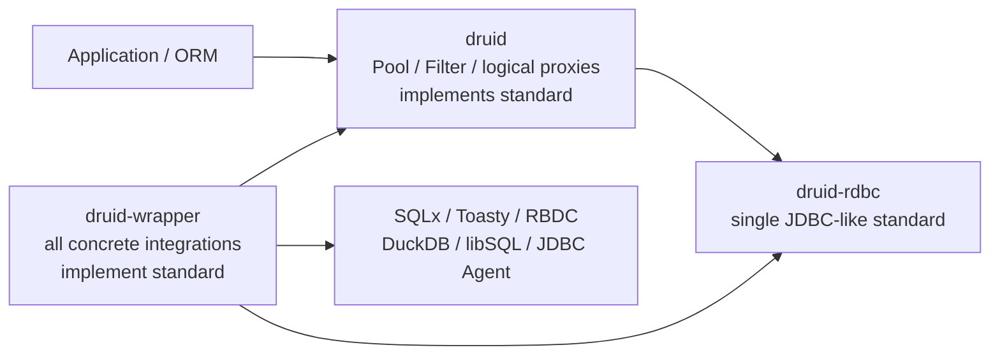

# druid-rdbc 单一 JDBC-like Standard Trait Tree 规格

> **状态：PROPOSED — 用户已明确批准架构，书面规格待复核**
>
> **决策编号：ADR-RDBC-006**
>
> **取代：ADR-RDBC-004、ADR-RDBC-005**

## 1. 决策

`druid-rdbc` 是 druid-rust 中所有数据库 integrations 的唯一 JDBC-like standard。

1. SQLx、Toasty、RBDC、DuckDB、libSQL、HTTP SQL、JDBC Agent 直接实现
   `druid-rdbc` standard traits。
2. `DruidPooledConnection`、pooled Statement/ResultSet 和 Druid metadata/resource proxies
   实现同一套 traits。
3. 最终不存在第二套 `Physical*` canonical hierarchy；现有 `Physical*` 的标准行为
   rename/merge 到 standard traits，兼容旧名在 merge 完成后删除。
4. raw 与 logical 的差别由 holder、lease、owner strategy 和 close policy 表达，不由第二套
   SQL trait 表达。
5. 不机械复制全部 JDBC Java 对象；必须保留相关对象的命名、方法、可观察逻辑语义，并对
   未形成独立 Rust 类型的 Java 对象记录明确 disposition。

允许声明：

> `druid-rdbc` is the unified JDBC 4.2-aligned Rust database contract used by
> every druid-rust integration and proxy.

在 TCK、完整 RowSet、Java/Rust differential 和真实数据库矩阵通过前，不声明 JDBC
compliant implementation。

## 2. 基线

| 项目 | 冻结值 |
| :--- | :--- |
| JDBC | JSR 221 JDBC 4.2 MR2 / Java SE 8 |
| Java source oracle | OpenJDK `jdk8u502-b07`, commit `7373384725418fa645fb4508ec05a869bc7fc3e7` |
| archive SHA-256 / size | `5f9c0657c534319a272751431a1f5919cfdcd4e0ac4e0fb9b7e181bc27fa489b` / `94,004,963` bytes |
| Java Druid | `1.2.28` / `33824c3dec1612711f9bb4e409319bcab2e4cd0e` |
| Rust decision baseline | `2c421efa6caf8bfc983633529fc3775c251f9492` |
| MSRV / default / edition | `1.95` / `1.97.1` / `2021` |
| unsafe | `forbid` |

执行时重新记录 HEAD、dirty state、Cargo metadata、工具版本与 CodeGraph 状态。语义
inventory 生成前必须验证 oracle commit、size、SHA-256。

## 3. 目标拓扑



Cargo normal DAG remains：

```text
druid-rdbc <- druid <- druid-wrapper
      ^                    |
      +--------------------+
```

`druid-rdbc` 不依赖 Druid 或具体 driver/pool。`druid` 对 wrapper 只允许 dev-dependency。

## 4. 唯一标准公共面

目标 modules：

```text
crates/druid-rdbc/src/
├── connection/
├── statement/
├── result_set/
├── metadata/
├── resource/
├── data_source/
├── driver/
├── types/
├── error/
├── extensions/
└── compat/
```

Canonical traits/types：

```text
Connection
Statement
PreparedStatement
CallableStatement
ResultSet
DatabaseMetaData
ResultSetMetaData
ParameterMetaData
Driver
ConnectionFactory                 # Rust acquisition extension
DataSource
Array / Blob / Clob / NClob / Ref / SqlXml / Struct
Wrapper
```

Rust 形状可不同于 Java：

- checked exception → `Result<T, RdbcError>`；
- overload → typed options/parameter descriptors；
- nullable → `Option<T>` 与唯一 `Value::Null` 规则；
- blocking cursor → async method or explicitly named extension；
- exception subclasses → `SqlExceptionKind` + payload；
- static manager → registry/manager module；
- listener/event → callback/event value；
- JavaBeans/security/reflection objects → disposition，不机械复制 runtime。

## 5. 现有 `Physical*` 处置

### 5.1 MERGE_STANDARD

| 当前 canonical | 最终 canonical |
| :--- | :--- |
| `PhysicalConnection` | `connection::Connection` |
| `PhysicalStatement` | `statement::Statement` |
| `PhysicalPreparedStatement` | `statement::PreparedStatement` |
| `PhysicalCallableStatement` | `statement::CallableStatement` |
| `PhysicalResultSet` | `result_set::ResultSet` |
| `PhysicalDatabaseMetaData` | `metadata::DatabaseMetaData` |
| `PhysicalResultSetMetaData` | `metadata::ResultSetMetaData` |
| `RdbcArrayAccess/RdbcBlobAccess/...` | corresponding standard resource traits |
| Callable/Prepared parameter DTO | `statement` descriptors |
| ResultSet metadata/update/nullability DTO | `result_set` / `metadata` DTO |
| generated keys / execution outcome / update result | `statement` DTO |
| standard `Wrapper` portion | standard `Wrapper` |

现有实现体作为标准化输入，不重写数据库行为。迁移期允许旧/new traits 短暂并存，但只有
standard 是 canonical；adapter 的两个 impl 必须委托同一实现 core。method set 不同期间
禁止用 alias 假装 type identity 相同。Druid holder 切换完成后删除全部 `Physical*` names。

### 5.2 RDBC_EXTENSION

| 当前对象 | 最终处置 |
| :--- | :--- |
| `PhysicalConnectionFactory` | `driver::ConnectionFactory` |
| `PhysicalConnectionCapabilities` | `extensions::ConnectionCapabilities` |
| `PhysicalStatementOptions` | `statement::StatementOptions` |
| `Unwrapped/WrapperExt` | pure typed standard extension；移除 Druid/Physical variants |
| buffered fallback | `extensions::BufferedRowSet`，不冒充 `javax.sql.RowSet` |
| async stream | `ResultSetExt` / Stream adapter；不建第二个 canonical cursor trait |

### 5.3 DRUID_INTERNAL

以下迁回 `druid` internal modules，不进入公共标准：

- `PhysicalConnectionInfo`；
- `PreparedStatementKey/PreparedStatementMethodType`；
- `RdbcResourceContext/Factory/Owner/Id/Kind/State` 与 runtime capability；
- pool/filter `is_wrapper_proxy`、`statement_connection` hooks；
- connection holder、reset plan、validation policy、discard state；
- Druid-specific metadata compatibility flags。

### 5.4 CONCRETE_IMPL

- `SqlTextStatement/SqlTextPreparedStatement` → wrapper common/testkit；
- `RowSetResultSet` → accurately named buffered implementation；
- current forwarding `RdbcResultSet` → concrete forwarding implementation；
- access/context-backed Blob/Clob/... → wrapper raw implementation or Druid logical proxy；
- physical backend-bearing ResultSetMetaData → split standard trait/snapshot from concrete backend。

## 6. raw 与 logical ownership

raw 与 logical 是 owner/close policy，不是 SQL API 类型差异：


目标 holder：

```text
DruidConnectionHolder
├── connection: Box<dyn druid_rdbc::Connection>
├── owner: NativePool | ExternalLease
├── reset_plan
├── prepared_cache
└── resource_registry
```

- raw 只能从 `Driver/ConnectionFactory` acquisition path 进入 holder；
- logical close exactly-once recycle；
- eviction/shutdown 才调用 holder raw `Connection::close`；
- external owner 不进入 native pool；
- 不公开 Raw/Physical marker trait；必要时使用 Druid private newtype。

## 7. 第三方 integration 合同

所有 adapter 直接实现 standard：

```rust
impl druid_rdbc::Connection for SqlxConnectionAdapter { /* ... */ }
impl druid_rdbc::PreparedStatement for SqlxPreparedStatement { /* ... */ }
impl druid_rdbc::ResultSet for SqlxResultSet { /* ... */ }
```

Toasty、RBDC、DuckDB、libSQL、HTTP SQL、JDBC Agent 使用同一 traits 和同一 conformance
suite。bb8/deadpool lease wrapper 也直接实现 `Connection`，不形成第二个 pool。

### 7.1 Statement/ResultSet 执行所有权

JDBC Statement 能在 `Connection#createStatement` 返回后独立执行。Rust standard 固定以下
owner 模型：

- `Connection::create_statement/prepare_statement/prepare_call` 返回唯一所有权
  `Box<dyn Statement/PreparedStatement/CallableStatement>`，不返回借用；
- adapter Statement 拥有可克隆的 connection actor/executor handle 或等价 native owned
  handle；不得在返回值中借用 `&mut Connection`；
- Statement execute/query/update 以 `&mut self` 执行；
- query 返回唯一所有权 `Box<dyn ResultSet>`；ResultSet 持有 cursor/connection lease 或
  actor channel，并以 `&mut self` 推进；
- 不使用 `Arc<dyn ResultSet>` 搭配 `next(&mut self)`；共享只读 metadata 使用 `Arc` 或 owned
  snapshot；
- Druid pooled Statement 持有 logical connection lease 与 underlying standard Statement，
  close/cascade 后 exactly-once 释放；
- prepared cache 在 Druid 内部包装 standard `PreparedStatement`，不改变 standard owner。

### 7.2 Auto traits、object safety 与 lifetime

| Trait family | Required bound / owner |
| :--- | :--- |
| `Driver/ConnectionFactory/DriverRegistry` | `Send + Sync + 'static` |
| `Connection` | `Send + 'static`；exclusive mutable operations，不要求 `Sync` |
| `Statement/Prepared/Callable` | `Send + 'static`；owned executor/handle，不要求 `Sync` |
| `ResultSet` | `Send + 'static`；unique `Box` owner，`next(&mut self)` |
| immutable metadata snapshot | `Send + Sync + 'static` |
| mutable resource objects | `Send + 'static`；是否 `Sync` 由只读 view 单独声明 |

所有 runtime traits 必须 dyn-compatible；async methods 使用统一 Send future mapping。标准对象
不得把 connection-local borrow 暴露到返回 trait object lifetime。

### 7.3 Metadata ownership

Metadata 分为 live runtime 与 immutable snapshot：

- `Connection::database_meta_data(&mut self)` 返回 owned
  `Box<dyn DatabaseMetaData>`；它持有 connection actor/lease，不借用 caller；
- `DatabaseMetaData: Send + 'static`，query/capability methods 允许 async `&mut self`；返回行集
  时使用 owned `Box<dyn ResultSet>`，ResultSet 继续持有 actor/lease；
- `ResultSetMetaData` 与 `ParameterMetaData` 是 immutable owned snapshots，要求
  `Send + Sync + 'static`；
- `ResultSet::meta_data` 与 `PreparedStatement::parameter_meta_data` 返回
  `Arc<dyn ResultSetMetaData>` / `Arc<dyn ParameterMetaData>` 或等价 owned snapshot；
- live DatabaseMetaData 不能伪装成脱离连接的 snapshot，snapshot 也不能持有 mutable
  connection borrow。

## 8. Driver、factory、registry 与 pool policy

| 能力 | Owner |
| :--- | :--- |
| JDBC Driver naming/accepts/connect semantics | `druid-rdbc::Driver` |
| Rust factory abstraction | `druid-rdbc::ConnectionFactory` extension |
| canonical provider registry | `druid-rdbc::driver::DriverRegistry` extension |
| product profile orchestration | `druid` |
| concrete provider registration | `druid-wrapper` |
| raw connection slot / owner strategy | `druid` internal |
| validate | standard `Connection::is_valid`；Druid chooses policy/query |
| reset | Druid internal `ResetPlan` calling standard rollback/setters |
| prepared cache | Druid internal using standard `PreparedStatement` |
| resource release arbiter | Druid internal wrapping standard resources |

## 9. JDBC naming and semantic inventory

Java 8 `java.sql` 52 + `javax.sql` 17 objects remain the semantic denominator，不代表必须创建
69 个 Rust public types。

每个 Java object/member row contains：

```text
item_key
java_fqcn
java_member
rust_shape                 # TRAIT / DTO / ENUM_KIND / MODULE / CALLBACK / EXCLUDED_RUNTIME
semantic_disposition
canonical_rust_entry
target_state               # PLANNED_TARGET / DECLARED / LIVE
adapter_implementation
adapter_state              # NOT_APPLICABLE / PLANNED / LIVE
logical_implementation
logical_state              # NOT_APPLICABLE / PLANNED / LIVE
normalized_signature
call_kind
index_null_adapter
error_adapter
lifecycle_owner
evidence_level
capability_state
notes
```

阶段门禁：Task 2 允许唯一 target 为 `PLANNED_TARGET`，adapter/logical 为 `PLANNED`；Task 4
要求 adapter `LIVE`；Task 5 要求 logical `LIVE`；Task 8 禁止任何 `PLANNED_*`、unresolved、
`MISSING`、`UNKNOWN`、duplicate 或 empty canonical entry。Java runtime exclusion 必须有理由
和替代语义。

## 10. 可观察语义

- index newtype 全部 1-based；signed `TryFrom` 拒绝负数、0、越界；
- `Value::Null` 是 SQL NULL 唯一表示，primitive getter 维护 `was_null`；
- SQL feature unsupported → `SQLFeatureNotSupportedException` taxonomy + `0A000`；
- Java default `UnsupportedOperationException` 使用独立 typed mapping；
- SQLState、vendor、cause/source、next、warning、client-info、DataTruncation payload 保留；
- batch counts 用 `i64`；JDBC int view 模拟 Java cast，Rust checked view 独立；
- metadata null/empty/pattern 不合并，capability=true 必须有 adapter behavior evidence；
- standard resource free/close/free-after-use 和 SQLXML state 对所有 integrations 一致；
- Druid owner cancellation 不得 double-free 或永久阻塞。

## 11. Error waiver

P04 Task 1 只有以下全部通过才能退出 transitional `compat::DruidError`：

1. `WAIVER_EXIT_GATE_1_COMPAT_REMOVED`
2. `WAIVER_EXIT_GATE_2_STANDARD_CLEAN`
3. `WAIVER_EXIT_GATE_3_ADAPTERS_CLEAN`
4. `WAIVER_EXIT_GATE_4_PRODUCT_OWNER_UNIQUE`
5. `WAIVER_EXIT_GATE_5_BASELINE_DISPOSED`
6. `WAIVER_EXIT_GATE_6_COMPAT_VERIFIED`

其后所有 standard implementations 只返回 `RdbcError`；Druid product boundary 包装
`DruidError::Rdbc` 或等价 variant。

## 12. 执行顺序


P03 Tasks 1–5 remain verified mechanical extraction history。P03 Task 6 only freezes current
trait/method/impl denominator and disposition; completion state：

```text
TRANSITIONAL_PHYSICAL_SURFACE_PENDING_STANDARDIZATION
```

## 13. Compatibility and breaking correction

- standard/Physical 短暂双 impl 必须共用一套行为 core；不得形成长期双 canonical；
- `DruidError -> RdbcError` signatures、resource runtime removal、Wrapper split、sync→async
  ResultSet changes are breaking；
- `PhysicalConnectionInfo`/cache/resource runtime cannot remain as rdbc public API；
- current version `0.0.0-design` + `publish=false` allows explicit pre-release correction，但必须
  public API diff、external consumer/implementor、migration table and semver allowlist。

## 14. Completion gates

1. `druid-rdbc` contains one canonical standard trait tree and no `Physical*` public names。
2. Every configured wrapper adapter directly implements standard traits。
3. Druid pooled proxies implement the same traits；holder stores `Box<dyn Connection>`。
4. raw/logical lifecycle gates prove exactly-once recycle/close and no double pool。
5. 52 + 17 semantic inventory has no missing/unknown/duplicate。
6. six error waiver gates pass。
7. index/null/default/error/metadata/resource semantics pass shared conformance。
8. public API/semver/external implementor/migration evidence matches approved breaking allowlist。
9. Java/Rust differential and real DB evidence support every true capability。
10. fmt/check/clippy/test/doc、all-features、MSRV、DAG and forbidden-dependency gates pass。

## 15. ADR

| ADR | Decision | Status |
| :--- | :--- | :--- |
| ADR-RDBC-001 | `druid::sql::*` consumer canonical path | ACCEPTED |
| ADR-RDBC-002 | logical concrete handles，不复制 Java inheritance | ACCEPTED |
| ADR-RDBC-003 | buffered/streaming 显式分型 | ACCEPTED |
| ADR-RDBC-004 | rdbc owns standard + Physical SPI | SUPERSEDED |
| ADR-RDBC-005 | Druid owns second Physical hierarchy | SUPERSEDED |
| ADR-RDBC-006 | single rdbc standard trait tree；Physical merged then deleted | PROPOSED_FOR_WRITTEN_REVIEW |
