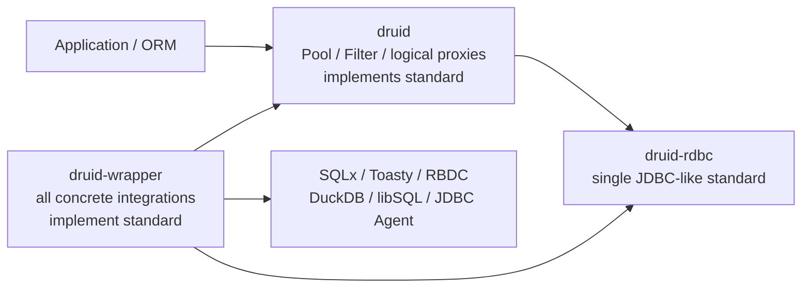

# druid-rdbc 单一 JDBC-like Standard Trait Tree 规格

> **状态：PROPOSED — 用户已明确批准架构，书面规格待复核**
>
> **决策编号：ADR-RDBC-006**
>
> **取代：ADR-RDBC-004、ADR-RDBC-005**

## 1. 决策

`druid-rdbc` 是 druid-rust 中所有数据库 integrations 的唯一 JDBC-like standard。

1. SQLx、Toasty、RBDC、DuckDB、libSQL、HTTP SQL、JDBC Agent 直接实现
   `druid-rdbc` standard traits。
2. `DruidPooledConnection`、pooled Statement/ResultSet 和 Druid metadata/resource proxies
   实现同一套 traits。
3. 最终不存在第二套 `Physical*` canonical hierarchy；现有 `Physical*` 的标准行为
   rename/merge 到 standard traits，兼容旧名在 merge 完成后删除。
4. raw 与 logical 的差别由 holder、lease、owner strategy 和 close policy 表达，不由第二套
   SQL trait 表达。
5. 不机械复制全部 JDBC Java 对象；必须保留相关对象的命名、方法、可观察逻辑语义，并对
   未形成独立 Rust 类型的 Java 对象记录明确 disposition。

允许声明：

> `druid-rdbc` is the unified JDBC 4.2-aligned Rust database contract used by
> every druid-rust integration and proxy.

在 TCK、完整 RowSet、Java/Rust differential 和真实数据库矩阵通过前，不声明 JDBC
compliant implementation。

## 2. 基线

| 项目 | 冻结值 |
| :--- | :--- |
| JDBC | JSR 221 JDBC 4.2 MR2 / Java SE 8 |
| Java source oracle | OpenJDK `jdk8u502-b07`, commit `7373384725418fa645fb4508ec05a869bc7fc3e7` |
| archive SHA-256 / size | `5f9c0657c534319a272751431a1f5919cfdcd4e0ac4e0fb9b7e181bc27fa489b` / `94,004,963` bytes |
| Java Druid | `1.2.28` / `33824c3dec1612711f9bb4e409319bcab2e4cd0e` |
| Rust decision baseline | `2c421efa6caf8bfc983633529fc3775c251f9492` |
| MSRV / default / edition | `1.95` / `1.97.1` / `2021` |
| unsafe | `forbid` |

执行时重新记录 HEAD、dirty state、Cargo metadata、工具版本与 CodeGraph 状态。语义
inventory 生成前必须验证 oracle commit、size、SHA-256。

## 3. 目标拓扑



Cargo normal DAG remains：

```text
druid-rdbc <- druid <- druid-wrapper
      ^                    |
      +--------------------+
```

`druid-rdbc` 不依赖 Druid 或具体 driver/pool。`druid` 对 wrapper 只允许 dev-dependency。

## 4. 唯一标准公共面

目标 modules：

```text
crates/druid-rdbc/src/
├── connection/
├── statement/
├── result_set/
├── metadata/
├── resource/
├── data_source/
├── driver/
├── types/
├── error/
├── extensions/
└── compat/
```

Canonical traits/types：

```text
Connection
Statement
PreparedStatement
CallableStatement
ResultSet
DatabaseMetaData
ResultSetMetaData
ParameterMetaData
Driver
ConnectionFactory                 # Rust acquisition extension
DataSource
Array / Blob / Clob / NClob / Ref / SqlXml / Struct
Wrapper
```

Rust 形状可不同于 Java：

- checked exception → `Result<T, RdbcError>`；
- overload → typed options/parameter descriptors；
- nullable → `Option<T>` 与唯一 `Value::Null` 规则；
- blocking cursor → async method or explicitly named extension；
- exception subclasses → `SqlExceptionKind` + payload；
- static manager → registry/manager module；
- listener/event → callback/event value；
- JavaBeans/security/reflection objects → disposition，不机械复制 runtime。

## 5. 现有 `Physical*` 处置

### 5.1 MERGE_STANDARD

| 当前 canonical | 最终 canonical |
| :--- | :--- |
| `PhysicalConnection` | `connection::Connection` |
| `PhysicalStatement` | `statement::Statement` |
| `PhysicalPreparedStatement` | `statement::PreparedStatement` |
| `PhysicalCallableStatement` | `statement::CallableStatement` |
| `PhysicalResultSet` | `result_set::ResultSet` |
| `PhysicalDatabaseMetaData` | `metadata::DatabaseMetaData` |
| `PhysicalResultSetMetaData` | `metadata::ResultSetMetaData` |
| `RdbcArrayAccess/RdbcBlobAccess/...` | corresponding standard resource traits |
| Callable/Prepared parameter DTO | `statement` descriptors |
| ResultSet metadata/update/nullability DTO | `result_set` / `metadata` DTO |
| generated keys / execution outcome / update result | `statement` DTO |
| standard `Wrapper` portion | standard `Wrapper` |

现有实现体作为标准化输入，不重写数据库行为。迁移期允许旧/new traits 短暂并存，但只有
standard 是 canonical；adapter 的两个 impl 必须委托同一实现 core。method set 不同期间
禁止用 alias 假装 type identity 相同。Druid holder 切换完成后删除全部 `Physical*` names。

### 5.2 RDBC_EXTENSION

| 当前对象 | 最终处置 |
| :--- | :--- |
| `PhysicalConnectionFactory` | `driver::ConnectionFactory` |
| `PhysicalConnectionCapabilities` | `extensions::ConnectionCapabilities` |
| `PhysicalStatementOptions` | `statement::StatementOptions` |
| `Unwrapped/WrapperExt` | pure typed standard extension；移除 Druid/Physical variants |
| buffered fallback | `extensions::BufferedRowSet`，不冒充 `javax.sql.RowSet` |
| async stream | `ResultSetExt` / Stream adapter；不建第二个 canonical cursor trait |

### 5.3 DRUID_INTERNAL

以下迁回 `druid` internal modules，不进入公共标准：

- `PhysicalConnectionInfo`；
- `PreparedStatementKey/PreparedStatementMethodType`；
- `RdbcResourceContext/Factory/Owner/Id/Kind/State` 与 runtime capability；
- pool/filter `is_wrapper_proxy`、`statement_connection` hooks；
- connection holder、reset plan、validation policy、discard state；
- Druid-specific metadata compatibility flags。

### 5.4 CONCRETE_IMPL

- `SqlTextStatement/SqlTextPreparedStatement` → wrapper common/testkit；
- `RowSetResultSet` → accurately named buffered implementation；
- current forwarding `RdbcResultSet` → concrete forwarding implementation；
- access/context-backed Blob/Clob/... → wrapper raw implementation or Druid logical proxy；
- physical backend-bearing ResultSetMetaData → split standard trait/snapshot from concrete backend。

## 6. raw 与 logical ownership

raw 与 logical 是 owner/close policy，不是 SQL API 类型差异：


目标 holder：

```text
DruidConnectionHolder
├── connection: Box<dyn druid_rdbc::Connection>
├── owner: NativePool | ExternalLease
├── reset_plan
├── prepared_cache
└── resource_registry
```

- raw 只能从 `Driver/ConnectionFactory` acquisition path 进入 holder；
- logical close exactly-once recycle；
- eviction/shutdown 才调用 holder raw `Connection::close`；
- external owner 不进入 native pool；
- 不公开 Raw/Physical marker trait；必要时使用 Druid private newtype。

## 7. 第三方 integration 合同

所有 adapter 直接实现 standard：

```rust
impl druid_rdbc::Connection for SqlxConnectionAdapter { /* ... */ }
impl druid_rdbc::PreparedStatement for SqlxPreparedStatement { /* ... */ }
impl druid_rdbc::ResultSet for SqlxResultSet { /* ... */ }
```

Toasty、RBDC、DuckDB、libSQL、HTTP SQL、JDBC Agent 使用同一 traits 和同一 conformance
suite。bb8/deadpool lease wrapper 也直接实现 `Connection`，不形成第二个 pool。

### 7.1 Statement/ResultSet 执行所有权

JDBC Statement 能在 `Connection#createStatement` 返回后独立执行。Rust standard 固定以下
owner 模型：

- `Connection::create_statement/prepare_statement/prepare_call` 返回唯一所有权
  `Box<dyn Statement/PreparedStatement/CallableStatement>`，不返回借用；
- adapter Statement 拥有可克隆的 connection actor/executor handle 或等价 native owned
  handle；不得在返回值中借用 `&mut Connection`；
- Statement execute/query/update 以 `&mut self` 执行；
- query 返回唯一所有权 `Box<dyn ResultSet>`；ResultSet 持有 cursor/connection lease 或
  actor channel，并以 `&mut self` 推进；
- 不使用 `Arc<dyn ResultSet>` 搭配 `next(&mut self)`；共享只读 metadata 使用 `Arc` 或 owned
  snapshot；
- Druid pooled Statement 持有 logical connection lease 与 underlying standard Statement，
  close/cascade 后 exactly-once 释放；
- prepared cache 在 Druid 内部包装 standard `PreparedStatement`，不改变 standard owner。

#### Generic execute 的结果行数保真

BASE generic execute 对已缓冲查询结果保留实际行数，并且不为生成执行摘要推进游标。
canonical `ResultSet::known_row_count() -> Option<u64>` 是 SQL-neutral Rust 扩展：
实现可返回已知的完整结果行数；未知或尚未耗尽的 streaming cursor 默认返回 `None`。
该方法不得执行数据库请求、读取后续行或改变游标位置，也不表示受影响行数。
缓冲 adapter 返回真实缓冲长度，pooled proxy 保留该信息；关闭后返回 `None`。
generic execute 的 Filter summary 使用首个结果的已知行数，不能以固定零替代。
更新结果仍使用 update count，且查询结果的 update count 仍为 `None`。
这是既有 BASE 行为迁移义务的细化，不关闭 generated-keys 请求或 Task 7 streaming 门禁。

#### Generated keys 准备请求保真

`Connection::prepare_statement_with_generated_keys(sql, options, GeneratedKeys)` 合并 Java
生成键准备重载。`None` 默认委托既有普通准备入口；其他模式未经驱动实现时必须在
创建 raw statement 前返回明确不支持，禁止把 auto/index/name 请求降级为 `None`。
Druid pooled proxy 与 external lease 必须原样传播请求；缓存同时区分模式、列内容、
列顺序与结果集选项，显式 `None` 与普通标准准备入口允许复用相同条目。
这是 BASE 准备重载迁移义务的细化；请求传播证据不能替代真实数据库生成键结果证据。

BASE Toasty SQLite 的 prepared 列索引/列名重载属于已实现行为：接受准备请求，
并返回 SQLite 单 rowid 生成键，不承诺任意多列投影。迁移不得统一拒绝该既有路径；
普通 Statement 的列选择执行重载仍保持明确不支持。其他驱动的能力分别验收，
不得将 Toasty SQLite 的行为扩展为所有驱动的支持声明。

#### 可变标准接口解包

`Wrapper::unwrap_mut` 是同一 canonical interface 的 Rust 独占借用入口，
以 `StandardUnwrappedMut` 返回原对象的可变标准视图，保持 leaf 和继承接口身份。
不能借助 `Any`、具体产品类型或第二套驱动接口实现。借用不得越过owner生命周期，
不能同时建立可重叠的独占视图。旧手写Wrapper实现可默认明确拒绝此扩展；
使用标准macro的实现应提供完整可变继承视图。空目标为参数错误，未知目标为0A000。
ResultSet 的创建Statement恢复仍必须返回拥有真实共享逻辑状态的句柄，
不能以这个可变借用入口本身作为共享owner、资源保活或关闭协议已完成的证明。

#### Java 整数结果处置入口

`Statement::get_more_results_current(current: i32)` 保留 BASE 的整数重载边界，
只接受 JDBC `CLOSE_CURRENT_RESULT=1`、`KEEP_CURRENT_RESULT=2`、
`CLOSE_ALL_RESULTS=3`，转换后调用同一 typed `get_more_results`。
其他整数返回 `InvalidArgument`，且必须先于 driver 调用、游标关闭和结果序列推进；
尤其 `999` 失败后，当前游标及 update count 保持原状态。
上述整数参数校验适用于有效句柄。Druid logical proxy 必须先检查逻辑关闭和租约失效，
保留 BASE `ensure_open_for` 的错误顺序：已关闭/失效时返回 `ConnectionDiscarded`，
不能被非法整数的 `InvalidArgument` 遮蔽。关闭检查不调用驱动或推进游标。
无参数默认处置继续使用 `CurrentResultDisposition::Default`，不能将整数0当作默认。

### 7.2 Auto traits、object safety 与 lifetime

| Trait family | Required bound / owner |
| :--- | :--- |
| `Driver/ConnectionFactory/DriverRegistry` | `Send + Sync + 'static` |
| `Connection` | `Send + 'static`；exclusive mutable operations，不要求 `Sync` |
| `Statement/Prepared/Callable` | `Send + 'static`；owned executor/handle，不要求 `Sync` |
| `ResultSet` | `Send + 'static`；unique `Box` owner，`next(&mut self)` |
| immutable metadata snapshot | `Send + Sync + 'static` |
| mutable resource objects | `Send + 'static`；是否 `Sync` 由只读 view 单独声明 |

所有 runtime traits 必须 dyn-compatible；async methods 使用统一 Send future mapping。标准对象
不得把 connection-local borrow 暴露到返回 trait object lifetime。

### 7.3 Metadata ownership

Metadata 分为 live runtime 与 immutable snapshot：

- `Connection::database_meta_data(&mut self)` 返回 owned
  `Box<dyn DatabaseMetaData>`；它持有 connection actor/lease，不借用 caller；
- `DatabaseMetaData: Send + 'static`，query/capability methods 允许 async `&mut self`；返回行集
  时使用 owned `Box<dyn ResultSet>`，ResultSet 继续持有 actor/lease；
- `ResultSetMetaData` 与 `ParameterMetaData` 是 immutable owned snapshots，要求
  `Send + Sync + 'static`；
- `ResultSet::meta_data` 与 `PreparedStatement::parameter_meta_data` 返回
  `Arc<dyn ResultSetMetaData>` / `Arc<dyn ParameterMetaData>` 或等价 owned snapshot；
- live DatabaseMetaData 不能伪装成脱离连接的 snapshot，snapshot 也不能持有 mutable
  connection borrow。

## 8. Driver、factory、registry 与 pool policy

| 能力 | Owner |
| :--- | :--- |
| JDBC Driver naming/accepts/connect semantics | `druid-rdbc::Driver` |
| Rust factory abstraction | `druid-rdbc::ConnectionFactory` extension |
| canonical provider registry | `druid-rdbc::driver::DriverRegistry` extension |
| product profile orchestration | `druid` |
| concrete provider registration | `druid-wrapper` |
| raw connection slot / owner strategy | `druid` internal |
| validate | standard `Connection::is_valid`；Druid chooses policy/query |
| reset | Druid internal `ResetPlan` calling standard rollback/setters |
| prepared cache | Druid internal using standard `PreparedStatement` |
| resource release arbiter | Druid internal wrapping standard resources |

Java 兼容 `DriverManager` 保留显式注册顺序和回调身份；`get_driver` 的首个 URL
接受者选择及 `get_connection` 的连接协商均委托 standard `DriverRegistry`。
注册表锁必须在第三方 `accepts_url`/`connect` 回调前释放。产品档案工厂仍须经
canonical provider registry 收敛。兼容连接查找不调用无关驱动的 `name()`；
注册顺序和 URL 协商由 standard registry 决定。此兼容入口调整不单独关闭 P05。

## 9. JDBC naming and semantic inventory

Java 8 `java.sql` 52 + `javax.sql` 17 objects remain the semantic denominator，不代表必须创建
69 个 Rust public types。

每个 Java object/member row contains：

```text
item_key
java_fqcn
java_member
rust_shape                 # TRAIT / DTO / ENUM_KIND / MODULE / CALLBACK / EXCLUDED_RUNTIME
semantic_disposition
canonical_rust_entry
target_state               # PLANNED_TARGET / DECLARED / LIVE
adapter_implementation
adapter_state              # NOT_APPLICABLE / PLANNED / LIVE
logical_implementation
logical_state              # NOT_APPLICABLE / PLANNED / LIVE
normalized_signature
call_kind
index_null_adapter
error_adapter
lifecycle_owner
evidence_level
capability_state
notes
```

阶段门禁：Task 2 允许唯一 target 为 `PLANNED_TARGET`，adapter/logical 为 `PLANNED`；Task 4
要求 adapter `LIVE`；Task 5 要求 logical `LIVE`；Task 8 禁止任何 `PLANNED_*`、unresolved、
`MISSING`、`UNKNOWN`、duplicate 或 empty canonical entry。Java runtime exclusion 必须有理由
和替代语义。

## 10. 可观察语义

- index newtype 全部 1-based；signed `TryFrom` 拒绝负数、0、越界；
- `Value::Null` 是 SQL NULL 唯一表示，primitive getter 维护 `was_null`；
- SQL feature unsupported → `SQLFeatureNotSupportedException` taxonomy + `0A000`；
- Java default `UnsupportedOperationException` 使用独立 typed mapping；
- SQLState、vendor、cause/source、next、warning、client-info、DataTruncation payload 保留；
- batch counts 用 `i64`；JDBC int view 模拟 Java cast，Rust checked view 独立；
- metadata null/empty/pattern 不合并，capability=true 必须有 adapter behavior evidence；
- standard resource free/close/free-after-use 和 SQLXML state 对所有 integrations 一致；
- Druid owner cancellation 不得 double-free 或永久阻塞。

## 11. Error waiver

P04 Task 1 只有以下全部通过才能退出 transitional `compat::DruidError`：

1. `WAIVER_EXIT_GATE_1_COMPAT_REMOVED`
2. `WAIVER_EXIT_GATE_2_STANDARD_CLEAN`
3. `WAIVER_EXIT_GATE_3_ADAPTERS_CLEAN`
4. `WAIVER_EXIT_GATE_4_PRODUCT_OWNER_UNIQUE`
5. `WAIVER_EXIT_GATE_5_BASELINE_DISPOSED`
6. `WAIVER_EXIT_GATE_6_COMPAT_VERIFIED`

其后所有 standard implementations 只返回 `RdbcError`；Druid product boundary 包装
`DruidError::Rdbc` 或等价 variant。

## 12. 执行顺序


P03 Tasks 1–5 remain verified mechanical extraction history。P03 Task 6 only freezes current
trait/method/impl denominator and disposition; completion state：

```text
TRANSITIONAL_PHYSICAL_SURFACE_PENDING_STANDARDIZATION
```

## 13. Compatibility and breaking correction

- standard/Physical 短暂双 impl 必须共用一套行为 core；不得形成长期双 canonical；
- `DruidError -> RdbcError` signatures、resource runtime removal、Wrapper split、sync→async
  ResultSet changes are breaking；
- `PhysicalConnectionInfo`/cache/resource runtime cannot remain as rdbc public API；
- current version `0.0.0-design` + `publish=false` allows explicit pre-release correction，但必须
  public API diff、external consumer/implementor、migration table and semver allowlist。

## 14. Completion gates

1. `druid-rdbc` contains one canonical standard trait tree and no `Physical*` public names。
2. Every configured wrapper adapter directly implements standard traits。
3. Druid pooled proxies implement the same traits；holder stores `Box<dyn Connection>`。
4. raw/logical lifecycle gates prove exactly-once recycle/close and no double pool。
5. 52 + 17 semantic inventory has no missing/unknown/duplicate。
6. six error waiver gates pass。
7. index/null/default/error/metadata/resource semantics pass shared conformance。
8. public API/semver/external implementor/migration evidence matches approved breaking allowlist。
9. Java/Rust differential and real DB evidence support every true capability。
10. fmt/check/clippy/test/doc、all-features、MSRV、DAG and forbidden-dependency gates pass。

## 15. ADR

| ADR | Decision | Status |
| :--- | :--- | :--- |
| ADR-RDBC-001 | `druid::sql::*` consumer canonical path | ACCEPTED |
| ADR-RDBC-002 | logical concrete handles，不复制 Java inheritance | ACCEPTED |
| ADR-RDBC-003 | buffered/streaming 显式分型 | ACCEPTED |
| ADR-RDBC-004 | rdbc owns standard + Physical SPI | SUPERSEDED |
| ADR-RDBC-005 | Druid owns second Physical hierarchy | SUPERSEDED |
| ADR-RDBC-006 | single rdbc standard trait tree；Physical merged then deleted | PROPOSED_FOR_WRITTEN_REVIEW |

### Task 6 标准结果创建语句合同的 Rust 实现澄清

`ResultSet::get_statement` 返回拥有型 `Option<Box<dyn Statement>>`，对应 JDBC getStatement。
Druid 查询及生成键结果的返回句柄必须保留原创建对象的 Prepared/Callable 叶子能力，
通过既有 `Wrapper::unwrap_mut` 操作同一逻辑状态。原变量释放或结果单独关闭不能提前关闭
该 owner；通过任一语句句柄关闭时共享参数、结果、初始属性恢复、缓存资格与关闭进度。
metadata 结果没有调用方创建 Statement，必须返回 None，不返回内部生命周期 placeholder。
不支持此方法的 adapter 默认明确报 UnsupportedOperation，不以 SQL/id 描述符冒充逻辑身份。
此处是既有 BASE 身份合同的语言映射，未改变最终验收范围；公共 API/compiler/SemVer、
失败/取消与完整差分证据仍须按 Task6–8 验收。

### Task 6 强类型读取与资源更新重载保真澄清

固定 BASE 的 all_strong_getter_overloads_preserve_raw_spi_argument_identity 要求完整58次驱动调用。
唯一标准结果集用 ResultSetRead 描述符承载 Decimal 的无 scale/指定 scale，以及日期时间
Unspecified/Specified(None)/Specified(Some(Calendar))，不能在扩展 getter 中丢弃参数。
列名入口必须抵达原驱动列名 getter；配置隐藏或映射时继续执行可见性检查。
资源更新 NULL 仍保留 Ref/Blob/Clob/Array/RowId/NClob/SQLXML family，BlobStream/ClobReader/
NClobReader 与普通 stream/Reader family 分开；不得消费或关闭调用者资源。
默认标量转换严格延续固定 BASE：Decimal 使用 with_scale，日期时间支持既有字符串/时间戳转换；
Calendar 描述符仍传递到驱动，默认读取已解码 naive 日期时间时不再次解释时区，原生适配器可覆盖。
池化标量读取保留既有 Filter around-chain 与错误分类，资源句柄不扁平化为标量。
此处恢复原 BASE 合同，不缩减 C1/C2 或 Task7–8 的验收范围。

### Task 6 typed getObject 默认合同的 BASE 恢复

固定 BASE 的 custom_typed_object_checks_the_physical_column_exactly_once 要求 Custom target
先调用指定列的 value 一次，成功后返回 result_set_get_object_typed_custom 的
UnsupportedOperation；驱动读取失败时原错误优先，不能提前拒绝或重复读取。
default_typed_get_object_delegates_every_standard_resource_target 要求 Blob/Clob/NClob/Array/
Ref/RowId/SQLXML/URL 各自分派到对应强类型标准 getter，保持资源身份和 SQL NULL。
默认列名 typed getObject 延续 find_column 一次后按下标分派；原生覆盖仍可实现自己的转换。
default_typed_conversions_cover_alternate_values_and_driver_errors 的所有 BASE 标量、日期时间、
字符串替代值及错误观察必须完整保留，不能用笼统 is_err 或 generic fallback 代替。
这些规则属于唯一 standard ResultSet 默认实现与既有扩展，不增加第二套物理端口。

### Task 6 同步资源参数绑定的 BASE 保真澄清

`5afe860` 的 `prepared_stream_reader_lob_url_rowid_and_null_bind_against_real_sqlite`
明确要求 Toasty/SQLite 的同步 InputStream/Reader setter 返回前读取指定长度，
短流与负长度在绑定阶段报错。底层驱动存储已读取的值，后续执行和批次快照不得再次
读取 caller-owned 资源；逻辑代理与 Filter 仍保留原始完整参数描述符。

统一 standard trait 不强制所有驱动采用相同读取时机。Toasty 与 SQLx SQLite 的同步
stream/Reader setter 保留各自 BASE 的绑定阶段读取；其他 backend 时机须单独证明。
异步 LOB 访问和直接提交的富描述符批次在异步执行边界处理。清参、清批次不新增
资源读取，取消和失败按已经开始执行的实际批次判定消费与重试责任。

`prepared_setter_overloads_preserve_exact_descriptor_identity` 的 BASE 是记录型 driver
参数槽测试：其未消费资源的断言不得推广为真实 Toasty/SQLite driver 的统一要求。
两种行为分别用完整 BASE 记录型绑定用例与真实 SQLite 资源执行用例证明。

### Task 6 Prepared cleanup 失败与逻辑关闭完成状态

BASE 两个 `result_set_statement_handle_reports_*_failure` 用例要求从结果集恢复的
Prepared owner 在 close 返回清参/清批次错误后仍报告逻辑关闭尚未完成。
逻辑关闭完成与租约有效性分开判定：fatal classification 立即失效租约、拒绝后续
执行和 setter；不能通过把关闭状态改为 true 来抹去原 close 失败。
底层资源可以先安全释放，但完成通知/逻辑关闭只在后续成功完成关闭时发布；
registry 保留未完成逻辑关闭责任，重复关闭不重复驱动释放或 pool discard 计数。

### Task 6 执行失败语句的 Java 缓存统计保真

BASE statement_execution_error_removes_handle_instead_of_reusing_it 要求：启用缓存时，首次创建而尚未入缓存的语句执行失败，关闭必须排除该 raw，cached_prepared_statement_count=-1、delete_count=1、closed_count=1。已命中且借出的缓存条目在 checkout 已递减，删除时不能重复递减。标准接口不再暴露私有 holder；通过关闭拒绝执行、raw 关闭一次、同 SQL 再次 prepare 新 raw 证明不复用。该规则恢复既有可观察统计合同，不将负数静默归零。

### Task 6 SQLx SQLite 同步资源绑定原始合同

BASE sqlx_prepared_resources_execute_and_batch_against_real_sqlite 明确要求SQLx SQLite短流和负Reader长度在setter报错，同步stream/Reader在setter消费指定长度，调用者读取剩余资源后execute仍使用已绑定值。逻辑Filter保留原始富描述符。该要求与之前将SQLx一律按延迟绑定处理的假设冲突，原始BASE优先；仅恢复SQLite同步资源setter，不改变其他backend未经证明的时机。异步LOB与直接rich batch继续在异步执行阶段物化，保留取消重试与部分失败合同。

### Task 6 Callable 参数错误与缓存合同恢复

BASE callable_errors_invalidate_cache_and_non_callable_handles_are_rejected 要求空命名 IN 参数在池化层拒绝，不依赖 driver 自行校验；保留全部 scalar/resource/stream/Reader overload 身份。错误路径最终准备、缓存删除、关闭统计必须保留原始验收值，不因改用 owned Callable 或 typed selector 而省略。typed index 构造拒绝与 raw 执行错误分别记录；完整错误缓存/非Callable拒绝证据未闭合前不得标记该 BASE 用例完成。
Callable index0 恢复的固定BASE事实：原 DruidPooledCallableStatement#index_parameter 在语句对象内部调用 CallableParameter::by_index，再通过 record_result 记录校验错误；非法索引不进入驱动。唯一标准 CallableStatement 应提供同名 index_parameter 校验入口：独立驱动默认沿用严格1-based构造，Druid先验证当前租约/关闭状态，再把原构造结果交给已有语句错误/缓存失效路径。现有 CallableParameter::by_index(0) 仍必须独立返回Err；不引入可伪造的ParameterIndex、全局错误计数或第二驱动端口。完整BASE的14个原index0 setter/getter观察必须经过当前语句入口后保留原and_then调用/错误断言，最终7/6/6/6不变。该入口扩展仍需公共API、编译消费者与完整回归验收，不能以局部GREEN关闭Task6。

### Task 6 ResultSet 更新列名身份保真澄清

固定 BASE 的全部 56 次标量、对象和流更新由 canonical `ResultSetUpdate` 描述符承载。
`DruidPooledResultSet::update_value_by_label` 必须保留原列名并调用驱动同名入口，不得无条件
经过 `find_column` 折叠为下标更新；下标更新仍使用既有逻辑列映射。配置隐藏列或列映射时，
按列名入口仍须检查可见性，关闭及过期租约继续 fail closed。流句柄、NULL、负长度和
int/long/unspecified 描述符不得提前物化、消费、关闭或改写。这是 BASE 行为恢复，未新增第二套驱动端口。

### Task 6 typed getObject 默认合同的 BASE 恢复
固定 BASE 要求默认 object_as 对 Custom 先读取实际列一次，保留游标/列错误优先级，然后返回 result_set_get_object_typed_custom。八类资源目标分派到对应标准资源 getter，不得经过通用标量读取替代。其余十三类标量目标执行原转换，保留 NULL、溢出、UTF-8、Decimal 和日期时间行为。按 label 默认只解析一次列，然后进入 index typed getter。不能以通用 UnsupportedOperation 缩小原合同。

Task 6 补充保真：Decimal Float 默认转换必须使用平台 from_f64，保留二进制精度，不先格式化为十进制字符串。真实 SQLite typed getObject 的溢出和自定义目标错误必须分别记入创建语句异常计数，原累计值为 2。BufferedRowSet 字符串的 ASCII/Unicode 输入流与字符/national Reader 返回原始内容，不带 Value SQL 展示引号；完整原四列 labeled 重载案例是验收依据。

### Task 6 type-map 与 typed getObject 列名入口的 BASE 保真

固定 BASE 两个完整身份案例要求：type-map 下标 31/Some(APP.MONEY -> BigDecimal) 与列名 mapped/None 分别到达驱动的下标和列名重载，返回 Scalar(Int(71))/Scalar(Int(72))；typed 下标 41/Custom(com.example.Money) 与列名 payload/Bytes 分别返回驱动原始 String(typed-index)/String(typed-label)。不得无条件解析列名再折叠为下标，也不得按请求类型强制转换驱动返回对象。标准 ResultSet 必须提供可覆盖的列名入口，ResultSetExt 仅委托同一标准树。

默认 type-map 下标和列名入口分别保留 result_set_get_object_with_type_map 与 result_set_get_object_by_label_with_type_map 不支持错误，列名默认不先读取或查列。默认 typed 列名仍只解析一次后委托下标入口，驱动覆盖时保留原列名。池化代理在配置隐藏列或列映射时验证可见性，再传递原列名和原始 map/target；关闭或过期租约拒绝访问驱动。对象不得为了复用标量 Filter hooks 而丢失原生/资源身份；完整对象 Filter 合同仍须独立验收，不因这两个无 Filter 原始案例通过而标为完成。

### Task 6 强类型读取错误进入创建语句异常路径

固定 BASE strong_typed_getter_conversion_errors_follow_statement_check_exception_path 使用单列 event_date=not-a-date 的已定位游标。日期转换失败保留含 cannot be converted to Date 的 DriverError；同列 Blob 读取保留准确 UnsupportedOperation(result_set_blob)。两次失败均在真实创建语句上记录一次，原累计 exception_count=2 不得弱化或用测试计数替代。默认资源读取应在 canonical read_object 入口拒绝错误资源家族，保留驱动前置错误、对应原生资源与 SQL NULL。池化 read_object/read_object_by_label 保留现有 Filter/映射/策略分类，并记录实际强类型读取失败；关闭及过期租约检查仍在外层，不能因恢复统计而重复执行 driver。

### Task 6 ResultSet Filter 更新完整 BASE 合同恢复

全量原始断言核查发现，pooled_result_set_routes_lob_stream_updates_and_preserves_sqlite_capability_errors 与 result_set_scalar_update_filter_defaults_delegate_all_java_overloads 的当前参数化分支把成功Filter转发/短路替换成通用不支持检查。此处恢复已有固定BASE要求，不新增第二套规格或驱动端口。

标量更新需保留原14种setter×下标/原列名共28次PassThrough委托，含Nullable/数值符号/Decimal scale/原String、Bytes和日期时间；全部原9项assert_eq观察为最低要求，不能靠重复空断言通过数量门禁。

LOB更新需保留原12次Blob stream、Clob/NClob Reader短路，包含Some/None、unspecified/long长度、负长度及i64::MAX。Filter应在driver terminal之前执行并可返回成功/错误；资源只由原Filter消费规定首字节/字符，调用者后续读取余量保留原值。精确Filter错误 filtered LOB stream update failure 在实际创建Statement上记入一次。PassThrough到真实SQLite返回各Blob/Clob/NClob下标/列名入口的原UnsupportedOperation名称，两类长度重载共享对应原操作名；12次失败累计真实Statement.exception_count=12，游标仍开放。

唯一标准ResultSetUpdate描述符与原列名必须经过ResultSet Filter链，默认链末端才委托canonical ResultSet::update_value/update_value_by_label；不得增加Physical或另一套driver trait树。闭合/过期租约检查仍在外层，配置列治理时验证可见性。策略fatal分类、result_set统计与creatingStatement异常计数分别保留，不能把record_result_set_error统计误当再次fatal分类而删除。完整BASE与相关Filter/driver/动态分派验证完成前，这两项仍待恢复，C1/C2未关闭。

缓冲驱动兼容性：BufferedRowSet 已实现实际标量/资源 NULL 更新。按列名入口仍须先执行自身 find_column 和 update_value，保留关闭/列错误优先级，以及不支持资源流的既有 SQL 异常 SQLSTATE=0A000。只读默认 LOB 操作名恢复不得绕过该驱动的实现；拒绝时行值及调用者资源均不改变。

### Task6 元数据完整原案例恢复验收

physical_result_set_metadata_preserves_getter_error_and_wrapper_identity 的固定 BASE 观察必须整体保留：24次原getter调用及顺序、nullable/type-code派生入口的原raw委托、精确column_label(9)错误、两个底层对象指针身份、clone、Debug具体类型及同/不同后端相等性。移除旧Physical入口不等于批准删除这些观察。恢复在Druid-private代理实现，公共标准仍只提供结构化接口，不引入Any或第二驱动树。类型擦除入口的实际生产等价性须独立取得证据，不能仅凭私有具体构造器测试通过关闭完整门禁。

标准接口身份映射依据：同一诊断97873终态exit101/0PASS1FAIL，实际 observed=expected=0x1d9df07abf0，data_eq=true/fat_eq=false。原底层对象一致而编译生成的虚表不一致。标准role继续由StandardUnwrapped::ResultSetMetaData检查；两个原指针观察均保留std::ptr::eq，其中标准接口视图明确比较数据指针，不将虚表地址当对象身份，不替换成snapshot内容相等。诊断日志task6-metadata-standard-pointer-diagnostic.log永久保留；临时打印移除。精确错误/clone/Debug/相等性仍待后续运行，不按前置通过推断。

元数据类型擦除恢复的实现约束：固定BASE要求的后端身份和Debug不能在Arc<dyn ResultSetMetaData>入口丢失。标准metadata保留Rust std::fmt::Debug能力；metadata Wrapper宏允许自身TypeId目标返回同一结构化ResultSetMetaData视图，不返回Any或任意产品对象，不新增驱动树或Wrapper方法。Druid-private代理通过同一raw Wrapper目标查询恢复后端身份，Debug委托真实raw对象。共有Arc不能提供独占raw可变视图。新增Debug约束及具体TypeId目标属于待API/编译器/回归验收的接口变化，不能仅以私有案例通过宣称兼容性。


### Task6 稀疏结果集原调用点验收

固定BASE pooled_result_set_classifies_every_sparse_capability_at_the_java_call_site保留34个导航/属性/行修改调用、精确UnsupportedOperation操作名与原参数、创建语句exception_count=34。无结果集Filter时包装不预读metadata，不把getter不支持提前变为构造失败；Filter需要开放元数据时仍保留原Filter配置流程，不向公开getter伪造空快照。错误保持原驱动身份，策略分类后实际creatingStatement只记录一次；成功关闭、重复关闭及registry收尾不重复释放driver。新增SparseResultSet标准fixture保留BASE拒绝能力，标准默认能力本身不因此修改。完整运行和原观察验证后才绑定迁移账本。


### Task6 完整标量原重载验收

固定BASE pooled_scalar_getters_delegate_exact_physical_overloads_and_classify_errors要求19次不同getter调用：object原列名一次，String/Boolean/Long/Int/Short/Byte/Double/Float/Bytes各下标及原列名一次。原不同返回值（index/label、true/false、101至108、109.5至112.5、bytes113/114）及原参数必须保留；boolean_by_label("failing")的原DriverError("boolean_by_label failed")和实际creatingStatement.exception_count1不可改为find_column错误或通用value转换错误。成功读取不得继续增加异常计数。

平台映射复用唯一标准ResultSet的read_object/read_object_by_label描述符入口，补齐原标量重载身份；不得增加Physical或第二个driver接口树。原列名在未配置列治理时直接抵达driver label入口，不能提前解析后转换成index。默认读取继续保留现有SQL NULL、数字宽度、布尔字符串转换、驱动错误优先级与was_null语义；新原生分派不可通过递归调用ResultSetExt便利方法实现。String成功读取仍记录原UTF-16长度，普通object不伪增。公共描述符扩展及外部match/编译/API影响需实际验证，不凭私有测试单例关闭兼容性门禁。


### Task6 结果集错误与旧租约完整原合同恢复

固定BASE result_set_errors_typed_getters_and_old_lease_are_observable保留未定位object与Custom目标object读取的原Other错误和文本 result set cursor is not positioned on a row；先读取列的错误优先于Custom不支持。定位后Custom操作准确返回result_set_get_object_typed_custom，三个失败在实际creatingStatement.exception_count中各记录一次，总数3。该错误来自原RowSetResultSet.value，迁移后的非SQLx缓冲适配器须保留其合同，不在pooled代理按文本伪造错误。

实际close回调归还同一底层连接，新holder复用相同connection id19；旧结果集仍拒绝访问，新租约可执行SELECT1。保留真实工厂、真实Statement及底层数据指针身份，不以模拟计数器或另一驱动树替代。完整正式测试及相关回归通过前不得准确绑定该迁移案例或关闭Task6。


### Task6 完整缓冲元数据与枚举身份验收

固定BASE result_set_metadata_preserves_complete_rdbc_column_contract的24列属性观察、10类类型身份各4项、三态可空性代码必须保留。canonical Snapshot由实际ColumnDescriptor持有原amount_alias/amount/MONEY/com.example.Money、main/app/invoice、24/19/4和全部原flags，不恢复第二套Metadata类型树。缺失的ResultSetColumnType四个纯查询及ColumnNullability.rdbc_code恢复到唯一标准枚举；当前9E0599属于真实缺失接口编译证据，非运行时失败。

Ruling: 新增Jdbc/Named变体没有足够的列级信息推导vendor类名和signed属性，纯枚举查询保留明确默认值Object/false，不改ColumnDescriptor.new的已批准中性默认或driver-reported getters。Jdbc.rdbc_type逐字返回驱动code；Jdbc.type_name为OTHER默认类型族名称；Named.rdbc_type为OTHER1111，type_name返回原厂商名不改大小写。原10类的数值/名称/类名/signed映射逐项保留固定BASE。成本：新增五个枚举查询属于公开API变化，必须通过API/外部编译及SemVer门禁；默认查询不能冒充真实列元数据。ResultSetMetaData真实column_type_name/class_name/is_signed仍来自descriptor，原MONEY/com.example.Money/signed=true不得被覆盖。

恢复测试在原完整矩阵案例及正式Cargo验证通过后才准确绑定账本；纯源码观察检查不能代替编译或执行。不得以减少类型循环、忽略三态、改期望值或移除原断言关闭合同。


### Task6 RowSet 原完整 getter 与转发身份观察

row_set_default_getters_cover_null_label_conversion_and_stream_contracts必须保留14列原工厂、完整成功/失败/stream三个helper及最后共享句柄clone/不同后端不等/原底层指针/Debug/close。局部Bool String预检实际DriverError而原要求true字符串只用于定位，不替代完整原案例。唯一标准String默认的驱动严格读取不能为RowSet兼容全局放宽；缓冲实现应保留自身原转换规则，含合法Bytes UTF8和非法Bytes的DriverError。共享转发身份仍须实际实现并验证，若与Task7对应组件调整执行顺序，应保持完整分母并记录决定，不删除身份断言或用内容相等替代。


### Task6 标准 value 与兼容 object 的独立游标错误

Ruling: 固定BASE中StandardAdapterResultSet.value的未定位合同为InvalidArgument(result set has no current row)，旧RowSet经pooled object/object_as的未定位合同为Other(result set cursor is not positioned on a row)。恢复两个入口的准确合同，不能通过全局修改value错误来保留object，也不能放宽任一原测试。适配器仅在object/object_as入口先执行关闭和定位检查；定位后复用唯一标准转换逻辑。将既有object_as默认实现提取为共享default_object_as自由函数，标准trait仍只有原方法，不复制资源/标量分派、不新增第二接口树。成本：自由函数是公开API新增，完整API/编译/SemVer门禁仍待验收。

全仓85349已终态，242结果块/3712PASS/3FAIL/0ignored，两个Callable创建次数失败和一个标准value错误类别失败；此前LIVE描述由此更正。恢复后须验证真实SQLite原始三个入口、定位后Custom错误、关闭优先级及实际pooled创建语句计数3/旧租约失效，不能只让fetch提示单例通过。

### Task6 稀疏默认导航合同恢复

固定 BASE sparse_result_set_navigation_defaults_report_exact_capabilities 的稀疏实现只提供 close/is_closed，导航错误来自真实 trait 默认。迁移测试不得覆盖 navigate/previous/first/last 等方法来伪造等价。标准 mandatory next 由稀疏驱动明确拒绝，默认 navigate 的 Next 委托该方法；其余七种导航保留原 UnsupportedOperation 及逐操作名称。SQL 驱动自身的能力拒绝仍可由覆盖实现返回 SQLSTATE 0A000。此前池化34调用 fixture 的规则不替代此默认合同验收；原十个导航/行和值调用必须全部执行，原参数 -2、3、列1 保留。完整消费者与API/默认编译器/MSRV/features验证仍须完成。


### Task6 稀疏默认属性合同恢复

固定BASE完整 sparse_result_set_property_defaults_report_exact_capabilities 的31次调用与精确UnsupportedOperation名称须保留。真实稀疏标准对象仅实现mandatory next、close/is_closed，不覆盖可选属性。canonical默认流/Reader不得预读value来替换原stream能力错误，类型/并发/行状态不得以默认成功伪装能力，七个行变更默认错误与驱动自行报告的SQL0A000需区分。

具体BufferedRowSet保留原缓冲流/Reader覆盖以及三个行状态的真实能力；状态查询先验证关闭再返回实际状态，关闭后保持精确Other(result set is closed)。该恢复不增加第二驱动端口，不减少固定1283迁移分母。


### Task6 SQLite 完整更新拒绝和缓冲流能力恢复

保留固定BASE的sqlite_rejects_every_scalar_and_stream_update_without_corrupting_cursor完整58次调用：原Toasty SQLite、原两行SQL、14标量家族、NULL/Object/scale=-1、ASCII/Binary/Character的Unspecified/Int(-1)/Long(-1)、NCharacter的Unspecified/Long(-1)、两种nullable type-map。每个下标/原列名必须得到原精确UnsupportedOperation名称；实际creatingStatement.exception_count58，后续第二行int2/stringsecond，调用者stream/reader未关闭。测试通过现有DruidPooledStatement/registry生产构造，不伪造计数、提前拒绝或另建生产接口。

稀疏standard默认能力继续明确拒绝。真实Toasty缓冲结果保留BASE成功binary/ASCII/Unicode/character/n_character读取能力，不得为了默认拒绝而删除具体能力；当前完整workspace3729/3中的Filter binary_stream拒绝是运行RED。BufferedRowSet的实际按label更新继续自身实现，不能随只读generic默认一起禁用。恢复每个完整原观察后才允许绑定账本，当前42源码缺口和18顶层任务保持范围。

Task6 完整连接状态保真：固定BASE状态0->1->0 holdability与2->8->2->8 isolation不可改断言规避。标准holdability数字扩展沿现有rdbc_code传递，已知常量1/2及默认CloseAtCommit不变；未知数字保留原值并进入完整缓存键。ConnectionDefaults隔离快照使用i32对齐标准TransactionIsolation，u8->i32公开签名变化按§13显式pre-release correction追踪，仍须API diff/external consumer/SemVer/allowlist验收。状态复位保留原read_only->holdability->isolation(除keep)->auto_commit顺序及catalog/schema现有政策；unsupported getter分别跳过，真实driver/closed错误精确传播。此说明不关闭Task6–8任何门禁。


### 2026-10-07 完整读取 Filter 重载保留

固定 BASE 完整 decimal/temporal/calendar Filter 案例原19个等值断言、16次有序重载记录、指定null与UTC参数、短路返回及创建Statement异常1必须恢复。列治理配置时仍须在Filter短路前检查列可见性；没有列治理时应允许按原列名短路，不能以驱动提前find_column拒绝该调用。

在Druid ResultSetFilter中增补standard_result_set_read默认委托hook，参数为上下文、可空已治理列、原列名、完整ResultSetRead描述符和同步后续调用。它是Druid过滤扩展，不是第二个驱动接口；不得公开raw所有权或将资源句柄扁平化为标量。既有value before/after hook顺序及错误分类必须继续验证。

这是§13允许的显式发布前API修正。公共API diff、外部implementor、迁移表及SemVer allowlist门禁仍OPEN，不因新增默认方法、私有测试通过或源码纯度通过而关闭。

### 2026-10-07 完整 NString Filter 合同恢复

固定BASE pooled_result_set_preserves_distinct_n_string_filter_overloads 的原9个等值断言、一次真实Unicode游标next、默认索引与标签各自返回值及两条原驱动调用、两个短路重载及有序记录、精确filtered NString failure和实际创建Statement.exception_count1必须完整保留。未定位真实SQLite游标也必须允许Filter按列3或虚拟标签name短路；默认委托的真实查询SELECT '你好，Druid'须保留原Unicode。

NString读取须经唯一标准ResultSet的read_object/read_object_by_label描述符分派，不得借用String请求或先find_column把标签重载降为索引。默认驱动保持既有object路径、SQL NULL、NString及Scalar(String)接受规则，其他对象仍报准确类型错误；不得扩展为所有标量的字符串化。Druid过滤入口仍须保持隐藏列/映射/关闭/旧租约治理和创建语句异常恰好一次。固定BASE驱动探针的find_column记录physical:find_column:{label}并返回23，原NString两条调用记录中不得出现该记录；默认NString读取经过自己的完整hook后直接进入原生getter，不额外进入需要定位列的value hooks。既有String等描述符的value hooks默认顺序及错误回退继续验收。

ResultSetRead为公开穷举枚举，新增NString是§13允许的显式发布前接口修正，不能按非穷举兼容增补处理。公共API diff、外部消费方/implementor完整矩阵、compiler identity、迁移表和SemVer allowlist门禁继续OPEN；局部外部运行测试不关闭总体门禁。原固定1283分母及全部18顶层任务保持不变。


Task6 完整 Object Filter 合同恢复（2026-10-07）：普通、Map(None/空/非空)与Class的下标/标签六重载必须通过同一注册顺序的完整对象around-chain。类型映射和目标类型使用原借用引用，返回完整RdbcObject，保留资源共享游标和Custom对象身份；无列治理时标签默认委托不额外find_column，短路不得被驱动列定位提前拒绝。隐藏列、关闭和失效租约须先拒绝，实际创建语句异常只记录一次。原十个assert_eq和七条成功事件、精确错误必须保留，补充顺序/短路/错误回退、默认资源身份与全部六入口边界测试。ResultSetObjectRead为新增非穷举Druid Filter描述符，standard_result_set_object默认只调用next；未创建第二套驱动标准。按§13追踪公开API增补，API/compiler/SemVer/external-consumer门禁继续OPEN，1283固定分母与18任务不变。


Task6 完整动态Statement Filter合同（2026-10-07）：get_statement默认返回原逻辑创建语句共享视图（保留Prepared/Callable标准角色），Filter可以拥有型共享句柄替换或精确错误短路。链依注册顺序正向进入、反向退出，实际创建语句异常只记一次；旧租约先拒绝，但有效租约中的已关闭ResultSet/Statement仍保留原关闭身份查询合同。standard_result_set_statement为Druid Filter默认next扩展，返回Option<Box<dyn标准Statement>>，不公开raw所有权、不引入第二驱动端口。标准动态身份通过双向可观察状态变更/独立替换和Wrapper标准角色验证，不能以相同静态值证明共享。按§13追踪公开默认方法增补，API/compiler/SemVer/external-consumer全部门禁继续OPEN，固定1283与完整18任务不变。


Task6 完整Metadata Filter合同（2026-10-07）：固定BASE默认原生metadata0/原日志、平台句柄短路0、精确filtered metadata failure/实际创建语句异常1/原两事件及真实SQLite两列必须恢复。外部Filter以公开standard_result_set_metadata(context,next)保留完整Arc标准metadata短路/替换，不能要求外部实现者命名私有StandardResultSetFilterChain。默认hook仍调用既有meta_data before/after，保持成功/错误及after可替换语义；私有链around方法仅桥接新hook，不新增驱动端口或raw所有权。短路不得调用原生getter，旧租约/关闭优先拒绝；默认metadata仍由原proxy维护平台身份/属性。公开默认方法按§13跟踪，API/compiler/SemVer/external完整门禁仍OPEN，固定1283和全部18任务保持不变。


### 2026-10-07 完整导航与属性 Filter 合同恢复

固定BASE pooled_result_set_routes_navigation_properties_and_real_sqlite_state 原26次短路观察、行99/列88/方向2000/类型2004/并发2007/holdability2、absolute50/relative-20、精确findColumn错误和真实Statement异常1及第二个真实SQLite两行状态机必须完整保留。不能将过滤器原整数改成标准常量以规避断言。ResultSetType/ResultSetConcurrency/FetchDirection沿现有holdability DriverValue模式保存已类型化原整数；已知rdbc_code及FetchDirection::try_from整数输入校验不变，不用未知数字认证能力。

Druid Filter增加公开完整navigation惰性future及property operation/value hook，不提供raw所有权、不建立第二驱动接口。导航默认继续唯一标准navigate；属性按原方法委托并验证返回类型，setter参数与findColumn原标签不变。旧wasNull before/after链保持默认委托。关闭/旧租约先治理，结果仍经过原策略且实际创建语句异常仅记录一次。公开API增补按§13追踪，API/compiler/SemVer/external-consumer/feature/MSRV/完整回归门禁保持OPEN；固定1283与完整18顶层任务不变。

导航路由收尾说明：Next继续既有next around-chain以保留before/after和关闭错误优先级；新navigation hook覆盖其他导航。短路不得读取原生row或改变真实抓取统计。is_closed属于本地关闭状态快照，关闭或失效租约时保留既有快照且不运行hook；其他导航与属性先执行关闭/租约治理。ResultSetType及Concurrency DriverValue必须参与prepare缓存原数字身份，不能折叠为0。

### 2026-10-07 完整资源读取 Filter 合同恢复

固定BASE资源getter完整合同必须保留十三种下标/标签重载、共享字节流和Reader的同一游标、SQL NULL、精确filtered SQLXML failure、实际创建语句异常1和真实SQLite字节/国家字符流读取。资源对象沿ResultSetRead分派；字节流和Reader分别使用公开默认around-hook，不能将句柄扁平化为Value或复制剩余内容冒充共享身份。Filter hook只接收上下文、已治理列、原标签、描述符和惰性next，不公开原生所有权或新增驱动执行入口。

唯一标准ResultSet补充默认input_stream_by_label和reader_by_label，默认委托既有find_column及对应下标入口；ResultSetExt标签方法向该标准重载委托。原生实现可覆盖标签入口以保留重载身份。Druid先治理关闭/旧租约和配置的列可见性，再允许Filter在无列治理时短路虚拟标签；默认末端保留原驱动重载和资源身份，结果沿既有错误分类策略且创建语句失败计数恰好一次。上述公开默认增补按§13的pre-release correction跟踪；API/compiler/SemVer/external-consumer/MSRV/features/完整回归及全部18顶层任务继续OPEN。资源生命周期与取消安全仍须Task7独立验收。

### 2026-10-07 完整行操作 Filter 合同恢复

七个原ResultSet行操作必须依相同注册顺序通过惰性around-chain，保留每个操作身份、短路、刷新精确错误及原创建Statement异常计数。默认末端直接调用唯一标准ResultSet的对应方法，不提前读取游标或改写能力拒绝。关闭/旧租约门禁优先于Filter；驱动/Filter错误沿既有策略分类且实际创建语句仅计错一次。

新增Druid公开行操作描述符和默认委托hook以恢复既有Java Filter合同，不提供raw所有权或第二执行接口。按§13发布前合同修正追踪；API/compiler/SemVer/MSRV/features/external消费者及完整回归门禁仍OPEN，Task7八义务和18顶层不变。


### 2026-10-07 完整默认重载委托与上下文合同

固定BASE result_set_filter_defaults_delegate_and_context_defaults_are_observable 的原47个等值断言、3个状态断言、原标量/Decimal/calendar/object返回值与完整原生调用切片必须保留。无列治理的原生label getter在完整standard_result_set_read链末端应委托同一read_object_by_label，不能为了只有下标身份的value hooks额外find_column；完整读取hook本身承担label观察与返回值替换。已有下标以及显式列治理提供已解析列时仍保持value before/after链、关闭/租约/隐藏列校验与原错误分类。NString独立重载继续保持既有语义。

先前补充控制中人为要求raw:find:virtual/失败标签的事件并非固定BASE默认合同，须修正为原生标签直接读取，并保留完整read-hook正向/逆向顺序、短路、精确错误和实际异常断言；不得删除原合同的physical:find_column探针或隐藏额外调用。既有强getter观察/Decimal替换夹具迁到完整label读取hook，原结果/事件/治理断言不变，不伪造下标身份。这是私有标准链的发布前行为纠正，未增补公开驱动接口，§13的API/compiler/SemVer/external-consumer/MSRV/feature/完整回归门禁继续OPEN，完整1283合同与18顶层任务不变。

### 2026-10-07 完整导航默认委托合同

固定BASE result_set_navigation_filter_defaults_delegate_every_physical_method 的原15个assert、9个assert_eq、原返回值和25条原生事件必须保留。标准Filter默认导航只委托原导航描述符，不能为普通FilterChain调用额外读取row，也不能让驱动row默认拒绝改变已经成功的导航结果。

Druid池化结果集仍需要实际行号维护共享游标状态；该职责通过私有的显式行号跟踪分派保留，继续使用同一标准链和同一原生结果集，原生导航实际执行后才读取row。短路、取消和导航错误不读取row，池化路径row错误仍按既有策略传播。默认导航分派与池化跟踪分派不创建第二驱动端口或公开标准trait。既有池化行号、统计、关闭和租约合同不得削弱，§13及API/compiler/SemVer/MSRV/features/全仓与最终审查、Task7八义务和18顶层任务继续OPEN。
