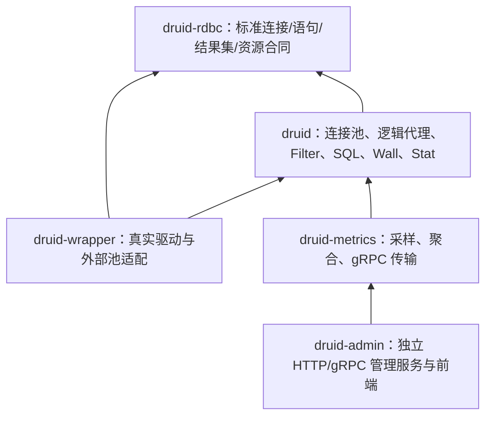

# Druid Java → Rust 当前理解与迁移审计

> 续审更正：本首轮报告对 ADR-003 的发现不完整。`docs/migration/adr/ADR-CRATE-003.md` 已记录 2026-10-22 批准且 governance 已部分落地。架构无需再次批准；以下“等待架构确认”描述保留为首轮调查过程，不能作为当前阻断。详见 [续审报告](continuation.md)。

审计日期：2026-11-01。状态：V0_STATIC / migration incomplete。
用户补充“重点了解”后，本轮不调整架构、不修改生产实现或已有规格。

## 基线与范围

| 项目 | 本轮事实 |
|---|---|
| Java HEAD | fa8dc9912637a2f729eef9f55356621fec18d40e |
| Rust HEAD | b7c2afc59cf67e11f2d66fe7769093ca2d7f93f9 |
| Rust 工作区 | 有既存 Admin 前后端修改；审计期间 WallView.vue 也发生外部修改，均未触碰 |
| 工具链 | rust-toolchain.toml = 1.97.1；MSRV = 1.95 |
| CodeGraph | 两仓库可查询；Rust status 报告 up to date，1847 files / 35873 nodes |
| 覆盖率工具 | cargo-llvm-cov 0.9.1 与 llvm-tools 已安装；本轮未执行覆盖率测试 |
| SDD | OpenSpec 已初始化；Superpowers 保留架构、实施计划和历史证据 |

本轮阅读了主要架构规格、总路线、Admin/Wrapper 计划、验收规范、对象台账当前事实区、最终发布报告的最新结论，并通过 CodeGraph 查询关键调用链。尚未逐篇通读全部 docs 或逐对象核验全部源码。不能声称已完成全量深入审查。

## 当前架构

箭头表示产品依赖，不表示网络流向。另有 druid-bench 和 publish=false 的 druid-test，共七个 workspace 成员。

Java 的 DruidDataSource 负责连接获取、复用、回收、配置与统计，DruidDriver 提供代理驱动接入。Admin 的 MonitorStatService 消费服务发现与远端统计，执行 URL 分派、聚合、排序和分页，不能只迁移页面或 DTO。

Rust 的 wrapper 已有 sqlx、rbdc、toasty、duckdb、libsql、http_sql、jdbc_agent 以及外部池适配。druid-rdbc 是标准 API，不等同于 druid-wrapper/src/rbdc 的第三方 RBDC 驱动适配。

Metrics 的 runtime.rs 使用有界 mpsc 通道，启动 sampler、aggregator、exporter、unregister listener；后台任务受 MetricsSupervisor 管理。pipeline_ownership.rs 记录不同传输阶段的所有权转移。源码显示了异步隔离机制；“完全不影响 SQL”仍需负载、拥塞和取消验证，不能仅凭异步设计承诺零成本。

## 已确认的差距

| 事项 | 证据与解释 |
|---|---|
| 架构要求冲突 | ADR-CRATE-002 明确取代 druid-core + facade；本次最初要求与之不同。用户随后要求重点了解，本轮保持实现 |
| 基线不一致 | Superpowers 仍记录 Java 33824c3；迁移四文档记录 Java fa8dc991、Rust f14738a4；当前 Rust 已是 b7c2afc5 |
| 对象迁移未闭合 | 既有 1875 行台账记录 MISSING=1746、UNVERIFIED=129，已处理三类均为 0；这是旧台账事实，不是重新证明当前代码零功能 |
| 对象统计口径不一致 | 技能布局工具本轮识别 core 1668 个对象，旧台账为 1875；需要核对内部类型、声明识别与范围，不能计算百分比 |
| 按模块四文档未齐 | 当前 docs/migration 四文档主要覆盖 core；未发现 admin、wrapper 各自独立完整的当前四文档集 |
| 测试验收清单缺失 | 未找到 source-test-parity 命名的完整清单；技能审计未提供 parity manifest，明确拒绝完成判定。现有局部差分清单不等价于全分母 |
| 全量差分缺口 | 发布报告最新局部差分为 636 例中 620 MATCH、16 已批准差异；不代表所有源测试均 MATCH |
| 文件长度阻断 | 当前 crates/druid/tests/resource_owner_cancellation_test.rs 为 6853 行，standard_filter_stat_semantics_test.rs 为 1884 行；技能门禁要求最多 800 行 |
| 文档状态过时 | 验收规范仍称六成员，而 Cargo.toml 为七成员；旧计划的 IMPLEMENTED_UNVERIFIED 不是技能允许的最终对象状态 |

## 本轮实际验证

| 命令 | 结果 | 证据 |
|---|---|---|
| codegraph explore（两仓库关键符号） | 查询成功 | 对话工具记录 |
| codegraph status（Rust） | up to date | 对话工具记录 |
| cargo llvm-cov --version | 0.9.1 | 工具可用，不是覆盖率验证 |
| audit_migration_layout.py --java-package-root E:/workspaces/workspace-github/druid/core/src/main/java/com/alibaba/druid --rust-root crates/druid --retain-segments 2 --require-source-comments --json | exit 1 | core-layout.json |
| audit_migration_tests.py --java-root E:/workspaces/workspace-github/druid/core --rust-root . --object-ledger docs/migration/对象级对照表.md --java-test-assets-root src/test/resources --format json --output docs/verification/migration-audit-20261101/core-tests.json --fail-on-incomplete | exit 1 | core-tests.json |

布局扫描只以 crates/druid 为 Rust 目标，未聚合分布在其他产品 crate 的源对象；1795 errors / 2044 warnings 是工具输出，不能作为经人工确认的全工作区缺陷数。

测试扫描识别 Java 4759 个测试条目及 822 个资源文件。Rust 扫描范围包含历史 .superpowers 草稿，其 7026 个测试条目不是当前 Cargo 可执行测试总数。未提供全量 parity manifest，mapped/verified=0 表示本次没有清单证明，不表示仓库完全没有迁移测试或资源副本。参数化/动态用例仍需对 runner 和数据源进行语义展开。

未执行：Java 完整测试、Rust 完整测试、Clippy、MSRV gate、cargo-llvm-cov 覆盖率运行、全量逐例差分、真实数据库和回滚演练。本轮没有新的 V1–V7 验收证据。

## 后续顺序

1. 明确保留 ADR-CRATE-002 还是正式变更为 druid-core；同步三个模块的当前事实源，保留历史批准差异。
2. 在相同 SHA 和明确包根下重建对象、方法、测试用例、资源 SHA-256 分母，解释 1668/1875 差异。
3. 补齐 core/admin/wrapper 各自四文档，关联现有实现与逐行为证据；不以同名或依赖声明晋升状态。
4. 冻结实施批次后按 Java 语义补齐，再统一审计、测试、逐例差分与覆盖率验证。
5. 单独验证管理服务故障、拥塞、取消、shutdown 对 SQL 热路径和资源生命周期的影响。

迁移未完成。本报告用于继续理解和实施，不修改既有对象状态，也不替代正式规格。
