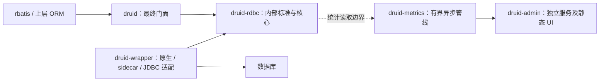

# 迁移续审、DBX 调研与首批修复（2026-11-01）

## 结论与基线

整体迁移仍未完成。本次按代码事实继续已有 ADR-CRATE-003，不重建架构。

| 对象 | 基线与限制 |
|---|---|
| Java Druid | fa8dc9912637a2f729eef9f55356621fec18d40e |
| Rust 起始 HEAD | b7c2afc59cf67e11f2d66fe7769093ca2d7f93f9 |
| Rust 外部更新 | 运行期间其他工作将 HEAD 推进到 106387246f169b40ae19d17de8b8a3340f266d42；本次未提交、未切换分支 |
| DBX 本地参考 | E:/workspaces/workspace-github/dbx，87b030d626dc4869fe1435cb20e33daa08e98d78；只读、无 CodeGraph 索引，使用定向源码检查 |
| Rust 工具链 | 1.97.1 / Windows MSVC；本轮未执行 MSRV 1.95 验收 |
| 技能 | rust-java-migration 与 rust-java-migration-testing；使用会话内正文 |

前一轮报告遗漏 ADR-003，关于“架构尚待批准”的结论应撤回。ADR-003 已记录 2026-10-22 批准。本次用户再次明确 druid-rdbc 内核与 druid 门面职责。Superpowers 索引、路线图标题已添加更正，保留历史记录，不篡改旧证据。

本次阅读重点：Superpowers 当前架构、主路线、驱动边界、Admin/Wrapper 计划，migration 四文档当前事实、ADR-003、trait-exception-review-20261023，以及对应源码。尚未完成 docs 所有历史材料的逐篇通读或全量对象审计。

## 当前实现与目标的差距

这是目标职责图，不是当前完整 Cargo 依赖图。当前 wrapper 和 metrics 仍依赖 druid 的运行时。避免为了画出目标图而增加 rdbc 到 wrapper 的反向依赖。

| 阶段 | 当前代码证据 | 判定 |
|---|---|---|
| P3.1/P3.2 | rdbc/governance/shrink_policy.rs；druid/pool/pool_inner/recycle.rs 调用 classify | 已有实现，需保留并补证据 |
| P3.3a | governance/wall 十个模块，druid/sql/wall_* 兼容重导出 | 已部分下沉，非待新建 |
| P3.3b | Filter 接口引用 DruidPooledConnection、FilterChain 等运行时类型 | 未闭合，不能简单搬文件 |
| P3.4 | druid 仍含 pool/core/sql/stats 等真实实现 | 门面收敛未完成 |
| Wrapper | sqlx/rbdc/toasty/jdbc_agent/duckdb/libsql/http_sql 与外部池目录已存在 | 有实现不等于每个产品完成验收 |
| Metrics | runtime.rs 有界 mpsc、sampler/aggregator/exporter 与 supervisor；pipeline_ownership.rs 跟踪阶段所有权 | 保留现有单协议，不引入第二套通信系统 |
| Test | druid-test 为 publish=false；整体源用例/资源/差分门禁尚缺 | 继续作为整仓验收入口 |

## DBX 五个页面与源码核对

官方页面观察日期：2026-11-01。官网内容可变化，不作为固定 Java 迁移 oracle。

| 官方页面 | 本次观察 | 对 druid-rust 的意义 |
|---|---|---|
| https://dbxio.com/cn | 当前宣传 100+ 数据库/系统，轻量客户端 | 不再假定固定 78，支持数必须来自可执行证据 |
| https://dbxio.com/cn/docs/what-is-dbx | 桌面、Web/Docker、CLI、MCP 共用能力；专用模型有独立工作流 | 我们仅复用中间层职责，不照搬客户端产品 |
| https://dbxio.com/cn/changelog | 页面列版本列表；动态版本正文未完整获取 | 未把某版本修复推断成当前本地实现 |
| https://dbxio.com/cn/drivers | 原生 Agent、JDBC、JRE 和按平台离线包 | 研究安装清单、平台匹配与运行时边界，不只复制连接 URL |
| https://dbxio.com/cn/contributors | 展示社区贡献情况 | 不是驱动正确性或生产可靠性证据 |

补充官方数据库支持说明：https://dbxio.com/cn/docs/databases 。其明确区分原生、原生 Agent、JDBC Agent、JDBC 插件，且协议兼容不代表 DDL、元数据、权限等完全相同。专用模型不能强行套用全部 SQL 概念。

### 枚举与分发

本地 `crates/dbx-core/src/connection/mod.rs:106` 定义 PoolKind，覆盖 MySQL、PostgreSQL、SQLite、Agent、ExternalDriver 等具体句柄；`query/mod.rs` 使用 match 分派执行；`schema/mod.rs:42` 的 dispatch_mysql 宏区分 MySQL 与 OceanBase Oracle 元数据路径。

可借鉴：在 wrapper 内对已知驱动族生成静态分支，让每种驱动实现同一内部合同；第三方扩展可保留受控动态边界。rdbc 只拥有不依赖厂商类型的判别/能力模型，具体枚举载荷不能反向引入所有数据库依赖。

尚未证明：静态分发必然改善吞吐或 p99。网络、锁、分配和异步 Future 都可能主导成本；宏不能自动消除底层动态调用。必须由 druid-bench 对比代码体积、延迟、分配与驱动 feature 组合。

### 2PC 与恢复

本地 `crates/dbx-core/src/query/two_phase_commit.rs`：
- log_key 使用 `2pc:tx:{transaction_id}`，通过 StateBackend 保存 TransactionLog。
- commit_phase 返回每个参与者的 committed/error 结果，只重试失败参与者。
- execute 使用本轮结果判断 Mixed，不额外调用 commit 探测。
- recover 对已持久化 Mixed 直接返回日志；对 Committing 会重新执行 commit_phase。

必须区分“禁止为了探测而重发”和“带持久化决策的恢复重试”。观察到的 TransactionLog 不包含完整逐参与者持久化提交结果，不能把其结构直接作为 Druid XA 崩溃一致性证明。Rust 落地必须明确 durable decision、参与者幂等键、提交结果不明、recover 查询、日志持久化失败及崩溃窗口；不得把网络错误当作未提交。Mixed 保持终态或人工裁决，不以重新 commit 探测。当前只完成源码研究，未实现/验收这套扩展。

### agent-job 对照

`agent-job-core/src/callback.rs` 已有有界通道、批量转发和失败落盘；`job_thread.rs` 使用 try_send。值得借鉴容量与所有权边界。当前 callback 源码中的 deadline 分支没有直接 flush 少量积压，且 JoinHandle 字段本身不能保证 Drop 取消任务，不能原样移植其可靠性承诺。

本项目现有 Metrics supervisor、ACK/sequence 与生命周期测试更贴合统计链路，应沿用并审查；SQL 热路径不得加入网络/落盘等待，磁盘重试只能属于后台策略。

## 本次修复：精确 Filter 类身份

OpenSpec：`openspec/changes/filter-class-identity-parity`。
源合同：Java FilterManager#existsFilter 当前使用 String.equals。
原 Rust：contains_filter_class_name 使用 eq_ignore_ascii_case。

两个注册类仅大小写不同会错误合并。修正为精确相等，保留完全相同类名去重、别名展开顺序、未知工厂跳过、错误传播。原测试只有第一个类注册，实际上不能识别该偏差；已改正旧说明，并新增双工厂回归。

| 测试账本 | 本次内容 | 等级 |
|---|---|---|
| SOURCE_PARITY | 精确类身份、同名幂等、顺序与构造次数 | V2_MIRRORED；没有 Java 执行参与，不是差分 |
| RUST_OBLIGATION | 两个工厂均真实注册；before/after/result_set 链计数一致 | V1_RUST_LOCAL |
| VALUE_ADD | 覆盖短别名与 >=128 UTF-16 长度直接加载分支 | 捕获两个分支共用去重函数的缺陷 |

## 实际验证与边界

- RED：`cargo test --offline -p druid --test task6_filter_manager_semantics_test_parity case_distinct_registered_filters_preserve_identity_and_exact_duplicates`，exit 101，期望 2 次构造实际 1 次。
- GREEN：`cargo test --offline -p druid --test task6_filter_manager_semantics_test_parity --test task6_data_source_filter_config_test_parity`，exit 0，10 passed / 0 failed / 0 ignored；包含真实 Toasty SQLite 合同。
- 格式：`rustfmt --edition 2021 --check` 检查两个修改的 Rust 文件，exit 0。
- 规格：`openspec validate filter-class-identity-parity --strict`，exit 0。
- 覆盖率/Clippy：原始运行输出分别保存在 filter-coverage.log 和 filter-clippy.log，完成结果见后续补记。

所有构建临时产物使用 E:；独立覆盖率构建使用 D:/codex-build/druid-filter-coverage-20261101。不安装、不升级依赖，不修改 Java/DBX/agent-job 参考仓库。

尚未完成：整仓默认/all-features/MSRV、全量 Java 测试无损迁移、逐例 MATCH、资源 SHA-256、70+ 数据库真实验收、2PC 崩溃演练、整体门面收敛。对象台账不因这一个修复晋升。文档漂移仍需基于统一新基线集中刷新，不能手改旧自动生成统计。

### 验证完成补记

覆盖率命令：`cargo llvm-cov --offline -p druid --test task6_filter_manager_semantics_test_parity --test task6_data_source_filter_config_test_parity --summary-only`，使用 `CARGO_LLVM_COV_TARGET_DIR=D:/codex-build/druid-filter-coverage-20261101`。10 项全部通过，exit 0。保留历史测试 ID 后重新执行相同覆盖率命令，避免旧迁移账本失去目标。

| 范围 | Regions | Functions | Lines |
|---|---:|---:|---:|
| core/filter_manager.rs | 97.34% | 100.00% | 98.21% |
| core/filter_chain_impl/chain_a.rs | 31.16% | 31.94% | 27.74% |
| 此次报告 TOTAL | 14.98% | 13.02% | 16.34% |

仅执行两组集成测试；没有覆盖率排除正则。TOTAL 是这次报告实际纳入文件的分母，不是完整工作区验收范围。未采集分支覆盖率，不能报告为 0% 或 100%。不能与旧全量测试的覆盖率直接比较。

严格 Clippy：`cargo clippy --offline -p druid --test task6_filter_manager_semantics_test_parity --test task6_data_source_filter_config_test_parity -- -D warnings`，exit 101。首层错误归属 `crates/druid-rdbc/src/extensions/shared_row_set/trait_impls.rs:1` 的既存 `use super::*`，不是本次新引入。未修改该依赖模块或禁用 lint。后续错误可能被首层失败遮蔽；不得声称零警告。

本次对象状态保持原台账；新增回归仅为 V2/V1 范围证据。OpenSpec change 保持未归档，严格验收未闭合。
