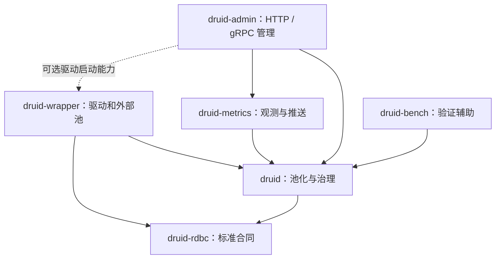

# 架构与完成进度核验（2026-10-08）

本次以 CodeGraph 当前磁盘源码、Cargo manifests、正式规格、计划和真实日志为依据。目标仓库为 `E:/workspaces/workspace-github-easy-4-rust/druid-rust`。分析时分支 main，存在 324 项未提交变更；未覆盖这些变更。未重新初始化 CodeGraph，因为索引已存在，查询报告约 1214 个文件。

## 结论与事实源

五产品 crate 已存在，核心 standard traits、驱动适配、池化代理及监控服务都有实际实现；生产级完整验收尚未完成。版本仍为 `0.0.0-design`，所有 workspace package 均为 `publish=false`。

规格事实源是 `docs/superpowers/specs/2026-08-21-rdbc-first-five-crate-architecture.md`（ADR-CRATE-002）及 `2026-08-24-rdbc-single-standard-trait-tree.md`；执行依据是现有 RDBC-first master roadmap 与子计划。本次不创建第二套规格、不初始化 Spec Kit/OpenSpec。

README 的旧三模块、druid-core/facade 目标以及 Physical 接口描述存在时效差异。ADR-CRATE-002 已取代 ADR-CRATE-001，源码与最新验收证据优先用于描述当前实现；历史规格基线不能当作当前源码快照。

## 当前模块与职责

| crate | 当前职责 | 完成边界 |
| --- | --- | --- |
| druid-rdbc | 独立 Connection/Statement/PreparedStatement/CallableStatement/ResultSet、metadata、错误、资源及 Wrapper 标准合同 | 标准树已实现，完整行为和公开 API 验收仍开放 |
| druid | 池化、holder、logical proxies、Filter、SQL Parser、Wall、Stat、Dynamic | 核心链路已实现；生产级队列、关闭与取消治理尚未全部验收 |
| druid-wrapper | SQLx、Toasty、RBDC、JDBC Agent、DuckDB、HTTP SQL、libSQL 和外部池适配 | 有真实实现及局部通过证据；全部数据库认证与 feature 隔离未闭合 |
| druid-metrics | 本地观测、推送及公共 gRPC 协议 | P02 历史范围已验收；最终 supervisor/故障与 shutdown 认证仍开放 |
| druid-admin | HTTP 管理、gRPC 接收、观测 repository 与安全配置 | 已有真实服务，最新网络回归仍失败 |
| druid-bench | 性能验证辅助成员 | 不属于五产品 crate；最终性能认证仍开放 |

下图箭头表示主要依赖方向，细节以各 Cargo.toml 为准：

原生池的核心链路是 ConnectionFactory 创建标准 Connection，由 DruidConnectionHolder 持有，经 DruidPooledConnection 暴露池化语义；Statement/ResultSet proxies 插入 Filter、统计、缓存与资源所有权治理。bb8/deadpool 的外部租约通过 ExternalConnectionLease 委托标准连接，避免作为 factory 再嵌套一个 DruidPool。

## 实际进度

| 路线 | 当前状态 | 不应扩大解释的边界 |
| --- | --- | --- |
| P01 外部池一致性 | 历史限定范围 COMPLETE | SQLite direct SQLx/bb8/deadpool 通过，不等于全部数据库通过 |
| P02 Metrics/Admin 单协议 | 历史限定范围 COMPLETE | 不等于当前网络、可靠性及生产安全验收通过 |
| P03 抽取恢复 | 过渡 handoff 已冻结 | 旧 Physical surface 只是迁移输入 |
| P04 唯一标准统一 | Tasks1–5 已接受；Task6 FIX_REQUIRED | Task7、Task8 仍未完成 |
| P05 registry 与 feature | 前置 P04 尚未完成 | 五项顶层任务仍开放 |
| P06 运行时生产治理 | 前置 P04 尚未完成 | 五项顶层任务仍开放，部分实现存在不代表完成 |
| P07 最终验证与发布就绪 | 等待前置路线 | 五项顶层任务仍开放 |

剩余顶层任务共 **18**：P04 Tasks6–8 三项，加 P05/P06/P07 各五项。任务工作量不等，不能据此给出可靠工时或总体百分比。

### Task6 证据分层

- C1：479 条方法迁移映射静态验证通过，分类为 2 INTERNALIZED、215 MERGED_EXACT、262 MERGED_TYPED；完整实际运行仍未通过。`executed=no` 不构成 runtime 验收。
- C2：固定 67 个删除文件、1283 个原测试身份，1146 EXACT、137 PARAMETERIZED；全部 source floor 1283/0、静态绑定通过，但完整运行未通过。
- 局部实际证据：Druid lib 150/0、六消费者27/0。这些范围不能代替全 workspace、全部 features 或全部原始测试迁移证明。
- 37 项补充源码检查为36 PASS/1 FAIL；剩余 compiler coverage 清单的105个源码 hash 过期，需要七个 adapter family 的实际编译覆盖再生成。
- API/SemVer、MSRV1.95、feature matrix、完整审查和新鲜全仓回归仍需完成。缺失工具的安装方案已经提出，尚无安装授权，不应当成执行成功。

### C2 最新终态更正

`task6-complete-stat-close-error-runtime3-2026-10-07.log` 的实际终态为：druid-wrapper 全功能 lib 目标在1800秒达到子命令超时，验证器记录 `replacement tests NOT_RUN/ERROR`。这替代旧说明中的 LIVE session13316。

2026-10-08 只读检查未发现原 Python13276、Cargo70556、DuckDB40160，也未发现任何 Cargo/rustc/cl/link/build-script-build 进程。逐文件复核原1090冻结输入，CHANGED_INPUTS=0。日志未提供整体运行通过结果；不能推定业务断言失败或已完成验收。

下一步是先独立运行完全相同的 wrapper all-features lib 目标完成昂贵的原生编译与测试，再重跑正式完整 C2/C1。独立目标即使通过，也不代替正式完整验证器，不改变1283/479分母、断言或超时规则。

### 最新完整 workspace 与网络证据

最近记录的完整 workspace 为3795 PASS/11 FAIL；两个失败目标独立复现为49 PASS/11 FAIL。它们对应较早冻结输入，不能描述为当前1090输入的新鲜全仓结果。之后需要新鲜完整回归。

故障主要位于 Admin TLS/gRPC 网络场景。已有只读证据发现当前测试程序路径的 Windows 入站阻止规则，与监听端口 TCP 超时吻合；尚无获授权变更后的同一测试对照，不能证明全部11项都由同一个原因造成。未修改系统安全策略、测试断言或超时。

## 架构上仍需完成的内容

### P04 Task7：八项固定行为义务

1. ResourceOperations 与 ResourceHandleFactory 标准操作及创建行为。
2. 资源1-based访问、free后使用拒绝与SQLXML状态。
3. 退役 RdbcResultSet 的独立转发身份，不能以 RowSetResultSet 替代。
4. capabilities声明与真实支持行为一致。
5. 驱动释放和 owner 通知各自恰好一次。
6. caller取消后的受监管释放，避免永久 Releasing/Closing。
7. 将 eager SQLx 结果集改为准确的 buffered 命名。
8. 真正有界的异步首行消费及 Stream adapter。

CodeGraph 当前 SqlxStreamingResultSet 源码21–25行仍持有 `Vec<Row>`，async next 只是推进内存游标，不能作为真实数据库流式读取证明。

### P05：五项驱动边界任务

统一三条驱动解析路径；移除同步 inventory factory 的运行时嵌套风险；让 DriverManager 委托 canonical registry；真正可选化 Wrapper dependencies并验证feature组合；完成package/publish/CI ownership。

当前 DriverManager 仍有独立进程 registry，druid-rdbc::DriverRegistry 另有 descriptors；Wrapper 的sqlx/rbdc/bb8/deadpool仍是非optional依赖。这些是尚待统一与隔离的源码证据。

### P06：五项生产治理任务

Pool创建/关闭队列有界化与慢关闭治理；Metrics单一supervisor与确定shutdown；Admin repository TTL/容量/session identity完整验收；HTTP/gRPC认证授权TLS与脱敏统一；故障注入、过载、性能及shutdown预算。

PoolInner 当前109–110行的create_sender/close_sender仍为UnboundedSender，原生连接关闭风暴和补池压力需要有界预算。已有TTL、安全或任务监管代码应先核验，不重复实现，也不直接宣称整项通过。

### P07与P04 Task8：发布验收

依赖DAG与禁止依赖；格式/build/clippy/docs/features/MSRV/public API/SemVer；Java/Rust差分及各adapter真实数据库合同；Metrics/Admin网络故障和安全；供应链审计、真实性能基线、需求逐条完成报告与文档一致性。

## 执行顺序与判断

先取得Task6完整C2/C1、编译覆盖、API/工具链与新鲜回归证据，再完成Task7八项与Task8；随后按正式前置关系关闭P05/P06，最后汇总P07。任何环境阻断单独记录，不能用局部GREEN替换失败的完整门禁。

本次没有修改Rust/Cargo/proto/SQL、创建或切换分支、stage/commit/push、安装工具或更改防火墙。架构分析已交付；整个“完成计划任务”目标仍未完成。

## 后续执行证据更新（2026-10-08）

以上章节记录分析时点；后续已继续原计划实施，不能沿用旧“下一步预构建”描述作为当前状态。

- Wrapper all-features lib 独立命令已取得真实 exit0，16 PASS/0 FAIL。
- 正式完整 C2 runtime4/session56915 已 exit1：构建 `sqlx_bb8_pool_test` 时缺少 manifest 声明的 `druid-driver` 二进制源码，尚未进入该目标断言。
- 已从 Git 历史恢复完整250行驱动 CLI 到 Wrapper，调整 import ownership 与 snake_case 路径；补充针对该源文件的 Git ignore 例外。真实 all-features CLI4/0 与原bb8目标5/0，同一命令exit0。见[入口恢复证据](task6-driver-cli-recovery-2026-10-08.md)。
- 原1090输入在修复前一致；修复后仅更新 Wrapper manifest SHA并新增入口/测试两项，共1092输入。正式完整C2 runtime5/session55218/Python41348持续运行；02:39:24实际观察Cargo41276执行 `task6_sqlite_wrapper_semantics_test_parity`，rustc9220正在构建。复核1092输入无变化。
- 过期核心依赖脚本已从不存在的 `druid-core` 修正为 `druid`，保持13项禁止依赖，并拒绝空输出/错误根节点。真实RED后最终5自测及默认normal依赖检查exit0；此为默认范围，不是all-features/DAG全部验收。见[核心门禁恢复证据](task6-core-dependency-gate-recovery-2026-10-08.md)。

完整C1/C2、105项编译覆盖再生成、API/SemVer/MSRV/features、当前全仓回归及最终审查仍未闭合。Task6保持FIX_REQUIRED、Task7八义务与全部18顶层任务仍OPEN；不把局部通过数转换为整体百分比。

## 最新终态与复查更正（2026-10-08）

C2 runtime5已取得实际完整PASS（67文件/1283原测试身份，executed=yes），旧LIVE描述为历史记录。C1 runtime2实际FAIL：子C2过期空闲连接测试首次归还后的idle_count为0/期望1。相同源码和断言复查该目标10/0，不构成根因修复证明。完整C1 runtime3已启动session50617，1092源码/58工具输入冻结，尚待终态。全部18任务仍OPEN。详见[核对报告](task6-lifetime-idle-recheck-2026-10-08.md)。

## 完整C1通过（2026-10-08）

最新runtime3/session50617实际exit0/executed=yes，479映射与442选择器，完整C2子验证保留；1092源码/58工具输入终态变化0。此前runtime2断言失败仍保留，尚无根因修复证明。正在执行当前输入的全workspace/all-features回归，未取得终态。Task6其余门禁、Task7八义务及全部18任务仍开放。详见[完整C1报告](task6-complete-c1-pass-workspace-start-2026-10-08.md)。

## 全 features 回归终态补充（2026-10-08）

原 session52736 已 exit101：164 已完成结果块 /2886 PASS /8 FAIL /0 ignored；grpc_network_e2e_test 38/8，admin_binary_test 14/0。fail-fast停止剩余目标，不构成完整全仓PASS。1092源码+58控制输入终态变化0；完整原始日志SHA256为ead36cb62a1110ef1ea461870b7e1fe93cad1cc59363872e2d5b9b68fd558dd6。此前LIVE描述仅为历史观察。

只读检查发现本轮实际grpc测试程序路径20b9d4a616891dd0对应启用的Public入站Block规则。未修改防火墙，尚无对照，不能证明8项失败同源或根因已修复。Task6其余门禁、Task7八义务与18顶层任务继续OPEN。

## 最新质量门禁通过与新鲜运行（2026-10-08）

正文的Clippy失败描述属于历史状态。原session72889执行正式 `cargo clippy --workspace --all-targets --all-features --locked --offline -- -D warnings` 已实际exit0，累计53项诊断全部消除。最新两个crate完整all-features lib原15350实际166/0；完整源码C1原8604 exit0/479映射442选择器、executed=no，完整C2子检查保留。以上均对应最新1092源码+58控制冻结，终态变化0，见[原范围证据](task6-remaining33-lint-recovery-2026-10-08.md)。

完整C1默认实际运行原session20187正在同一冻结输入上执行，不能先推定PASS。只读工具重检仍缺MSRV1.95、Windows nightly/API/SemVer和LLVM覆盖工具；未安装、未改防火墙。最新全仓运行FAIL记录仍有效，Task6其余门禁、Task7八义务及全部18顶层任务未关闭。

2026-10-08 架构长文验收记录同步：当前标准Connection、实际ExternalConnectionLease、六成员manifest依赖与批准目标差异已更新；局部链接/闭合代码块/manifest事实检查PASS，Mermaid未渲染。Task8综合报告已接入机器证据，未将文档检查扩大为整体完成。原C1 session20187/Python2368及C2子36612实际LIVE，本次观察Cargo47436执行task6_rdbc_external_consumer_test_parity；保留原运行和1092源码+58控制冻结。Task6 FIX_REQUIRED/Task7八义务/18顶层任务继续OPEN。

2026-10-08 Task8原命令预检：final purity实际exit0/48标准文件；final semantic原命令因未实现--require-final-evidence参数实际exit2，未进入语义验收。日志和机器摘要逐字节镜像，1092源码+58控制输入无变化。原C1/C2仍LIVE，未修改冻结验证脚本；需要运行终态后以正式final合同补齐fail-closed入口和测试，不以planned/logical-live替代。Task6 FIX_REQUIRED/Task8 INCOMPLETE/18 OPEN。

2026-10-08 final语义合同审计：ADR-RDBC-006 §9明确Task8禁止计划态。当前69行中61行含计划态；49 target PLANNED_TARGET、21 adapter PLANNED、17 logical PLANNED、59 capability PLANNED，具体行及原inventory SHA保存在task6-e-space-task8-final-semantic-state-audit.summary.json。原1092/58冻结输入核对无变化。补final参数必须同时实现严格状态/真实证据检查，不能把logical-live或Task4 stale coverage handoff当final通过；未改账本。Task6 FIX_REQUIRED/Task8 INCOMPLETE/18 OPEN。

2026-10-08 原C1 session20187终态实际exit0/executed=yes：479方法映射/442选择器，7目标/442函数；完整C2子验收保留67文件/1283身份。1092源码+58控制输入终态无变化，原日志SHA b6c8627c0cd8ed83621a1855db8ffc64d740517b3638f31aabf40b59a795fb10，日志/summary逐字节镜像。其后仅test_verify_jdbc42_semantic_inventory.py新增LF字节回归及14处显式newline，RED两subtest失败+4 ERROR，最终完整自测19/0；生产验证器/账本/Rust源码不变，旧控制冻结不扩大到新脚本。Task8 final模式仍缺失，Task6其余门禁/Task7八义务/18顶层继续OPEN。

2026-10-08 文档门禁终态：完整workspace/all-features/no-deps/locked/offline文档生成实际exit0，零rustdoc警告。首次85500 exit0的三条警告原证据保留；仅修复Admin私有TTL引用及Metrics两处限定链接。新快照doc-link-repair-inputs.json含1092源码+58控制输入，最新运行终态变化0，日志和机器摘要逐字节镜像。旧C1/Clippy冻结不扩大到三处注释及LF测试脚本修改后的新输入。Task6 FIX_REQUIRED/Task8 INCOMPLETE/18顶层任务OPEN。

2026-10-08 final语义CLI防降级RED：扩展真实CLI合同测试到5项，覆盖help、默认final及planned/adapter-live/logical-live三种显式phase均不能绕过final要求。实际5FAIL/0ERROR，四个验收调用仍因参数未实现返回usage exit2；此为入口缺失的真实RED，不是语义验证通过，也尚不证明计划态/伪证据具体拒绝分支。生产验证器、oracle与inventory未修改，61计划态仍保留。证据task6-e-space-task8-final-semantic-cli-phase-bypass-red.summary.json；下一阶段需要完整final状态、来源绑定、canonical形态与实际证据校验，不能只添加参数或转用Task5。Task6 FIX_REQUIRED/Task8 INCOMPLETE/18 OPEN。

2026-10-08 final状态策略组件TDD：新增verify_final_state_policy，首次27测试实际RED（26个失败subtest），边界补充后28测试RED两FAIL/一ERROR，最终完整28/0。独立拒绝四列计划态及PLANNED_V2、十九字段UNKNOWN/MISSING/unresolved、空白canonical、无效状态、实现路径语法与LIVE/evidence不一致；保留既有standard_adapter_matrix引用语法。真实inventory第一行被PLANNED_TARGET拒绝，inventory/oracle SHA未变。仅两个Python控制脚本变化，1092源码变化0；final CLI仍未接入，未构成冻结来源绑定、类型形态或compiler/runtime认证，未生成LIVE账本。证据task6-e-space-task8-final-state-policy.summary.json。Task6 FIX_REQUIRED/Task8 INCOMPLETE/18 OPEN。

2026-10-08 final来源绑定组件TDD：新增verify_final_source_binding，从已校验52+17 Java oracle重建Task2策略并保留Task3接受的canonical/DECLARED（含DriverRegistry），取得原冻结semantic摘要5d99b573...。首次35测试RED含13失败subtest，最终完整35/0；拒绝五个来源身份字段漂移、缺失/额外/重复对象、错误字段数及冻结摘要/来源声明漂移。允许证据晋升而不改oracle，仅证明Java来源绑定；Rust形态、canonical实际公开路径与compiler/runtime仍未核验，final CLI未接入。仅两个Python控制输入改变，1092源码变化0，oracle/inventory SHA不变。证据task6-e-space-task8-final-source-binding.summary.json。Task6 FIX_REQUIRED/Task8 INCOMPLETE/18 OPEN。

2026-10-08 Task8 canonical编译诊断：原4987实际RDBC all-features check exit0，使用该Cargo JSON明确返回的rmeta与Rust1.97.1对69行逐个外部编译，68Rust目标37PASS/31FAIL，host排除1项未认证。6个资源别名TRAIT不符、24个名称无法解析、types模块私有；ENUM_KIND/MODULE通过项只证明import解析，不认证精确形态。源码1092冻结逐项无变化，oracle/inventory不变，原Rust探针/错误/rmeta保留，机器摘要与Cargo日志逐字节镜像。详见task8-canonical-compiler-identity-audit-2026-10-08.md。final CLI仍未接入，Task6 FIX_REQUIRED/Task8 INCOMPLETE/18 OPEN。

2026-10-08 ClientInfoStatus唯一标准归属修复：真实四状态定义迁入RDBC connection，Druid旧模块/门面只重导出同一类型。原33983 RED exit101/E0432；16500 GREEN两项2/0；原25608完整RDBC all-features exit0/474PASS0FAIL含external implementor/public surface/doctest。workspace fmt实际exit0无输出。新冻结1094源码+58控制输入变化0。严格Clippy原96459仍LIVE，观察进程50784→41292→45860→45160，不推定终态。账本/oracle未改，旧37/31/1不扩大到新源码；API/SemVer与其余canonical缺口仍开放。详见task8-client-info-status-recovery-2026-10-08.md。Task6 FIX_REQUIRED/Task8 INCOMPLETE/18 OPEN。

2026-10-08 ClientInfoStatus修复最终终态：原严格workspace Clippy96459实际exit0/3m22s，all-targets/all-features/locked/offline/-Dwarnings通过，旧LIVE描述仅为历史。新Cargo JSON artifact支持原失败probe_04.rs实际rustc exit0，ClientInfoStatus canonical公开路径闭合；原31诊断中其余30仍待处理，不宣称当前完整69 final通过。RDBC474/0、Druid身份2/0及fmt PASS保留，1094源码+58控制终态变化0。原日志/summary逐字节镜像，见task8-client-info-status-recovery-2026-10-08.md。Task6 FIX_REQUIRED/Task8 INCOMPLETE/18 OPEN。

2026-10-08 三个错误对象canonical归属终态：BatchUpdateException、DataTruncation、SqlClientInfoException真实定义迁入RDBC error，compat及Druid门面重导出同一类型，原payload不变。真实RED exit101/E0432；完整RDBC477/0、Druid lib及身份152/0；严格全workspace Clippy复验直接捕获exit0。1097源码+58控制输入变化0。原69行探针完整复编译现为41PASS/27FAIL/1非Rust目标未认证，取代37/31/1作为最新诊断；旧日志保留。oracle/inventory未改，API/SemVer/final CLI/Task7八项仍开放，Task6 FIX_REQUIRED/Task8 INCOMPLETE/18顶层OPEN。详见task8-error-canonical-ownership-recovery-2026-10-08.md。
