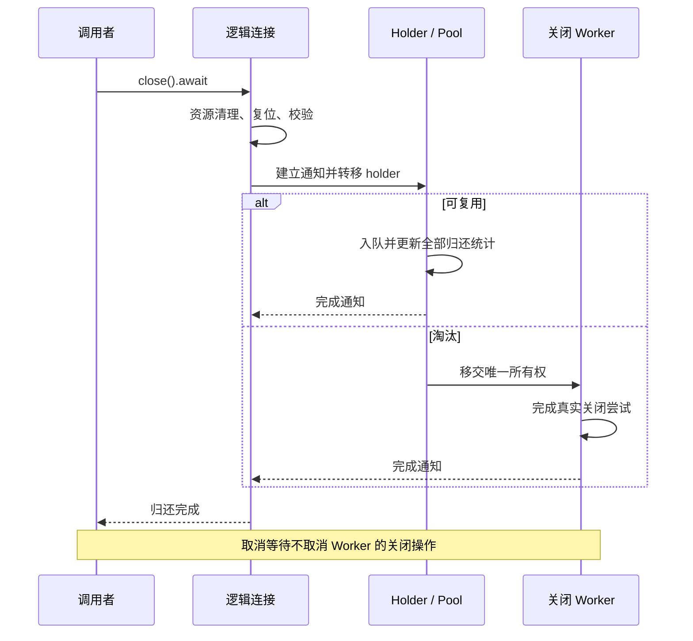

# Task 6 显式关闭完成协议与完整回收合同恢复

本轮完成原生逻辑关闭的完成时序修复，以及固定原始回收十二案例的正式精确迁移。Task 6 仍为 `FIX_REQUIRED`；P04 Tasks 6–8、P05–P07 合计 18 个顶层任务保持开放。

## 行为与所有权

此前原完整回滚失败案例要求 `close().await` 返回后 raw connection 已关闭，而实际只把 holder 交给关闭 worker，返回时 raw.closed 仍为 false。新增真实驱动关闭屏障再次得到 RED：调用者收到 Ok，但阻塞的物理关闭尚未完成。

当前实现：

- 原生显式归还在完成异步复位后、转移 holder 前建立一次性完成通知，中间没有 await。
- 通知端随 holder 所有权进入空闲队列或受监管关闭 worker；等待端保留在逻辑连接中。
- 复用路径先完成空闲队列及归还统计更新，然后发送通知；通知端不会进入下一租约。
- 淘汰路径在资源、缓存 statement 和驱动关闭尝试结束后发送通知。关闭错误仍遵守既有 Java recycle 吞错/worker 日志合同。
- 取消关闭 future 不撤销 worker 所有权；再次关闭等待同一次操作。取消后 Drop 也不会重复归还或驱动关闭。
- 完成通知丢失会返回明确错误，不将未确认完成的归还报告为成功。

没有新增公共接口，没有在调用者 future 中接管已经转交 worker 的驱动连接。External lease 的既有回调合同未改变；Task 7 的完整外部资源释放与取消义务没有因此关闭。

## 真实运行证据

日志位于 `.superpowers/sdd/2026-08-24-rdbc-single-standard-unification/`。

| 日志 | 终态 | 范围 |
| --- | --- | --- |
| `task6-close-completion-red-2026-10-07.log` | exit 101，11 PASS / 3 FAIL | 完整回收原案例及两个新增屏障案例；均实际运行，非编译失败 |
| `task6-close-completion-green-2026-10-07.log` | exit 0，127 PASS / 0 FAIL | 初版完成协议；后续通知统计顺序调整后由下面最终结果替代 |
| `task6-close-completion-final-regression-2026-10-07.log` | exit 0，129 PASS / 0 FAIL | Druid lib 105、holder 6、owner disposition 2、完整回收及补充控制 16 |
| `task6-close-completion-related-regression-2026-10-07.log` | exit 101，34 PASS / 2 FAIL | raw ownership 5、Filter Stat 21、池维护 differential 8/2；后一个 semantics 目标尚未执行 |
| `task6-close-completion-related-controlled-regression-2026-10-07.log` | exit 101，35 PASS / 1 FAIL | 两个原 fatal 状态断言通过；新增恢复步骤因只放行一个建连许可而超时 |
| `task6-close-completion-related-final-2026-10-07.log` | exit 0，50 PASS / 0 FAIL | raw ownership 5、Filter Stat 21、池维护 differential 10、池维护 semantics 14 |

最终两组范围互不重叠，共 **179 PASS / 0 FAIL / 0 ignored**。这不是完整 workspace 的新鲜通过证明，也不包含 MSRV/all-features/API/SemVer/真实多数据库验收。

四个补充控制覆盖：关闭阻塞期间取消并重试、取消并 Drop、32 次多线程复用及统计一致性、驱动关闭报错后的完成通知与恰好一次调用。原十二案例的断言没有删减或改为等待后重新解释 raw.closed。

## 池维护调度控制

扩展回归揭示两个原 fatal 测试与后台成功校验存在竞争：fatal 请求 `request_refill(1)`，建连成功的 `validate_connection` 按既有合同清除 `onFatalError`。显式关闭新增等待让后台有机会在原断言前执行。

只修改测试夹具的真实建连屏障，未改变生产 fatal/refill/validation 逻辑，未移除原断言。失败校验案例先保留 fatal 置位观测，再放行失败校验，并额外断言真实建连及关闭次数均为 2。阈值案例保留原第三次 fatal 置位断言，随后放行后台及直接借用两条建连路径，再额外验证恢复借用成功、成功校验清除 fatal。单许可实验的真实超时保留在历史日志中，最终版本修正的是夹具许可预算。

## 固定分母与正式绑定

- 原始 Rust 测试基线：`5afe8609b177544ff7d18461aa84f69efe8ee90e`。
- 完整回收原文件 SHA-256：`61b6b30e143039ee90df698dbe37c37eb10f0b58bc31f2b8f61fb1e5aed1695d`。
- 1,283 行正式账本前七个基线字段全部保持固定。
- 原十二回收案例通过完整运行及源码观测检查后绑定至 `task6_recycle_complete_contract_test.rs` 的各自精确函数；无账本引用的旧通用回收矩阵已退役。
- 正式账本为 **1,122 EXACT / 161 PARAMETERIZED**；反向方法索引和派生 Markdown 已同步。
- 最终完整源码观测审计：**1,259 PASS / 24 FAIL**，全部剩余为 ResultSet Filter；JSON 为 `task6-complete-recycle-final-source-floor-audit-2026-10-07.json`。
- 新鲜 `verify_task6_deleted_test_parity.py --no-execute` 仍 exit 1，首个缺口是 `pooled_result_set_preserves_decimal_temporal_and_calendar_filter_overloads` 的明确参数化分支。该命令不执行运行时测试，不能当作行为验收。
- 权威验证 PASS：79 行、Task 7 pending 25 行、Physical 标准化 73 行；权威 SHA-256 仍为 `7210995f5b1e9ac4b50ec56693cc4a5f95905b0aee923f4048a3d2819d7620c3`。
- 验证器回归：迁移账本 17 项 PASS、权威表 5 项 PASS；final standard purity 48 文件 PASS。

## 剩余门禁与下一步

继续完整 ResultSet Filter 二十四原案例迁移，保留固定断言、调用与身份观测。C1/C2、public API/外部消费者/SemVer、MSRV 1.95/默认工具链 1.97.1、features、完整 workspace 新鲜回归及最终审查均保持开放。此次相关测试使用 stable Rust 1.99.0，不替代其他工具链门禁。未执行分支切换、提交、推送、安装或发布。
