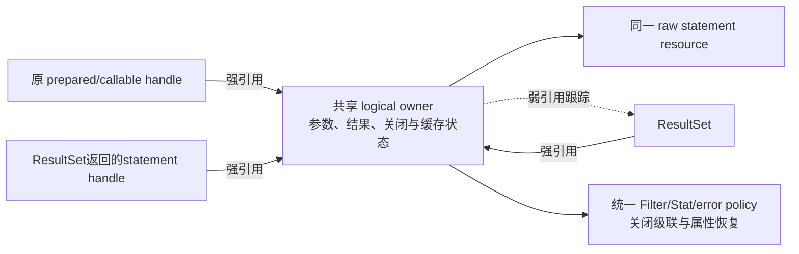
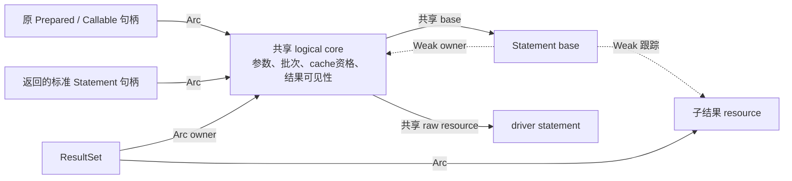

# Task 6：结果游标的 statement 身份恢复缺口

规格事实源仍为 `docs/superpowers/specs/2026-08-24-rdbc-single-standard-trait-tree.md`。
本记录解释 BASE 对等合同的缺口与实施约束，不创建第二套规格，不关闭 Task6/C2。

## 当前证据

- BASE `5afe8609b177544ff7d18461aa84f69efe8ee90e` 的
  `prepared_generic_execute_matches_real_sqlite_result_and_generated_key_semantics` 要求：
  查询7、query update count=-1、具体 PreparedStatement 身份、同一底层对象、raw prepared
  unwrap、默认 moreResults=false 并关闭游标、精确 Before/After SQL/op/params/Some(1)、
  查询8后无效current=999失败但旧游标保持打开，以及 plain/auto/index/name 插入的键1–4。
- 当前 `druid-rdbc::ResultSet` 没有 `get_statement` 接口。
  `DruidPooledResultSet::statement()` 只返回 `DruidPooledStatement` 的克隆；标准执行接口
  将结果装箱为 `dyn ResultSet` 后，调用者不能访问这一 concrete 方法，也不能从它恢复
  PreparedStatement/CallableStatement 的具体身份。
- `WrapperExt::unwrap_ref` 要求 `Self: Any + Sized`，不能把它用于标准 trait object
  来假装上述身份合同已经满足；纯标准接口不得引入 Druid concrete 类型或 Any。
- `CurrentResultDisposition` 是 typed enum，现有接口不能表示整数999。
  typed KeepCurrent 的正确行为不等价于无效整数处置失败且不关闭游标。
  下节记录随后新增整数边界后的验证；本段保留为缺口发现时的事实。
- `task6-base-generic-contract.log`：真实 Toasty/SQLite 补充回归及已有 generic suite
  9/9 PASS。新增合同精确验证 SELECT7 的一次 Before/After 与行数1、默认 moreResults
  关闭游标、复用查询8、typed KeepCurrent 保留游标、close级联，以及四个 prepared
  重载的真实键1–4、update count、单列 metadata、EOF、Filter 与真实底表内容。
  该测试首跑即通过，不声称新 production RED/GREEN。
- C2 的完整参数化 case arm 暂不添加：上述真实行为证据仍缺 statement 身份及999
  合同，不得让一个局部 helper 代替完整 BASE 后把迁移表标为完成。

## 身份恢复的实施约束

必须恢复可操作的同一对象身份，不用字符串SQL、数字id或非持有型descriptor替代：

1. 标准 ResultSet 的 statement 获取合同只能返回 canonical Statement；其 Wrapper
   解包须保持 PreparedStatement/CallableStatement leaf，不能返回无关的普通代理。
2. prepared/callable logical 状态、绑定参数、结果状态、关闭进度、cache资格和owner
   disposition 必须共享。仅复制字段或只克隆 raw Arc 会造成状态分裂、重复回池或
   绕开属性恢复，不能作为实现。
3. ResultSet 和返回的 statement handle 持有 logical owner 的强引用；内部跟踪结果
   使用弱引用。原 statement 变量被释放后，结果持有的对象仍可用；最后关闭与回收
   必须保持 exactly-once。拒绝形成 owner→结果→owner 的强引用环。
4. 通过结果返回的 statement 执行、setter、关闭，仍经过同一 Filter/Stat/error policy、
   子游标级联、property恢复和cache返还逻辑，不能直接 raw.close() 绕过治理。
5. integer current 的入口先检查 Druid 逻辑关闭/租约，再校验 Java 1/2/3 并转换为typed disposition；999及其他非法
   值必须在任何关闭、结果推进或driver调用前失败。无参数默认入口保持独立语义。
6. metadata 的无statement情况与不支持能力分别表达，禁止制造 MetadataStatement
   来冒充真实调用方statement身份。真实驱动支持范围分别验证。

该图描述待完成的所有权约束，不作为已实现架构证据。

## 整数处置边界的后续实现与验证

- 先增加真实 Toasty/SQLite 合同测试，再提供默认明确不支持的接口声明以运行合同。
  `task6-integer-disposition-red.log`：运行时0 PASS/1 FAIL，非法999未返回
  `InvalidArgument`。这是新接口声明的缺失行为RED，不声称旧仓库已有整数入口，
  也不把缺失方法导致的编译错误充作运行时RED。
- `Statement::get_more_results_current(i32)` 的默认实现现在先匹配 JDBC 常量1/2/3，
  再调用同一typed `get_more_results`；任何其他值先返回参数错误。
  不增加第二套driver port，不把Druid类型或Any引入标准层。
- 第一轮 `task6-integer-disposition-green.log` 实际9 PASS/1 FAIL：测试额外调用了
  Toasty不支持的可选 `is_before_first`。保留该日志，不作为GREEN证据。
  最终合同通过非法请求后第一次 `next` 仍读取原值来直接验证未消费游标，
  没有降低BASE的“不关闭旧游标”义务，也没有伪造可选navigation能力。
- `task6-integer-disposition-final-green.log`：generic专项10/10 PASS。真实游标
  验证999/0/-1/MAX失败、游标打开和update count保持、仍从首行读到7/8/9、
  有效1/2/3的关闭/保留及KeepCurrent后CloseAll级联。
- `task6-integer-disposition-dispatch-green.log`：标准层2/2 PASS。可控驱动证明
  MIN/-1/0/4/999/MAX不触发typed driver；有效值顺序准确；typed driver的错误原样
  返回；无参数Default与整数0并不混淆。这两个测试是补充边界证明，没有独立RED声明。
- 这是默认方法的公共API新增，旧trait实现者可沿用默认实现；最新public API、编译
  身份和SemVer门禁仍须执行。当前 `cargo public-api --help` 返回“No such command”，
  未安装或手工修改API快照来充作生成证据。指定工具链与MSRV未验证。
- C2完整generic case仍不能关闭：返回同一PreparedStatement/CallableStatement身份
  和raw identity的实现及证据未完成。所有后续任务保持原范围。

## 验收顺序

### 关闭与租约错误顺序补充验证

- BASE `5afe860` 的 `DruidPooledStatement::more_results_internal` 明确先调用
  `ensure_open_for`，再交给 driver；整数默认入口不能遮蔽已关闭/失效错误。
- 真实 pooled Toasty/SQLx 新测试 RED 0 PASS/2 FAIL：显式 Statement 关闭及连接
  关闭后，非法999先返回了参数错误。日志 `task6-disposition-owner-precedence-red.log`。
- 标准处置统一使用无副作用 `TryFrom<i32>` 转换；Druid ordinary/prepared/callable
  logical proxy 和内部资源 view 先调用各自已有 `ensure_open`，再转换并进入原typed路径。
  不增加产品依赖、第二套驱动接口或 `Any`。新增公开转换实现仍需要 API/SemVer 验证。
- 首次修复运行未编译：Callable 未导入处置类型，保留
  `task6-disposition-owner-precedence-green.log`，不作为GREEN。修正导入后
  `task6-disposition-owner-precedence-final-green.log` 12/12 PASS，覆盖两种真实驱动的
  ordinary/prepared，非法999/0/-1及有效1/2/3的关闭错误顺序，以及有效租约不消费游标。
- Callable 独立合同通过实际 DruidPooledConnection 包装可控 driver 资源：暂移除尚未独立
  验证的 callable numeric override 后 RED 0/1；恢复后 GREEN 1/1。关闭连接与显式关闭
  两个分支均保持恰好一次raw关闭，后续请求不增加关闭次数。日志
  `task6-disposition-callable-owner-red.log` / `task6-disposition-callable-owner-green.log`。
- 上述测试不证明 fatal sorter 后未归还holder、全部异步竞态或整体Task7取消安全；
  这些完整所有权合同仍须另外验证。共享Statement叶子身份仍未完成，C2不得关闭。
- 最终三个核心crate的默认locked/offline serial回归已结束：exit0、202个结果块、
  3380 PASS/0 FAIL（含1doctest），日志 `task6-disposition-owner-core-final.log`。
  六个变更Rust文件格式检查、默认git diff检查、final purity42和authority79/pending25通过。
  C2 no-execute仍失败；本轮不声称新的workspace、API、SemVer、all-features或MSRV验收。

### 共享身份实现前的接口与状态检查

- 补充前的 `Wrapper::unwrap` / `StandardUnwrapped` 只返回不可变标准接口视图。
  不能声称通过现有解包即可对返回的Prepared/Callable句柄调用需要 `&mut self` 的setter。
  正式身份恢复必须同时证明可操作的叶子接口，不能以只读身份测试代替。
- Prepared close 会 `take` key/cache 并执行property恢复、raw关闭或缓存返还；
  这些可变字段必须随参数、结果状态和关闭进度一起共享。仅克隆 `statement_base` 和raw
  resource仍会分裂关闭资格。共享状态设计应避免持有同步锁跨await。
- Metadata结果当前通过内部 `MetadataStatement` 组织生命周期；未来标准getStatement
  必须显式表示无创建Statement，不能把内部生命周期对象作为真实调用方身份返回。

### 可变标准解包的实现证据

- 新增独占借用的 `StandardUnwrappedMut`（一个独立对象文件），并提供
  `Wrapper::unwrap_mut` / 默认明确拒绝的隐藏投影钩子。既有只读解包保持原合同。
  所有19个macro emit arm保持原标准leaf及继承映射，并返回同一对象的独占引用；
  不新增产品依赖、Any类型解包、raw driver port或必需的手写实现方法。
- 扩展外部消费者runtime fixture后，在只有接口声明/拒绝默认的基线上实际运行
  RED0/1：返回0A000 `wrapper_unwrap_mut_target`，不是编译失败。
  实现macro投影后GREEN3/3，日志 `task6-mutable-wrapper-red.log` / `task6-mutable-wrapper-green.log`。
- 最终外部合同5/5：17种标准接口及全部既有继承组保持数据对象地址；泛型ResultSet
  保持映射；每个macro对象都支持可变Wrapper视图；空目标为参数错误、未知目标0A000。
  原wrong-variant及dyn concrete-downcast编译拒绝保留。新增fixture实际编译拒绝重叠独占
  借用E0499和越过owner生命周期E0515。日志 `task6-mutable-wrapper-contract-final.log`。
- 真实 pooled Toasty/SQLx额外测试1/1：通过`&mut dyn Statement`解包到Prepared，
  把参数7改成9并执行查询；原入口再次查询仍读取9；通过父Statement视图关闭后，
  原Prepared句柄与子游标均关闭。日志 `task6-mutable-wrapper-real-prepared-green.log`。
- 真实DruidCallable代理包裹可控资源的额外测试证明可变leaf引用指向同一代理对象，
  SQL合同保持，leaf关闭使原句柄关闭，重复关闭/连接关闭不重复raw关闭。
  原处置错误顺序测试一并2/2通过，日志 `task6-mutable-wrapper-callable-green.log`。
- final purity43与authority79/pending25通过；新枚举已进入实际standard文件分母。
  不手工修改API快照，新增API仍须fresh public-api/compiler/SemVer验收。
- 这些证据是原Prepared/Callable对象的独占解包，不是ResultSet返回共享句柄。
  ResultSet#getStatement、强owner保活、共享参数/关闭/cache状态以及完整C2 case仍未完成。
- 最终三个核心crate默认locked/offline serial回归已返回exit0：202结果块、
  3384 PASS/0 FAIL（含1doctest），日志 `task6-mutable-wrapper-core-final.log`。
  当前公共API工具缺失、C2仍FAIL；没有将此默认回归外推为全feature或发布验收。
- 随后完整workspace默认locked/offline serial回归返回exit0：234结果块、
  3620 PASS/0 FAIL/0 ignored（含2doctests），日志 `task6-mutable-wrapper-workspace-final.log`。
  Admin gRPC整套46/46通过（8.16s）。此前36/10及45/1失败日志保留；
  本次不确定此前失败根因，也不声称可变解包修复了网络时序或完成P06/P07可靠性认证。
  条件配置数据库测试的ok仍不能替代缺少服务/凭据的真实数据库认证。

### 下一步共享状态实现约束

- 以共享logical core保存资源、SQL、参数/批次、cacheable、执行结果可见性、初始属性
  以及cache key/归还资格；保留现有Statement base的共享Arc身份。
- ResultSet与返回的Statement拥有强core引用，Statement内部只保存弱owner引用，
  防止core→base→core的强引用环。现有结果跟踪继续使用弱resource引用。
- key/cache消费属于共享关闭状态；关闭不得因一个句柄的drop而提前结束，也不得克隆
  出独立的参数和cache资格。同步锁不得跨await，现有driver Mutex继续串行实际driver访问。
- 正式标准get_statement应区分无创建Statement、能力不支持和拥有标准Statement；
  后者可通过已验证的unwrap_mut取得Prepared/Callable叶子操作。
- 首先用真实SQLite绑定与查询、原句柄释放后的存活、返回句柄关闭级联/缓存一次入池、
  失败与取消重试建立RED；再实施共享core。不能把新解包的GREEN直接计为C2完整完成。

- 先用真实 Toasty/SQLite 和可控阻塞驱动复现身份获取、原变量释放后存活、返回句柄
  关闭级联、重复关闭、取消/失败重试；真实运行失败后实施共享owner恢复。
- 验证标准层未引入产品依赖、Any、第二套driver port或Physical名称。
- 完成该 BASE 函数全部断言后再加入 C2 的显式参数化分支；随后继续处理校验器暴露的
  下一个完整迁移合同。不能以C2检查只暴露首项误判其余1283项已经行为验收。
- 执行受影响回归、默认完整核心、公共API/compiler身份与整体质量门禁。
  Task7资源与取消、Task8以及P05–P07均继续保留。

### 标准 ResultSet 创建语句与共享 owner 实施

- 新增标准 `ResultSet::get_statement`：返回 `Result<Option<Box<dyn Statement>>, RdbcError>`；
  未提供该能力的手写 driver 实现保留明确 UnsupportedOperation 默认，不伪造创建语句。
  Druid metadata 结果明确返回 None；关闭的结果或失效租约返回 ConnectionDiscarded。
- Prepared/Callable 各有一个共享核心文件，资源、SQL、参数与批次进入同一 Arc；Prepared
  另共享 cache key/cache 资格、cacheable、执行结果可见性和初始属性。逻辑代理只持有
  base 句柄与共享核心。ResultSet 保留强核心；base 保存弱 owner，结果跟踪仍为弱 resource。
- 内部 LogicalStatementOwner 只恢复标准逻辑句柄，不是第二套 driver port；标准层没有
  Any/product 类型依赖。关闭由共享异步锁串行，key/cache 的同步锁只用于短时读取与消费。
- 真实 Toasty/SQLx SQLite 新测试首先 RED0/1：get_statement 返回 UnsupportedOperation；
  实施后 GREEN1/1。覆盖返回 Prepared 叶子参数7→9、原入口查询9、原变量和首个结果释放后
  继续查询9、返回句柄与 sibling 共享关闭、所有子结果关闭、缓存占用1、重复关闭不重复入池、
  下个租约命中1且绑定11不影响旧关闭句柄。日志 task6-shared-owner-red/green.log。
- 首次绿色尝试中的测试还错误假定第二次 query 自动关闭第一游标；该断言实际失败。
  当前合同改为显式关闭首个结果，并验证结果关闭不会关闭返回的 owner；自动关闭前一次 query
  的 BASE 合同没有在本测试中得到认证，不计入新增生产修复。
- Callable 可控 driver 经过真实 Druid proxy：接口基线 RED0/1；共享状态实施后曾2 PASS/1 FAIL，
  暴露 Callable close 没有级联子结果；补齐 CloseAll 后最终3/3通过。
  返回 Callable 叶子改参数、原入口查询、原变量释放后的执行、子结果级联和 raw 关闭一次均验证。
  日志 task6-shared-callable-red.log / task6-shared-callable-green.log /
  task6-shared-callable-final-green.log。该测试不是数据库 Callable 能力认证。
- 扩展受控 raw cursor 探针：ordinary 与返回 Prepared owner 的关闭失败/取消均保留子资源，
  从另一个返回句柄重试后 raw cursor 恰好一次成功、raw statement 恰好一次关闭。
  新增取消/失败合同是首次 GREEN 的补充验证，不声称新的 RED/GREEN。
- generic execute 合同最终16/16通过，日志 task6-shared-owner-contract-final.log。
  metadata 合同补充无创建语句及租约失效断言，纳入新完整核心回归。
- final purity43、authority79/pending25及默认 diff check通过。C2 no-execute仍失败于完整
  prepared generic/generated-keys显式 case；未把共享 owner 单项测试充作整个1283项迁移完成。
- 三核心完整回归正在运行 session66956，日志 task6-shared-owner-core-final.log；未取得终态前
  不声明完整回归通过。此前3384/0核心及3620/0 workspace是旧源码证据。
- 新公共方法及共享句柄仍须 API/compiler/SemVer、完整 BASE Filter/结果身份、属性与取消竞态
  审查。Task6保持FIX_REQUIRED；Task7八组件、Task8以及P05–P07全部保留。

- 共享owner三个核心crate完整回归已终态 exit0：202结果块、3388 PASS/0 FAIL，含1doctest。
  日志 task6-shared-owner-core-final.log。随后只补充内部方法doc注释，未改变行为。
  十二个本轮Rust入口及共享核心文件的rustfmt check通过。
- 新完整workspace命令LIVE session91370，日志task6-shared-owner-workspace-final.log；
  未返回终态，不能把旧3620/0作为本轮完整workspace认证。

### 本轮最终默认回归结果

- 三核心完整默认locked/offline串行：exit0，202结果块，3388 PASS/0 FAIL，含1doctest。
- 整个workspace完整默认locked/offline串行：session91370终态exit0，234结果块，
  3624 PASS/0 FAIL/0 ignored，含2doctests；日志task6-shared-owner-workspace-final.log。
- Admin gRPC整套46/46通过，8.23s。旧失败根因仍未确定，不把本轮owner修复归因于网络稳定性。
- 十二文件rustfmt检查和最终默认git diff检查通过；日志task6-shared-owner-diff-final.log。
- 标准层purity43、authority79/pending25通过；C2最终no-execute仍失败于完整generic/keys显式分支。
- 下一步完整迁移BASE5afe860中prepared_statement_semantics_test.rs#
  prepared_generic_execute_matches_real_sqlite_result_and_generated_key_semantics：必须同时覆盖
  SELECT7/8、精确Before/After参数及行数、无效999保留游标、默认more-results关闭、四类
  Prepared insert请求的id1–4，以及查询/生成键返回的可操作共享Prepared叶子。
  原Java式地址身份在Rust拥有型句柄中须用共享逻辑状态、Filter参数和统一关闭资格证明，
  不能用返回wrapper的地址相等或SQL/id描述符代替。只有完整合同实际运行后才增加显式case。
- 新API与完整BASE差分及Task6整体审查仍待完成；Task7–8/P05–P07目标不变。
