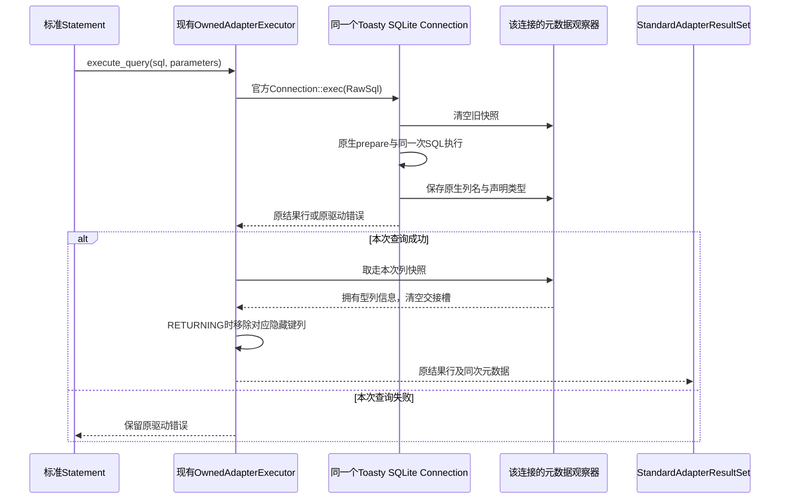

# Task6 Toasty SQLite 原生元数据交接准备（2026-10-06）

## 实际缺口与边界

真实standard_buffered_stream_contract_test复测1PASS1FAIL：binary_stream(index1)得到原0102，binary_stream_by_label(payload)失败unknown column: payload。标准ResultSet标签断言保留。生产StandardAdapterResultSet已准确查找StandardQueryResult.column_labels，但Toasty standard_execute_query_core调用rows_only；上游toasty-core0.9.0 ExecResponse不携带列信息，Connection也没有downcast或观察方法。已vendor的SQLite Connection::exec_sql_inner在同一prepare_cached范围内能取得stmt.columns()。

当前完整workspace2850/cargo49196已确认LIVE。此文件只是源码核对后的准备，不是实现、编译、测试通过或任务关闭；运行期间不修改Rust/Cargo输入。

## 同一标准接口内的实现方向

1. 在已vendor的SQLite驱动内部，为每个真实Connection保存独立元数据观察器；在原SQL同一次prepare/execute范围内保存原生列名、decl_type及列序。无行结果同样保留列信息。观察器不执行SQL，不持有另一个连接，不复用跨连接全局槽。
2. 官方Toasty Connection::exec仍是唯一数据库执行入口。只为具体SQLite Driver提供取得该连接观察器的构造辅助，不扩展RDBC标准端口、不把元数据藏到分页cursor。
3. Wrapper sqlite feature按需引用已vendor的同版本toasty-driver-sqlite；不安装或升级依赖。使用配置一致的具体SQLite Driver构造连接，并把其观察器随连接移动到现有OwnedAdapterExecutor。自定义from_driver不能被静默替换为按URL重建的另一个驱动。
4. 在现有执行锁内，于实际查询完成后复制该次原生列快照到StandardQueryResult，再交给现有StandardAdapterResultSet。标签大小写、重复顺序及首匹配沿用原生输出，不能用column_N或SQL解析推断冒充驱动元数据。
5. SQLite RETURNING补充隐藏生成键列时，真实行删除末尾隐藏值与元数据删除对应末尾列必须在同一交接内完成；不把内部键列暴露给调用者，不丢失其他返回列。

需核对具体Driver构造保持ConnectContext.query_log、URL解码、内存库隔离、factory max_connections和runtime trace；普通官方Connection入口不能因此失去行为。

## 必须取得的验证

- 已存在真实流测试的五个家族下标/标签、NULL、原payload、非法UTF8、未知标签与关闭优先全部通过。
- 无行结果仍返回实际列数与标签，不能依赖第一行推断列宽。
- 大小写、重复标签返回首个原生列；表达式、通配符、子查询标签来自SQLite stmt列元数据。
- prepared绑定参数不触发额外执行，查询与元数据对应同一次实际结果。
- 两个真实连接并发执行不同投影时元数据互不污染。
- RETURNING实际返回列、完整生成键、错误分类和取消清理回归保持。
- no-default-features和sqlite feature依赖边界、供给链patch说明及当前工具链检查。

新控制需先取得实际RED，再连接具体驱动实现。已有完整58和Filter矩阵通过不能替代此元数据合同。正式迁移分母1283、当前floor1241/42、完整18顶层任务不变。

## 已保存的非Cargo草稿

同一SDD目录drafts下已保存sqlite_query_column.rs.txt、sqlite_query_metadata.rs.txt和toasty_native_metadata_contract_test.rs.txt。前两者是单连接、单次结果的列快照与取走后清空的观察器设计；没有第二数据库执行入口。测试草稿含四个真实Toasty工厂控制，覆盖空结果/大小写/重复首匹配、无行通配符与子查询、prepared绑定参数和RETURNING隐藏键列、两个实际连接并发投影隔离。依当前标准方法源码写入参数绑定和元数据调用，不使用伪造Fixture填充驱动列信息。

全部草稿通过对应Edition的rustfmt语法/格式检查；仍为NOT_COMPILED、NOT_RUN、NOT_BOUND，未接入vendor或Wrapper生产模块。连接构造需安全保留具体SQLite Driver原配置：可以对传入的具体Driver使用拥有型Arc安全downcast，不能把自定义from_driver仅凭URL替换为另一个驱动；cfg sqlite直接依赖必须真实可选并验证锁文件变化。完整workspace终态前不进行这些输入变更。

## 正式 RED 与首次实现

四项真实控制已接入 crates/druid-wrapper/tests/toasty_native_metadata_contract_test.rs。
实际 RED 终态 exit101 /0PASS4FAIL：原标签 DUP、ReturnedId、leftonly、id 均未知。
日志 task6-toasty-native-metadata-red.log。失败后的后续观察不能认定执行通过。

在没有本任务 Cargo 活动进程时接入 vendor 原生列快照、同次取走机制、
工厂具体 SQLite 实例保留和 adapter 元数据传递。native SQLite 的 prepare 提供
真实标签与声明类型；官方 exec 保持唯一执行入口。非 SQLite 与自定义 Driver
继续原 connect 路径。可选直接依赖仍为已存在的 vendored 0.9.0，不安装或升级。
Cargo.lock 本轮仅增加 wrapper 的 toasty-driver-sqlite 边；现有 sqlparser 边属于
此前实现，不算本轮新增。RETURNING 同步移除隐藏键列。

首次测试正在同一 session83344 运行，日志 task6-toasty-native-metadata-green-attempt.log，
范围为四项 native 控制及原 buffered stream 两项。此记录不认定 GREEN、
不绑定迁移账本，不改变正式1241/42或18顶层任务。

Toasty native metadata 正式首轮验证（2026-10-06）：实际RED0PASS4FAIL后接入同连接原生列快照与取走机制；首次复测83344终态exit0/6PASS0FAIL（native四项+真实buffered stream两项），替代该报告的首次LIVE说明。没有额外SQL、连接或第二执行端口；真实声明类型保留，RETURNING移除内部列。增加configured from_driver/声明类型/失败后新空结果隔离控制后，扩大Wrapper回归14710仍LIVE，日志task6-toasty-native-metadata-wrapper-regression.log。正式floor1241/42、18顶层任务未变；无ledger绑定、Task6或发布完成声明。

扩大Wrapper回归已终态（2026-10-06）：修正前14710 exit101/1PASS1FAIL，旧补充控制错误要求真实id标签未知；依据本次原生合同改为id成功、真正missing保留精确InvalidArgument，合成标签及关闭优先级保留。生产未再次修改。修正后 locked/offline/no-fail-fast 六target终态exit0/6blocks/49PASS0FAIL0ignored，日志task6-toasty-native-metadata-wrapper-corrected.log。包含native五项（新增已配置from_driver/声明INTEGER与BLOB/失败后空查询隔离），原buffered streams两项，Prepared完整矩阵、Toasty矩阵、generated keys和label控制。初次6/0包含在本49/0中，不重复累计。格式check及diff通过。Druid lib/Filter/Buffered/Callable/generated-key五target同一11075仍LIVE；保持Rust/Cargo输入不变。正式1241/42和18顶层任务不变，尚无本轮全workspace终态。

Druid扩大回归11075终态exit101/5blocks/110PASS3FAIL：映射诊断补加name未知断言失败，原整数label拒绝两个入口失败，其他Callable9/0及Filter1/0仍通过。固定BASE完整整数case确实验证无标签RowSet，不改其InvalidArgument断言；改用原官方Connect包装的真实Driver（原工厂实现路径），原五行/SQL/下标3/标签拒绝/关闭均保留。另加相同真实SQL原生ID标签3和missing精确错误控制，覆盖最终原生能力。映射BASE本身只要求映射/复位，未要求真实name未知；补充观察改为name经反向映射到逻辑1，并保留真正missing精确错误。未更改迁移验证器、1283分母或绑定。

首次修正29629终态exit101为缺toasty测试依赖E0433，未产生运行结果；仅增加druid dev-dependency已有Toasty，不新增生产驱动依赖。Cargo metadata --offline完整枚举因未缓存antithesis_sdk0.2.9失败，未安装或联网下载；已检查lock仅新增已有包依赖边，无包版本变更。后续locked/offline定向测试50868实际LIVE，日志task6-toasty-native-metadata-druid-final.log。旧Wrapper49/0在追加SQLite feature显式测试门禁之前，尚需最终源重新验证；完整18任务不变。

Toasty最终局部验证：Druid50868终态exit0/5blocks/114PASS0FAIL，Wrapper59880终态exit0/6blocks/49PASS0FAIL；两范围不重叠，共163PASS0FAIL。原无标签整数完整拒绝与新增原生标签成功并存，原计数与Filter合同通过；不重复计入初次6/0及前一Wrapper49/0。纯度48/final、生成14、diff通过。native五项门禁明确sqlite feature。新no-default lib check已启动，结果待终态；完整workspace尚未启动，原3732/3仍为前轮完整范围证据，不代表当前源码。正式1241/42、18任务及API/MSRV/全features/完整C1C2与审查继续开放。

本轮原生元数据收尾与全仓启动（2026-10-06）：no-default lib check32630终态exit0，Finished1m39s，日志task6-toasty-native-metadata-no-default-check.log；该构建不能证明feature依赖已完全隔离。最终六文件格式check通过。新鲜全workspace locked/offline/no-fail-fast -j1 serial测试同一session4342已启动，日志task6-toasty-native-metadata-workspace-final.log；当前LIVE，无终态总计，保持Rust/Cargo输入不变。局部最终Druid114/0+Wrapper49/0=163/0，非全仓成功声明。标准纯度48/final、生成14与diff通过；完整C1/C2/API/SemVer/MSRV/all-features/whole-review、Task7八义务及18顶层任务继续开放，正式sourcefloor1241/42及ledger1104exact/179parameterized未改。
