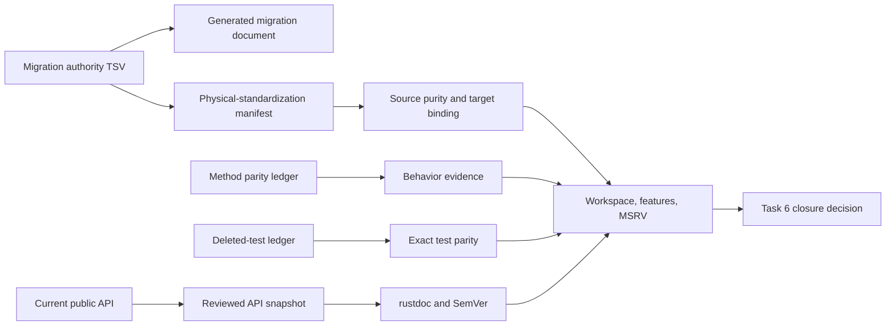

# Design: P04 Task 6 final gates

## Current architecture

The canonical contracts live in `druid-rdbc`; Druid owns pooling and filter behavior. Task 6 removed the transitional physical trait surface while preserving behavior in the standard traits and Druid-owned implementations. The existing DataSource API remains compatible, and the standard pooled-owner route is independently implemented and tested.

## Verification flow

## Failure handling

- A stale or conflicting ledger is corrected at its authoritative source, then generated views are regenerated with the repository renderer.
- A missing CLI or toolchain is reported as a blocked gate; installation requires user confirmation and must not modify repository dependencies.
- A behavior-parity failure is treated as a potential runtime regression, investigated with the canonical target test, and fixed before recording acceptance.
- No evidence is inferred from a successful compile, a checked task box, or an old audit report.

## Compatibility

No public API changes are intended. Any API diff or SemVer violation blocks acceptance until classified against the migration contract and reviewed baseline.
