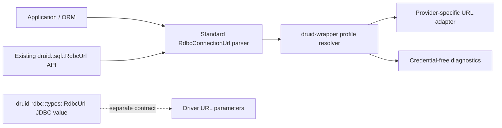

# Design: one standard RDBC product URL parser

## Current boundary

`druid-rdbc::types::RdbcUrl` is a JDBC `java.net.URL`-equivalent value and must keep that meaning. Product-profile URLs are a different concept: `druid::sql::RdbcUrl` parses the `rdbc:` scheme, profile, endpoint, database, and connection properties. This change adds `druid_rdbc::url::RdbcConnectionUrl` to name the latter unambiguously.

## Compatibility and error handling

- The standard parser owns accepted syntax, decoding, profile extraction, endpoint/database projection, and redacted rendering.
- `druid::sql::RdbcUrl` remains a public facade with its existing methods and `DruidError` result type. It delegates parsing and maps standard invalid-argument errors without changing observable error text.
- Wrapper resolution consumes the standard type directly. Existing profile validation and provider-specific normalization stay in `druid-wrapper` because the standard parser does not know provider policy.
- Raw URLs and property values remain secret-bearing. Debug and diagnostic output exposes only the redacted URL and property names.
- Native DSN and legacy JDBC URL conversion are not moved into the generic parser; they remain adapter behavior selected by runtime/provider.

## Validation

Use test-first migration: port current parser contract tests to the standard crate, confirm they fail for the absent API, implement the parser, then convert Druid and wrapper call sites. Run the exact `RdbcUrl` differential tests plus profile-resolution and credential-redaction tests. Do not change URL behavior while moving ownership.
