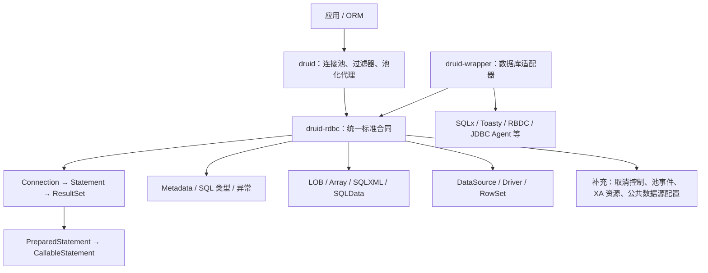
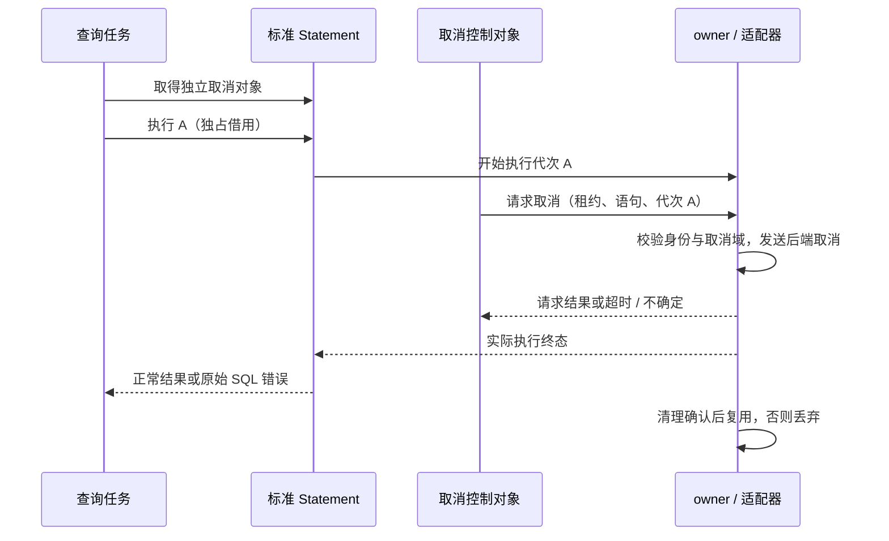

# Design

## Context

动机与范围见 [proposal.md](proposal.md)。架构遵循 [ADR-RDBC-006](../../../docs/superpowers/specs/2026-08-24-rdbc-single-standard-trait-tree.md) 的单一标准 trait 树、owned handle 和依赖方向；本增量不改写该文档的历史审阅状态。

审查基线为 `main@af9a6946d8b02806f61246e50843656cb0af8730`。前序审查实际运行的 RDBC 测试为 610 个通过，标准纯度检查为 119 个文件通过。这些是历史基线，不是本变更的实施验收。69 个 JDBC 对象登记也不是方法行为完成率；完整 wrapper 验收未在该次审查完成。

| 已有基础 | 此次补充位置 |
|---|---|
| DriverRegistry、DriverManager 委托与注册快照 | 驱动协商顺序及首次 SQL 异常保留 |
| Timestamp、Time 与独立 Rust SQL 值 | Java 本地字段、epoch、精度与格式转换 |
| 独占借用的 Statement 异步执行 | 独立取消控制与执行、租约身份 |
| 连接/语句事件类型及 Druid holder 监听器 | 标准 PooledConnection 入口与 owner 通知 |
| XaConnection 名称及 Druid 内部 XA 类型 | 中立可操作资源和外部事务管理器接入 |
| CommonDataSource 超时配置 | 可失败查询、日志配置与父命名空间 |
| 对象清单、迁移矩阵、合同测试和 API 门禁 | Java 来源的方法分母及分层证据 |

LOB、Array、SQLXML、SQLData、RowSet 和异步结果集已有实现，本设计不会以“重新补齐 JDBC”为名重写这些模块。CodeGraph 当前能定位这些标准声明、资源协调器和 SQLx 结果集实现；符号存在不等于行为证据，且部分动态调用关系没有直接测试命中。因此新增 MC-06 有限验收：检查能力集合与操作的一致性、释放/关闭错误、游标与 owner 生命周期及精确不支持结果。只修复所选场景中证实的合同不一致；其余后端能力保持 `NOT_RUN` 或明确不支持，并登记独立缺口。

## Goals / Non-Goals

**Goals:**

- 让只依赖 `druid-rdbc` 的外部驱动、连接池及事务管理器访问合同；内部复用 Druid 已有 owner 和事件机制。
- 以六类行为补充和一套证据规范形成有限交付；每批有可执行验证与明确结束点。
- 将 Rust 类型安全、异步取消与 JDBC 可观察语义同时纳入合同，不机械照搬 Java 对象模型。

**Non-Goals:**

- 不增加第二套标准 trait，不让 `druid-rdbc` 反向依赖 `druid`、SQLx 或其他具体后端。
- 不自建分布式事务协调器，不用本地事务模拟 XA，不要求所有后端实现全部可选能力。
- 不升级数据库驱动、不初始化工具配置、不重新启动 P04–P07 全量实施，也不在编写规范时发布或修改运行代码。

## Decisions

### D1. 保留标准、产品、适配器三个责任边界

图中的箭头表达接口依赖与能力归属，不表示 trait 继承或数据库调用的完整时序。`druid-rdbc` 定义中立合同，`druid` 承担租约、回收和事件分发，`druid-wrapper` 承担真实后端执行。扩展唯一标准树比新增平行兼容接口更容易保持代理闭包。

同一分层图必须出现在 `docs/druid-rust-Architecture.zh_CN.md` 的主架构说明中，并补充图例、owner/租约归属和实现能力边界；OpenSpec 内的设计图用于决策记录，不能替代面向仓库读者的架构文档。该文档交付由 MC-05 和任务 8.5 验收，不能作为后端能力或生产就绪证据。

### D2. 驱动查找与连接协商分别实现

对应 [DN-01–03](specs/rdbc-driver-negotiation/spec.md)。保留查找入口的 `accepts_url` 判断；连接入口对注册快照逐个调用 `connect`，不先调用 `accepts_url` 或名称方法。保存首个 SQL 异常所有权，遇到后续成功立即返回，遍历结束才返回首个异常或无匹配。

整体登录期限及调用取消在协商外层控制；单驱动 SQL 超时仍属于可继续的 SQL 异常，不能误当成整体期限。非 SQL 的框架状态错误按现有错误分类立即传播，不将注册器损坏等内部错误伪装为可忽略的驱动拒绝。回调始终发生在注册表锁之外。

只修改 `DriverManager` 而保留注册表错误行为会产生两个语义，因此修复应位于标准注册表，兼容入口只转换无匹配等边界结果。

### D3. JDBC 时间包装保留时刻，转换时解释本地字段

对应 [TV-01–04](specs/rdbc-jdbc-temporal-values/spec.md)。JDBC `Timestamp` 的内部语义应为时刻加纳秒；获取本地字段及从本地字段构造时应用默认时区规则。不能仅保存一个无时区日期时间，再在 `millis` 中固定解释为 UTC。`Value` 原生 SQL 时间值保留原有独立语义。

实施时先固定 Java 8 oracle，再调整私有表示和转换。优先复用现有时间库；系统本地时区的 DST 歧义选择、负 epoch 及 Java 支持范围必须通过差分确定，不用时间库默认选择替代证据。默认时区变更前后查询同一对象也纳入探针。范围不匹配显式登记，禁止溢出或静默截断。

冻结来源为 OpenJDK 8u `jdk8u502-b07`、commit `7373384725418fa645fb4508ec05a869bc7fc3e7`；测试还必须记录实际运行的 Java 8 发行版、版本和时区数据版本。前序 JDK 17 实验只是问题线索，不能替代此项。不同默认时区在独立子进程运行，不在并行测试中改变进程全局时区。

### D4. 取消是独立控制操作，并与执行代次绑定

对应 [SC-01–04](specs/rdbc-statement-cancellation/spec.md)。为标准 Statement 增加可选的独立取消控制对象；对象可跨任务持有，原 Statement 保持独占执行，不新增 `Sync` 约束。旧取消入口可委托同一实现，避免两个执行状态机。

控制状态至少识别物理 owner、逻辑租约、语句和执行代次。请求提交时固定目标代次，驱动发送前再次验证；上一代取消未确认或清理前，不允许在同一取消域启动下一执行。对只有连接级取消的驱动，通过 owner 串行执行和隔离屏障保证范围；无法保证时报告不支持，不仅依赖本地比较后仍可竞态的 generation 检查。

取消通道不能排队等待查询所占的同一个锁或 JDBC Agent 请求串行队列。SQLx 中能力不能按 crate 或 Statement 类型整体声明：缓冲查询、流式游标、通用 `execute`、更新、批处理和生成键可能走不同 actor 路径，取消原子标记必须真正到达数据库执行点，并经过清理屏障后才能释放连接租约。实施先建立“后端 × 执行入口”矩阵，再按矩阵接入实现；未接入路径明确返回 `0A000`。至少一个实际后端必须提供执行中取消和迟到取消隔离的正向证据，其他后端必须给出精确的不支持结果。准备批固定后端与版本，长查询须有数据库执行终态证据；本地游标或 Future 的结束不等于服务端取消。没有可运行后端时此项保持未完成。

### D5. 池化事件属于物理 owner，逻辑句柄负责触发

对应 [PE-01–04](specs/rdbc-pooled-connection-events/spec.md)。复用现有事件类型及 holder 注册机制，在标准 `PooledConnection` 暴露四个监听器入口。标准 pooled owner 与借出的逻辑 `Connection` 分开；不能把逻辑句柄自行关闭等同于物理关闭。

监听器用稳定对象身份匹配，事件带原 owner 和原语句身份。取注册快照后释放锁再调用。回调中的注册变更影响下一事件；可展开 panic 不跳过清理。重复注册/移除的细节先从冻结 Druid 1.2.28（commit `33824c3dec1612711f9bb4e409319bcab2e4cd0e`）提取案例，不自行发明去重规则。仅在产品内部加便捷方法不足以满足外部池的标准入口需求。

### D6. XA 合同中立化，真实后端负责协议结果

对应 [XA-01–04](specs/rdbc-xa-resource-contract/spec.md)。在 `druid-rdbc` 的数据源边界提供 `XaResource`、Xid、flags、prepare 结果和 XA 错误映射，一对象一文件；将 `druid` 现有中立类型迁移或重导出到唯一标准来源，产品协调和状态管理仍留在 `druid`。

资源通过 owner 管理的共享句柄获取，关闭 owner 后失效。方法映射补充冻结 Java 8 的 `javax.transaction.xa` 来源，覆盖 `isSameRM`、扫描 flags、事务超时和错误码；协议 flag 的数值必须逐项与 Java 8 常量一致，防止“名称相同、位值不同”导致事务管理器误判。禁止只比较资源显示名、URL 或连接配置；稳定 RM 身份以独立凭证表达，未知身份不得乐观地判定相同。若通过 trait 默认方法扩展标准 API，须验证既有外部实现保持源兼容。驱动原始错误与 XA 协议错误分层保留。

`recover` 遵守冻结 Java 8 扫描协议：开始扫描时固定结果快照；`TMNOFLAGS` 只继续活动扫描；`TMENDRSCAN` 释放扫描状态；`TMSTARTRSCAN | TMENDRSCAN` 表示一次性扫描。非法 flags 或阶段错误必须在修改扫描/分支状态前拒绝。结果只含 prepared 或启发式完成的完整 Xid；分页不得重漏，空页和扫描终止语义必须一致且可测试。示例状态机只能证明标准协议语义，实际持久恢复能力另由 JDBC Agent 数据源验收。

协议实现按两个有界里程碑验收：6.2 验证分支关联状态机、JDK 8 常量、prepare 投票、一阶段提交、未知分支及非法输入无副作用；6.3 再验证 recover 扫描边界、资源管理器身份、超时及 owner 失效。6.3 的测试按“失败用例 → 最小实现 → 外部消费者兼容性 → 直接受影响回归”推进。6.2 通过后停止并交付证据，不自动进入 6.3；真实 JDBC Agent 数据源恢复闭环单独留在 6.4，不能由示例状态机或 mock 替代。

优先复用 JDBC Agent 接入真正的 JDBC XAResource，验收需选定支持恢复的实际数据源，执行 prepare 后重建连接、recover、commit/rollback 的闭环。具体已有数据库环境在准备批固定；不能用 mock 或普通本地事务代替实库恢复证据。未配置该环境时标准合同测试仍可完成，实库任务保持 NOT_RUN。

### D7. 公共数据源的失败结果进入类型合同

对应 [CD-01–04](specs/rdbc-common-data-source/spec.md)。提供可失败的登录超时查询，以明确零时长表达 Java 零值语义，避免 `Option` 同时承担未配置和读取失败。优先新增可失败的规范入口，并让旧无错误访问器进入明确的弃用迁移；若旧访问器无法保真，只在审阅破坏性 API 清单后移除，不能默许用默认值吞错。

日志接收对象采用中立、可共享且能表示 I/O 失败的 Rust 合同，不依赖 Java Logger；父日志接口返回命名空间或不支持错误。普通、池化、XA 数据源复用公共配置实现，彼此实例及全局 DriverManager 的状态隔离。凭据在进入日志接收对象前脱敏。日志失败不得覆盖原 SQL 异常或伪造连接状态。

选择类型化标准配置比让产品私有对象承担所有配置更适合第三方实现；实际签名和外部最小实现编译测试一起审查，避免强迫每个实现增加无意义状态。

### D8. 独立方法分母与固定范围的证据台账

对应 [MC-01–06](specs/rdbc-jdbc-method-conformance/spec.md)。提取器从冻结 Java 源码生成签名身份，包含声明类型、方法/构造器名、参数类型、返回类型、常量和 default 标记，继承来源独立记录；禁止使用现有 Rust 清单生成 Java 分母。资源与结果集验收以明确的标准操作、适配器能力、关闭错误和 owner 生命周期为单位；它只增加可追溯的有限样例，不推导全 JDBC 后端覆盖承诺。

每行关联 Rust 路径、规范 ID、声明/合同/适配器/逻辑代理/实库证据、命令、版本、源码哈希及状态。Java 重载映射到同一 Rust 类型化请求时保留各自场景。全局未实现方法保持缺口；本次只要求六类已选缺口完成，其他差距形成有证据的后续清单，不能为了关闭本变更把全局清单变绿。

证据只保存小型文本记录和必要输入，不提交构建缓存、ZIP、PDB、数据库卷或安装包。检查受影响源码哈希；实现变化后重跑对应证据，不因无关 README 变化重建整个覆盖率。

### D9. 分批验收，不做无终点自回归

任务依赖和停止点见 [tasks.md](tasks.md)。每批先运行能暴露缺口的目标测试，再实现、验证目标与直接受影响消费者。只有最终验收批运行一次约定的综合门禁；通过后停止。

同一命令、输入和环境失败后，只有新修改或明确可验证的环境修复才重跑。执行前记录超时及外部服务条件，达到期限停止并报告，不自动增加预算。缺 Java 8、数据库或可选后端时记录 NOT_RUN；不安装工具、不削弱断言、不循环等待环境。新问题若不阻断本次规范则仅进入后续清单。

## Risks / Trade-offs

- [时间行为修正会影响旧调用方] → 明确列为行为破坏，保留原生 Rust SQL 值语义，提供时区及转换迁移示例。
- [后端连接级取消存在跨执行竞态] → owner 取消域隔离和清理屏障，实库验证晚到请求；无法确认就丢弃或不声明能力。
- [标准接口新增方法影响外部实现] → 默认不支持仅用于真正可选能力，外部最小实现编译验证，逐项审阅 API/SemVer 差异。
- [XA 与监听器已有产品实现可能重复] → 迁移中立合同，复用产品状态，禁止复制平行标准树。
- [Java 8 时间范围及平台差异] → 独立 oracle 和范围错误台账；未达成等价的输入不计为通过。
- [方法分母暴露更多全局缺口] → 保留全局真实状态，以本变更固定场景关闭；额外修复另行安排。
- [真实数据库环境不可用] → 标准测试与实库证据分别报告，后者保持未完成，不以纯编译替代。

## Migration Plan

1. 固定基线、Java 来源、六类方法映射和每批命令，确认既有工作区修改与本变更无交叉覆盖。
2. 先交付驱动和时间行为修复，再完成取消、池事件、XA、公共数据源合同及对应消费者迁移；每批单独可审查。
3. 新增标准类型保持唯一来源；旧产品路径可临时重导出并标记迁移方向，清除计划内过渡表面后再验收纯度。
4. 最后一批核验 API 差异、文档、方法证据和实际后端场景。发布版本选择依据真实 SemVer 差异另行执行，本规范不自动发版。
5. 若实施需撤回，按批回退本变更提交及其证据，不覆盖用户未提交文件；已发布接口不重写历史。不得将新 `Timestamp` 私有内存表示作为持久化格式，任何现有序列化入口须保持格式或提供明确转换。

## Open Questions

- 实施机器上可用的 Java 8 发行版、时区数据与 XA 数据源版本，在准备批记录；缺失时阻断对应验收，不改变合同。
- 精确测试文件名和现有证据目录复用位置在准备批确认；优先扩展已有同类文件，不另建重复账本。
