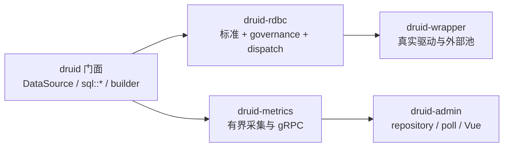

# Design

## Context

当前为 Brownfield 收尾，不是新建架构。以 `openspec/specs/`、ADR-CRATE-003 和当前代码为约束，保留已有实现及并行修改。主要事实：七成员 workspace 已存在；80 个 profile 尚无 verified/certified；2001 个 JDBC 身份只有 25 个 PARTIAL，real_db 全部未评估；源测试与资源账本缺失；最新 CI 与全仓覆盖率尚未形成可信结果。

本设计遵循 `migration-verification`、`driver-evidence-matrix`、`static-driver-dispatch`、`durable-two-phase-commit` 四份增量规格。Admin、Filter 身份和 ExceptionSorter 的前置 change 独立验收，本路线不接管其代码所有权。

## Goals / Non-Goals

**Goals:**

- 用同一组可追溯账本连接 Java 对象、来源用例、Rust 实现、差分结果、真实宿主与发布结论。
- 复用现有 `druid-bench` 和 `druid-test`，形成整仓验收而非生产 crate 的局部绿色测试。
- 完成 ADR-CRATE-003 最后边界，同时保持旧公共路径可用和依赖方向不变。
- 用静态分发原型验证性能，用持久化日志与真实故障注入验证 durable 2PC。

**Non-Goals:**

- 不重写 Pool/SQL/Wall/Stat、RDBC traits、驱动适配、metrics 协议或 Admin 控制台。
- 不把 Java 对象 1:1 文件数、测试总数、CI 绿灯或覆盖率百分比当完成证明。
- 不在本 change 中发布 crate、替换公共 RDBC 标准、引入第二套 ingest 协议或实现 JVM 专属 Web 监控面。
- 不把被忽略、未配置、未运行的真实宿主测试计为通过。

## Decisions

### D1 基线与证据模型

采用“冻结快照 → 当前基线修复 → 全量账本 → 分层差分 → 真实宿主 → 发布判定”的顺序。每次验收记录 Java/Rust SHA、dirty 状态、工具链、feature、平台、命令和原始产物。

账本沿用现有文件，不新建平行事实源：

- `docs/migration/source-test-parity.json`：SOURCE_PARITY 与 TEST_ASSET。
- `docs/verification/rdbc-first/java8-method-evidence.tsv`：JDBC 方法及 declaration/contract/adapter/logical_proxy/real_db 分层。
- `docs/verification/rdbc-first/`：差分、宿主、覆盖率、性能和发布报告。
- `crates/druid-test`：整仓验收命令与汇总产物；`crates/druid-bench`：Java golden/live oracle。

`IMPLEMENTED/DEPENDENCY_REUSED/PLATFORM_NA` 才能计完成；`MISSING/MISPLACED/STUB/PARTIAL/UNVERIFIED` 保持阻塞。V0–V7 证据级别与对象状态分别记录。

### D2 基线修复和并行变更边界

先处理生产依赖、严格 Clippy 和陈旧测试，再跑全量门禁。`memory-stats` 若被生产代码使用，移至正式依赖；不能依赖 dev-dependency 让库代码通过。

Filter 身份继续采用 Java `String.equals` 语义，只修正旧 Rust 断言，不回退实现。并行 Admin 工作区保持独立，先完成 `admin-live-console` 的六项任务和浏览器/API 验证，本路线仅引用其结果。

### D3 验收包与差分拓扑

`druid-test` 作为整仓验收权威，不把生产 crate 的局部测试代替整仓验收。每批差分按以下次序：

1. 冻结对象、方法、来源用例和资源分母；
2. 完成现有实现的测试映射，不先写新实现；
3. 运行 pinned Java 与 Rust 全套用例并保留原始结果；
4. 运行 golden/live differential，逐 case 输出 MATCH/MISMATCH/NOT_RUN；
5. 只对证据确认的真实偏差做最小修复；
6. 重跑受影响域及全部下游门禁。

高风险顺序为 RDBC 核心方法 → Pool/Filter/Stat → SQL/Wall → HA/Dynamic → DBCP 兼容层 → Admin → 外部池/XA。`webapp/weburi/websession/spring` 若主张 `PLATFORM_NA`，必须单独提供 JVM-only 证据；Rust HTTP 埋点另立产品需求。

### D4 门面收敛

按 ADR-CRATE-003 的 P3.3b/P3.4 分期，不为目录整齐直接搬文件：

Filter 参数先与 `DruidPooledConnection` 等运行时类型解耦，再移动接口/实现。每期保留兼容重导出、public-api 快照和 SemVer 证据；发现反向依赖、运行时污染或行为差异即停止该期并回滚，不留下双实现。

### D5 静态 dispatch

在 `druid-rdbc::dispatch` 引入 `DriverKind` 与 `dispatch!`，宏生成统一 match 分支。内部调用只分派，不复制 SQL 执行逻辑；驱动仍实现同一 RDBC 标准。外部注册驱动继续走动态协商和 trait object 扩展点。

首批限定 `sqlx / toasty / jdbc-agent`，复用现有合同与差分。基准使用同一工作负载比较动态与静态路径的吞吐和 p50/p95/p99；只有行为 MATCH 且尾延迟在已批准预算内才推广。原型失败时保留现有动态路径，不形成第二套正式实现。

### D6 durable 2PC 日志与恢复

采用协调器与 XA 资源分离的设计：XA 负责分支操作，协调器负责持久化决策、逐参与者结果和恢复。定义存储抽象及模型，不以内存 `Instant/history` 代替 durable log。

参考实现优先使用 SQLite 事务表与 WAL/同步语义，原因是已有成熟原子写与崩溃恢复能力；逻辑键为 `2pc:tx:{id}`，包含 schema version、事务状态、参与者、投票、决策、完成结果和错误上下文。文件 append-only 可作为后续适配器，但不在缺乏 fsync/原子写证据时作为默认实现。

恢复流程：读取日志 → 重建事务和参与者状态 → 跳过已完成外部效果 → 重放未完成且已有明确决策的操作 → 重新核验 unknown/Mixed。网络错误记录 unknown，不视为未提交；Mixed 仅允许只读核验和已批准裁决，禁止再次 commit 探测。

### D7 驱动证据晋升

以 profile 为行、数据库版本/驱动 feature/平台为维度建立矩阵。verified/certified 晋升必须连接真实产物，覆盖正向行为、负能力、异常、清理和故障恢复。未配置环境的用例写 NOT_RUN 与原因，不把 ignored 改为 PASS。

### D8 覆盖率与性能

`cargo llvm-cov` 在冻结快照、独立 D 盘目录和低并发下执行，避免把 OOM、目录错误或并发修改误报为代码结论。按 crate 和高风险分支分析报告；Admin scoped 结果不能外推全仓。性能复用现有 runtime/adapter benchmark 脚本，保留样本、环境、分位数和失败产物。

## Risks / Trade-offs

- [并行工作区持续变化导致证据漂移] → 每批冻结 SHA 与工作区哈希；变更后重跑受影响门禁，不混用快照。
- [全量差分扩大周期] → 按风险分批实现账本，但最终完成判定必须覆盖全分母，不以样本收口。
- [静态分发宏隐藏行为分叉] → 宏只分派，合同测试同时跑动态/静态路径，p99 退化即回退。
- [SQLite 日志模型与参与者真实提交不一致] → 决策顺序、唯一键、幂等重放和故障注入先于性能优化；unknown/Mixed 显式保留。
- [真实数据库环境成本高] → 矩阵分平台调度并保留 NOT_RUN，禁止用 mock 代替真实宿主。
- [门面移动造成 API/依赖破裂] → 分期兼容重导出、public-api/SemVer 和可回滚边界，失败即停止，不做一次性大搬迁。

## Migration Plan

1. P0 基线修复与前置 change 验收；失败不进入后续批次。
2. P1 建立 SOURCE_PARITY、TEST_ASSET、JDBC 方法账本和全仓覆盖率基线。
3. P2 按风险完成各领域差分及 Admin 活跃 change；Admin 规格同步由该 change 自己归档。
4. P3 完成门面收敛与三族静态分发原型，记录性能和回退路径。
5. P4 建立 durable 2PC 和真实驱动矩阵，完成故障与恢复证据。
6. P5 汇总 MSRV、API、供应链、性能、安全、全量覆盖率和回滚结果，决定是否仍为 NOT_READY。

每阶段独立保留可回退边界；不删除旧证据、不重写历史报告、不用新文档覆盖既有批准规格。回滚优先于带缺陷前进，尤其是公共 API、事务恢复和驱动支持状态。
