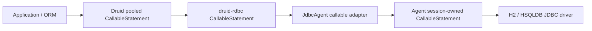

# Design

The Agent session remains the authority for remote statement IDs, active execution, cursor ownership and close. Prepare a real `java.sql.CallableStatement` on the session connection and register it in the existing prepared-statement resource domain with a callable type check; ordinary prepared statements must never be reinterpreted as callable. Use one protocol identity for prepare, register, execute and OUT reads. The Rust adapter buffers synchronous standard setter/OUT registration operations until async execution, then sends their ordered descriptors together, preserving explicit nulls and parameter selector kinds. Execution publishes OUT values only after a successful driver response; it clears them before every attempt. Keep `was_null` tied to the last successful OUT read.

The existing standard executor serializes access to the physical connection. It may expose a callable-specific operation, but must not create a second runtime or register duplicate driver state. Cancellation uses the current active Agent request and cannot affect a later execution. Statement close and session close reuse the Agent's resource cleanup path, including dependent cursors. SQL exceptions carry SQLState, vendor code, and cause through the existing error decoder; credentials and raw SQL values must not enter diagnostics.

Capability discovery is conservative. A connected session advertises callable support only if both protocol implementation and driver evidence are present. A driver that rejects a particular syntax still returns its original SQL error; it is not converted into a generic capability success. H2 and HSQLDB tests will exercise real callable execution and null/close behavior, with unsupported paths tested separately. Update the semantic inventory only after the standard external consumer, Agent tests, and real-database matrix pass; API and SemVer reports remain independent release gates.
